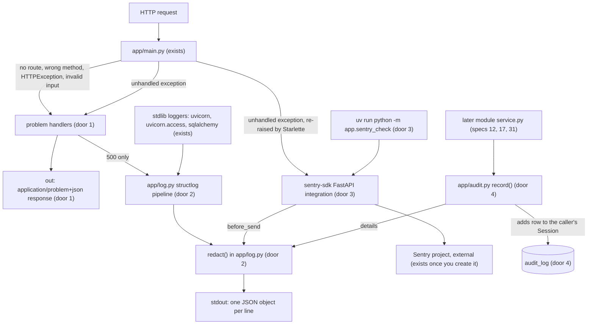
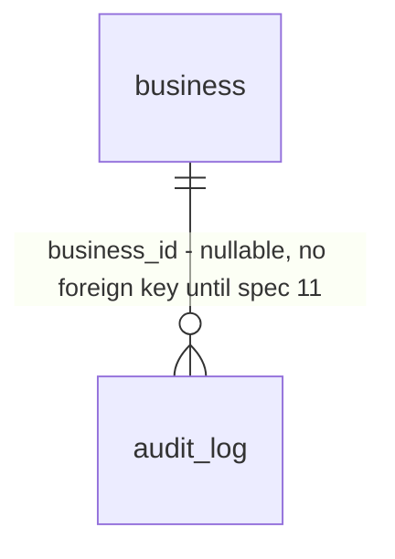

# 08 - API errors, logging, and monitoring

## Problem

Every API failure today answers in FastAPI's default shape: `{"detail": "Not Found"}` for an unknown route, a list of Pydantic errors that echoes the submitted `input` for a `422`, and a plain-text `Internal Server Error` for a crash. AGENTS.md requires RFC 9457 problem details, and spec 09's typed client will bind to whatever shape exists first, so the error shape gets decided by accident unless this spec decides it. Nothing in the API logs anything yet. The first spec that handles a Plaid access token (12) has no logger that removes it, and AGENTS.md says to "log only through the structured logger, which removes known sensitive fields", a logger that does not exist yet. A crash in staging is visible only to someone reading Railway's log tail, so nobody finds out about it. Specs 12, 17 and 31 must each "write an audit log entry", and there is nowhere to write one.

When this ships, every error from the API is `application/problem+json`, every log line is one JSON object with secrets replaced by `[REDACTED]`, an unhandled exception shows up in Sentry with the environment it came from, and later specs record audit entries with one call that commits with their own change. The source gives no evidence beyond the roadmap's build order.

## Flow

This reuses the FastAPI `app` in `app/main.py`, `Settings`/`get_settings()` (AD-001), `app.db.Base` and its naming convention (AD-003), and the Alembic chain from spec 03. Logs, Sentry events and audit `details` all go through one redaction function, so there is only one list of sensitive names.

## Impact

| Front | What changes |
| --- | --- |
| error contract | every non-2xx response the app raises changes from FastAPI's `{"detail": ...}` to a problem object (door 1). Nobody reads errors today: spec 09's client is not built and the web app does not call the API yet |
| health probes | unchanged. `/healthz/ready` returns its `503` body directly instead of raising, so AD-002 still holds; AC 8 pins it |
| logging | stdlib loggers (uvicorn, SQLAlchemy) are re-routed through the structlog formatter, so `fastapi dev` and `fastapi run` print JSON instead of uvicorn's coloured lines. fastapi-cli's startup banner is not a log record and stays as it is |
| dependencies | `uv add structlog sentry-sdk`; `uv.lock` regenerated by uv |
| configuration | two optional env vars, `SENTRY_DSN` (no default, absent means Sentry is off) and `SENTRY_ENVIRONMENT` (default `local`); `.env.example` documents both with empty values |
| domain | new term `audit entry` - one row recording who did what to which business, lives in `app/audit.py` |
| module ownership | `audit_log` belongs to the shared platform layer (`app/audit.py`, beside `app/db.py`), not to one of the five modules. Modules write to it only through `audit.record`, and none of them may query it. This is the one table outside `modules/` |
| identifier type | `audit_log.business_id` is `uuid`, which commits spec 11's `businesses.id` to `uuid` (door 4) |
| stored data | new empty table plus triggers in one hand-checked revision; nothing to migrate. Railway's `preDeploy: alembic upgrade head` applies it on the next staging deploy |
| Railway staging | `api` gets `SENTRY_DSN` (a Railway variable, never in `.railway/railway.ts`) and `SENTRY_ENVIRONMENT=staging`. Pushing to `development` deploys, so it needs your go-ahead at that step |

## Relations

One-way constraints: `audit_log` is append-only, enforced in Postgres (door 4); `action` must match `^[a-z][a-z_]*\.[a-z][a-z_]*$` (check constraint, door 4); `business_id` is `uuid` (door 4). No columns and no types beyond those doors.

## Surface

None - no route is added. Every existing and future route's error responses change shape; that contract is door 1 and AC 1-7. `python -m app.sentry_check` is an operator command, covered in `Observable`.

## Landing

| One-way door | Literal shape | Alternative rejected |
| --- | --- | --- |
| 1. Problem details contract | `Content-Type: application/problem+json`; body `{"type": "about:blank", "title": HTTPStatus(status).phrase, "status": <int>, "detail": <str>, "instance": <request path, no query string>}`. `422` adds `"errors": [{"loc": [...], "msg": "...", "type": "..."}]` and never Pydantic's `input`, `ctx` or `url`. `500` has `detail` exactly `"An unexpected error occurred."`. The `headers` on an `HTTPException` (e.g. `Allow` on `405`) are kept. Hand-written handlers for Starlette's `HTTPException`, `RequestValidationError` and `Exception`, plus a `ProblemDetails` Pydantic model | A library (`fastapi-problem` and similar): a new dependency for about 40 lines, and its body shape would become the contract. Echoing Pydantic's error list as is: it includes `input`, which would return a submitted token in the response. Including the query string in `instance`: a query string can carry a token |
| 2. Structured logger | `structlog` configured once in `app/log.py` by `configure_logging()`; code logs with `structlog.get_logger(__name__)`. Each line is one JSON object with `timestamp` (ISO 8601 UTC, `Z`), `level`, `logger`, `event`. A `redact` processor runs last, before rendering: any key that contains (case-insensitive) `token`, `secret`, `password`, `passwd`, `authorization`, `cookie`, `api_key`, `apikey`, `dsn`, `account_number` or `private_key`, at any depth of dicts and lists, gets the value `"[REDACTED]"`; inside any string, `access-(sandbox|development|production)-<uuid>` and `Bearer <token>` are replaced. stdlib records are routed through `structlog.stdlib.ProcessorFormatter`, so they pass the same chain | stdlib-only logging with a hand-written JSON formatter: you chose structlog. Redacting account numbers by value (any 7-17 digit run): it would also blank amounts in cents and ids, so account numbers are redacted by key only |
| 3. Sentry contract | dependency `sentry-sdk`; `sentry_sdk.init(dsn=settings.sentry_dsn, environment=settings.sentry_environment, send_default_pii=False, before_send=<redact the event>)` only when `SENTRY_DSN` is set, called from the app's startup and never at import (AD-001). FastAPI integration defaults kept: only `5xx` is reported. No tracing or profiling options. Test errors come from `uv run python -m app.sentry_check`, never a route | `send_default_pii=True` as the guide shows: it sends authorization headers, cookies and IP addresses, which AGENTS.md forbids for bank data. A `/sentry-debug` route: a public crash endpoint in staging and production; you chose the CLI. Putting the DSN in `.railway/railway.ts`: no secrets in source |
| 4. Audit log | table `audit_log`: `id` bigint identity primary key, `occurred_at timestamptz not null default now()`, `business_id uuid null`, `actor_user_id text null` (Clerk user ID; null for jobs), `action text not null` with check `^[a-z][a-z_]*\.[a-z][a-z_]*$` (e.g. `bank_connection.created`), `target_type text null`, `target_id text null`, `details jsonb not null default '{}'`. Postgres trigger function `audit_log_append_only()` raises on `BEFORE UPDATE OR DELETE` (row) and `BEFORE TRUNCATE` (statement). Helper `record(session: Session, *, action: str, business_id: UUID \| None, actor_user_id: str \| None, target_type: str \| None = None, target_id: str \| None = None, details: Mapping[str, object] \| None = None) -> None` adds the row to the caller's session and flushes, but never commits, so it commits or rolls back with the caller's change | `REVOKE UPDATE, DELETE`: the API connects as the table owner on Railway, and owners keep those rights. `record()` opening its own session and committing: an action that rolls back would still leave an audit entry, or a crash between the two commits would lose it. `bigint` business IDs: enumerable in `/v1/businesses/{business_id}` URLs, and a future split service could not mint IDs without the shared sequence. A foreign key to `businesses` now: that table does not exist until spec 11. Closes: deleting a business's audit rows later (PIPEDA requests) needs the trigger dropped inside a migration |
| 5. `instance` is redacted (found while building, C5) | `instance` = request path with `app.log.TOKEN_PATTERN` matches replaced by `[REDACTED]`, so `GET /x/access-sandbox-<uuid>` answers `"instance": "/x/[REDACTED]"` | the raw path (door 1 as first written): a token placed in a path segment came back in the `422` body. The route template (`/x/{item_id}`): unknown routes have no template, and it hides which resource a client asked for |
| 6. Logging is configured in the lifespan (found while building, C15) | `configure_logging()` is called at the start of the app's lifespan, never at import | at import (door 2's first reading): `fastapi run` imports the app before uvicorn applies its own log config, which then replaced the JSON handler, so the access log stayed in uvicorn's plain format |

- Doors 1 to 4 reach past this feature and become AD-008 to AD-011 in `.specs/STATE.md` `## Decisions` once the plan is approved.
- Module file layout, processor order apart from "redact last", the exact Pydantic model names and the trigger function's message are reversible and settled in the diff.

## Criteria

### S1: Every error is problem details (P1)

A client can parse any API error with one shape, and no error leaks internals.

**Acceptance Criteria**

1. WHEN a request is made to a path with no route (e.g. `GET /does-not-exist?x=1`) THEN the API SHALL respond `404` with `Content-Type: application/problem+json` and body exactly `{"type": "about:blank", "title": "Not Found", "status": 404, "detail": "Not Found", "instance": "/does-not-exist"}`
2. WHEN a route exists but the method does not (e.g. `POST /healthz/live`) THEN the API SHALL respond `405` with `Content-Type: application/problem+json`, `"status": 405`, `"title": "Method Not Allowed"`, and an `Allow` header containing `GET`
3. WHEN a route raises `HTTPException(status_code=409, detail="Already connected", headers={"X-Test": "1"})` THEN the API SHALL respond `409` with `Content-Type: application/problem+json`, body `{"type": "about:blank", "title": "Conflict", "status": 409, "detail": "Already connected", "instance": <path>}`, and the header `X-Test: 1`
4. IF a request fails validation THEN the API SHALL respond `422` with `Content-Type: application/problem+json`, `"title"` equal to `http.HTTPStatus(422).phrase`, and an `errors` list whose items each have exactly the keys `loc`, `msg` and `type`
5. IF a request that fails validation carries the value `access-sandbox-00000000-0000-0000-0000-000000000000` THEN that value SHALL NOT appear anywhere in the response body
6. IF a route raises an unhandled exception with message `boom-secret-detail` THEN the API SHALL respond `500` with `Content-Type: application/problem+json`, `"detail": "An unexpected error occurred."`, and the body SHALL NOT contain `boom-secret-detail` or the exception class name
7. IF a route raises an unhandled exception THEN the API SHALL emit exactly one `error`-level log record with `event` `request.unhandled_exception`, the request method and path, and the exception traceback
8. IF the database is unreachable THEN `GET /healthz/ready` SHALL still respond `503` with `Content-Type: application/json` and body exactly `{"status": "unavailable"}` (AD-002)

**Independent test:** `uv run fastapi dev app/main.py`, then `curl -i localhost:8000/does-not-exist` shows the AC 1 body and content type.

### S2: Logs are JSON and never carry secrets (P1)

An operator reads one JSON object per line, and no token or account number reaches it.

**Acceptance Criteria**

9. WHEN code logs `structlog.get_logger("t").info("thing.happened", count=3)` after `configure_logging()` THEN stdout SHALL receive exactly one line that parses as a JSON object containing `"event": "thing.happened"`, `"level": "info"`, `"logger": "t"`, `"count": 3` and a `timestamp` ending in `Z`
10. WHEN a log call carries a key whose name contains, case-insensitively, any of `token`, `secret`, `password`, `passwd`, `authorization`, `cookie`, `api_key`, `apikey`, `dsn`, `account_number` or `private_key` THEN the rendered line SHALL contain `"[REDACTED]"` as that key's value and SHALL NOT contain the original value
11. WHEN such a key appears nested inside a dict or a list at any depth (e.g. `payload={"items": [{"access_token": "s3cr3t"}]}`) THEN the rendered line SHALL NOT contain `s3cr3t`
12. WHEN the event message or any string value contains `access-sandbox-<uuid>`, `access-development-<uuid>`, `access-production-<uuid>` or `Bearer <token>` THEN the rendered line SHALL contain `[REDACTED]` in its place and SHALL NOT contain the original token
13. WHEN a record is emitted through stdlib `logging.getLogger(name)` for `name` in `uvicorn.error`, `uvicorn.access` and `sqlalchemy.engine` after `configure_logging()` THEN it SHALL be rendered as a JSON line by the same redaction (a Plaid token in its message is replaced)
14. IF an exception is logged with its traceback and the exception message contains a Plaid access token THEN the rendered `exception` field SHALL contain `[REDACTED]` and not the token

**Independent test:** `uv run fastapi dev app/main.py` prints JSON lines; `uv run pytest tests/test_log.py` proves AC 9-14.

### S3: Crashes reach Sentry (P1)

An unhandled exception in any environment with a DSN appears in Sentry, tagged with that environment, without personal data.

**Acceptance Criteria**

15. WHERE `SENTRY_DSN` is set, WHEN a route raises an unhandled exception THEN the SDK SHALL send exactly one error event containing that exception's type (proved with a fake transport, no network)
16. WHERE `SENTRY_DSN` is set, WHEN a route raises `HTTPException` with a `4xx` status THEN the SDK SHALL send no event
17. WHERE `SENTRY_DSN` is set, WHEN an event carries an `Authorization` request header or an extra keyed `access_token` THEN the event delivered to the transport SHALL have `"[REDACTED]"` (or no value) in their place and no `user.ip_address`
18. IF `SENTRY_DSN` is unset THEN the app SHALL start with no Sentry client bound and `GET /healthz/live` SHALL respond `200`
19. WHEN `uv run python -m app.sentry_check` runs with `SENTRY_DSN` set THEN it SHALL exit `0` and print the event ID, and the event SHALL be visible in the Sentry project under that ID with `environment` equal to `SENTRY_ENVIRONMENT` (Done when: "A deliberate test error shows up in Sentry")
20. IF `SENTRY_DSN` is unset THEN `uv run python -m app.sentry_check` SHALL exit `1`, print `SENTRY_DSN is not set` to stderr, and send nothing
21. WHEN `python -m app.sentry_check` runs on the staging `api` service through `railway ssh` THEN the event SHALL appear in Sentry with `environment` `staging`

**Independent test:** with your DSN in `.env.local`, `uv run python -m app.sentry_check` prints an event ID that opens in Sentry.

### S4: Later specs can record audit entries (P2)

One call writes an audit entry that commits or rolls back with the action it records, and nobody can rewrite it.

**Acceptance Criteria**

22. WHEN `audit.record(session, action="bank_connection.created", business_id=<uuid>, actor_user_id="user_test", target_type="bank_connection", target_id="42", details={"institution": "Sandbox Bank"})` runs and the caller commits THEN `audit_log` SHALL hold exactly one new row with those values and an `occurred_at` within 5 seconds of the current UTC time
23. IF the caller's transaction rolls back after `audit.record(...)` THEN `audit_log` SHALL hold no row for that call
24. IF any session executes `UPDATE audit_log ...` on an existing row THEN Postgres SHALL raise an error and the row SHALL be unchanged
25. IF any session executes `DELETE FROM audit_log ...` THEN Postgres SHALL raise an error and the row count SHALL be unchanged
26. IF any session executes `TRUNCATE audit_log` THEN Postgres SHALL raise an error and the row count SHALL be unchanged
27. IF `audit.record` is called with an `action` that does not match `^[a-z][a-z_]*\.[a-z][a-z_]*$` (e.g. `"BankConnected"`) THEN it SHALL raise `ValueError` and add nothing to the session
28. IF a row with such an `action` is inserted directly with SQL THEN Postgres SHALL reject it with a check-constraint error
29. WHEN `details` contains a key named like a secret (AC 10's list) at any depth THEN the stored `details` JSON SHALL hold `"[REDACTED]"` for it
30. WHEN `uv run alembic upgrade head` then `uv run alembic downgrade -1` then `uv run alembic upgrade head` run on an empty database THEN each SHALL exit `0`, and `uv run alembic check` SHALL then exit `0` (models and migration agree)

**Independent test:** `uv run pytest tests/test_audit.py` with the local Postgres up.

### S5: The checks stay green (P1)

31. WHEN `uv run ruff format --check .`, `uv run ruff check .`, `uv run mypy app` and `uv run pytest` run in `services/core/` with the local Postgres up THEN all four SHALL exit `0`, and CI's `api` job SHALL pass on the pushed commit

## Out of scope

| Excluded | Why |
| --- | --- |
| Reading the audit log (API, screen, export) | no spec in v1 asks for it |
| Audit log retention and deletion requests | needs a product and legal decision; door 4 names the cost |
| Sentry performance tracing and profiling | not in the spec; adds cost per request |
| Request IDs and log correlation across services | not in the spec; v1 is one process |
| Sentry alert rules and notifications to the team | spec 34 |
| Sentry in the web app | spec 07 |
| Typed problem `type` URIs (e.g. for Quebec refused) | the specs that need a specific problem add them; `about:blank` is the RFC default |
| Exporting the OpenAPI contract with the problem schema | spec 09 creates `contracts/openapi.json` |

## Assumptions

| Assumption | Chosen default | Rationale | Confirmed? |
| --- | --- | --- | --- |
| Where `sentry_sdk.init` runs | in the FastAPI lifespan startup, after `get_settings()`. Built that way: the lifespan then sets `app.middleware_stack = None` so Starlette rebuilds it with Sentry's `ExceptionMiddleware` patch, which a raised `HTTPException(503)` needs (extra test `test_5xx_http_exception_sends_one_event`). If `get_settings()` fails validation, Sentry stays off and `monitoring.disabled` is logged with field names only, so spec 03 AC 10 (`/healthz/live` without `DATABASE_URL`) still holds under a real server. `ignore_logger("app.problems")` stops the 500 log line becoming a second Sentry event (C16 caught it) | AD-001 forbids reading settings at import, while Sentry's guide calls `init` before creating the app | n |
| Log level | `INFO`, fixed in code | no spec needs it configurable yet; adding `LOG_LEVEL` later is reversible | n |
| `sentry_check` exception | raises and captures `SentryCheckError("Headroom API Sentry check <UTC timestamp>")`, then flushes for up to 10 seconds | a unique message makes the event easy to find; no route is involved | n |
| Railway variables vs IaC | `SENTRY_ENVIRONMENT=staging` goes into `.railway/railway.ts` `env`; `SENTRY_DSN` is set with `railway variables`. Before setting it, confirm with `railway config plan` that `apply` does not remove variables missing from the file; if it does, stop and ask | AD-007 keeps service settings in IaC, but secrets stay out of source | n |
| 500 and Sentry together | the `Exception` handler builds the response, and Starlette re-raises the exception after sending it, so Sentry still captures it; AC 15 proves this rather than trusting it | Starlette's `ServerErrorMiddleware` behaviour | n |
| Commit split | commit 1: `uv add` output only; commit 2: problem details; commit 3: logger; commit 4: Sentry; commit 5: audit log and migration; then the staging variables and spec status | keeps generated files reviewable on their own, as in specs 02 and 03 | n |

**Open questions:** two, below.

| # | Kind | Question | Until answered |
| --- | --- | --- | --- |
| 1 | blocks | A Sentry project for the API and its DSN (you said you will create it) | AC 19 and AC 21 cannot pass; everything else can be built and proved with the fake transport |
| 2 | blocks go-live | Go-ahead to push to `development` and set the staging variables | AC 21 and the CI half of AC 31 |

## Observable

| Surface | Decision | Landing |
| --- | --- | --- |
| all API routes, present and future | error shape and codes | AC 1-7, door 1 |
| all API routes | response shape on success | n/a - unchanged by this spec |
| all API routes | who may call them | n/a - authentication is spec 10; this spec adds no route |
| all API routes | versioning, rate limits | n/a - adds no route; the problem shape applies inside and outside `/v1`; no rate limiting in v1 |
| `GET /healthz/ready` | error shape | AC 8, AD-002 kept |
| command `python -m app.sentry_check` | output format and verbosity | AC 19: prints the event ID only |
| command `python -m app.sentry_check` | flags and their defaults | n/a - no flags; reads `SENTRY_DSN` and `SENTRY_ENVIRONMENT` through `Settings` |
| command `python -m app.sentry_check` | exit codes | AC 19 (`0`), AC 20 (`1`) |
| command `python -m app.sentry_check` | failure halfway | assumption: flush waits up to 10 seconds; a network failure still exits `0` with the ID, and the Sentry UI lookup in AC 19 is the real proof |
| document `.env.example` | structure and what the reader does next | Impact row "configuration"; the next step is already in AGENTS.md Setup |
| log stream (stdout) | structure | AC 9, AC 13 |

## Sources

- `context/specs/08-api-errors-logging-monitoring.md`: the four build items and the three Done-when items
- `AGENTS.md`: "API" (RFC 9457, `/v1`), "Security and data handling" (structured logger, what is never logged), "Domain conventions" (tenancy, UTC)
- [Sentry for FastAPI](https://docs.sentry.io/platforms/python/integrations/fastapi/): `failed_request_status_codes` default `{*range(500, 600)}`, and what `send_default_pii` sends
