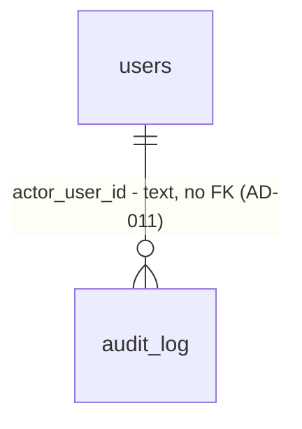

# 10 - Login with Clerk

## Problem

Anyone who can reach the web app sees every page, and the API cannot tell who is calling: no route knows a user, so nothing can be scoped to a business (spec 11) and no bank data can be protected (spec 12 onward). AGENTS.md makes this a hard requirement - "Verify the Clerk session token on every API request" and "Enforce permissions on the server" - and today nothing enforces either. The source gives no evidence beyond the build order: spec 11 and every later spec that returns customer data depends on knowing the caller.

When this ships, a visitor who is not signed in lands on a Clerk sign-in page themed with Headroom's tokens; after signing up or signing in they see the app shell with their name, and signing out returns them to sign-in. Every `/v1` API route rejects a request without a valid Clerk session token with `401`, and the first valid request from a new person creates their `users` row.

## Flow

This reuses Clerk's own Next.js middleware (`clerkMiddleware`) and components instead of any hand-built session handling, the typed client from spec 09 (headers passed per call, AD-019), the AD-008 problem-details handlers for the `401`, and the AD-009 logger and redaction. No second session store.

1. browser -> `frontend/proxy.ts` (new, door 5) runs a bare `clerkMiddleware()` so Clerk's `auth()` works server-side; every protected layout and page then calls `await auth.protect()` (door 7), which sends a request without a Clerk session to `/sign-in`
2. `/sign-in` and `/sign-up` (new pages, Clerk `<SignIn />` / `<SignUp />`, themed through `ClerkProvider` `appearance`, door 5) - Clerk sets its session cookie
3. `app/(app)/layout.tsx` (exists) - a server component: reads the session token with Clerk's `auth().getToken()` and the display name with Clerk's `currentUser()`, calls `api.GET("/v1/me", { headers: { Authorization: "Bearer <token>" } })` (client exists, door 6); a cookie token with less than 10 seconds left is replaced by one Clerk mints with `getToken({ expiresInSeconds: 60 })`, because a slow render let a 60-second token expire before it reached the API (found in verification round 1); if that call fails, the layout renders the `States` error content in place of its children, because the `(app)/error.tsx` boundary sits inside this layout and cannot catch the layout's own errors
4. API `/v1` router (new, door 3) -> `app/auth.py` (new, door 2) verifies the RS256 token against `CLERK_JWT_KEY` with no network call; on failure, `401` problem details
5. `app/modules/accounts` (new module, door 4) - `service.get_or_create_user(clerk_user_id)` inserts the `users` row on first sight (door 1) and returns it
6. out: `GET /v1/me` returns the user; the shell renders the name; the header's sign-out control (Clerk `<SignOutButton>`) ends the session and lands on `/sign-in`

## Impact

| Front | What changes |
| --- | --- |
| domain | new term: `User` - a person who signed in through Clerk, keyed by the Clerk user ID; lives in `accounts`. Nothing branches on it yet |
| web routing | every existing page (`/`, `/alerts`, `/expected-payments`, `/settings`, `/dev/*`) now requires login. Existing Playwright specs (`shell`, `home`, `api-check`, `dev-components`, `sentry-check`) must sign in first, through `@clerk/testing` |
| API routing | `/healthz/live` and `/healthz/ready` stay unauthenticated (AD-002). Every route under `/v1` requires a token. `/docs` and `/openapi.json` stay open in this spec |
| dependencies | web: `@clerk/nextjs` (7.9.x), devDependency `@clerk/testing`. API: `pyjwt[crypto]` via `uv add`. Lockfiles regenerated by the tools |
| configuration | web: `NEXT_PUBLIC_CLERK_PUBLISHABLE_KEY`, `CLERK_SECRET_KEY`, `NEXT_PUBLIC_CLERK_SIGN_IN_URL=/sign-in`, `NEXT_PUBLIC_CLERK_SIGN_UP_URL=/sign-up`, plus `E2E_CLERK_USER_USERNAME` for Playwright only (signed in with a Clerk sign-in token, so no password). API: `CLERK_JWT_KEY` (PEM public key, required, no default) and `CLERK_AUTHORIZED_PARTIES` (comma-separated origins). Both `.env.example` files document them with empty values |
| shell | `AppHeader` gains the user's name and a sign-out control, in a place the mockups do not show (see Assumptions) |
| CI | the `api` job needs no new variable: `tests/conftest.py` sets `CLERK_JWT_KEY` to the public half of an RSA key pair it generates per session, and pytest's Alembic subprocesses inherit it. The `web` job needs nothing new: `npm run build` exits 0 with `NEXT_PUBLIC_CLERK_PUBLISHABLE_KEY` and `CLERK_SECRET_KEY` empty, because every page is dynamic or a production 404 |
| Railway staging | `api` gains `CLERK_JWT_KEY` and `CLERK_AUTHORIZED_PARTIES`; `web` gains the Clerk keys and `API_URL` (left open by spec 09). Set as Railway variables, never in `.railway/railway.ts` (see Open questions) |
| stored data | new table `users`; no existing rows to migrate |

## Relations

One new entity, `users`, owned by `accounts`. One-way constraints: `clerk_user_id` is unique and not null (door 1); `id` is a `uuid`, which spec 11's memberships reference; AD-011's `actor_user_id` is `text`, so audit callers write `str(user.id)`, never the Clerk ID. No customer data and no `business_id` on this table: a user exists before any business does, and spec 11 links them. No name, email, password or token is stored.

## Surface

| Route | In | Out | Status |
| --- | --- | --- | --- |
| `GET /v1/me` | header `Authorization: Bearer <Clerk session token>` | `id` · `clerk_user_id` · `created_at` | `200`, `401` |

## Landing

| One-way door | Literal shape | Alternative rejected |
| --- | --- | --- |
| 1. `users` table | table `users`, model `User(Base)` in `app/modules/accounts/models.py`: `id uuid` primary key (generated by the app, `uuid.uuid4`), `clerk_user_id text not null` with `uq_users_clerk_user_id` (AD-003 naming), `created_at timestamptz not null default now()`; created by an `alembic revision --autogenerate` migration | a bigint key: AD-011 fixed business IDs as `uuid`, and user IDs follow the same convention. Keying the table on the Clerk ID itself: every later foreign key would carry a provider's string, and changing provider would rewrite every table. Storing name or email: copies PII Clerk already holds, and it goes stale when the person edits their profile |
| 2. Token verification | `app/auth.py`: `pyjwt[crypto]`, `jwt.decode(token, settings.clerk_jwt_key, algorithms=["RS256"], options={"require": ["exp", "nbf", "iat", "sub"]}, leeway=5)`, then `azp`, when present, must be in `CLERK_AUTHORIZED_PARTIES`. Token read only from `Authorization: Bearer`. Any failure raises `401` with `WWW-Authenticate: Bearer`, detail `"Authentication required."` for every cause, and the log event `auth.rejected` with `reason` (`missing`, `expired`, `invalid`, `unauthorized_party`) and never the token | the `clerk-backend-api` SDK's `authenticate_request`: pulls `httpx` and its own models, and I could not confirm its request-authentication API from the docs (the README returned 503) - AGENTS.md forbids inventing one. Fetching the JWKS per request: a network call to Clerk on every API request, and a Clerk outage would fail every request. Reading the `__session` cookie: the browser never calls the API, so only the server sends tokens |
| 3. Auth on every `/v1` route | one `APIRouter(prefix="/v1", dependencies=[Depends(current_user)])` in `app/main.py` (or a `app/api_v1.py` it includes); module routers are included into it, so a new route cannot opt out by forgetting a decorator | a dependency on each route: the next route that forgets it is public. A global middleware: it would also guard `/healthz/*`, which AD-002 keeps open for Railway |
| 4. First module layout | `app/modules/__init__.py`, `app/modules/accounts/{__init__,api,service,models,repository}.py`, exactly as AGENTS.md "Modules"; `service.get_or_create_user(session, clerk_user_id) -> User`; `api.py` holds the `/me` route only; `alembic` `env.py` imports each module's `models` so autogenerate sees them | flat `app/users.py`: the four later modules copy whatever this first one does |
| 5. Clerk in the web app | `@clerk/nextjs`; `frontend/proxy.ts` exports `clerkMiddleware` with `createRouteMatcher(["/sign-in(.*)", "/sign-up(.*)"])` and `await auth.protect()` for every other route, with the quickstart's `matcher`; `ClerkProvider` inside `<body>` in `app/layout.tsx` with `appearance.variables` mapped to the AD-012 tokens (`colorPrimary` `--accent`, `colorBackground` `--surface`, `colorText` `--ink`, `colorDanger` `--danger`, `fontFamily` IBM Plex Sans, `borderRadius` DESIGN.md's radius); pages `app/sign-in/[[...sign-in]]/page.tsx` and `app/sign-up/[[...sign-up]]/page.tsx`, outside `(app)` so they have no shell | `middleware.ts`: Next 16 renamed it to `proxy.ts` (Clerk quickstart, `node_modules/next/dist/docs/01-app/01-getting-started/16-proxy.md`). Clerk's hosted Account Portal: leaves the domain, and DESIGN.md says these pages use Clerk's components themed with our tokens. `@clerk/themes`: a second set of colours outside AD-012 |
| 6. Sending the token | `frontend/lib/api/auth.ts` (server-only) exports `authHeaders(): Promise<{ Authorization: string }>` built from `(await auth()).getToken()`; callers write `api.GET("/v1/me", { headers: await authHeaders() })`. No token is cached, stored or logged on the web side | `api.use()` middleware: AD-019 removed it because the client is rebuilt per request. Making `api` itself read the token: `client.ts` would import Clerk and every call site would hide an auth dependency; per-call headers keep it visible and testable |

| 7. Protection per layout and page (found while building: Clerk 7.9.10 deprecates `createRouteMatcher`, door 5, and says it goes in the next major; user chose this 2026-10-02) | `frontend/proxy.ts` is `export default clerkMiddleware()` plus the quickstart `matcher`, with no path checks; every `layout.tsx` and `page.tsx` under `frontend/app/` except the root `app/layout.tsx` and the `sign-in` / `sign-up` pages calls `await auth.protect()` from `@clerk/nextjs/server` before anything else it does (an `app/dev/` page after its AD-014 production 404 gate, which reveals nothing); a Vitest test fails when one does not | keeping `createRouteMatcher` in `proxy.ts` as door 5 states: logs a deprecation on every start and breaks on Clerk's next major. Path checks in `clerkMiddleware` without the matcher helper: the path matching Clerk deprecates, only spelled by hand. Protecting only the `(app)` layout: Clerk notes layouts do not re-render on every navigation, so a page could render without a check |

| 8. Clerk colours are copies of the token values (found while building: with `var(--accent)` Clerk's primary button computed `rgba(0, 0, 0, 0)` and its error text a 2.96 contrast shade) | `frontend/lib/clerk-appearance.ts` exports `CLERK_TOKENS`, the hex values of `--accent`, `--surface`, `--surface-muted`, `--border-input`, `--ink`, `--ink-3`, `--positive`, `--danger-text` as declared in `app/globals.css`, and `appearance.variables` reads only from it; `tests/clerk-appearance.test.ts` fails when any value differs from `globals.css`. Font stays `var(--font-plex-sans)`, which Clerk passes through untouched | CSS variables in `appearance.variables`, as door 5 implied: Clerk derives shades with its own colour math, which cannot resolve `var()`. `@clerk/themes`: a second palette outside AD-012 |

- Doors 1 to 6 reach past this feature and become AD-020 to AD-025; door 7 becomes AD-026 and supersedes AD-024's route matcher; door 8 becomes AD-027 in `.specs/STATE.md` `## Decisions` once the plan is approved.
- Header layout details, the sign-in page's surrounding layout, test helpers and file split inside `app/auth.py` are reversible and settled in the diff.

## Criteria

### S1: The API knows who is calling (P1)

A request with a valid Clerk session token reaches `/v1/me`; anything else gets `401`.

**Acceptance Criteria**

1. WHEN `GET /v1/me` is called with an RS256 token signed by the key matching `CLERK_JWT_KEY`, unexpired, with `sub` set THEN the API SHALL return `200` with `id`, `clerk_user_id` equal to `sub`, and `created_at`
2. IF the `Authorization` header is missing or is not `Bearer <token>` THEN the API SHALL return `401` `application/problem+json` (AD-008) with `detail` `"Authentication required."` and header `WWW-Authenticate: Bearer`
3. IF the token's `exp` is more than 5 seconds in the past THEN the API SHALL return the same `401` as AC 2
4. IF the token's signature does not verify against `CLERK_JWT_KEY` (signed by another key, or its payload altered after signing) THEN the API SHALL return the same `401` as AC 2
5. IF the token is signed with any algorithm other than `RS256` (including `none` and `HS256`) THEN the API SHALL return the same `401` as AC 2
6. IF the token's `nbf` is more than 5 seconds in the future, or `sub` is absent THEN the API SHALL return the same `401` as AC 2
7. IF the token carries an `azp` not listed in `CLERK_AUTHORIZED_PARTIES` THEN the API SHALL return the same `401` as AC 2
8. The API SHALL require a verified token on every route under `/v1`, and SHALL NOT require one on `/healthz/live` and `/healthz/ready`

**Independent test:** pytest with a locally generated RSA key pair: sign tokens with it, call `/v1/me` through `TestClient`.

### S2: First sign-in creates the user (P1)

The first verified request from a new Clerk user creates exactly one `users` row.

**Acceptance Criteria**

9. WHEN the first verified request with a `sub` not yet in `users` arrives THEN the API SHALL insert one `users` row with `clerk_user_id` equal to `sub`
10. WHEN later verified requests with the same `sub` arrive, including two at the same time THEN the API SHALL keep exactly one row for that `sub` and return the same `id` each time, enforced by `uq_users_clerk_user_id`
11. IF a request is rejected with `401` THEN the API SHALL NOT insert a `users` row

**Independent test:** pytest against Postgres: two calls with the same `sub`, one count query; two concurrent calls; one rejected call.

### S3: Sign in, see the shell, sign out (P1)

A person signs in through Clerk, sees the shell with their name, and signs out back to sign-in.

**Acceptance Criteria**

12. WHILE no Clerk session exists, WHEN any page other than `/sign-in` and `/sign-up` is requested THEN the web app SHALL redirect to `/sign-in`
13. WHEN `/sign-in` or `/sign-up` is requested without a session THEN the web app SHALL render Clerk's sign-in or sign-up form without the app shell
14. WHEN a person signs in THEN the web app SHALL show the app shell with the person's name from Clerk (full name, falling back to the primary email address when no name is set)
15. WHEN the shell renders THEN the web app SHALL call `GET /v1/me` from the server with `Authorization: Bearer <session token>`
16. IF `GET /v1/me` returns anything other than `200`, or the call fails THEN the web app SHALL render the existing `(app)` error state (`States.errorTitle`)
17. WHEN the person activates the sign-out control THEN the web app SHALL end the Clerk session and show `/sign-in`
18. The sign-in and sign-up pages SHALL take their colours and font from the AD-012 tokens through `ClerkProvider` `appearance`, and work at 375px wide with keyboard alone
19. The name and sign-out control SHALL be reachable at 375px (inside the phone menu) and at desktop width, with touch targets of at least 44px

**Independent test:** Playwright with `@clerk/testing` against the Clerk development instance and a test user; the API running locally with that instance's `CLERK_JWT_KEY`.

### S4: Nothing secret is kept (P1)

No password or token is stored or logged.

**Acceptance Criteria**

20. The `users` table SHALL have no column for a password, a token, a name or an email
21. WHEN a request is rejected THEN the API log SHALL contain `auth.rejected` with a `reason` and SHALL NOT contain the token or the `Authorization` header value
22. WHEN a request is accepted THEN no API log line SHALL contain the token
23. The web app SHALL NOT write the session token to any log, cookie or storage of its own; Clerk's own `__session` cookie is the only place it lives

**Independent test:** pytest with `caplog`/captured stdout over accepted and rejected requests; a grep of `frontend/` for `getToken` call sites that reach a logger.

## Out of scope

| Excluded | Why |
| --- | --- |
| Businesses, memberships and roles | spec 11 |
| Bookkeeper invitations | spec 31 |
| Profile editing, password reset, MFA settings | Clerk's own components handle these; no spec asks for them |
| Clerk webhooks (`user.created`, `user.deleted`) | the spec creates the row on first request; deleting a user's data is not specified in v1 |
| Requiring auth on `/docs` and `/openapi.json` | no spec asks; the schema holds no customer data |
| Social sign-in providers | a Clerk dashboard choice, not code |

## Assumptions

| Assumption | Chosen default | Rationale | Confirmed? |
| --- | --- | --- | --- |
| Where the shell's name comes from | the web app reads it from Clerk (`currentUser()`) on the server; `/v1/me` returns no name, and `users` stores none | the default session token carries only `sub`; storing a name copies PII that goes stale; adding a custom claim means configuration in the Clerk dashboard that no repo file records | y - plan approved 2026-10-02 |
| Where the name and sign-out sit in the shell | desktop: right end of the header, after the nav, name in `--ink-2` 15px then a `ghost` Button "Sign out"; phone: at the bottom of the existing menu Dialog. Text in `messages/en.json` (`Shell.signOut`) | the mockups have no user slot (DESIGN.md says Clerk pages have no mockup but is silent on the shell); uses only existing components (Button `ghost`, AD-013), no Clerk `<UserButton>` popover, which brings its own look | y - plan approved 2026-10-02 |
| Token verification library | `pyjwt[crypto]` with the PEM public key, no network | see door 2 | y - plan approved 2026-10-02 |
| Clock skew | 5 seconds of leeway on `exp` and `nbf` | Clerk's own SDKs default to 5 seconds | y - plan approved 2026-10-02 |
| `CLERK_AUTHORIZED_PARTIES` empty | when empty, `azp` is not checked | lets tests and local runs work without listing origins; staging and production set it | y - plan approved 2026-10-02 |
| Clerk session status `sts: pending` | not checked | only matters with Organizations without personal accounts, which Headroom does not use | y - plan approved 2026-10-02 |
| What goes in `audit_log.actor_user_id` | `str(users.id)`, never the Clerk user ID | the Clerk ID is a provider's identifier; door 1 keeps it on `users` only. No audit entry is written in this spec | y - plan approved 2026-10-02 |
| Staging `API_URL` value | `http://${{api.RAILWAY_PRIVATE_DOMAIN}}:<port>` once the port and IPv4/IPv6 bind address are proven, as the spec 09 handoff requires | carried over from spec 09 | y - plan approved 2026-10-02 |

**Open questions:**

| # | Kind | Question | Until answered |
| --- | --- | --- | --- |
| 1 | resolved | Clerk development instance (`polite-trout-7592`) keys and test user are in both `.env.local` files (2026-10-02); `CLERK_JWT_KEY` is the PEM built from the instance JWKS (RSA, RS256). The test user signs in with a username, so the instance must have username sign-in enabled | - |
| 2 | blocks go-live | Who sets the Railway staging variables (Clerk keys on `web` and `api`, `API_URL` on `web`): the auto-mode classifier denied Railway configuration changes in spec 07 | sign-in on staging cannot work; local and CI do |
| 3 | resolved | CI needs no Clerk secret: the build passes with both Clerk keys empty (checked 2026-10-02); e2e stays out of CI as today | - |

## Observable

| Surface | Decision | Landing |
| --- | --- | --- |
| screen `/sign-in`, `/sign-up` | loading state | n/a - Clerk's component renders its own loading state |
| screen `/sign-in`, `/sign-up` | empty state | n/a - a form, nothing to list |
| screen `/sign-in`, `/sign-up` | error state (wrong password, unknown email) | n/a - Clerk's component shows field errors; themed by AC 18 |
| screen `/sign-in`, `/sign-up` | unauthorised state | AC 13 - open to everyone by design |
| screen `/sign-in`, `/sign-up` | 375px and keyboard | AC 18 |
| screen app shell | loading state | existing - `app/(app)/loading.tsx` |
| screen app shell | error state (`/v1/me` fails) | AC 16 |
| screen app shell | unauthorised state | AC 12 |
| screen app shell | empty state | n/a - the shell always has a signed-in user |
| screen app shell | destructive action confirms | n/a - signing out is not destructive and is reversed by signing in |
| screen app shell | 375px, keyboard, 44px targets | AC 19 |
| API `GET /v1/me` | response shape | AC 1 |
| API `GET /v1/me` | error shape and codes | AC 2-7 (AD-008 problem details) |
| API `GET /v1/me` | who may call | AC 1, AC 8 |
| all `/v1/*` | versioning | existing - the `/v1` prefix from AGENTS.md; door 3 |
| all `/v1/*` | rate limits | n/a - no spec sets rate limits in v1; Clerk throttles sign-in attempts itself |
| copy `Shell.signOut` | tone | existing - DESIGN.md writing guidelines; AC 19 |

## Sources

- `context/specs/10-accounts-login.md` - the build list and the three "Done when" items
- `AGENTS.md` "Security and data handling" - verify the Clerk session token on every request, never log tokens
- Clerk docs: Next.js quickstart (`proxy.ts`, `clerkMiddleware`, `ClerkProvider`), manual JWT verification (RS256, `exp`/`nbf`/`azp`, PEM key), session token claims (`sub` only, no name), Playwright testing (`@clerk/testing`, `clerkSetup`, `setupClerkTestingToken`)
