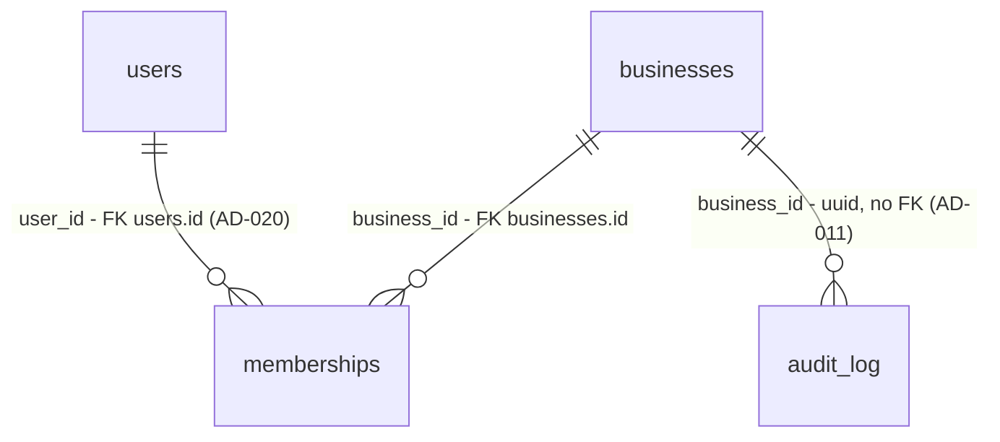

# 11 - Businesses and access

## Problem

A signed-in person has a `users` row and nothing else: the API has no notion of a business, so no data can be scoped to one, and no route can tell a member from a stranger. Every later spec that stores customer data (bank connections in 12, transactions in 14, forecasts in 21) needs a `business_id` to hang it on and a check that the caller belongs to that business. AGENTS.md makes the second part a hard requirement: "no query may run without filtering on it" and "Every endpoint that returns customer data needs a test proving that a user from another business is denied." Nothing enforces either today. The forecast also needs the business's time zone (weeks start on Monday in it; spec 15 syncs at 2 AM in it; spec 30 sends at 8 AM in it), and nothing records one. The source gives no other evidence; the project overview's onboarding target is "70%+ of new sign-ups connect a bank within 24 hours", and this step sits in front of that.

When this ships, a person who signs in without a business always lands on onboarding step 2, enters a name, a province or territory, and a time zone (prefilled from the device), and lands on the dashboard with the business name in the header. Choosing Quebec says Headroom isn't available there yet and does not create anything. Every business route answers `404` to anyone who is not a member of that business.

## Flow

This reuses the `/v1` router with `current_user` (AD-022), the `accounts` module and its layout (AD-023), the AD-008 problem-details handlers for every error, the typed client with per-call `authHeaders()` (AD-016, AD-017, AD-025), `auth.protect()` per layout and page (AD-026), and the existing shell's `businessName` slot in `AppHeader`. No second auth path and no second error shape.

1. browser -> `app/(app)/layout.tsx` (exists) calls `GET /v1/businesses` (door 5) instead of `GET /v1/me`; an empty list redirects to `/onboarding/business`; otherwise the first business's name goes to `AppHeader` (exists); a failed call renders the existing `LayoutError`
2. `/onboarding/business` (new page, no door - placement) - outside `(app)`, so no shell; calls `auth.protect()` (AD-026) and `GET /v1/businesses`; a non-empty list redirects to `/`; renders the step indicator (door 6) and the form; the time zone is prefilled in the browser from `Intl.DateTimeFormat().resolvedOptions().timeZone`
3. form submit -> a server action (new, placement) calls `POST /v1/businesses`; `201` or `409` redirects to `/`; `422` maps `errors[].type` / `loc` to the field messages in `messages/en.json`; anything else shows the form-level error and keeps the values
4. API `/v1` router (exists) -> `app/modules/accounts` (exists): `service.create_business` inserts `businesses` and the owner `memberships` row in one transaction (doors 1, 2); the partial unique index decides a second owned business (door 2) and the API answers `409`
5. `GET` / `PATCH /v1/businesses/{business_id}` -> `require_member(*roles)` in `app/auth.py` (door 3) loads the caller's membership through `accounts.service`; none means `404`, a role outside `roles` means `403`; the route then reads or updates only that business
6. out: the business as JSON (door 4); the shell shows its name on the next render

## Impact

| Front | What changes |
| --- | --- |
| domain | new term: `Business` - the company whose cash is forecast; Canada only, CAD only; lives in `accounts`. Every later customer-data table carries its `id` as `business_id` |
| domain | new term: `Membership` - a user's role in one business; only `owner` in this spec, spec 31 adds `bookkeeper`. Lives in `accounts` |
| domain | new term: `require_member` - the one dependency every business route uses (specs 12 onward copy it) |
| web routing | every page under `(app)` now redirects to `/onboarding/business` for a user with no business. Existing Playwright specs (`shell`, `home`, `auth`, `api-check`) sign in as a test user who has no business today, so `e2e/global.setup.ts` must give that user a business, and a second test user without one drives the onboarding spec |
| web shell | `(app)/layout.tsx` calls `GET /v1/businesses` in place of `GET /v1/me` (the user row is still created by `current_user` on that call, AD-022); `tests/app-layout.test.tsx` changes with it. `AppHeader` receives `businessName` (the slot spec 07 left for this spec) |
| API contract | three new routes and one new path in `contracts/openapi.json`; `frontend/lib/api/schema.d.ts` regenerated (AD-015, AD-016). `GET /v1/me` is unchanged |
| copy | new `Onboarding` namespace in `messages/en.json`: titles, labels, province and time zone names, field errors, the Quebec message |
| stored data | two new tables, `businesses` and `memberships`; nothing existing to migrate. Staging's `users` rows gain no business, so those users land on onboarding on their next visit, which is the intended behaviour |

## Relations

Two new entities, both owned by `accounts`. One-way constraints: a user has at most one membership per business (door 2); a user owns at most one business (door 2, partial unique index); `role` is one of a closed set, today only `owner` (door 2); a business's country is always `CA` and its currency always `CAD` (door 1); `province` is one of the 13 Canadian codes and never `QC` in this spec (door 1); `time_zone` is one of eight IANA names (door 1). Business IDs are `uuid` (AD-011). No delete in this spec, so foreign keys keep the default `NO ACTION`.

## Surface

| Route | In | Out | Status |
| --- | --- | --- | --- |
| `POST /v1/businesses` | `name`, `province`, `time_zone` | `id` · `name` · `province` · `time_zone` · `country` · `currency` · `role` · `created_at` | `201`, `401`, `409`, `422` |
| `GET /v1/businesses` | - | `items[]` of the business shape above, the caller's memberships only, oldest membership first | `200`, `401` |
| `GET /v1/businesses/{business_id}` | path `business_id` (uuid) | the business shape above | `200`, `401`, `404`, `422` |
| `PATCH /v1/businesses/{business_id}` | path `business_id`; any of `name`, `province`, `time_zone` | the business shape above | `200`, `401`, `404`, `422` |

## Landing

| One-way door | Literal shape | Alternative rejected |
| --- | --- | --- |
| 1. `businesses` table | model `Business(Base)` in `app/modules/accounts/models.py`, table `businesses`: `id uuid` primary key generated by the app (`uuid.uuid4`, AD-011); `name text not null` with `ck_businesses_name_length` (`char_length(name) between 1 and 100`); `province text not null` with `ck_businesses_province` (`province in ('AB','BC','MB','NB','NL','NS','NT','NU','ON','PE','SK','YT')`); `time_zone text not null` with `ck_businesses_time_zone` (`time_zone in ('America/St_Johns','America/Halifax','America/Toronto','America/Winnipeg','America/Regina','America/Edmonton','America/Vancouver','America/Whitehorse')`); `country text not null default 'CA'` with `ck_businesses_country` (`= 'CA'`); `currency text not null default 'CAD'` with `ck_businesses_currency` (`= 'CAD'`); `created_at`, `updated_at timestamptz not null default now()`. Created by `alembic revision --autogenerate`, then corrected by hand | Province as full names: a display string in the database, and French comes later. Postgres enums: adding Quebec or a role later needs `ALTER TYPE`, which cannot run inside a transaction on older Postgres and cannot drop a value; a check constraint is replaced in one migration. Any IANA zone: spec 30's "8 AM in each business's time zone" then has to cope with zones no Canadian business uses, and the select would list hundreds. No `country`/`currency` columns: AGENTS.md wants every amount to carry its code, and later tables read it from here |
| 2. `memberships` table | model `Membership(Base)`, table `memberships`: primary key `(business_id, user_id)`; `business_id uuid not null` FK `businesses.id`; `user_id uuid not null` FK `users.id`; `role text not null` with `ck_memberships_role` (`role in ('owner')`); `created_at timestamptz not null default now()`; partial unique index `uq_memberships_owner_user_id` on `(user_id) where role = 'owner'` | A surrogate `id`: nothing references a membership, and the pair is the identity. `role` on `businesses` (`owner_user_id`): spec 31 adds bookkeepers to the same business, so the relation is many-to-many from day one. No owner uniqueness: a double-clicked Continue creates two businesses, and nothing else stops it. Closes: an owner with two businesses, until a later spec drops the index (dropping is one migration with no data risk) |
| 3. `require_member` | in `app/auth.py`, beside `current_user`: `def require_member(*roles: Role) -> Callable[..., Member]`; routes write `member: Annotated[Member, Depends(require_member(Role.OWNER))]`; the inner dependency takes path `business_id: uuid.UUID` and `CurrentUser`, calls `accounts.service.get_membership(session, business_id=..., user_id=...)`; none raises `404` detail `"Business not found."`; a role not in `roles` raises `403` detail `"You don't have permission to do this."`. `Member` is a frozen dataclass `(business_id, user_id, role)`; `Role` is a `StrEnum` in `accounts.service` with `OWNER = "owner"` | Checking membership inside each service function: the next route that forgets is a cross-tenant read. A query that filters by `user_id` only in the repository: correct for this module, but modules 12 onward cannot query `memberships` (AGENTS.md data ownership), so they need a dependency they can import. `403` for non-members: tells a stranger the business exists |
| 4. Business JSON shape | `Business` Pydantic model: `id` (uuid), `name`, `province` (two-letter code), `time_zone` (IANA name), `country` (`"CA"`), `currency` (`"CAD"`), `role` (the caller's role), `created_at`; the list route wraps it as `{"items": [...]}` | A bare JSON array for the list: cannot add a cursor or a count later without breaking the client. Province names in the response: the web owns display text (`messages/en.json`) |
| 5. `GET /v1/businesses` (not in the spec's build list) | lists the caller's businesses, as Surface; the web shell and onboarding use it to decide "has a business" | `businesses` inside `GET /v1/me`: changes a shipped contract and mixes the user with tenancy. A web-side "has business" cookie: a second source of truth the API cannot enforce |
| 6. Onboarding step indicator | `frontend/components/onboarding/step-indicator.tsx`, `StepIndicator({ step, total })`: "Step 2 of 5" text (`messages/en.json`) plus a five-segment bar, `aria-hidden` bar, done segments `--accent`, the rest `--line` - DESIGN.md's "Step indicator" row; specs 12, 13, 23 reuse it | Inline markup in the page: four more onboarding pages would copy it. A shadcn `Progress`: not what DESIGN.md describes (segments, not a fill) and not installed |

- Doors 1 to 5 reach past this feature and become AD-029 to AD-033 in `.specs/STATE.md` once the plan is approved; door 6 becomes AD-034.
- The onboarding URL, the server action's file, the onboarding layout, test helpers and the repository split are reversible and settled in the diff.

## Criteria

### S1: An owner creates a business through the API (P1)

A signed-in user posts a name, province and time zone and becomes its owner.

**Acceptance Criteria**

1. WHEN `POST /v1/businesses` is called with `name` `"Harbor Street Plumbing"`, `province` `"ON"`, `time_zone` `"America/Toronto"` by a user who owns no business THEN the API SHALL return `201` with `id`, the three values, `country` `"CA"`, `currency` `"CAD"`, `role` `"owner"`, and `created_at`
2. WHEN a business is created THEN the API SHALL store exactly one `businesses` row and one `memberships` row with that user, that business and `role` `owner`, in one transaction
3. The API SHALL strip leading and trailing whitespace from `name` before validating and storing it
4. IF `name` is empty after stripping, or longer than 100 characters THEN the API SHALL return `422` problem details with an `errors` item whose `loc` ends in `name`
5. IF `province` is not one of `AB`, `BC`, `MB`, `NB`, `NL`, `NS`, `NT`, `NU`, `ON`, `PE`, `QC`, `SK`, `YT` THEN the API SHALL return `422` with an `errors` item whose `loc` ends in `province`
6. IF `province` is `QC` THEN the API SHALL return `422` with an `errors` item whose `loc` ends in `province`, `type` `"province_not_available"` and `msg` `"Headroom isn't available in Quebec yet."`, and SHALL store no row
7. IF `time_zone` is not one of the eight names in door 1 THEN the API SHALL return `422` with an `errors` item whose `loc` ends in `time_zone`
8. IF the caller already owns a business THEN `POST /v1/businesses` SHALL return `409` problem details with `detail` `"You already own a business."` and SHALL store no row
9. WHEN two `POST /v1/businesses` requests from the same user arrive at the same time THEN the API SHALL store exactly one business, answer one `201` and one `409`, enforced by `uq_memberships_owner_user_id`

**Independent test:** pytest against Postgres with signed test tokens: one create, each invalid body, Quebec, a second create, two concurrent creates.

### S2: Only members reach a business (P1)

Every business route answers `404` to anyone who is not a member.

**Acceptance Criteria**

10. WHEN `GET /v1/businesses` is called THEN the API SHALL return `200` with `items` holding only the businesses the caller is a member of, oldest membership first, and `[]` when there are none
11. WHEN a member calls `GET /v1/businesses/{business_id}` THEN the API SHALL return `200` with the business shape of AC 1
12. IF the caller is not a member of `business_id` THEN `GET` and `PATCH /v1/businesses/{business_id}` SHALL return `404` problem details with `detail` `"Business not found."`, the same status and body as for a `business_id` that does not exist
13. IF `business_id` is not a valid uuid THEN `GET` and `PATCH /v1/businesses/{business_id}` SHALL return `422`
14. IF a route uses `require_member(*roles)` and the caller's role is not in `roles` THEN the API SHALL return `403` problem details with `detail` `"You don't have permission to do this."`
15. WHEN the owner calls `PATCH /v1/businesses/{business_id}` with any of `name`, `province`, `time_zone` THEN the API SHALL update only the fields sent and return `200` with the updated business
16. IF a `PATCH` body breaks any rule in AC 3 to AC 7 (Quebec included) THEN the API SHALL return the same `422` as `POST` and SHALL leave the business unchanged
17. IF a user who is not a member sends `PATCH /v1/businesses/{business_id}` THEN the API SHALL leave the business unchanged
18. Every route under `/v1/businesses/{business_id}` SHALL declare `require_member`, and a pytest SHALL fail when one does not

**Independent test:** pytest with two users, each owning one business: every route called across the boundary; a fake role set for AC 14; a route walk over the app for AC 18.

### S3: Onboarding step 2 (P1)

A signed-in user with no business creates one from the onboarding screen.

**Acceptance Criteria**

19. WHILE the signed-in user has no business, WHEN any page under `(app)` is requested THEN the web app SHALL redirect to `/onboarding/business`
20. WHILE the signed-in user has a business, WHEN `/onboarding/business` is requested THEN the web app SHALL redirect to `/`
21. WHEN `/onboarding/business` renders THEN the web app SHALL show, as in `onboarding-2-business.dc.html`: the wordmark, "Step 2 of 5" with a five-segment bar (two filled), the heading "Tell us about your business", the time-zone line, and three labelled fields - Business name, Province or territory, Time zone - with the Quebec hint and the device hint under them, and a Continue button
22. The province field SHALL list the 13 provinces and territories by English name in alphabetical order, Quebec included, with none preselected
23. WHEN the page loads in a browser whose time zone is one of the eight names in door 1 THEN the time zone field SHALL be preselected with it; otherwise none SHALL be preselected
24. WHEN the user chooses Quebec THEN the web app SHALL show the error "Headroom isn't available in Quebec yet. You can't set up a business there for now." under the province field, in `--danger-text`, linked to the field with `aria-describedby`, before Continue is pressed
25. IF Continue is pressed with Quebec chosen, an empty name, or no province or time zone THEN the web app SHALL create nothing and SHALL show each field's message from `messages/en.json` next to its field and move focus to the first field in error
26. WHEN Continue is pressed with valid values THEN the web app SHALL create the business through a server action calling `POST /v1/businesses` and land on `/`, with the business name in the header
27. IF the API answers `409` THEN the web app SHALL land on `/`
28. IF the API answers anything else that is not `201` or `422`, or the call fails THEN the web app SHALL show "We couldn't save your business. Try again." above Continue and keep the values entered
29. WHILE the form is submitting the Continue button SHALL show a pending state and SHALL NOT submit again
30. IF `GET /v1/businesses` fails while loading `/onboarding/business` THEN the web app SHALL render the existing `States` error content
31. WHILE `/onboarding/business` loads THEN the web app SHALL render a loading state
32. The page SHALL work at 375px wide, SHALL centre a column at most 480px wide on desktop (DESIGN.md), SHALL be usable with the keyboard alone, and every control SHALL be at least 44px tall
33. WHEN a new user starts onboarding step 2 THEN the web app SHALL let them reach the dashboard in under 2 minutes, measured by a Playwright test that signs in a user without a business, fills the form, and asserts the dashboard within 120 seconds of the first page load
34. The web app SHALL take all text on the onboarding page from `messages/en.json`

**Independent test:** Playwright with `@clerk/testing`: a test user with no business goes through onboarding; one with a business is sent away from it; an axe check on the page.

### S4: The shell shows the business (P2)

35. WHEN a user with a business opens any page under `(app)` THEN the header SHALL show the name of their first business (oldest membership) through `AppHeader`'s `businessName`

**Independent test:** Playwright: the header holds the business name after onboarding.

### S5: Nothing about a business leaks (P1)

36. WHEN a business is created or updated THEN the API SHALL log `business.created` or `business.updated` with `business_id` and `user_id`, and SHALL NOT log the business name
37. The `/v1/businesses*` routes SHALL return no field of a business the caller is not a member of, and SHALL NOT return any `clerk_user_id`

**Independent test:** pytest with captured log output over create and update; response bodies checked for keys.

## Out of scope

| Excluded | Why |
| --- | --- |
| Editing the business in the web app (a settings screen) | the spec asks only for the `PATCH` route; `/settings` stays a placeholder |
| Switching between businesses in the shell | only bookkeepers (spec 31) have more than one |
| Bookkeeper role and invitations | spec 31 |
| Deleting a business or leaving one | no v1 spec asks |
| Quebec | French and Law 25 come later (`specs/later/`) |
| Onboarding step 3 | spec 12; until then Continue lands on `/` |
| Audit entries for creating or updating a business | spec 11 does not ask; specs 12, 17, 31 name the actions they audit |

## Assumptions

| Assumption | Chosen default | Rationale | Confirmed? |
| --- | --- | --- | --- |
| How the web learns whether the user has a business | a fourth route, `GET /v1/businesses` (door 5) | the three routes in the spec need a `business_id` the web does not have yet; "a signed-in user without a business always lands on this step" needs a lookup | y - plan approved 2026-10-04 |
| How many businesses one user may own | one; a second `POST` is `409` (door 2) | the only mechanism that stops a double-submitted form from creating two; dropping the index later is cheap, adding it to populated data is not | y - plan approved 2026-10-04 |
| Which time zones are offered | eight, labelled like the mockup: Newfoundland Time (St. John's), Atlantic Time (Halifax), Eastern Time (Toronto), Central Time (Winnipeg), Saskatchewan Time (Regina), Mountain Time (Edmonton), Pacific Time (Vancouver), Yukon Time (Whitehorse) | covers every Canadian offset and the no-DST zones; spec 30 already names Newfoundland | y - plan approved 2026-10-04 |
| The Quebec message | the mockup's hint always shows ("Headroom isn't available in Quebec yet."); choosing Quebec adds the error of AC 24 | the mockup shows the hint as static help text; the Done-when line needs a message that appears on choosing Quebec | y - plan approved 2026-10-04 |
| Name length | 1 to 100 characters after trimming | long enough for any trade name; keeps the header from overflowing | y - plan approved 2026-10-04 |
| Malformed `business_id` | `422` (FastAPI's path validation, AD-008 shape), not `404` | it is not a business id at all, and reveals nothing about any business | y - plan approved 2026-10-04 |
| `PATCH` permission | owner only (`require_member(Role.OWNER)`); `GET` any member | spec 31 says bookkeepers can't change business settings | y - plan approved 2026-10-04 |
| The step indicator | a new `components/onboarding/step-indicator.tsx` built from DESIGN.md's row (door 6) | DESIGN.md defines it and no `components/ui/` component matches; AGENTS.md asks before adding a component | y - plan approved 2026-10-04 |
| The province select | the existing `components/ui/select.tsx` (Radix), styled at 48px as in the mockup | AGENTS.md: only components in `components/ui/`; Radix select is keyboard-operable | y - plan approved 2026-10-04 |
| e2e test users | the existing `E2E_CLERK_USER_USERNAME` user gets a business in `global.setup.ts` (through the onboarding form when it lands there); the onboarding spec uses a Clerk user created per run (Open question 1) | specs `shell`, `home`, `auth` need a user with a business; onboarding needs one without | y - plan approved 2026-10-04 |

**Open questions:**

| # | Kind | Question | Until answered |
| --- | --- | --- | --- |
| 1 | resolved | The onboarding test user: Playwright's setup creates a fresh Clerk user per run on the dev instance through the Clerk Backend API (`CLERK_SECRET_KEY`), username `e2e-onboarding-<timestamp>`, and deletes it and any older `e2e-onboarding-*` user in teardown and before creating; no second `.env.local` variable is needed | - |
| 2 | resolved | Resetting "no business" between runs: not needed, because the onboarding user is new every run; local `users` rows for old test users stay behind in the local database only | - |

## Observable

| Surface | Decision | Landing |
| --- | --- | --- |
| screen `/onboarding/business` | loading state | AC 31 |
| screen `/onboarding/business` | empty state | n/a - a form; "no business yet" is the reason the page exists |
| screen `/onboarding/business` | error state (load fails) | AC 30 |
| screen `/onboarding/business` | error state (save fails) | AC 25, AC 28 |
| screen `/onboarding/business` | unauthorised state | existing - AD-026 `auth.protect()` sends it to `/sign-in` |
| screen `/onboarding/business` | already has a business | AC 20 |
| screen `/onboarding/business` | destructive action confirms | n/a - creating a business destroys nothing |
| screen `/onboarding/business` | density and ordering | AC 21, AC 22 |
| screen `/onboarding/business` | 375px, keyboard, 44px targets | AC 32 |
| screen app shell | no business | AC 19 |
| screen app shell | business name | AC 35 |
| API `POST /v1/businesses` | response shape | AC 1 |
| API `POST /v1/businesses` | error shape and codes | AC 4-9 (AD-008) |
| API `GET /v1/businesses` | response shape, empty | AC 10 |
| API `GET`, `PATCH /v1/businesses/{business_id}` | response shape | AC 11, AC 15 |
| API `GET`, `PATCH /v1/businesses/{business_id}` | error shape and codes | AC 12, 13, 16 |
| all new `/v1/businesses*` | who may call | AC 12, 14, 17, 18; `401` from AD-022 |
| all new `/v1/businesses*` | versioning | existing - `/v1` prefix |
| all new `/v1/businesses*` | rate limits | n/a - no v1 spec sets rate limits; one owned business caps creates |
| copy `Onboarding.*` | tone, what the reader does next | AC 21, 24, 25, 28, 34; DESIGN.md writing guidelines |

## Sources

- `context/specs/11-accounts-businesses-and-access.md` - the build list and the three "Done when" items
- `design/mockups/onboarding-2-business.dc.html` - binding for the step 2 screen's copy and arrangement
- `AGENTS.md` "Domain conventions" (tenancy, time) and "Security and data handling" (cross-business denial tests)
