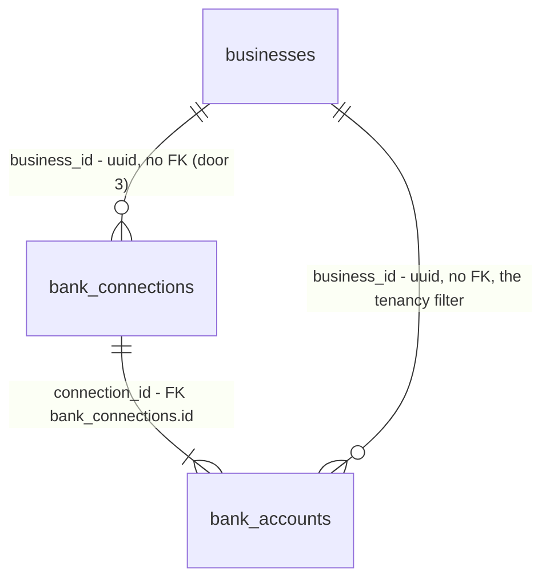

# 12 - Connect a bank

## Problem

A business exists after onboarding step 2, but Headroom holds none of its bank data, so there is nothing to forecast: no accounts, no balances, no way to fetch transactions later (spec 14 needs a stored, usable connection to sync). Step 2's Continue lands on a placeholder dashboard. The owner has to hand Headroom read access to a bank in a way that never exposes their bank password, and the access token that results is the most sensitive value the product will ever hold: anyone with it can read the business's bank data. AGENTS.md makes its handling a hard requirement (encrypted with Fernet before storage, never logged, never returned). The project overview sets the onboarding target this step sits on: "70%+ of new sign-ups connect a bank within 24 hours"; the spec's own bar is "A sandbox bank connects in under 2 minutes."

When this ships, step 2's Continue lands on onboarding step 3. The owner reads the three trust lines, presses "Connect your bank", logs in on the bank's own screen inside Plaid Link, and lands back in Headroom with the bank and each of its accounts (name, type, last four digits, currency, balance) stored, the access token stored only encrypted, and an audit entry recording the connection.

## Flow

This reuses `require_member(Role.OWNER)` (AD-031) for the owner-only rule, `app.audit.record` (AD-011) for the audit entry, the AD-008 problem details for every error, `app.log.redact` (AD-009) for logs, the typed client with per-call `authHeaders()` (AD-016, AD-017, AD-025), `auth.protect()` per page (AD-026), the onboarding layout and `StepIndicator` (AD-034), and `LayoutError` for the load-error state. No second auth path, no second error shape, no second redaction list.

1. step 2 server action (exists) -> `POST /v1/businesses` answers `201`; it now redirects to `/onboarding/bank` instead of `/`
2. `/onboarding/bank` (new page, placement) -> `auth.protect()`, `GET /v1/businesses` (exists, AD-033); none redirects to `/onboarding/business`; else calls `POST /v1/businesses/{business_id}/bank/link-token` for the first business
3. API `/v1` router (exists) -> `app/modules/bank_sync` (new module, door 1) `api.py` -> `require_member(Role.OWNER)` (exists) -> `service.create_link_token` -> the Plaid client port (door 2) `/link/token/create` with `CA`, `transactions`, 730 days -> out: `link_token`, `expiration`
4. browser: `react-plaid-link` (door 6) opens Plaid Link with the link token; the owner logs in on the bank's screen; Link hands `public_token` to `onSuccess`
5. `onSuccess` -> a server action (new, placement) -> `POST /v1/businesses/{business_id}/bank/connections` with `public_token`
6. `bank_sync.service.connect_bank` -> Plaid `/item/public_token/exchange` -> `/accounts/get` -> `/institutions/get_by_id`; rejects a second connection to the same institution (door 3) by removing the new item at Plaid; encrypts the access token (door 4); stores `bank_connections` and `bank_accounts` (door 3) and calls `app.audit.record` (exists) in one transaction; on any failure after the exchange, removes the new item at Plaid and stores nothing
7. out: `201` with the connection JSON (door 5); the server action redirects to `/`; spec 13 later points this at the choose-accounts step

## Impact

| Front | What changes |
| --- | --- |
| domain | new term: `BankConnection` - one Plaid item: one login at one bank for one business, holding the encrypted access token. Lives in `bank_sync` |
| domain | new term: `BankAccount` - one account inside a connection (checking, savings, credit card, line of credit, other) with its last known balance. Lives in `bank_sync`; spec 13 adds included and primary to it |
| domain | new module `bank_sync`, the second of the five AGENTS.md modules; it reaches `accounts` only through `app.auth.require_member` and `accounts.service.Role` |
| web onboarding | step 2's success redirect changes from `/` to `/onboarding/bank` (spec 11 AC 26). A `409` from step 2 still lands on `/`. `e2e/onboarding.spec.ts` and its 2-minute check (spec 11 AC 33) now pass through step 3; the spec 11 assertion that it reaches the dashboard needs the step 3 page in between |
| API settings | four new required settings: `PLAID_CLIENT_ID`, `PLAID_SECRET`, `PLAID_ENV`, `TOKEN_ENCRYPTION_KEYS`. The API will not start without them (AD-001), so tests, CI and the Railway `api` service in staging need values **before** the next push to `development` |
| API contract | two new routes in `contracts/openapi.json`; `frontend/lib/api/schema.d.ts` regenerated (AD-015, AD-016) |
| dependencies | `plaid-python` and `cryptography` (explicit; today it arrives only through `pyjwt[crypto]`) in `services/core`; `react-plaid-link` in `frontend` |
| copy | new `Onboarding.Bank` namespace in `messages/en.json` |
| stored data | two new tables, `bank_connections` and `bank_accounts`; nothing existing to migrate |

## Relations

Two new entities, both owned by `bank_sync`. One-way constraints (door 3): a Plaid item is stored once (`plaid_item_id` unique); a business has at most one connection per institution (`(business_id, plaid_institution_id)` unique); a Plaid account is stored once (`plaid_account_id` unique); an account's type is one of a closed set; the access token is stored only as Fernet ciphertext (door 4); `business_id` has no foreign key to `businesses`, following AD-011, because `businesses` belongs to `accounts`. No delete in this spec, so `bank_accounts.connection_id` keeps the default `NO ACTION`; spec 17 decides disconnect.

## Surface

| Route | In | Out | Status |
| --- | --- | --- | --- |
| `POST /v1/businesses/{business_id}/bank/link-token` | path `business_id` (uuid) | `link_token` · `expiration` | `200`, `401`, `403`, `404`, `422`, `502` |
| `POST /v1/businesses/{business_id}/bank/connections` | path `business_id`; `public_token` | `id` · `institution_name` · `created_at` · `accounts[]` (`id` · `name` · `type` · `mask` · `currency` · `balance_cents`) | `201`, `400`, `401`, `403`, `404`, `409`, `422`, `502` |

## Landing

| One-way door | Literal shape | Alternative rejected |
| --- | --- | --- |
| 1. Second module `bank_sync` | `app/modules/bank_sync/{__init__,api,service,models,repository}.py` (AD-023); router `APIRouter(tags=["bank_sync"])` included into the `/v1` router (AD-022); `migrations/env.py` imports `bank_sync.models`; routes under `/businesses/{business_id}/bank/...` | Putting connections in `accounts`: AGENTS.md names `bank_sync` as the owner of bank data, and spec 14 adds transactions to it. A separate `/v1/bank/...` prefix with `business_id` in the body: breaks AD-031, which reads the business from the path |
| 2. Plaid client port | `bank_sync/plaid.py`: a `PlaidClient` `Protocol` with one method per Plaid call this spec makes (`create_link_token`, `exchange_public_token`, `get_accounts`, `get_institution`, `remove_item`), each returning plain dataclasses, never `plaid-python` models; the real implementation wraps `plaid-python`'s `PlaidApi`; routes get it through the FastAPI dependency `get_plaid_client`, which tests override with a fake. Every Plaid failure becomes one exception type carrying only `error_type`, `error_code` and `request_id` | Calling `PlaidApi` from `service.py`: unit tests would need to patch generated SDK classes, and AGENTS.md wants fakes that behave like the service. Raw `httpx` calls: the Plaid quickstart uses `plaid-python`, and hand-written request types are what AGENTS.md "Generate, don't hand-write" forbids |
| 3. `bank_connections` and `bank_accounts` tables | `BankConnection(Base)`, table `bank_connections`: `id uuid` app-generated; `business_id uuid not null`, no FK; `plaid_item_id text not null` unique `uq_bank_connections_plaid_item_id`; `plaid_institution_id text not null`; `institution_name text not null`; `access_token_ciphertext text not null`; `created_at`, `updated_at timestamptz not null default now()`; unique `uq_bank_connections_business_id_plaid_institution_id` on `(business_id, plaid_institution_id)`. `BankAccount(Base)`, table `bank_accounts`: `id uuid`; `business_id uuid not null`, no FK; `connection_id uuid not null` FK `bank_connections.id`; `plaid_account_id text not null` unique `uq_bank_accounts_plaid_account_id`; `name text not null`; `type text not null` with `ck_bank_accounts_type` (`type in ('checking','savings','credit_card','line_of_credit','other')`); `mask text` (null when Plaid gives none); `currency text not null` (`iso_currency_code`, else `unofficial_currency_code`); `balance_cents bigint` (Plaid `balances.current` x 100 rounded half-even, as the bank reports it: for a credit card or line of credit, the amount owed as a positive number; null when Plaid gives none); `created_at`, `updated_at`. Autogenerated, then corrected by hand | Plaid's raw `type`/`subtype` strings: spec 13's cash rules then depend on Plaid's vocabulary in every module; one mapping here, in `bank_sync`, keeps it in one place (`depository/checking` -> `checking`, `depository/savings` -> `savings`, `credit/credit card` -> `credit_card`, `loan/line of credit` and `credit/line of credit` -> `line_of_credit`, anything else -> `other`). A signed balance (owed as negative): the choose-accounts mockup shows "$8,000" for a line of credit, and AGENTS.md's sign rule is for money moving, not for balances. A FK to `businesses`: couples two modules' schemas (AGENTS.md "keep them independent", AD-011 precedent). No institution uniqueness: user chose to reject a second connection to the same bank. Closes: two logins at one bank for one business, until a later spec drops the index |
| 4. Access token encryption | setting `TOKEN_ENCRYPTION_KEYS`: comma-separated Fernet keys, at least one, each validated as a Fernet key at startup; `cryptography.fernet.MultiFernet` built from them; the first key encrypts, any key decrypts; ciphertext stored as the Fernet token's text in `access_token_ciphertext`; encrypt and decrypt only inside `bank_sync` (one function each); the plaintext never leaves `bank_sync.service` | One `FERNET_KEY`: rotating it later means a data migration and a settings rename at once; a list lets a new key go first and old ciphertext still decrypt. Postgres `pgcrypto`: the key would travel to the database with every query. Encrypting in the repository layer only: the token would sit in plaintext on the ORM object across the whole session |
| 5. Connection JSON shape | `BankConnection` response: `id` (uuid), `institution_name`, `created_at`, `accounts` (each `id`, `name`, `type` from door 3's set, `mask` (string or null), `currency` (ISO code), `balance_cents` (integer or null)), accounts ordered by `name`. Link token response: `link_token`, `expiration` | Returning Plaid IDs (`plaid_item_id`, `plaid_account_id`): no consumer needs them and they are Plaid's handles, not ours. Balance as a decimal or float: AGENTS.md money rule. Specs 13 and 17 read this shape |
| 6. New dependencies | `uv add plaid-python` (45.0.0 today), `uv add cryptography`, `npm install react-plaid-link` (5.0.0 today; peer React 19 supported); `PLAID_ENV` is `sandbox` or `production` (Plaid's two hosts), no default | Plaid Link from the CDN script by hand: the spec names `react-plaid-link`. A `PLAID_ENV` default of `sandbox`: a production deploy that forgets the variable would silently talk to the sandbox |
| 7. Public tokens join the redaction pattern (found while building: Sentry captures local variables by default, so a `500` traceback through the connect path can hold the `public_token` in a value whose key does not say "token", and AD-009's `TOKEN_PATTERN` matches only `access-*` tokens) | `app.log.TOKEN_PATTERN` also matches `public-(sandbox\|development\|production)-<uuid>`; the request body field is a Pydantic `SecretStr`; the port's exchange result hides `access_token` from `repr` | Turning off Sentry's `include_local_variables`: changes AD-010 for every route and loses debugging context. Relying on the key name alone: a repr of the request body or a dataclass carries the value under a key like `body` |
| 8. Request bodies join the redacted keys (found while building: C28 showed a Sentry event for the `500` path carrying FastAPI's frame local `body_bytes`, the raw request body with the public token, under a key door 7 does not cover) | `app.log.SECRET_KEY_FRAGMENTS` gains `body`, so `body`, `body_bytes`, `json_body` and any other key containing `body` are `[REDACTED]` in logs, Sentry events and audit details | Relying on door 7's pattern alone: it only matches tokens shaped like Plaid's, and a raw body can carry anything a later route accepts. Turning off Sentry local variables: same objection as door 7 |

- Doors 1 to 5 reach past this feature and become AD-035 to AD-039 in `.specs/STATE.md` once the plan is approved; doors 7 and 8 amend AD-009.
- The page URL `/onboarding/bank`, the server action's file, component split, the fake's file, and test helpers are reversible and settled in the diff.

## Criteria

### S1: The API creates a link token (P1)

The owner's server asks the API for a Plaid link token for Canada and 24 months of history.

**Acceptance Criteria**

1. WHEN the owner calls `POST /v1/businesses/{business_id}/bank/link-token` THEN the API SHALL return `200` with `link_token` and `expiration` from Plaid
2. WHEN the API creates a link token THEN it SHALL ask Plaid for `country_codes` `["CA"]`, `products` `["transactions"]`, `transactions.days_requested` `730`, `language` `"en"`, `client_name` `"Headroom"`, and `user.client_user_id` equal to the caller's `users.id`
3. IF Plaid returns an error or does not answer within 15 seconds THEN the link-token route SHALL return `502` problem details with `detail` `"We couldn't reach our bank connection provider. Try again."`

**Independent test:** pytest with the fake Plaid client: the request the fake received, the response, and a fake failure.

### S2: The API stores a connection (P1)

The owner's server sends the `public_token` and the API stores the bank and its accounts, with the access token encrypted.

**Acceptance Criteria**

4. WHEN the owner calls `POST /v1/businesses/{business_id}/bank/connections` with a valid `public_token` THEN the API SHALL return `201` with the connection JSON of door 5, holding the institution's name and every account Plaid returns
5. WHEN a connection is stored THEN the API SHALL store one `bank_connections` row and one `bank_accounts` row per account, each with that `business_id`, in one transaction
6. WHEN an account is stored THEN its `type` SHALL follow door 3's mapping, `mask` SHALL be Plaid's `mask`, `currency` SHALL be `iso_currency_code` (else `unofficial_currency_code`), and `balance_cents` SHALL be `balances.current` in cents rounded half-even (`1234.565` -> `123456`), or null when Plaid gives none
7. The API SHALL store the access token only as Fernet ciphertext that decrypts, with the configured keys, to the exact token Plaid returned
8. WHEN a connection is stored THEN the API SHALL write one audit entry in the same transaction with `action` `bank_connection.created`, the `business_id`, `actor_user_id` `str(users.id)`, `target_type` `bank_connection`, `target_id` the connection's `id`, and `details` holding only `institution_id` and `account_count`
9. IF the business already has a connection to the same institution THEN the API SHALL remove the new item at Plaid, store nothing, and return `409` problem details with `detail` `"This bank is already connected."`
10. WHEN two connection requests for the same business and institution arrive at the same time THEN the API SHALL store exactly one connection and answer the other with `409`, enforced by `uq_bank_connections_business_id_plaid_institution_id`, and SHALL remove the losing item at Plaid
11. IF Plaid rejects the `public_token` with error type `INVALID_INPUT` THEN the API SHALL return `400` problem details with `detail` `"We couldn't finish connecting your bank. Try again."` and store nothing
12. IF any other Plaid call fails or does not answer within 15 seconds THEN the API SHALL return `502` with AC 3's detail and store nothing
13. IF anything fails after the public token was exchanged (a Plaid call, the database write, or the audit entry) THEN the API SHALL call Plaid's item remove with the new access token before answering, and store nothing
14. IF that item remove also fails THEN the API SHALL log `bank_connection.orphaned` at `error` level with `business_id` and `plaid_item_id`, and still answer as AC 12
15. IF `public_token` is missing, empty, or the body has other fields THEN the API SHALL return `422`

**Independent test:** pytest against Postgres with the fake Plaid client: one connect, the stored rows, the ciphertext, the audit row, each failure point, a duplicate, two concurrent connects.

### S3: Only the owner, only their business (P1)

**Acceptance Criteria**

16. IF the caller is not a member of `business_id` THEN both bank routes SHALL return `404` with `detail` `"Business not found."` and SHALL make no Plaid call
17. IF the caller is a member whose role is not `owner` THEN both bank routes SHALL return `403` with `detail` `"You don't have permission to do this."` and SHALL make no Plaid call
18. The API SHALL declare on both bank routes `require_member(Role.OWNER)`, caught by spec 11's route walk (AC 18 there)

**Independent test:** pytest with two users each owning one business, every route called across the boundary; a fake role set for 403.

### S4: The access token never leaks (P1)

**Acceptance Criteria**

19. The API SHALL NOT include the access token, the public token, or the ciphertext in any response body, including every error response of both routes
20. The API SHALL NOT write the access token or the public token to any log line or Sentry event, on success or on any failure path of AC 3 and AC 9 to AC 14
21. WHEN a connection is stored THEN the API SHALL log `bank_connection.created` with `business_id`, `connection_id`, `institution_id` and `account_count`, and no account name, mask or balance
22. IF `TOKEN_ENCRYPTION_KEYS` is missing, empty, or holds a value that is not a Fernet key THEN `get_settings()` SHALL raise, so the API does not start
23. IF `PLAID_CLIENT_ID`, `PLAID_SECRET` or `PLAID_ENV` is missing, or `PLAID_ENV` is not `sandbox` or `production`, THEN `get_settings()` SHALL raise

**Independent test:** pytest that captures stdout logs and Sentry events across the success path and every failure path, and searches them and every response body for the fake's token strings; settings tests.

### S5: Onboarding step 3 (P1)

**Acceptance Criteria**

24. WHEN step 2's form creates a business (`201`) THEN the web app SHALL redirect to `/onboarding/bank`
25. IF the signed-in user has no business WHEN `/onboarding/bank` is requested THEN the web app SHALL redirect to `/onboarding/business`
26. WHEN `/onboarding/bank` renders THEN the web app SHALL show, as in `onboarding-3-connect-bank.dc.html`: the wordmark, "Step 3 of 5" with three of five segments filled, the heading "Connect your bank", the intro line, the three trust items with their icons and text ("Read-only", "Your password stays with your bank", "You're in control"), the line "Bank connections are provided by Plaid.", and a primary "Connect your bank" button
27. WHEN "Connect your bank" is pressed THEN the web app SHALL open Plaid Link with the link token the page loaded
28. WHILE Plaid Link is not ready, or a connection is being saved, the button SHALL be disabled, and while saving it SHALL read "Connecting your bank…"
29. WHEN Plaid Link succeeds THEN the web app SHALL send `public_token` through a server action to `POST /v1/businesses/{business_id}/bank/connections` and, on `201`, land on `/`
30. IF the API answers `409` THEN the web app SHALL show "This bank is already connected." above the button and keep the button enabled
31. IF the API answers anything else that is not `201` or `409`, the call fails, or Plaid Link exits with an error THEN the web app SHALL show "We couldn't connect your bank. Try again." above the button and keep the button enabled
32. WHEN the owner closes Plaid Link without an error THEN the web app SHALL show no message and keep the button enabled
33. IF `GET /v1/businesses` or the link-token call fails while loading `/onboarding/bank` THEN the web app SHALL render the existing `LayoutError` content
34. WHILE `/onboarding/bank` loads THEN the web app SHALL render the existing onboarding loading state
35. The page SHALL work at 375px wide, centre a column at most 480px wide on desktop, be usable with the keyboard alone up to Plaid Link opening, and every control SHALL be at least 44px tall
36. The web app SHALL take all text on the page from `messages/en.json`, and the message area of AC 30 and AC 31 SHALL be announced (`role="alert"`)
37. WHEN a new user starts at onboarding step 2 THEN they SHALL reach `/` with a sandbox bank connected within 120 seconds of the first page load, measured by a Playwright test that drives the real Plaid Link sandbox (`user_good` / `pass_good`)

**Independent test:** Playwright with `@clerk/testing` and the Plaid sandbox: a fresh user through steps 2 and 3; a user with no business sent back to step 2; an axe check on step 3. Vitest for the button states and messages with a mocked `usePlaidLink`.

## Out of scope

| Excluded | Why |
| --- | --- |
| Choosing cash accounts and the primary account, "Connect another bank" | spec 13; step 3 lands on `/` until then |
| Fetching transactions, the `/transactions/sync` cursor, webhooks | spec 14; items created now carry no webhook URL, and spec 14 sets it |
| Reconnecting (Link update mode), disconnecting, the bank settings page | spec 17 |
| Forcing an owner with no bank back to step 3 | user chose no redirect; spec 26's dashboard empty state covers it |
| Plaid OAuth institutions (`redirect_uri`, resuming Link after the bank's site) | not in the spec; see open question 1 |
| Refreshing balances after the connection | spec 14 stores the latest balance after each sync |

## Assumptions

| Assumption | Chosen default | Rationale | Confirmed? |
| --- | --- | --- | --- |
| Gating step 3 | no redirect into `/onboarding/bank`; step 2 sends the owner there once | a bookkeeper (spec 31) cannot connect banks and would loop; a spec 17 disconnect would bounce the owner | y - plan approved 2026-10-04 |
| Same bank twice | reject with `409` and remove the new item at Plaid (door 3, AC 9) | Plaid bills per item and recommends the check | y - plan approved 2026-10-04 |
| Where the link token is created | in the step 3 server component on every render (link tokens last 4 hours and cost nothing) | `usePlaidLink` needs the token before `open()`; the browser never calls the API (AGENTS.md) | y - plan approved 2026-10-04 |
| Which balance | `balances.current` from `/accounts/get` (cached, no extra fee), not `/accounts/balance/get` | the spec asks for "balance"; real-time balance is a separately billed product | y - plan approved 2026-10-04 |
| Plaid call timeout | 15 seconds per call | Link's exchange is interactive; past that the owner retries | y - plan approved 2026-10-04 |
| Status for the link-token route | `200`, since nothing is stored | `201` would announce a resource Headroom keeps | y - plan approved 2026-10-04 |
| After connecting | land on `/` until spec 13 builds choose-accounts | the spec gives no next screen | y - plan approved 2026-10-04 |
| Sandbox institution for API integration proofs | a Canadian sandbox institution found through `/institutions/search` at build time, used with `/sandbox/public_token/create` | no institution ID is invented here | y - plan approved 2026-10-04 |

**Open questions:**

| # | Kind | Question | Until answered |
| --- | --- | --- | --- |
| 1 | blocks go-live | Do the Canadian banks the pilot clients use require Plaid OAuth (a registered `redirect_uri` and a page that resumes Link)? | sandbox and non-OAuth banks work; an OAuth bank cannot complete Link in production |
| 2 | blocks go-live | Plaid sandbox keys (local keys arrived 2026-10-04 and are in `services/core/.env.local`; staging still needs them) (`PLAID_CLIENT_ID`, `PLAID_SECRET`) for `services/core/.env.local`, and the same plus `TOKEN_ENCRYPTION_KEYS` as Railway `api` variables in staging | AC 37 and the sandbox integration proof cannot run; a push to `development` would fail the staging deploy (AC 22, AC 23) |

## Observable

| Surface | Decision | Landing |
| --- | --- | --- |
| screen `/onboarding/bank` | loading state | AC 34 |
| screen `/onboarding/bank` | empty state | n/a - the page exists because there is no bank yet; AC 26 is its content |
| screen `/onboarding/bank` | error state (load fails) | AC 33 |
| screen `/onboarding/bank` | error state (connect fails, duplicate, Link error) | AC 30, AC 31 |
| screen `/onboarding/bank` | Link closed by the owner | AC 32 |
| screen `/onboarding/bank` | unauthorised state | existing - AD-026 `auth.protect()` sends it to `/sign-in` |
| screen `/onboarding/bank` | no business | AC 25 |
| screen `/onboarding/bank` | destructive action confirms | n/a - connecting destroys nothing |
| screen `/onboarding/bank` | density and ordering | AC 26 |
| screen `/onboarding/bank` | 375px, keyboard, 44px targets | AC 35 |
| screen step 2 | where Continue lands | AC 24 |
| API `POST .../bank/link-token` | response shape | AC 1, AC 2 |
| API `POST .../bank/link-token` | error shape and codes | AC 3, AC 16, AC 17 (AD-008) |
| API `POST .../bank/connections` | response shape | AC 4, AC 6 |
| API `POST .../bank/connections` | error shape and codes | AC 9, AC 11, AC 12, AC 15, AC 16, AC 17 (AD-008) |
| both bank routes | who may call | AC 16, AC 17, AC 18; `401` from AD-022 |
| both bank routes | versioning | existing - `/v1` prefix |
| both bank routes | rate limits | n/a - no v1 spec sets rate limits; Plaid's own limits surface as AC 3 / AC 12 |
| copy `Onboarding.Bank.*` | tone, what the reader does next | AC 26, AC 30, AC 31, AC 36; DESIGN.md trust copy and writing guidelines |

## Sources

- `context/specs/12-bank-connect.md` - the build list and the two "Done when" items
- `design/mockups/onboarding-3-connect-bank.dc.html` - binding for step 3's copy and arrangement
- `AGENTS.md` "Security and data handling" (Fernet, never log tokens) and "Architecture rules" (module layout, data ownership)
