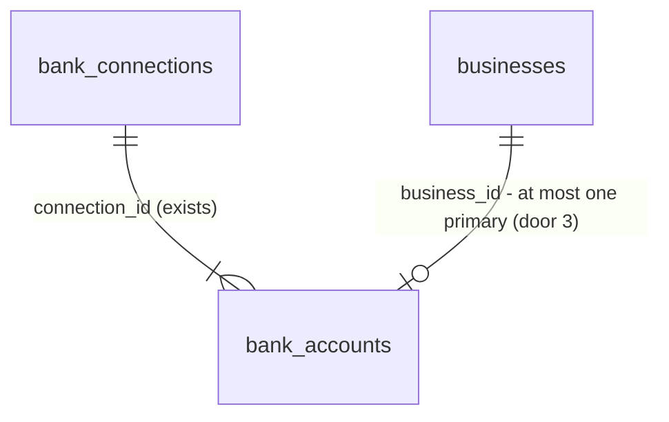

# 13 - Choose cash accounts

## Problem

After onboarding step 3, a business's bank accounts are stored, but Headroom cannot tell which of them hold money the owner can spend. A connection brings in every account at the bank, including credit cards, lines of credit, savings set aside, and sometimes US-dollar accounts. If all of them counted, the forecast (spec 21) would add an amount owed on a credit card as if it were cash, and an owner with a reserve they never touch would see more headroom than they have. AGENTS.md fixes the rule: "only included checking and savings accounts" count as cash, and "credit cards and lines of credit never count as cash." Nothing today records which accounts are included. Nothing records a primary account either, and spec 20 needs one as the default account for an expected payment. Step 3 also ends on the placeholder dashboard (`/`), so an owner whose cash is spread across two banks has no way to add the second one during onboarding. The spec gives no figures beyond its three "Done when" items.

When this ships, connecting a bank leads to a "Which accounts count as cash?" step. Each account shows its name, last four digits, type and balance. Checking accounts start included and savings accounts start excluded, and the owner can change either. Credit cards, lines of credit, other account types and non-CAD accounts show why they can't count. One included account is marked primary, and the owner can choose another. From this step the owner can connect another bank, and Continue takes them to `/`.

## Flow

This reuses `require_member(Role.OWNER)` (AD-031), `app.audit.record` (AD-011), the AD-008 problem details, spec 12's `bank_sync` module and tables (AD-035, AD-037), spec 12's connect path and its Plaid Link button logic, the typed client with `authHeaders()` (AD-016, AD-017, AD-025), `auth.protect()` (AD-026), the onboarding layout, `StepIndicator` (AD-034), `LayoutError`, `formatMoney`, and the shadcn `Switch`, `ToggleGroup` and `RadioGroup` already in `components/ui/`. It adds no second connect path and no new component.

1. connect (exists, AD-039) -> `bank_sync.service.connect_bank` now stores `included` per door 1's default and `available_cents` (door 2), and makes the largest-balance included checking account primary when the business has no primary account yet (door 3), in the same transaction
2. step 3 server action (exists) -> on `201` it now redirects to `/onboarding/accounts` instead of `/`
3. `/onboarding/accounts` (new page, placement) -> `auth.protect()`, `GET /v1/businesses` (AD-033); no business redirects to `/onboarding/business`; else `GET /v1/businesses/{business_id}/bank/connections` (new, door 4); no connection redirects to `/onboarding/bank`; else also `POST .../bank/link-token` (exists) for "Connect another bank"
4. owner flips "Counts as cash", answers "Is this money you can spend?", or picks a primary account -> a server action (new, placement) -> `PATCH /v1/businesses/{business_id}/bank/accounts/{account_id}` (new, door 5) -> `require_member(Role.OWNER)` -> `bank_sync.service.update_account` applies the cash rules, locks the business's accounts, writes the change and an audit entry in one transaction -> out: the account JSON; the page re-renders from the server
5. "Connect another bank" -> Plaid Link with the page's link token -> the spec 12 connect server action -> on `201` the page re-renders with the new bank; on `409` or failure it shows spec 12's messages
6. Continue -> `/` (spec 23 later points it at step 4)

## Impact

| Front | What changes |
| --- | --- |
| domain | new term: `included` - the owner counts this account as cash. Only `checking` and `savings` accounts in `CAD` can be included. Lives on `bank_accounts` in `bank_sync`. Nobody reads it yet; spec 21's forecast and spec 26's dashboard will |
| domain | new term: `primary account` - the one included account per business that expected payments default to (spec 20). Lives on `bank_accounts` |
| domain | new term: `available_cents` - the available balance the bank reports. Shown for credit cards and lines of credit; spec 25's line-of-credit fix reads it |
| API contract | AD-039's account JSON gains `included`, `primary` and `available_cents` (additive; spec 12's connect response carries them too). Two new routes. `contracts/openapi.json` and `schema.d.ts` regenerated |
| web onboarding | step 3's success redirect changes from `/` to `/onboarding/accounts` (spec 12 AC 29). `e2e/onboarding.spec.ts` and its 120-second check (spec 12 AC 37) now pass through the new step before `/` |
| web formatting | `formatMoney` in `lib/format.ts` accepts any ISO 4217 code, not only `CAD`, so a USD account shows "US$1,200" in `en-CA`. Every existing caller passes `CAD` or nothing and is unchanged |
| copy | new `Onboarding.Accounts` namespace in `messages/en.json` |
| stored data | `bank_accounts` gains three columns. Existing rows are backfilled in the migration: `included` true for `checking` in `CAD`, false otherwise; `is_primary` true for each business's largest-balance included checking account; `available_cents` null (spec 14's sync fills it). Local and staging only; no production data yet |

## Relations

No new entity. One-way constraints on `bank_accounts`: an account can be included only when its type is `checking` or `savings` and its currency is `CAD` (door 1); a primary account is always included (door 3); a business has at most one primary account (door 3).

## Surface

| Route | In | Out | Status |
| --- | --- | --- | --- |
| `GET /v1/businesses/{business_id}/bank/connections` | path `business_id` (uuid) | `items[]` of the connection JSON (`id` · `institution_name` · `created_at` · `accounts[]` with `id` · `name` · `type` · `mask` · `currency` · `balance_cents` · `available_cents` · `included` · `primary`) | `200`, `401`, `403`, `404`, `422` |
| `PATCH /v1/businesses/{business_id}/bank/accounts/{account_id}` | path `business_id`, `account_id` (uuid); `included` (bool, optional), `primary` (`true`, optional), at least one | the account JSON | `200`, `401`, `403`, `404`, `409`, `422` |

## Landing

| One-way door | Literal shape | Alternative rejected |
| --- | --- | --- |
| 1. `included` column and the cash rule in the schema | `bank_accounts.included boolean not null`, no server default; check constraint `ck_bank_accounts_included_cash`: `NOT included OR (type IN ('checking','savings') AND currency = 'CAD')`. On connect: `included = (type = 'checking' AND currency = 'CAD')` | The rule only in `service.py`: a later spec (sync, settings) that writes the row could make a credit card count as cash, and AGENTS.md says it "never" does. A nullable tri-state ("not answered yet") for savings: the spec says savings is excluded until included, so false is the answer. Closes: including a USD account until a later spec drops the `currency` clause |
| 2. `available_cents` column | `bank_accounts.available_cents bigint` null: Plaid `balances.available` in cents rounded half-even, as `balance_cents` is (AD-037); null when Plaid gives none | Showing the owed amount for credit: the mockup shows "$20,000 available" for a line of credit, and spec 25's fix needs available credit, so the column comes now rather than as a second migration. Computing `limit - current`: Plaid already reports `available`, and `limit` is often null |
| 3. Primary account | `bank_accounts.is_primary boolean not null default false`; partial unique index `uq_bank_accounts_primary_business_id` on `(business_id) WHERE is_primary`; check constraint `ck_bank_accounts_primary_included`: `NOT is_primary OR included`. JSON field name `primary` | `businesses.primary_account_id`: `businesses` belongs to `accounts`, and AGENTS.md forbids one module writing another's tables. A `bank_settings` table with the account ID: a second table to keep consistent, and no constraint could say the account is included |
| 4. List route | `GET /v1/businesses/{business_id}/bank/connections` -> `{"items": [Connection]}` (AD-032 list shape), connections oldest first, accounts by `name` (AD-039); `require_member(Role.OWNER)` | `GET .../bank/accounts` (flat): the screen groups accounts under their bank and spec 17's settings page shows each bank with its accounts; one list serves both. Specs 17 and 26 read this route |
| 5. Update route | `PATCH /v1/businesses/{business_id}/bank/accounts/{account_id}`, body `{"included"?: bool, "primary"?: true}`, `extra="forbid"`, both may be sent together (applied as one change); `200` with the account JSON; rule violations are `409` problem details (AD-008), not `422`, so `422` keeps meaning "malformed body" | `PUT` of the whole account: name, mask and balance come from the bank, not the owner. `primary: false`: a business never chooses "no primary", so the field only ever moves the primary to this account. Separate `/include`, `/exclude`, `/make-primary` routes: the spec names one `PATCH`. `422` for rule violations: AD-008's `422` carries Pydantic's `errors` list, which a rule violation has no use for |

- Doors 1 to 5 reach past this feature and become AD-040 to AD-044 in `.specs/STATE.md` once the plan is approved; door 5's account fields amend AD-039.
- The page URL `/onboarding/accounts`, the server action's file, the component split, and how `ConnectBank`'s Link logic is shared are reversible and settled in the diff.

## Criteria

### S1: The cash rules hold in the API (P1)

The API decides what can count as cash, and refuses anything else, whoever writes the row.

**Acceptance Criteria**

1. WHEN a connection is stored THEN the API SHALL store `included` true for every `checking` account in `CAD` and false for every other account
2. WHEN a connection is stored THEN the API SHALL store `available_cents` as Plaid's `balances.available` in cents rounded half-even, or null when Plaid gives none
3. WHEN the owner sends `PATCH .../bank/accounts/{account_id}` with `{"included": true}` for a `checking` or `savings` account in `CAD` THEN the API SHALL store `included` true and return `200` with the account JSON
4. IF the owner sends `{"included": true}` for a `credit_card` or `line_of_credit` account THEN the API SHALL return `409` problem details with `detail` `"Credit cards and lines of credit can't count as cash."` and change nothing
5. IF the owner sends `{"included": true}` for an account of type `other` THEN the API SHALL return `409` with `detail` `"This type of account can't count as cash."` and change nothing
6. IF the owner sends `{"included": true}` for a `checking` or `savings` account whose currency is not `CAD` THEN the API SHALL return `409` with `detail` `"Only Canadian dollar accounts can count as cash for now."` and change nothing
7. WHEN the owner sends `{"included": false}` for an included account that is not primary THEN the API SHALL store `included` false and return `200`
8. The database SHALL reject a `bank_accounts` row with `included` true whose type is not `checking` or `savings` or whose currency is not `CAD` (`ck_bank_accounts_included_cash`)

**Independent test:** pytest against Postgres with the fake Plaid client: connect a bank holding one account of each type plus a USD checking, then PATCH each one; a raw `UPDATE` for the constraint.

### S2: One primary account (P1)

**Acceptance Criteria**

9. WHEN a connection is stored and the business has no primary account THEN the API SHALL make primary the included account of that connection with the largest `balance_cents` (null last, ties by `name`, then `id`), or none when the connection has no included account
10. WHEN a connection is stored and the business already has a primary account THEN the API SHALL leave the primary account unchanged
11. WHEN the owner sends `{"primary": true}` for an included account THEN the API SHALL make it primary, make the previous primary account not primary, and return `200`
12. WHEN the owner sends `{"included": true, "primary": true}` for an excluded account that can be included THEN the API SHALL include it and make it primary in one change
13. IF the owner sends `{"primary": true}` for an account that is not included and the body does not include it THEN the API SHALL return `409` with `detail` `"Only an account that counts as cash can be primary."` and change nothing
14. IF the owner sends `{"included": false}` for the primary account THEN the API SHALL return `409` with `detail` `"Choose another primary account first."` and change nothing
15. WHEN the owner includes an account and the business has no primary account THEN the API SHALL also make that account primary
16. The database SHALL reject a second primary account for one business (`uq_bank_accounts_primary_business_id`) and a primary account that is not included (`ck_bank_accounts_primary_included`)
17. WHEN two requests make two different accounts of one business primary at the same time THEN exactly one account SHALL be primary afterwards and both requests SHALL answer `200`
18. WHEN two connections for one business with no primary account are stored at the same time THEN both SHALL be stored and exactly one account SHALL be primary afterwards

**Independent test:** pytest against Postgres: connect two fake banks, move the primary, try each refusal; two threads with their own sessions for AC 17 and AC 18.

### S3: Listing and updating are the owner's, for their business only (P1)

**Acceptance Criteria**

19. WHEN the owner calls `GET /v1/businesses/{business_id}/bank/connections` THEN the API SHALL return `200` with `{"items": [...]}` holding every connection of that business, oldest first, each with its accounts ordered by `name` and every field of door 5, and `{"items": []}` when there is none
20. WHEN any route returns the account JSON THEN it SHALL hold `id`, `name`, `type`, `mask`, `currency`, `balance_cents`, `available_cents`, `included` and `primary`, and no Plaid ID (AD-039)
21. IF the caller is not a member of `business_id` THEN both new routes SHALL return `404` with `detail` `"Business not found."`
22. IF the caller is a member whose role is not `owner` THEN both new routes SHALL return `403` with `detail` `"You don't have permission to do this."`
23. IF `account_id` does not exist or belongs to another business THEN `PATCH` SHALL return `404` with `detail` `"Account not found."` and change nothing
24. The API SHALL declare `require_member(Role.OWNER)` on both new routes, caught by spec 11's route walk
25. IF the `PATCH` body is empty, has a field other than `included` and `primary`, has `primary` other than `true`, or has `included` that is not a boolean THEN the API SHALL return `422`
26. WHEN a `PATCH` changes an account THEN the API SHALL write one audit entry in the same transaction with `action` `bank_account.updated`, the `business_id`, `actor_user_id` `str(users.id)`, `target_type` `bank_account`, `target_id` the account's `id`, and `details` holding only the fields that changed (`included`, `primary`) with their new values; a `PATCH` that changes nothing SHALL write none and return `200`
27. WHEN a `PATCH` changes an account THEN the API SHALL log `bank_account.updated` with `business_id`, `account_id` and the changed fields, and no account name, mask or balance

**Independent test:** pytest with two users each owning a business, every route called across the boundary, a fake role for `403`, the audit table and captured logs read back.

### S4: Two sandbox banks on one business (P1)

**Acceptance Criteria**

28. WHEN two different Plaid sandbox institutions are connected to one business through the real sandbox (`/sandbox/public_token/create`, then `POST .../bank/connections` for each) THEN `GET .../bank/connections` SHALL list both connections with their accounts, and exactly one account SHALL be primary

**Independent test:** pytest marked `plaid_sandbox` (spec 12's marker, deselected by default).

### S5: Onboarding "choose accounts" step (P1)

**Acceptance Criteria**

29. WHEN step 3 stores a connection (`201`) THEN the web app SHALL redirect to `/onboarding/accounts`
30. IF the signed-in user has no business WHEN `/onboarding/accounts` is requested THEN the web app SHALL redirect to `/onboarding/business`, and IF the business has no connection THEN to `/onboarding/bank`
31. WHEN `/onboarding/accounts` renders THEN the web app SHALL show, as in `onboarding-3-choose-accounts.dc.html`: the wordmark, "Step 3 of 5" with three of five segments filled, the heading "Which accounts count as cash?", the intro "{bank} is connected. Choose what Headroom counts as cash you can spend.", one card per account in the API's order, the line "Expected payments you add go to your primary account unless you choose another.", an outline "Connect another bank" button with a plus icon, and a primary "Continue" button
32. WHILE the business has more than one connection, the intro SHALL read "Your banks are connected. Choose what Headroom counts as cash you can spend." and each connection's accounts SHALL sit under a heading with its institution name
33. WHEN an account card renders THEN it SHALL show the account name, "••{mask} · {type label}" ("Checking", "Savings", "Credit", "Other"; the "••{mask} · " part only when `mask` is not null), and the balance with `formatMoney` in the account's currency, or no amount when `balance_cents` is null
34. WHEN a `checking` account in `CAD` renders THEN its card SHALL show a "Counts as cash" switch reflecting `included`, labelled for assistive technology "{name} counts as cash"
35. WHEN a `savings` account in `CAD` renders THEN its card SHALL show "Is this money you can spend?" and a two-option segmented control, "Yes, count it" and "No, keep it separate", with the option matching `included` pressed
36. WHEN a `credit_card` or `line_of_credit` account renders THEN its card SHALL show `available_cents` with `formatMoney` and the caption "available" in place of the balance (no amount when `available_cents` is null), the line "Credit never counts as cash. Headroom shows what's available, and may suggest it as a fix.", and no switch or primary choice
37. WHEN an `other` account renders THEN its card SHALL show "This type of account can't count as cash." and no control; WHEN a non-`CAD` checking or savings account renders THEN its card SHALL show "Only Canadian dollar accounts can count as cash for now." and no control
38. WHEN an included account renders THEN its card SHALL show a "Primary account" radio, checked for the primary account, all radios in one group
39. WHEN the owner changes a switch, a segmented control or the primary radio THEN the web app SHALL send the change through a server action to `PATCH .../bank/accounts/{account_id}` at once and, on `200`, re-render the page from the API
40. WHILE a change is being saved, every control on the page SHALL be disabled
41. IF the `PATCH` answers anything other than `200`, or the call fails, THEN the web app SHALL show "We couldn't save that change. Try again." above the buttons, announced with `role="alert"`, and show the controls as the API last returned them
42. WHEN "Connect another bank" is pressed THEN the web app SHALL open Plaid Link with the link token the page loaded, and WHEN Link succeeds and the API answers `201` THEN the page SHALL show the new bank's accounts without leaving `/onboarding/accounts`
43. IF connecting another bank answers `409`, fails, or Link exits with an error THEN the web app SHALL show spec 12's messages ("This bank is already connected." / "We couldn't connect your bank. Try again.") above the buttons, and closing Link without an error SHALL show no message
44. WHEN "Continue" is pressed and at least one account is included THEN the web app SHALL go to `/`
45. IF "Continue" is pressed and no account is included THEN the web app SHALL stay on the page and show "Choose at least one account that counts as cash." announced with `role="alert"`
46. IF `GET /v1/businesses`, `GET .../bank/connections` or the link-token call fails while loading THEN the web app SHALL render the existing `LayoutError` content
47. WHILE `/onboarding/accounts` loads THEN the web app SHALL render the existing onboarding loading state
48. The page SHALL work at 375px wide with no horizontal scroll, centre a column at most 480px wide on desktop, be usable with the keyboard alone up to Plaid Link opening, and every control SHALL be at least 44px tall
49. The web app SHALL take all text on the page from `messages/en.json`

**Independent test:** Playwright with `@clerk/testing` and the Plaid sandbox: a fresh user through steps 2, 3 and the new step, a second sandbox bank through "Connect another bank", a savings account included and made primary, an axe check, the 375px layout. Vitest for each card variant and the error states with mocked actions.

## Out of scope

| Excluded | Why |
| --- | --- |
| Choosing accounts after onboarding (the settings page), disconnecting a bank | spec 17 |
| Refreshing balances and `available_cents` after the connection | spec 14's sync |
| Publishing `forecast_inputs.changed` when inclusion or the primary account changes | the event bus arrives in spec 14; spec 21's forecast reads inclusion through `bank_sync.service` then |
| Counting non-CAD accounts as cash, currency conversion | the spec says "can't be included yet" |
| Onboarding step 4 (minimum balance); Continue lands on `/` until then | spec 23 |
| Letting a bookkeeper change accounts | spec 31 decides bookkeeper permissions; both routes are owner-only until then |

## Assumptions

| Assumption | Chosen default | Rationale | Confirmed? |
| --- | --- | --- | --- |
| How a change is saved | each switch, segmented control or radio saves at once (AC 39); Continue saves nothing | the API is one `PATCH` per account; a half-saved form on a closed tab would otherwise be lost | y - plan approved 2026-10-04 |
| Savings' starting answer | "No, keep it separate" is pressed, because `included` is false (door 1 rejects a tri-state) | the spec says savings is excluded until the owner includes it; the mockup's "Yes" pressed shows an owner who already answered | y - plan approved 2026-10-04 |
| Excluding the primary account | refused with `409` (AC 14); the screen shows the primary radio only on included accounts, so the owner moves the primary first | keeps "an included account exists implies a primary exists" true without the API choosing a new primary silently | y - plan approved 2026-10-04 |
| Accounts of type `other` (Plaid's money market, cash management, prepaid, ...) | never included (AC 5) | the spec lists only checking and savings as cash; a later spec can widen door 1 | y - plan approved 2026-10-04 |
| Primary when the first bank has no CAD checking | no primary until the owner includes an account, which then becomes primary (AC 15) | the spec's default names a checking account; any other choice would be Headroom guessing | y - plan approved 2026-10-04 |
| Where "Connect another bank" opens Plaid Link | in place on `/onboarding/accounts`, with a link token the page creates on render (as spec 12 does) | sending the owner back to step 3 would show "Connect your bank" again and lose the step context | y - plan approved 2026-10-04 |
| Continue with nothing included | refused on the page with a message (AC 45); the API does not enforce it | with no cash account there is nothing to forecast; the rule is about onboarding, not the data | y - plan approved 2026-10-04 |
| Who reads the list route | owner only, like every bank route (AD-035) | no other role exists until spec 31 | y - plan approved 2026-10-04 |

**Open questions:** none - all resolved or logged above.

## Observable

| Surface | Decision | Landing |
| --- | --- | --- |
| screen `/onboarding/accounts` | loading state | AC 47 |
| screen `/onboarding/accounts` | empty state (no connection) | AC 30 |
| screen `/onboarding/accounts` | empty state (no includable account) | AC 45; each card says why (AC 36, AC 37) |
| screen `/onboarding/accounts` | error state (load fails) | AC 46 |
| screen `/onboarding/accounts` | error state (save fails) | AC 41 |
| screen `/onboarding/accounts` | error state (connect another bank) | AC 43 |
| screen `/onboarding/accounts` | unauthorised state | existing - AD-026 `auth.protect()` sends it to `/sign-in` |
| screen `/onboarding/accounts` | no business | AC 30 |
| screen `/onboarding/accounts` | density and ordering | AC 19, AC 31, AC 32 |
| screen `/onboarding/accounts` | destructive action confirms | n/a - every change is undone with the same control, and nothing is deleted |
| screen `/onboarding/accounts` | 375px, keyboard, 44px targets | AC 48 |
| screen step 3 | where a connect lands | AC 29 |
| API `GET .../bank/connections` | response shape | AC 19, AC 20 |
| API `GET .../bank/connections` | error shape and codes | AC 21, AC 22 (AD-008); `422` for a malformed `business_id` from FastAPI |
| API `PATCH .../bank/accounts/{account_id}` | response shape | AC 3, AC 20 |
| API `PATCH .../bank/accounts/{account_id}` | error shape and codes | AC 4 to AC 6, AC 13, AC 14, AC 21 to AC 23, AC 25 (AD-008) |
| both new routes | who may call | AC 21, AC 22, AC 24; `401` from AD-022 |
| both new routes | versioning | existing - `/v1` prefix |
| both new routes | rate limits | n/a - no v1 spec sets rate limits, and neither route calls Plaid |
| copy `Onboarding.Accounts.*` | tone, what the reader does next | AC 31 to AC 37, AC 41, AC 45, AC 49; DESIGN.md writing guidelines |

## Sources

- `context/specs/13-bank-cash-accounts.md` - the cash rules, the route, and the three "Done when" items
- `design/mockups/onboarding-3-choose-accounts.dc.html` - binding for the step's copy and arrangement
- `AGENTS.md` "Domain conventions" (what counts as cash) and "Architecture rules" (data ownership)
