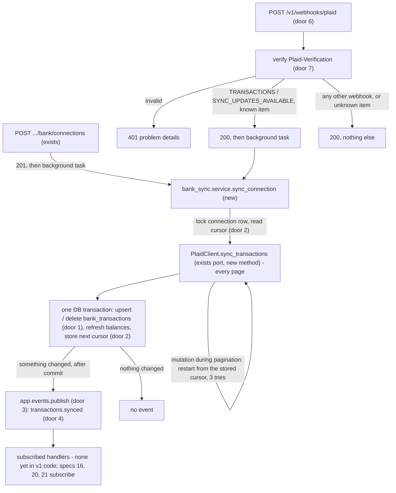
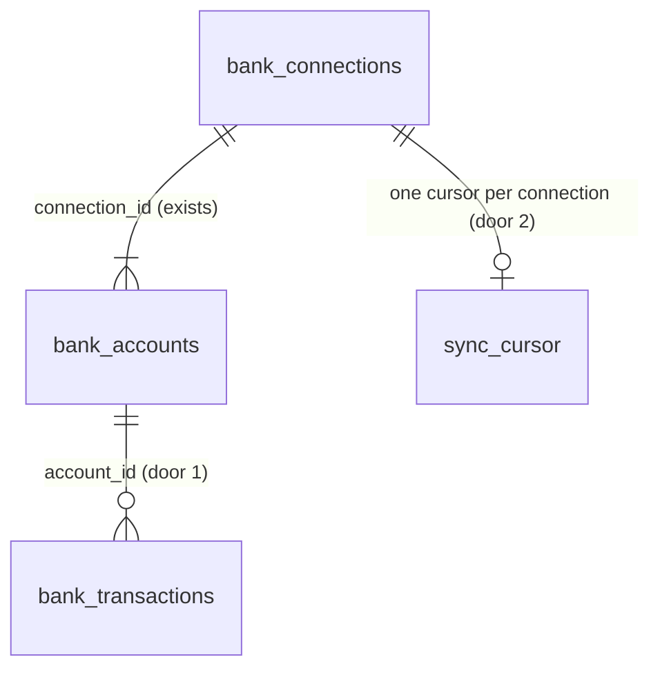

# 14 - Transaction sync

## Problem

After onboarding step 3, a business's banks and accounts are stored, but none of its transactions are, and each account's balance is frozen at the moment the bank was connected. Every later piece of Headroom reads transactions: labels (spec 16), recurring payments (spec 19), matching expected payments (spec 20), the forecast (spec 21) and its accuracy (spec 22). Without them the forecast has nothing to project from, and cash on hand never moves after day one. Plaid reports transactions as a stream of changes - added, modified, removed - and a pending charge later reappears as a different, posted transaction, so a naive copy double-counts money or keeps charges the bank has since cancelled. Plaid also reports money out as a positive amount, the opposite of AGENTS.md's sign rule. Nothing today receives Plaid's notice that new data is ready, and the modules have no way to tell each other that data changed (AGENTS.md names the in-process event bus as the mechanism, and this spec as the one that adds it). The spec gives no figures beyond its four "Done when" items.

When this ships, connecting a bank pulls up to 24 months of history for every account in the background. Each later Plaid notice pulls only what changed. Every transaction is stored once, in cents, signed money-in positive, with its date, pending flag, counterparty and category; a pending charge that posts is stored once, and one the bank drops disappears. Every account's balance and available amount are refreshed after each sync, and the other modules hear `transactions.synced` whenever something changed. Nothing new is visible on any screen yet.

## Flow

This reuses spec 12's `PlaidClient` port and its one error type (AD-036), `decrypt_access_token` (AD-038), `to_cents` and `account_type` from `bank_sync.service`, the `bank_connections` and `bank_accounts` tables (AD-037, AD-040 to AD-042), the structured logger with `redact` (AD-009), the AD-008 problem details, and the session dependency in `app.db`. It adds no second Plaid client and no second rounding rule.

1. Connect (exists, AD-039) -> after the `201` is sent, a background task runs `sync_connection` for the new connection. Plaid only starts sending `SYNC_UPDATES_AVAILABLE` after the first `/transactions/sync` call, so this first call is what switches webhooks on.
2. `POST /v1/webhooks/plaid` (new, door 6) -> no Clerk token; `Plaid-Verification` verified (door 7) before the body is parsed for anything else -> for `TRANSACTIONS` / `SYNC_UPDATES_AVAILABLE`, the connection is found by `item_id` (the one lookup with no `business_id`, because the webhook carries none; everything after it is scoped to the connection's business) -> `200`, then a background task runs `sync_connection`.
3. `bank_sync.service.sync_connection` (new, placement) -> locks the connection row (`SELECT ... FOR UPDATE`), reads its cursor, decrypts the token, calls `PlaidClient.sync_transactions` (new port method, placement) page by page until `has_more` is false, restarting the whole loop from the stored cursor on `TRANSACTIONS_SYNC_MUTATION_DURING_PAGINATION`.
4. Same function, one transaction -> normalizes each transaction (sign flipped here and only here), upserts by Plaid transaction ID, deletes removed ones and any pending row a posted transaction replaces, adds accounts Plaid reports that are not stored yet, refreshes every account's balance and available amount from the last page, stores `next_cursor`, commits.
5. After commit -> if any row or balance changed, `app.events.publish` (new, door 3) delivers `transactions.synced` (door 4) to subscribers; out: a log line `bank_sync.synced` with counts only.

## Impact

| Front | What changes |
| --- | --- |
| domain | new term: `transaction` - one bank transaction, stored once per Plaid transaction ID, amount in signed cents (money in positive). Lives in `bank_transactions` in `bank_sync`. Specs 16, 19, 20, 21, 22 read it through `bank_sync.service` |
| domain | new term: `sync` - pulling every change since the connection's stored cursor and applying it. `sync_connection` is what spec 15's job calls and spec 17's repair re-runs |
| domain | new term: `event` - an `app.events.Event` published after a commit. First one is `transactions.synced`; AGENTS.md lists the five others later specs publish |
| domain | existing term: `balance_cents` / `available_cents` meant "as reported at connect"; now "as of the last sync". Read today by the connections list (AD-043) and the step 3 accounts screen; both just show fresher numbers |
| API auth | AD-022 says every `/v1` route requires a Clerk token. `POST /v1/webhooks/plaid` cannot: Plaid sends none. Door 6 adds one public `/v1` router for webhooks only, signature-verified; AD-022 is superseded by AD-049, which keeps it for everything else. `tests` that walk every `/v1` route for `401` must list the webhook as the one exception |
| Plaid Link | `create_link_token` now passes `webhook` = `PLAID_WEBHOOK_URL` when that setting is set (door 8). Items connected before this ship, and every local item, have no webhook; they sync on connect and, from spec 15, nightly |
| settings | new optional `PLAID_WEBHOOK_URL`. Staging needs it set to `https://api-staging-e068.up.railway.app/v1/webhooks/plaid` (Railway variable on `api`, user action) |
| API contract | one new route; `contracts/openapi.json` and `schema.d.ts` regenerated. No existing response changes |
| stored data | new table `bank_transactions`; `bank_connections` gains a nullable cursor column. Existing connections start with no cursor, so their first sync pulls full history. Nothing to backfill. Local and staging only; no production data yet |

## Relations

One-way constraints: a transaction is unique by its Plaid transaction ID (door 1); every transaction belongs to one stored account and carries that account's `business_id` (door 1); a removed transaction is deleted, not flagged (door 1); the cursor lives on the connection, one per connection (door 2).

## Surface

| Route | In | Out | Status |
| --- | --- | --- | --- |
| `POST /v1/webhooks/plaid` | header `Plaid-Verification` (JWT); raw JSON body with `webhook_type`, `webhook_code`, `item_id` | `{"status": "ok"}` | `200`, `401`, `422`, `502` |

## Landing

| One-way door | Literal shape | Alternative rejected |
| --- | --- | --- |
| 1. Table `bank_transactions` | `id uuid` app-generated; `business_id uuid` (no FK, AD-037 precedent); `account_id` FK `bank_accounts.id`; `plaid_transaction_id text` unique as `uq_bank_transactions_plaid_transaction_id`; `amount_cents bigint not null` = `-to_cents(plaid.amount)`; `currency text not null` (ISO, else Plaid's unofficial code); `date date not null` (Plaid `date`); `pending boolean not null`; `description text not null` (Plaid `name`); `counterparty text` null (first of `counterparties[].name`, else `merchant_name`); `category text` null and `category_detailed text` null (Plaid `personal_finance_category.primary` / `.detailed`); `created_at`, `updated_at` `timestamptz`. A removed transaction is deleted (hard delete) | Soft delete with `removed_at`: every reader (specs 16, 19, 20, 21) would have to remember the filter, and a forgotten one double-counts; the spec says "removed". Storing Plaid's raw transaction JSON: AGENTS.md keeps raw provider data out of everything we return, and specs 16-22 need only these fields. Storing Plaid's legacy `category` array: deprecated by Plaid in favour of `personal_finance_category`. Closes: recovering a removed transaction - only a fresh full sync can |
| 2. Sync cursor | `bank_connections.transactions_cursor text` null; null means "never synced" and is sent to Plaid as no cursor (full history); updated only in the same transaction that applies the changes it covers | A separate `bank_sync_state` table: one row per connection either way, and spec 15's status fields can join the connection row too. Storing the cursor per page: a crash mid-update would leave a cursor that skips the pages not yet applied |
| 3. In-process event bus | `app/events.py`: `@dataclass(frozen=True) class Event: name: str; business_id: uuid.UUID; payload: Mapping[str, str \| int \| bool]`; `subscribe(name: str, handler: Callable[[Event], None]) -> None`; `publish(event: Event) -> None` runs that name's handlers synchronously in subscription order; a handler that raises is logged as `event.handler_failed` (name, handler, error type only) and the rest still run; `publish` is called only after the publisher's commit; payload values are JSON scalars so a queue can carry them unchanged later | An async queue or Postgres `LISTEN/NOTIFY` now: project-overview says one application first, and the queue comes after clients confirm. Exceptions propagating to the publisher: the data is already committed, so a failing subscriber would turn a successful sync into a `500` and a webhook retry. Handlers receiving ORM objects: a split-out module could not receive them |
| 4. Event `transactions.synced` | `Event(name="transactions.synced", business_id=<business>, payload={"connection_id": "<uuid>", "added": int, "modified": int, "removed": int, "balances_changed": bool})`; published once per sync that changed at least one transaction or balance; never published by a sync that changed nothing | One event per transaction: spec 21 recomputes per business, so N events would mean N forecasts. A payload with transaction IDs: subscribers re-read through `bank_sync.service`, and IDs would make the payload unbounded |
| 5. `PlaidClient` sync method | `sync_transactions(access_token: str, cursor: str \| None) -> SyncPage` with plain dataclasses `SyncPage(added: list[PlaidTransaction], modified: list[PlaidTransaction], removed: list[str], accounts: list[PlaidAccount], next_cursor: str, has_more: bool)`; request `count=500`, `options.include_personal_finance_category=True`; `TRANSACTIONS_SYNC_MUTATION_DURING_PAGINATION` surfaces as the existing `PlaidError` with that `error_code` | Returning `plaid-python` models: AD-036 forbids it. Fetching all pages inside the port: the restart rule needs the caller's original cursor, and a fake per page is what lets tests drive pagination and mutation |
| 6. Public webhook router | `app/main.py`: `webhooks = APIRouter(prefix="/v1/webhooks")`, no `current_user` dependency, included next to the `v1` router; only `bank_sync`'s `webhook_router` is included in it; route `POST /v1/webhooks/plaid` | Putting the route on the `v1` router with an override: AD-022's point is that no `/v1` route can be public by accident, and an override is exactly that accident. A path outside `/v1` (`/webhooks/plaid`): the spec names `/v1/webhooks/plaid`, and AGENTS.md puts every route under `/v1`. Supersedes AD-022 as AD-049 |
| 7. Webhook verification | Per Plaid's docs: JWT from `Plaid-Verification`; header `alg` must be `ES256`; key fetched by header `kid` through a new port method `get_webhook_verification_key(key_id) -> dict` (JWK) via `/webhook_verification_key/get`, cached in-process by `kid`, refused when `expired_at` is set and past; decoded with PyJWT `algorithms=["ES256"]`; `iat` no more than 300 seconds old; `request_body_sha256` equal to `sha256(raw body)` by `hmac.compare_digest`. Any failure is `401` problem details, detail `"Invalid webhook signature."`; a key fetch that fails at Plaid is `502` so Plaid retries | Plaid's legacy HMAC header: not offered; Plaid signs with ES256 JWTs. Skipping the key cache: one Plaid call per webhook doubles the work and the failure surface. Verifying after parsing the body: a forged body would reach the JSON parser and the item lookup first |
| 8. Link token webhook URL | Setting `plaid_webhook_url: str \| None = None` (`PLAID_WEBHOOK_URL`); `LinkTokenRequest` gains `webhook: str \| None`; passed to `link_token_create` only when set | Hard-coding the staging URL: production and staging differ. Required setting: local runs have no public URL, and connect must still work there. `/item/webhook/update` for existing items: only sandbox items exist; reconnecting them is cheaper than code no client needs |

- Every door reaches past this feature and is recorded as AD-045 to AD-050 in `.specs/STATE.md`: door 1 AD-045, door 2 AD-046, door 3 AD-047, door 4 AD-048, doors 6 and 7 AD-049 (supersedes AD-022), doors 5 and 8 AD-050 (extends AD-036).
- Nothing else in this change is hard to reverse.

## Criteria

### S1: A sync stores every transaction once, signed and normalized (P1)

Running `sync_connection` on a connection stores its transactions and balances, and running it again changes nothing.

**Acceptance Criteria**

1. WHEN `sync_connection` runs on a connection with no cursor THEN the system SHALL call Plaid's sync with no cursor and store every transaction from every page until `has_more` is false.
2. The system SHALL store each transaction's amount as `-to_cents(plaid amount)`, so a Plaid amount of `12.34` is stored as `-1234` and `-500.00` as `50000`.
3. The system SHALL store each transaction's currency as Plaid's `iso_currency_code`, or its `unofficial_currency_code` when the ISO code is null.
4. IF a transaction has neither currency code THEN the system SHALL fail the sync with `PlaidError` (`INVALID_RESPONSE` / `NO_CURRENCY`) and store nothing from it, including the cursor.
5. The system SHALL store each transaction's `date` as Plaid's `date` (a date, not a datetime) and its `pending` flag as Plaid's `pending`.
6. The system SHALL store `description` as Plaid's `name`, `counterparty` as the first `counterparties[].name` or else `merchant_name` or else null, and `category` / `category_detailed` as `personal_finance_category.primary` / `.detailed` or null.
7. The system SHALL store each transaction with the `account_id` of the stored account whose Plaid account ID matches, and that account's `business_id`.
8. IF a page reports an account that is not stored THEN the system SHALL add it to the connection with `included` false and `is_primary` false, then store its transactions.
9. WHEN a sync finishes THEN the system SHALL set every account Plaid reports in the last page to `balance_cents = to_cents(current)` and `available_cents = to_cents(available)`.
10. WHEN a sync finishes THEN the system SHALL store Plaid's last `next_cursor` on the connection in the same transaction as the changes.
11. WHEN `sync_connection` runs again after a sync and Plaid reports no changes THEN the system SHALL leave every transaction, balance and the cursor unchanged and publish no event.
12. WHEN the same added transaction is applied twice (same Plaid transaction ID) THEN the system SHALL hold exactly one row for it, with the latest values.
13. WHEN Plaid reports a transaction as modified THEN the system SHALL update the stored row to the new values, keeping its `id`.

**Independent test:** with a fake Plaid client returning two pages, run `sync_connection` twice and read `bank_transactions`, the cursor and the balances.

### S2: Pending, removed and failed syncs leave the right data (P1)

Pending charges that post appear once, removed ones disappear, and a failed sync leaves nothing half-applied.

**Acceptance Criteria**

14. WHEN Plaid reports a transaction ID as removed THEN the system SHALL delete the stored transaction with that Plaid transaction ID.
15. IF a removed transaction ID is not stored THEN the system SHALL ignore it and continue the sync.
16. WHEN an added posted transaction carries a `pending_transaction_id` that is stored THEN the system SHALL delete that pending row, so the transaction appears once, even when the removal of the pending ID is not in the same page.
17. IF Plaid answers `TRANSACTIONS_SYNC_MUTATION_DURING_PAGINATION` THEN the system SHALL discard the pages fetched so far and restart from the stored cursor, at most 3 attempts in total.
18. IF the sync still fails after 3 attempts, or Plaid fails with any other error THEN the system SHALL raise `PlaidError`, roll back, and leave every transaction, balance and the cursor as they were before the sync.
19. WHILE one sync of a connection is running, WHEN a second sync of the same connection starts THEN the system SHALL wait for the first to commit and then sync from the cursor it stored.

**Independent test:** a fake Plaid client scripted with a pending add, then a removal plus a posted add with `pending_transaction_id`, then a mutation error; check row counts after each sync.

### S3: Other modules hear that data changed (P1)

The event bus exists and `transactions.synced` is published exactly when a sync changed data.

**Acceptance Criteria**

20. WHEN a sync commits at least one added, modified or removed transaction, or a changed balance THEN the system SHALL publish one `transactions.synced` event with the connection's `business_id` and payload `connection_id`, `added`, `modified`, `removed`, `balances_changed`.
21. The system SHALL publish `transactions.synced` only after the sync's transaction commits.
22. WHEN an event is published THEN the system SHALL call every handler subscribed to that event name, in subscription order, and no handler subscribed to another name.
23. IF a subscribed handler raises THEN the system SHALL log `event.handler_failed` with the event name, the handler name and the error type, call the remaining handlers, and not raise to the publisher.

**Independent test:** subscribe a recording handler and a raising handler in a test; run a changing sync and a no-op sync; read what was recorded.

### S4: Plaid's webhook triggers a sync, and only Plaid can trigger it (P1)

`POST /v1/webhooks/plaid` accepts only correctly signed requests and syncs the item it names.

**Acceptance Criteria**

24. IF the `Plaid-Verification` header is missing, not a JWT, or its `alg` is not `ES256` THEN the system SHALL answer `401` problem details with detail `"Invalid webhook signature."` and start no sync.
25. IF the JWT signature does not verify with the key for its `kid` THEN the system SHALL answer `401` with the same detail and start no sync.
26. IF the JWT `iat` is more than 300 seconds before the request THEN the system SHALL answer `401` with the same detail and start no sync.
27. IF the SHA-256 of the raw request body does not equal the JWT's `request_body_sha256` THEN the system SHALL answer `401` with the same detail and start no sync.
28. IF the key for the `kid` has an `expired_at` in the past THEN the system SHALL answer `401` with the same detail and start no sync.
29. IF Plaid fails or times out while fetching the verification key THEN the system SHALL answer `502` problem details and start no sync.
30. WHEN two webhooks carry the same `kid` THEN the system SHALL fetch that key from Plaid once.
31. WHEN a verified webhook has `webhook_type` `TRANSACTIONS` and `webhook_code` `SYNC_UPDATES_AVAILABLE` for a stored item THEN the system SHALL answer `200` `{"status": "ok"}` and then run `sync_connection` for that connection.
32. WHEN a verified webhook has any other type or code, or an `item_id` that is not stored THEN the system SHALL answer `200` `{"status": "ok"}` and start no sync.
33. IF a verified webhook body is not a JSON object with string `webhook_type`, `webhook_code` and `item_id` THEN the system SHALL answer `422` problem details and start no sync.
34. The system SHALL accept `POST /v1/webhooks/plaid` with no `Authorization` header, and every other `/v1` route SHALL still answer `401` without one.
35. IF the background sync started by a webhook fails THEN the system SHALL log `bank_sync.sync_failed` with the connection ID, `error_type`, `error_code` and `request_id`, and the webhook response SHALL already have been `200`.

**Independent test:** sign webhook bodies in a test with a generated ES256 key served by the fake Plaid client; post valid, tampered, stale and unsigned requests.

### S5: Connecting a bank starts the first sync, and webhooks are switched on (P1)

A new connection pulls its history without waiting for a webhook or the nightly job.

**Acceptance Criteria**

36. WHEN `POST /v1/businesses/{business_id}/bank/connections` answers `201` THEN the system SHALL run `sync_connection` for the new connection after the response is sent.
37. IF that first sync fails THEN the connect response SHALL still be `201` and the system SHALL log `bank_sync.sync_failed`.
38. WHERE `PLAID_WEBHOOK_URL` is set the system SHALL send it as `webhook` in every link token request, and WHERE it is unset the system SHALL send no `webhook`.

**Independent test:** connect with the fake Plaid client and read the stored transactions; create link tokens with and without the setting and read the fake's recorded request.

### S6: Real sandbox data comes in signed correctly (P1)

Against the Plaid sandbox, the "Done when" items hold on real provider data.

**Acceptance Criteria**

39. WHEN a sandbox item (`ins_42`, `user_good`) is synced THEN the system SHALL store every sandbox transaction with `amount_cents` equal to `-to_cents` of the amount Plaid returned for it, and the stored set SHALL contain at least one positive and one negative amount.
40. WHEN the same sandbox item is synced a second time with no new sandbox activity THEN the system SHALL change no transaction row and publish no event.

**Independent test:** `pytest -m plaid_sandbox` creates a sandbox item through `/sandbox/public_token/create`, syncs it until Plaid's historical update is complete, and syncs again.

### S7: Bank data stays private (P1)

Nothing this feature adds leaks tokens, raw provider data, or another business's data.

**Acceptance Criteria**

41. The system SHALL never log, return or include in an event the access token, the `Plaid-Verification` header, the webhook body, or any Plaid transaction field; sync logs SHALL carry only IDs, counts and Plaid's `error_type`, `error_code`, `request_id`.
42. The system SHALL store each transaction with the `business_id` of its account's connection, so a sync of business A's connection never writes a row with business B's `business_id`.
43. The system SHALL read and write transactions only through `bank_sync.repository` functions that require a `business_id`, except the webhook's single lookup of a connection by Plaid item ID.

**Independent test:** run a sync and a webhook with `structlog` capture and assert no secret or transaction field appears; sync two businesses' connections and check each row's `business_id`.

## Out of scope

| Excluded | Why |
| --- | --- |
| An API route that lists transactions | No v1 screen shows transactions yet; spec 18's "available through the API" check and later specs add the read route they need |
| Scheduled and retried syncs, one-sync-per-connection across job runs, "needs attention" status | Spec 15 |
| Handling `ITEM` webhooks (login required, pending expiration, new accounts) and Link update mode | Spec 17 |
| Transaction labels (transfers, card activity) | Spec 16 |
| `/accounts/balance/get` for real-time balances | A billed product; the balances in the sync response are what spec 14 asks for |
| `/item/webhook/update` for items connected before this ships | Only sandbox items exist; they can be reconnected |
| Subscribers to `transactions.synced` | Specs 16, 20 and 21 add them |

## Assumptions

| Assumption | Chosen default | Rationale | Confirmed? |
| --- | --- | --- | --- |
| Balance source after a sync | The `accounts` array of the last `/transactions/sync` page | Free with the sync call; `/accounts/balance/get` is billed per call, and the spec only asks for the latest balance after each sync | n |
| Webhook sync timing | FastAPI `BackgroundTasks`: answer `200` first, sync after, in the same process | A full-history first sync can outlast Plaid's webhook response window; a lost background task is caught by spec 15's nightly sync. No queue in v1 (project-overview) | n |
| Accounts that appear only in a sync | Stored with `included` false, not primary | Silently counting a new account as cash would change the forecast without the owner choosing; spec 17's settings page lets them include it | n |
| Concurrency between two syncs of one connection | Row lock on the connection for the sync's duration, held across the Plaid calls | The second sync then starts from the first one's cursor, so it is a no-op; Plaid calls have a 15-second timeout (AD-036), which bounds the wait. Spec 15 may switch its job to `SKIP LOCKED` | n |
| Restart limit on mutation during pagination | 3 attempts | Plaid gives no number; three restarts of the whole loop is enough for a transient update and bounds the work | n |
| Category vocabulary | Plaid `personal_finance_category` v1 (the SDK default) | Plaid's current taxonomy; the legacy `category` array is deprecated | n |

**Open questions:** none - all resolved or logged above. `PLAID_WEBHOOK_URL` is set on staging `api` to `https://api-staging-e068.up.railway.app/v1/webhooks/plaid` (user, 2026-10-05); production gets it in spec 34.

## Observable

| Surface | Decision | Landing |
| --- | --- | --- |
| API `POST /v1/webhooks/plaid` | response shape | AC 31, 32 |
| API `POST /v1/webhooks/plaid` | error shape and codes | AC 24-29, 33 (AD-008 problem details) |
| API `POST /v1/webhooks/plaid` | who may call it | AC 24-28, 34 - only a request signed by Plaid's current key |
| API `POST /v1/webhooks/plaid` | versioning | existing - under `/v1` like every route (AGENTS.md) |
| API `POST /v1/webhooks/plaid` | rate limit | n/a - Plaid is the only caller that passes AC 24-28; unsigned floods are rejected before any database or Plaid call except the cached key fetch |
| API `POST /v1/webhooks/plaid` | duplicate deliveries | AC 11, 19 - a repeated webhook runs a sync that finds no changes |
| API `POST .../bank/connections` (exists) | response unchanged, first sync added | AC 36, 37 |
| command `sync_connection` | output | AC 20, 35 and the `bank_sync.synced` log line with counts (AC 41) |
| command `sync_connection` | what it does when it fails halfway | AC 18 |
| collection `bank_transactions` | duplicates | AC 12, 16 |
| collection `bank_transactions` | ordering, grouping | n/a - nothing reads the collection in this spec; readers order it |
| screen | any state | None - no screen in this spec |

## Sources

- `context/specs/14-bank-transaction-sync.md` - the build list and the four "Done when" items
- `AGENTS.md` - sign rule (flip once, in `bank_sync`), money in cents with currency, event naming and idempotency, webhook signature before any work, no raw provider data in logs
- Plaid docs: [Transactions](https://plaid.com/docs/transactions/) (sync, pagination restart, pending-to-posted), [Webhook verification](https://plaid.com/docs/api/webhooks/webhook-verification/) (ES256, `kid`, `iat` 5 minutes, `request_body_sha256`)
