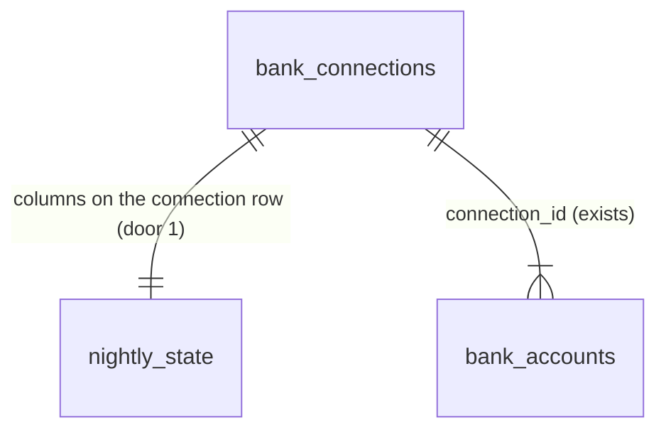

# 15 - Nightly sync job

## Problem

A business's transactions and balances change only when Plaid sends a `SYNC_UPDATES_AVAILABLE` webhook (spec 14) or when the bank is first connected. A webhook Plaid never sends, one our API misses during a deploy, or a background sync that fails (spec 14 logs `bank_sync.sync_failed` and stops there) leaves that bank's data stale with nothing to bring it back. Items connected before `PLAID_WEBHOOK_URL` existed, and every local item, never receive webhooks at all. Owners pay for this: the forecast (spec 21) projects from stale cash and stale history without saying so. Nobody learns that a connection keeps failing: no record of repeated failures exists, so spec 17's "needs attention" banner and spec 21's "incomplete forecast" have nothing to read. The spec gives no figures beyond its two "Done when" items.

When this ships, an hourly Railway `jobs` service syncs every bank once a night, at the first hourly run at or after 2 AM in the business's own time zone. A failed nightly sync is retried later that night, with a longer wait each time. A connection that fails 3 nights in a row is flagged as needing attention, and `bank_sync.service` exposes that flag. Two runs at the same moment never sync one connection twice. Nothing new is visible on any screen yet.

## Flow

This reuses spec 14's `sync_connection` path (AD-046), with its pagination restart and its single apply transaction. It also reuses the connection row lock, `PlaidClient` and `get_plaid_client` (AD-036), the `transactions.synced` publish after commit (AD-047, AD-048), `configure_logging` and `init_sentry` (AD-009, AD-010), and the `bank_sync.sync_failed` log line. It adds no second sync path and no second Plaid client.

1. Railway cron `0 * * * *` -> service `jobs` (door 5) runs `python -m app.jobs.run_due` -> configures logging and Sentry, registers event subscriptions (door 6), takes `now` as the current UTC time, and runs each registered job (door 3).
2. Nightly sync job -> `bank_sync.service` (exists) lists every connection with its nightly state. This is the job's one cross-business read, alongside spec 14's webhook item lookup. It gets each business's time zone through a new public function in `accounts.service` (exists) and keeps the connections whose night is due (door 2).
3. For each due connection, `bank_sync.service` takes a fresh transaction and locks the row `FOR UPDATE SKIP LOCKED` (door 4). It re-checks that the night is still due under the lock, then runs the spec 14 sync inside a savepoint.
4. The same transaction records the outcome on the connection (door 1): either the night is finished, or the failed attempt is counted and the next attempt time is set. It commits, and after the commit `transactions.synced` is published when data changed (exists).
5. Out: one `jobs.run_finished` log line with counts, a `bank_sync.sync_failed` line for each failure, exit code `0`, and the database engine disposed.

## Impact

| Front | What changes |
| --- | --- |
| domain | new term: `night` - for a business, the period from 02:00 local time to 01:59 the next day. Its date is the local date at 02:00. It lives in `bank_sync`. Specs 17 and 21 read only its result, `needs_attention` |
| domain | new term: `needs attention` - a connection whose nightly sync failed on 3 consecutive nights. `bank_sync.service` derives it from a counter; spec 17 shows it, and spec 21 marks the forecast incomplete from it |
| domain | existing term: `sync_connection` (spec 14) committed and rolled back on its own. Its apply step is now also callable inside a caller's transaction and savepoint, so the job can hold the row lock while it records the outcome. The webhook and connect callers (`sync_in_background`) keep today's behaviour. A successful sync from any caller now also clears the failed-nights counter |
| module boundary | `accounts.service` gains one public function: the time zone of each business in a list. `bank_sync` calls it; it is the first call from `bank_sync` into `accounts.service` |
| event subscriptions | a nightly sync publishes `transactions.synced` in the `jobs` process, not the API process. Handlers from specs 16, 20 and 21 must be registered in both, through one function (door 6) |
| settings | none new. `jobs` loads the same `Settings` as `api`, including `CLERK_JWT_KEY`, which it never uses (AD-001's single settings class) |
| Railway | new service `jobs` in project `headroom` / `staging` (AD-005 already names it). Railway skips a run while the previous one is still running, and starts runs "a few minutes" late (Railway docs). `api`'s pre-deploy step migrates the database, and `jobs` does not. A `jobs` run can start before a deploy's migration finishes; that run fails, and the next hour's run succeeds |
| time zones | tzdata 2026.4 (the installed `tzdata`) keeps British Columbia on UTC−7 from 2026-11-01, so `America/Vancouver` and `America/Whitehorse` no longer change clocks. Door 2's spring-forward example now applies to St. John's and the other DST zones only; the night rule is the same for every zone |
| stored data | `bank_connections` gains nightly-state columns (door 1), with defaults that make every existing connection "never synced nightly, no failures". A connection is first due at the 02:00 after it was created. Nothing to backfill. Local and staging only; no production data yet |

## Relations

One-way constraints: a connection has exactly one nightly state, held on its own row, so the row lock that serializes syncs (AD-046) also serializes outcome writes (doors 1, 4). The failed-nights count is never negative (door 1). `needs_attention` is derived from the count and never stored on its own (door 1). No columns or types here.

## Surface

None - nothing consumed outside. The job is a command run by Railway, not a route. `needs_attention` reaches no response until spec 17.

## Landing

| One-way door | Literal shape | Alternative rejected |
| --- | --- | --- |
| 1. Nightly state on `bank_connections` | `nightly_synced_on date` null: the night date last finished, whether it succeeded or ran out of attempts. `nightly_attempts integer not null default 0`: failed attempts in the current night. `next_nightly_attempt_at timestamptz` null. `failed_nights integer not null default 0` with `ck_bank_connections_failed_nights` (`failed_nights >= 0`). `needs_attention` = `failed_nights >= 3`, a property in `bank_sync.service`, not a column | A `sync_runs` history table: it grows every night, and nothing in v1 reads history. A stored `needs_attention` boolean: a second source of truth that can disagree with the counter. Spec 17 can add a reason column for `ITEM_LOGIN_REQUIRED` beside it. A separate `bank_sync_state` table: one row per connection either way, and the outcome must be written under the connection's own row lock (door 4) |
| 2. Night boundary | night date = `(now.astimezone(ZoneInfo(business.time_zone)) - timedelta(hours=2)).date()`. A connection is due when its night date is later than the night date of its `created_at` and later than `nightly_synced_on` (or that is null), and `next_nightly_attempt_at` is null or `<= now` | Matching "local hour == 2": Railway may skip a run while the previous one is still running, or start it late, and on the spring-forward day 02:00 does not exist in Vancouver or St. John's, so those nights would be missed. Storing a UTC `next_nightly_sync_at` per connection: it goes wrong when the owner changes the time zone (spec 11's `PATCH`), because nothing in `bank_sync` hears about that change |
| 3. Job runner pattern | `app/jobs/run_due.py`: `main() -> int` (the `python -m` entry point) and `run_due(now: datetime) -> RunSummary`. `app/jobs/__init__.py` declares `JOBS: tuple[Job, ...]` with `Job = Callable[[datetime], JobResult]`. Each job decides for itself what is due at `now`, must give the same result if it runs twice, and a job that raises is logged as `jobs.job_failed` (job name, error type) while the other jobs still run. Spec 15 registers one job, `nightly_bank_sync` | One Railway cron service per job: every service needs its own variables, and the spec names one `jobs` service. A scheduler inside the API (APScheduler): each API replica would run every job, and AGENTS.md says the jobs service runs hourly and exits. A `--now` command-line flag: tests call `run_due(now)` directly, and a production flag that rewinds the clock is a footgun |
| 4. One sync per connection across runs | For each candidate: a new session runs `SELECT ... FROM bank_connections WHERE business_id = :b AND id = :c FOR UPDATE SKIP LOCKED`. If no row comes back, the connection is counted `skipped_locked` and left due. Otherwise it re-checks due (door 2) under the lock, runs the sync in `session.begin_nested()`, writes the outcome (door 1) and commits once. The webhook and connect path keep their blocking `FOR UPDATE` (AD-046). Extends AD-046 | A lease column (`claimed_until`): needs a tuned expiry, and a crashed run blocks the connection until it expires. Postgres advisory locks: a separate lock from the row lock the webhook path takes, so a webhook sync and a nightly sync could run at the same time. Blocking `FOR UPDATE` in the job: a second run would wait for the whole first sync before re-checking, and Railway's overlap skip already shows waiting is the wrong default |
| 5. Railway `jobs` service | In `.railway/railway.ts`: `service("jobs", { source: github(REPO, { branch: "development", rootDirectory: "/services/core", checkSuites: true }), build: { builder: "RAILPACK", watchPatterns: ["/services/core/**"] }, start: "python -m app.jobs.run_due", deploy: { cronSchedule: "0 * * * *", restartPolicyType: "NEVER" }, replicas: { [US_EAST]: 1 }, env: { <each api variable the settings need>: "${{api.<NAME>}}" } })`, with no healthcheck and no pre-deploy step. Added to `project("headroom").resources` | `restartPolicyType` `ON_FAILURE`: Railway would rerun a failed job at once, which defeats the backoff (AC 13) and adds runs. Copying secret values into `jobs`: two copies drift. References to `api` keep one source. A pre-deploy `alembic upgrade head` on `jobs`: two services would race the same migration. Recorded as an AD-005 extension |
| 6. Event subscription registration | `app/subscriptions.py`: `register() -> None`, which subscribes every v1 handler and does nothing if it already ran (empty today). It is called from the API `lifespan` and from `run_due.main()`. Later specs (16, 20, 21) add their `subscribe` calls only there | Subscribing at module import: import order decides who is subscribed, and test reloads subscribe twice. Registering in `lifespan` only: the jobs process never runs `lifespan`, so every nightly sync would publish to nobody |

| 7. `jobs` `DATABASE_URL` (found while writing the checks) | `jobs` gets AD-006's literal template `postgresql+psycopg://${{Postgres.PGUSER}}:${{Postgres.PGPASSWORD}}@${{Postgres.PGHOST}}:${{Postgres.PGPORT}}/${{Postgres.PGDATABASE}}`, not `${{api.DATABASE_URL}}`. Every other variable stays an `api` reference (door 5) | `${{api.DATABASE_URL}}`: `api`'s value is itself made of references, and Railway's variables docs do not say whether a reference to a reference resolves. An unresolved URL would fail every run. The template references `Postgres` directly, the way `api` does |
- Recorded in `.specs/STATE.md`: door 1 AD-051, door 2 AD-052, door 4 AD-053, doors 5 and 7 AD-054, door 6 AD-055, door 3 AD-056.
- Nothing else in this change is hard to reverse. The retry delays are constants (see Assumptions).

## Criteria

### S1: Every business's banks sync once a night, around 2 AM local time (P1)

Run hourly on a simulated clock, the job syncs each connection exactly once per local night.

**Acceptance Criteria**

1. WHEN `run_due(now)` runs and a connection's night is due (door 2) THEN the system SHALL run the spec 14 sync for that connection once.
2. WHEN `run_due(now)` runs again later in the same night, after that connection's nightly sync finished THEN the system SHALL not sync it.
3. WHEN `run_due` is called at minute 0 of every UTC hour from 2026-10-25T00:00Z to 2026-11-08T00:00Z THEN a connection of an `America/Vancouver` business SHALL be synced exactly once per local night, each time at 02:00 local, and one of an `America/St_Johns` business exactly once per local night, each time at 02:30 local. The window includes the 2026-11-01 fall-back.
4. WHEN `run_due` is called at minute 0 of every UTC hour from 2027-03-07T00:00Z to 2027-03-21T00:00Z THEN each of those two connections SHALL be synced exactly once per local night. The window includes the 2027-03-14 spring-forward, when 02:00 local does not exist.
5. WHEN `run_due` is called hourly for 3 days THEN a connection of a business in each of the 8 time zones in AD-029 SHALL be synced exactly once per local night.
6. IF no run happened at or after 02:00 local until a later hour of the same night THEN the first later run in that night SHALL sync the connection.
7. WHEN a connection was created during the current night THEN the system SHALL not sync it nightly before the next 02:00 local.
8. The system SHALL sync each due connection with its own `business_id`, and SHALL read connections across businesses only in the one function the nightly job uses.

**Independent test:** in pytest, create businesses in Vancouver and St. John's with a fake Plaid connection each, call `run_due` for every hour of the windows, and count the syncs per local night.

### S2: Overlapping runs never sync the same connection twice (P1)

Two runs at the same moment split the connections between them, and none is synced twice.

**Acceptance Criteria**

9. WHILE another transaction holds a connection's row lock (a job run, or a webhook or connect sync) the job SHALL skip that connection without waiting, count it as `skipped_locked`, and leave it due for a later run.
10. WHEN two `run_due` calls run concurrently against the same due connections THEN the system SHALL call Plaid's sync for each connection in exactly one of them, and set that connection's `nightly_synced_on` once.
11. WHEN a run takes a connection's lock after another run committed that night's outcome THEN the system SHALL see the night as finished and not sync it.
12. The system SHALL write a nightly outcome in the same transaction that holds the connection's row lock during the sync.

**Independent test:** two threads with their own sessions call `run_due` at the same `now`, against a fake Plaid client that blocks inside the sync until both threads have started; count the sync calls per connection.

### S3: Failed syncs are retried, and repeated failures are flagged (P1)

A failed nightly sync is retried with a growing wait, and a connection that fails 3 nights in a row is flagged.

**Acceptance Criteria**

13. IF a nightly sync fails THEN the system SHALL leave the connection's transactions, balances and cursor as they were, add 1 to `nightly_attempts`, and set `next_nightly_attempt_at` to `now` plus 1 hour after the 1st failure, 2 hours after the 2nd, and 4 hours after the 3rd.
14. WHILE `next_nightly_attempt_at` is later than `now` the job SHALL not sync that connection.
15. IF the 4th attempt of a night fails THEN the system SHALL mark that night finished (`nightly_synced_on`), add 1 to `failed_nights`, and reset `nightly_attempts` and `next_nightly_attempt_at` for the next night.
16. WHEN `failed_nights` reaches 3 THEN `bank_sync.service` SHALL report the connection as `needs_attention` true.
17. WHEN any sync of the connection succeeds (nightly, webhook or connect) THEN the system SHALL set `failed_nights` to 0, so `needs_attention` is false.
18. WHEN a nightly sync succeeds THEN the system SHALL mark the night finished and reset `nightly_attempts` and `next_nightly_attempt_at`.
19. IF a sync raises `PlaidError` or any other exception THEN the system SHALL count it as a failed attempt for that connection only and continue with the other due connections.

**Independent test:** a fake Plaid client that always fails; run hourly across 3 nights and read the attempt times, the counters and `needs_attention`; then let it succeed once and read them again.

### S4: The command does its work, reports it, and exits (P1)

`python -m app.jobs.run_due` is safe for Railway to start every hour.

**Acceptance Criteria**

20. WHEN `python -m app.jobs.run_due` finishes its jobs THEN the system SHALL exit with code `0`, including when some connections failed to sync.
21. IF the runner cannot start (invalid settings, or a database it cannot reach) THEN the system SHALL log `jobs.run_failed` with the error type only and exit with code `1`.
22. IF one registered job raises THEN the system SHALL log `jobs.job_failed` with the job name and error type, run the remaining jobs, and still exit `0`.
23. WHEN a run finishes THEN the system SHALL log one `jobs.run_finished` line with the nightly job's counts `due`, `synced`, `failed` and `skipped_locked`, and one `bank_sync.sync_failed` line for each failed connection, with the connection ID, `error_type`, `error_code` and `request_id`.
24. The system SHALL never log, in any job line, an access token, a Plaid transaction field, or an exception message.
25. The system SHALL dispose the database engine before the process exits.
26. WHEN `run_due.main()` starts THEN the system SHALL configure logging, initialise Sentry WHERE `SENTRY_DSN` is set (AD-010), and call `app.subscriptions.register()` before any job runs.
27. WHEN a nightly sync changes data THEN the system SHALL publish `transactions.synced` to handlers registered through `app.subscriptions.register()` in the jobs process, after the commit.

**Independent test:** run `uv run python -m app.jobs.run_due` against the local database and read the exit code and the log lines; run it with an unreachable `DATABASE_URL` and read exit code `1`.

### S5: Railway runs the job every hour on staging (P1)

The `jobs` service exists in IaC and completes its hourly runs on staging.

**Acceptance Criteria**

28. The system SHALL define service `jobs` in `.railway/railway.ts` exactly as door 5 says: root `/services/core`, start `python -m app.jobs.run_due`, cron `0 * * * *`, restart policy `NEVER`, no healthcheck, no pre-deploy step, and every variable a reference to `api`'s variable of the same name.
29. WHEN the IaC is applied to staging THEN `railway config plan --detailed-exit-code` SHALL exit `0`.
30. WHEN the staging `jobs` service runs THEN its deployment log SHALL contain a `jobs.run_finished` line and the run SHALL end with exit code `0`.

**Independent test:** `railway config plan --detailed-exit-code`, then read the `jobs` deployment log after a scheduled or manually triggered run.

## Out of scope

| Excluded | Why |
| --- | --- |
| Showing "needs attention" or sync status on a screen, and repairing with Link update mode | Spec 17 |
| A "last synced" timestamp and the 48-hour staleness rule | Spec 21 states that rule. Spec 15 records only what it needs to sync once a night and flag failures |
| `ITEM` webhooks (login required) setting `needs_attention` at once | Spec 17 |
| Stopping the nightly sync for a disconnected bank | Spec 17. Until then, every stored connection is synced |
| Emailing the owner when a bank needs attention | Not in any v1 spec's build list; spec 29 covers cash gap alert emails only |
| The weekly digest job | Spec 30 registers it in `JOBS` |
| A production `jobs` service | Spec 34 |

## Assumptions

| Assumption | Chosen default | Rationale | Confirmed? |
| --- | --- | --- | --- |
| Where retries happen | Across hourly runs (attempts at about 02:00, 03:00, 05:00 and 09:00 local), never by sleeping inside a run | AGENTS.md: the job exits once its work is done. Railway skips a run while one is still running, so sleeping would cost whole runs for every business | y - approved with the plan (user, 2026-10-05) |
| Retry count and delays | 4 attempts per night: the first, then 1, 2 and 4 hours after each failure | "Waiting longer each time" with an hourly cron. Four attempts cover a Plaid outage of up to about 7 hours and still finish before the business day starts | y - approved with the plan (user, 2026-10-05) |
| What clears "needs attention" | Any successful sync of the connection (nightly, webhook or connect) resets `failed_nights` to 0 | A connection that syncs fine is not broken. Spec 17's repair is followed by a sync, so the banner clears at once instead of the next night | y - approved with the plan (user, 2026-10-05) |
| Nightly sync when a webhook already synced that day | The nightly sync still runs | It is the safety net for missed webhooks; it costs one `/transactions/sync` call, and when nothing changed it publishes nothing (spec 14 AC 11) | y - approved with the plan (user, 2026-10-05) |
| Which failures count | Every exception from one connection's sync, Plaid or not | A database or decrypt error leaves the data just as stale as a Plaid error. Only the error type is logged | y - approved with the plan (user, 2026-10-05) |
| Exit code when some syncs failed | `0` | Failures are recorded and retried by the job's own state. A non-zero code would only mark the Railway run red for an expected condition. `1` means the runner itself could not work | y - approved with the plan (user, 2026-10-05) |
| Processing order and parallelism | Due connections one at a time, oldest connection first, in one process | v1 has a handful of businesses; Plaid calls time out at 15 seconds (AD-036) | y - approved with the plan (user, 2026-10-05) |

**Open questions:**

| # | Kind | Question | Until answered |
| --- | --- | --- | --- |
| 1 | blocks go-live | `railway config apply` for the new `jobs` service: in spec 07 the auto-mode classifier denied IaC actions. Will you apply it, or allow it in this session? | Answered (user, 2026-10-05): the agent may run `railway config apply`. The `jobs` service builds from `origin/development`, so AC 30 also needs this feature pushed |

## Observable

| Surface | Decision | Landing |
| --- | --- | --- |
| command `python -m app.jobs.run_due` | output format and verbosity | AC 23, 24 - JSON log lines through AD-009, one summary line per run |
| command `python -m app.jobs.run_due` | flags and their defaults | n/a - it takes no flags. `now` is the current UTC time; tests call `run_due(now)` directly (door 3) |
| command `python -m app.jobs.run_due` | exit codes | AC 20, 21, 22 |
| command `python -m app.jobs.run_due` | what it prints when it fails halfway | AC 19, 22, 23. Each connection's outcome commits on its own, so the work already done stays done |
| scheduled task Railway `jobs` | schedule and overlap | AC 28. Railway skips a run while the previous one is still running; AC 9-12 cover overlap anyway |
| scheduled task Railway `jobs` | what happens after a failed run | door 5 - restart policy `NEVER`; the next hourly run retries |
| collection due connections | ordering | Assumptions - oldest connection first |
| collection due connections | duplicates | AC 10, 11 |
| collection due connections | the exception that does not fit | AC 7 (created tonight), AC 9 (locked by a webhook sync) |
| screen | any state | None - no screen in this spec |
| API | any route | None - no route added or changed |

## Sources

- `context/specs/15-bank-nightly-sync-job.md` - the build list and the two "Done when" items
- `AGENTS.md` - jobs run hourly and exit; event handlers and jobs are idempotent; modules talk through `service.py`; queries filter on `business_id`
- [Railway cron jobs](https://docs.railway.com/reference/cron-jobs) - schedules in UTC, a run skipped while the previous one runs, timing varies by a few minutes, the service must exit and close its connections
