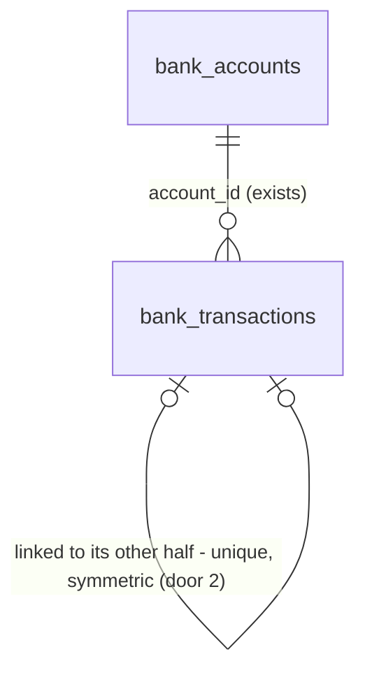

# 16 - Transaction labels

## Problem

Every stored bank transaction (spec 14) looks the same to whatever reads it next. A $10,000 move from reserve savings to operating checking is stored as $10,000 going out and $10,000 coming in. Paying the Business Visa from checking is stored as money going out, with a matching receipt on the card. A purchase on the card is stored as spending, even though no cash moved. Spec 19 has to skip card purchases and internal transfers when it looks for recurring payments ("Transfers between the two sample accounts aren't detected as recurring"), and spec 21 has to keep them out of money in and money out. Today nothing marks them, so both specs would count the same money twice, or count credit activity as cash. AGENTS.md says transfers between the business's own accounts are "never income or spending". The spec gives no figures beyond its three "Done when" items.

When this ships, every stored transaction carries exactly one label: `internal_transfer`, `in_transit`, `card_purchase`, `card_payment`, `credit_draw`, `credit_repayment`, or `normal`. Each paired transaction is linked to its other half. Labels are recomputed in the same database transaction as every sync (webhook, connect, and nightly), so a reader never sees a transaction without a current label. Nothing is visible on any screen yet.

## Flow

This reuses spec 14's sync transaction (`_sync_locked`, AD-046), spec 15's nightly run for the daily recompute (AD-052, AD-053), `accounts.service.business_time_zones` for the business's local date, the `bank_sync.synced` log line, and the `transactions.synced` publish after commit (AD-047, AD-048). It adds no event handler, because labels must commit with the transactions they describe, and no second sync path.

1. Webhook, connect, or nightly sync -> `bank_sync.service` (exists) locks the connection (AD-046 / AD-053), then locks every account of the business (door 3), before it writes anything.
2. `bank_sync.service` (exists) applies the Plaid changes exactly as spec 14 does: inserts, updates, deletions, balances, and the cursor.
3. Labelling (new, inside `bank_sync`; placement per conventions) reads every transaction and account of the business. It gets the business's local date through `accounts.service.business_time_zones` (exists) and business days from the `holidays` calendar (door 4). It pairs halves, assigns one label each, and writes only the rows whose label or link changed (doors 1, 2).
4. Commit. Out: the `bank_sync.synced` log line and the `transactions.synced` event, both carrying a new `relabeled` count (door 5). A sync that changed only labels now publishes too.

## Impact

| Front | What changes |
| --- | --- |
| domain | new term: `label` - one of 7 values on every transaction, owned by `bank_sync`. Spec 19 branches on it (it skips `card_purchase`, and skips `internal_transfer` between included accounts), and spec 21 keeps transfers and credit activity out of money in and money out |
| domain | existing term: `internal transfer` (AGENTS.md glossary) was a definition only. It now has a rule: the exact opposite amount, in the same currency, on two different accounts of the same business, at most 3 business days apart |
| domain | new term: `business day` - Monday to Friday, except Canadian federal statutory holidays (door 4). Used only by labelling for now |
| sync | `_sync_locked` now takes the business's account locks (`repository.lock_accounts`) after the connection lock and before any write. A `PATCH .../bank/accounts/{id}` (spec 13) for the same business waits for a sync that is running, and the reverse. The nightly `SKIP LOCKED` claim (AD-053) is unchanged. It still skips a locked connection, and it waits only on the business lock |
| event | AD-048's payload gains `relabeled` (int). `SyncResult.changed` becomes true when labels changed, so the nightly sync now publishes `transactions.synced` when an in-transit transfer expires with no new Plaid data. No subscriber exists yet (AD-055's tuple is empty) |
| performance | every sync reads every transaction of the business, up to Plaid's 24 months, instead of only the changed ones |
| dependency | new runtime dependency `holidays`, added with `uv add` |
| stored data | `bank_transactions` gains a label column, which defaults to `normal` on existing rows, and a nullable link. The first sync after deploy relabels everything (the nightly run reaches every connection within a day). Local and staging only; no production data yet |

## Relations

One-way constraints: every transaction has exactly one label from the closed set of 7 (door 1). A transaction links to at most one other transaction, and no two transactions link to the same one (door 2). A link exists only on the four paired labels, and never to the transaction itself (door 2). Deleting a transaction clears its partner's link (door 2). No columns or types here.

## Surface

None - nothing consumed outside. No route changes. Labels reach other modules through `bank_sync.service` when spec 19 adds its reader. The only contract change is door 5's event payload, which stays inside the process.

## Landing

| One-way door | Literal shape | Alternative rejected |
| --- | --- | --- |
| 1. Label vocabulary | `bank_transactions.label text not null server_default 'normal'`, with `ck_bank_transactions_label`: `label IN ('internal_transfer', 'in_transit', 'card_purchase', 'card_payment', 'credit_draw', 'credit_repayment', 'normal')`. Python `TransactionLabel = Literal[...]` in `bank_sync.models`, with the constraint built from it like `ACCOUNT_TYPES` | A Postgres enum: AD-029 says closed sets are check constraints. A nullable label meaning "normal": every reader in specs 19 and 21 would have to remember that null means normal. Plaid's category as the label: it can't express a pair, or "in transit until a date" |
| 2. Transfer link | `bank_transactions.linked_transaction_id uuid null`, FK `bank_transactions.id` `ON DELETE SET NULL`, unique `uq_bank_transactions_linked_transaction_id`. `ck_bank_transactions_linked_label`: `linked_transaction_id IS NULL OR label IN ('internal_transfer', 'card_payment', 'credit_draw', 'credit_repayment')`. `ck_bank_transactions_linked_not_self`: `linked_transaction_id <> id`. Both halves point at each other | A `transfer_pairs` table: two writes and a join for a strictly 1:1 relation, and nothing else lives on the pair. A shared `transfer_group_id`: it can't stop a third transaction joining the group, and the unique link can. A one-directional link: every reader would have to query both directions |
| 3. Business-level serialization of syncs | `_sync_locked` calls `repository.lock_accounts(session, business_id=...)` (`SELECT ... FROM bank_accounts WHERE business_id = :b ORDER BY id FOR UPDATE`) right after the connection lock and before `_apply`. Lock order everywhere: connection, then accounts. Extends AD-046 | Relabelling without a business lock: two syncs of a business's two banks each update the other bank's transactions and balances, and Postgres aborts one with a deadlock. `pg_advisory_xact_lock(business_id)`: a second lock beside the row locks that `update_account` already takes, so a `PATCH` and a sync could interleave. A `transactions.synced` handler that relabels after the commit: readers would see unlabelled rows in between, and a failing handler would leave them that way |
| 4. Business-day calendar | dependency `holidays` (via `uv add holidays`). Calendar `holidays.country_holidays("CA", categories=(GOVERNMENT, PUBLIC))`, built for the years in question. A business day is Monday to Friday and not in that calendar. `add_business_days(d, 3)` steps forward 3 business days. No province subdivision | Monday to Friday only: the user chose holidays, because a long weekend would end a transfer's window a day early and count both halves. A hand-written holiday list: it needs an edit every year, and moving dates such as Good Friday and Thanksgiving are easy to get wrong. Provincial holidays (`subdiv=`): banks are federally regulated, and payments clear on federal days |
| 5. Event payload | `transactions.synced` payload: `connection_id`, `added`, `modified`, `removed`, `relabeled` (int), and `balances_changed`. Published when any of the four counts is non-zero or balances changed. Extends AD-048 | A separate `transactions.labeled` event: spec 21 would recompute twice for one sync. Leaving the payload alone and publishing nothing for a relabel-only sync: an expired in-transit transfer would never reach the forecast |

- Recorded in `.specs/STATE.md`: doors 1 and 2 AD-057, door 3 AD-058, door 4 AD-059, door 5 AD-060.
- Nothing else in this change is hard to reverse. The pairing order and the label rules are code, and the next sync recomputes every label from scratch.

## Criteria

Business days below are door 4's. Mon 2026-10-12 is Thanksgiving, a federal statutory holiday. "Cash-side account" means any account whose type is not `credit_card` or `line_of_credit`.

### S1: A transfer between the business's own accounts is labelled on both sides (P1)

Both halves of a transfer are labelled `internal_transfer` and linked to each other.

**Acceptance Criteria**

1. WHEN a sync stores a transaction of -1,000,000 cents CAD on the business's savings account and one of +1,000,000 cents CAD on its checking account, dated at most 3 business days apart THEN the system SHALL label both `internal_transfer` and set each one's `linked_transaction_id` to the other's `id`.
2. WHEN the two halves are on accounts of two different connections of the same business THEN the system SHALL pair them as in AC 1.
3. WHEN the money in is dated before the money out, at most 3 business days earlier THEN the system SHALL pair them as in AC 1.
4. WHEN the money out is dated Fri 2026-10-09 and the money in Thu 2026-10-15 THEN the system SHALL pair them. IF the money in is dated Fri 2026-10-16 instead THEN the system SHALL not pair them.
5. IF two transactions differ in amount by any cent, differ in currency, are on the same account, or belong to different businesses THEN the system SHALL not pair them.
6. WHEN one transaction has more than one candidate other half THEN the system SHALL pair it with the candidate the fewest business days away, then the earliest-dated, then the one with the lowest `id`. No transaction SHALL be in more than one pair.

**Independent test:** in pytest, sync a fake Plaid page with a savings outflow and a checking inflow, then read both rows' `label` and `linked_transaction_id`.

### S2: Card and credit line activity is labelled for what it is (P1)

Credit card and line of credit activity never looks like cash spending or income.

**Acceptance Criteria**

7. WHEN an unpaired transaction with a negative amount is on a `credit_card` account THEN the system SHALL label it `card_purchase`.
8. WHEN money leaves a cash-side account and the opposite amount arrives on a `credit_card` account of the business, at most 3 business days apart THEN the system SHALL label both `card_payment` and link them.
9. WHEN an unpaired transaction with a positive amount is on a `credit_card` account THEN the system SHALL label it `card_payment`, unless its Plaid primary category is present and is neither `LOAN_PAYMENTS` nor `TRANSFER_IN`. In that case it is a refund, and the system SHALL label it `card_purchase`.
10. WHEN an unpaired transaction with a negative amount on a cash-side account has the Plaid detailed category `LOAN_PAYMENTS_CREDIT_CARD_PAYMENT` THEN the system SHALL label it `card_payment` (paying a card at a bank that isn't connected).
11. WHEN money leaves a `line_of_credit` account and the opposite amount arrives on another account of the business, at most 3 business days apart THEN the system SHALL label both `credit_draw` and link them. An unpaired negative transaction on a `line_of_credit` account SHALL be labelled `credit_draw`.
12. WHEN money arrives on a `line_of_credit` account and the opposite amount left another account of the business, at most 3 business days apart THEN the system SHALL label both `credit_repayment` and link them. An unpaired positive transaction on a `line_of_credit` account SHALL be labelled `credit_repayment`.
13. IF either half of a pair is on a `credit_card` account THEN the system SHALL label the pair `card_payment`, even when the other half is on a `line_of_credit` account.

27. IF a candidate pair's money-out half is on a `credit_card` account, or its money-in half is on a `credit_card` account and has a Plaid primary category that is present and is neither `LOAN_PAYMENTS` nor `TRANSFER_IN` THEN the system SHALL not pair them, and SHALL label each half as unpaired by AC 7-17. (Added 2026-10-06 after review finding F1, approved by the user: a card purchase or refund must not pair with an unrelated cash amount.)

**Independent test:** sync a fake page with a card purchase, a checking-to-card payment, and a credit line draw into checking, then read the labels.

### S3: A transfer whose other half hasn't arrived is in transit, then normal (P1)

An outgoing transfer is held as in transit for 3 business days, then becomes normal if nothing matched.

**Acceptance Criteria**

14. WHEN an unpaired transaction with a negative amount on a cash-side account has the Plaid detailed category `TRANSFER_OUT_ACCOUNT_TRANSFER` or `TRANSFER_OUT_SAVINGS`, and the business's local date is on or before its date plus 3 business days THEN the system SHALL label it `in_transit`.
15. WHEN a sync runs on a business-local date after the transaction's date plus 3 business days, and it is still unpaired THEN the system SHALL label it `normal`. A transfer dated Fri 2026-10-09 SHALL be `in_transit` at a sync on Thu 2026-10-15 and `normal` at a sync on Fri 2026-10-16.
16. WHEN the other half of an `in_transit` transaction arrives within the window THEN the system SHALL replace `in_transit` with the pair's label on both halves and link them.
17. The system SHALL label every transaction that no rule in AC 1-16 covers `normal`.

**Independent test:** run spec 15's `run_due(now)` on 2026-10-15 and on 2026-10-16 (business-local) against a fake Plaid client returning one outgoing transfer, and read the label after each.

### S4: Labels stay current and consistent through every sync (P1)

Labels are recomputed atomically with each sync, survive repeats and concurrency, and announce their changes.

**Acceptance Criteria**

18. The system SHALL store exactly one of the 7 labels on every transaction. It SHALL store a link only on `internal_transfer`, `card_payment`, `credit_draw` and `credit_repayment`, and every link SHALL be mirrored by its other half.
19. WHEN any sync runs (webhook, connect, or nightly) THEN the system SHALL recompute the labels and links of every transaction of the business in the same database transaction that stores the sync's changes.
20. IF a sync fails THEN the system SHALL keep every label and link as it was before the sync.
21. WHEN one half of a pair is removed, or is replaced by its posted version THEN the system SHALL, in the same sync, clear the other half's link and relabel it by AC 1-17.
22. WHEN a sync with no new Plaid data runs on the same business-local date as the previous one THEN the system SHALL leave every label and link unchanged and report `relabeled` 0.
23. WHEN two syncs of two connections of the same business run concurrently THEN both SHALL commit without a deadlock error, and a transfer between those two connections SHALL end up paired.
24. WHEN a sync changes the label or link of N transactions THEN the system SHALL publish `transactions.synced` with payload `relabeled` = N. This SHALL happen even when `added`, `modified` and `removed` are 0 and balances did not change.
25. WHEN a sync commits THEN the `bank_sync.synced` log line SHALL include `relabeled`, and no labelling log line SHALL contain an amount, a description, or a counterparty.
26. WHEN the migration runs on a database with existing transactions THEN every existing transaction SHALL have label `normal` and no link.

**Independent test:** sync the same fake page twice and compare labels; run two threaded syncs of two connections of one business with a blocking fake Plaid client; capture published events.

## Out of scope

| Excluded | Why |
| --- | --- |
| The owner correcting a label, or confirming a transfer ("Review transfer") | No v1 spec builds it. Labels are recomputed from data on every sync |
| A read function or API route for labelled transactions | Spec 19 adds the reader it needs, and spec 18 the API it names |
| Using labels in recurring detection or the forecast | Specs 19 and 21 |
| Transfers between currencies, or between a business's entities | `specs/later/19-platform-multi-currency-and-entities.md` |
| Provincial holidays | Door 4: payments clear on federal days |
| Labelling a draw from a line of credit at a bank that isn't connected | Plaid's `TRANSFER_IN_CASH_ADVANCES_AND_LOANS` also covers term loans and cash advances, so the label would be a guess. It stays `normal` |

## Assumptions

| Assumption | Chosen default | Rationale | Confirmed? |
| --- | --- | --- | --- |
| What a business day is | Monday to Friday, minus Canadian federal statutory holidays (door 4) | user chose it over Monday to Friday only | y |
| Whether matching needs Plaid categories | No. Matching uses amount, currency, account, and date only (AC 1, 5). Categories are used only for unpaired transactions (AC 9, 10, 14) | user chose the spec's literal rule; Plaid categories can be unreliable at Canadian banks | y |
| Account type `other` (investment, loan, unknown) | Treated as a cash-side account: it can be half of an `internal_transfer` | it is still the business's own account, and AGENTS.md says moves between them are never income or spending | n |
| Pending transactions | Paired and labelled like posted ones. When the posted version replaces one, it is relabelled in the same sync (AC 21) | a pending outgoing transfer is exactly the in-transit case | n |
| Which outgoing transactions can be `in_transit` | Only Plaid detailed `TRANSFER_OUT_ACCOUNT_TRANSFER` and `TRANSFER_OUT_SAVINGS` | `TRANSFER_OUT_WITHDRAWAL` is cash leaving the bank, and `..._INVESTMENT_AND_RETIREMENT_FUNDS` usually goes to an outside provider | n |
| How much history is relabelled | All of the business's transactions, on every sync | it keeps labels a pure function of the data and the date; 24 months of a 50-person business is a few thousand rows per account | n |
| "Today" for the in-transit window | The business's local date at the sync's `now`, from `accounts.service.business_time_zones` | weeks and nights are business-local everywhere else (AD-052) | n |
| A bank that stops syncing | Its in-transit labels stay until any sync of the business runs | after 3 failed nights the connection needs attention (AD-051), and spec 21 marks the forecast incomplete | n |

**Open questions:** none - all resolved or logged above.

## Observable

None - no user-facing surface. No screen, route, or command is added. The event payload change is door 5, and the log line is AC 25.

## Sources

- `context/specs/16-bank-transaction-labels.md` - the labels, the 3-business-day rule, and the three "Done when" items
- `context/specs/19-forecast-recurring-payments.md` - the consumer: skips card purchases and internal transfers between included accounts
- Plaid personal finance category taxonomy (`plaid.com/documents/transactions-personal-finance-category-taxonomy.csv`) - the `TRANSFER_OUT_*` and `LOAN_PAYMENTS_CREDIT_CARD_PAYMENT` names used in AC 9, 10, 14
