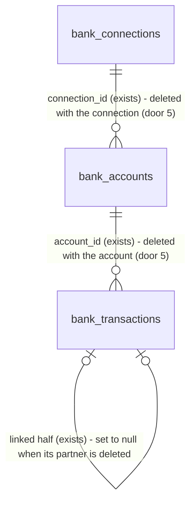

# 17 - Bank connection settings

## Problem

After onboarding, an owner can't see or change their banks. `Settings` is a "coming soon" placeholder. The accounts that count as cash, and the primary account, can only be changed on onboarding step 3, which an owner never sees again.

When a bank asks the owner to log in again (Plaid `ITEM_LOGIN_REQUIRED`), nothing records it. Every sync of that bank fails. The nightly job retries it and, after 3 failed nights, marks it as needing attention (AD-051). Nothing on screen says so, and nothing lets the owner fix it. Spec 21 will mark the forecast incomplete while a bank needs attention, so a forecast stays incomplete with no way out.

An owner who no longer wants a bank connected can't remove it. Plaid keeps the item live and billable, its encrypted access token stays in our database, and its transactions keep feeding the forecast. The spec gives no figures beyond its two "Done when" items.

When this ships, `Settings > Bank connections` lists each bank with its sync status and its accounts. The owner can switch accounts in or out of cash, choose the primary account, connect another bank, reconnect a bank that needs attention through Plaid Link's update mode, and disconnect a bank. A disconnect removes the item at Plaid, deletes the token and the bank's data, stops syncing, and writes an audit entry.

## Flow

This reuses spec 13's `PATCH .../bank/accounts/{id}` and its rules for the switches and the primary choice, spec 12's link token and `useConnectBank` for "Connect another bank", spec 14's `sync_connection` and its locks (AD-046, AD-058) for the repair, `_choose_primary` for a new primary account after a disconnect, spec 16's relabelling, `audit.record` (AD-011), and the `transactions.synced` publish (AD-047). It adds no second sync path and no second account editor.

Read path:

1. `/settings/banks` (new page, placement per conventions) -> `GET /v1/businesses/{b}/bank/connections` (exists, AD-043). Its `Connection` JSON gains `status` and `last_synced_at` (door 3).
2. `bank_sync.service.list_connections` (exists) derives `status` from the stored login flag, `failed_nights` (AD-051) and `last_synced_at` (doors 1, 2).

Learning that a bank needs a login:

3. Any sync (webhook, connect, nightly, repair) -> `bank_sync.service` (exists). A sync that fails with Plaid `ITEM_LOGIN_REQUIRED` stores `login_required = true` (door 1). A successful sync stores `last_synced_at` (door 2) and clears `login_required`.
4. `POST /v1/webhooks/plaid` (exists, AD-049) - `ITEM` / `ERROR` with `error.error_code` `ITEM_LOGIN_REQUIRED` stores `login_required = true`. `ITEM` / `LOGIN_REPAIRED` starts a background sync, which clears it on success (door 6).

Repair:

5. "Reconnect" -> server action -> `POST /v1/businesses/{b}/bank/connections/{c}/link-token` (new, door 4) -> `bank_sync.service` -> `PlaidClient.create_link_token` (exists, AD-036) with the stored access token and no products -> a Link token for update mode.
6. Plaid Link in update mode -> `onSuccess` -> server action -> `POST .../connections/{c}/repair` (new, door 4) -> `sync_connection` (exists). The public token is not exchanged (Plaid's update-mode docs). Out: the `Connection` with its new status.

Disconnect:

7. "Disconnect" -> confirmation dialog -> server action -> `DELETE .../connections/{c}` (new, door 4) -> `bank_sync.service` locks the connection, then the business's accounts (AD-058 order) -> `PlaidClient.remove_item` (exists).
8. Same transaction: delete the connection's transactions, accounts and connection row (door 5), choose a new primary if the deleted bank held it, relabel the business's remaining transactions, `audit.record("bank_connection.disconnected")`. Commit. Out: `204`, the `bank_connection.disconnected` log line, and `transactions.synced` (door 7).
9. Afterwards, a webhook for the item finds no connection and is answered `200` (exists). A queued background sync finds no connection and logs instead of raising. The nightly job never lists it again.

## Impact

| Front | What changes |
| --- | --- |
| domain | new term: `login required` - the bank wants the owner to log in again (Plaid `ITEM_LOGIN_REQUIRED`). Stored on the connection, owned by `bank_sync` |
| domain | existing term: `needs attention` (AD-051) meant `failed_nights >= 3`. It now means that **or** `login_required`. `bank_sync.service.needs_attention` is the only reader today. Spec 21 will branch on it ("an included connection needs attention"), and spec 26 shows a banner from it |
| domain | new term: `last synced` - when a sync of the connection last succeeded. Spec 21 reads it for "hasn't synced for 48 hours" |
| sync | every sync now records its outcome on the connection: success sets `last_synced_at` and clears `login_required`, and an `ITEM_LOGIN_REQUIRED` failure sets `login_required`. The nightly failure path (savepoint, then record) also sets it. `sync_in_background` now catches `ConnectionNotFoundError` (a disconnect that ran first) and logs `bank_sync.sync_skipped`, where today the exception would escape the background task |
| webhook | `POST /v1/webhooks/plaid` now acts on `ITEM` / `ERROR` and `ITEM` / `LOGIN_REPAIRED`. Every other webhook is still answered `200` with no action |
| API contract | `Connection` (AD-039) gains `status` and `last_synced_at`. Onboarding steps 3 and 4 read `Connection` and ignore the new fields. `contracts/openapi.json` and `schema.d.ts` are regenerated |
| event | `transactions.synced` is now also published by a disconnect, with `removed` = the deleted transactions and `balances_changed` true. No subscriber exists yet (AD-055's tuple is empty). Spec 21 recomputes on it |
| web | `/settings` stops being one placeholder page. It becomes a layout with 5 sections, and `next.config.ts` redirects `/settings` to `/settings/banks` with a 307 (a `redirect()` in a page under the streaming `(app)` layout becomes a client-side redirect after load). The `Settings` link in the main navigation keeps `/settings`, and now stays current on every `/settings/*` page |
| web | `connectBank` and `useConnectBank` take where to go after a connect: `/onboarding/accounts` (the default, unchanged for onboarding) or `/settings/banks`. Any other value falls back to the default |
| web | `lib/format.ts` gains a time formatter for "today at 2:04 AM" in the business's time zone (DESIGN.md "Show times in the business's time zone") |
| stored data | `bank_connections` gains `login_required` (defaults to false on existing rows) and `last_synced_at` (null on existing rows, set by the next successful sync; the nightly run reaches every connection within a day). Local and staging only; no production data yet |

## Relations

One-way constraints: a connection carries at most one login-required flag, never null (door 1). Disconnecting deletes the connection, its accounts and their transactions in one transaction, and nothing keeps a row that points at a deleted one (door 5). Audit entries are kept: `audit_log` has no foreign key to the connection (AD-011). No columns or types here.

## Surface

| Route | In | Out | Status |
| --- | --- | --- | --- |
| `GET /v1/businesses/{business_id}/bank/connections` (exists, signature changes) | - | `items[]` of `Connection`, each adding `status` (`syncing`, `synced`, `login_required` or `sync_failing`) · `last_synced_at` (UTC, null) | `200`, `403`, `404`, `422` |
| `POST /v1/businesses/{business_id}/bank/connections/{connection_id}/link-token` | - | `link_token` · `expiration` | `200`, `403`, `404`, `422`, `502` |
| `POST /v1/businesses/{business_id}/bank/connections/{connection_id}/repair` | - | `Connection` | `200`, `403`, `404`, `409`, `422`, `502` |
| `DELETE /v1/businesses/{business_id}/bank/connections/{connection_id}` | - | no body | `204`, `403`, `404`, `422`, `502` |
| `POST /v1/webhooks/plaid` (exists, now acts on 2 more codes) | `webhook_type`, `webhook_code`, `item_id`, `error.error_code` | `status: ok` | `200`, `401`, `422`, `502` (unchanged) |

## Landing

| One-way door | Literal shape | Alternative rejected |
| --- | --- | --- |
| 1. Login-required state | `bank_connections.login_required boolean not null server_default false`. Set by a sync failing with Plaid `error_code` `ITEM_LOGIN_REQUIRED`, or by the `ITEM` / `ERROR` webhook carrying it. Cleared only by a successful sync. Extends AD-051: `needs_attention` = `login_required OR failed_nights >= 3` | Waiting for 3 failed nights: an owner who changed their bank password would see nothing for 3 days, and the "Done when" banner wouldn't appear after a forced login error. Storing Plaid's last `error_code` as text: Plaid's vocabulary would leak out of `bank_sync`, and each new code would mean a new meaning for every reader. Asking Plaid `/item/get` on every page load: a Plaid call per page view, and a page that fails whenever Plaid does |
| 2. Last successful sync | `bank_connections.last_synced_at timestamptz null`, set to the sync's `now` in the same transaction that commits a successful sync (connect, webhook, nightly, repair). Null means never synced | `nightly_synced_on`: it is a date, and it is also set when a night runs out of attempts, so it can't say a sync succeeded. `updated_at`: a PATCH of an account or a failure record would move it |
| 3. Connection status in JSON | `Connection` (AD-039) adds `status`: `"syncing"` (never synced, no attention), `"synced"`, `"login_required"` or `"sync_failing"` (`failed_nights >= 3`), checked in that order with `login_required` first, and `last_synced_at` (ISO 8601 UTC or null). Python `ConnectionStatus` `Literal`. The web formats the time in the business's time zone | A `needs_attention: bool`: the screen needs two different banner texts, one for a login and one for repeated failures. Sending `failed_nights` and a raw flag: every screen (this one, spec 26, spec 29 emails) would repeat the precedence rule |
| 4. Three connection routes | `POST .../bank/connections/{connection_id}/link-token` (update mode: `link_token/create` with `access_token`, no `products`, same `client_name`, `language`, `country_codes`, `webhook` as AD-050); `POST .../connections/{connection_id}/repair` runs `sync_connection` and answers the `Connection`, or `409` `"Your bank still needs you to log in."` when Plaid still answers `ITEM_LOGIN_REQUIRED`; `DELETE .../connections/{connection_id}` answers `204`. All owner only (AD-031); an unknown or another business's connection is `404` `"Bank connection not found."` | A `mode=update` flag on the existing `/bank/link-token`: the update-mode token needs a connection ID, and one route with two meanings would need a body the create path doesn't have. Clearing the flag on `onSuccess` without a sync: it would say the bank is fixed before anything proved it. A repair that only queues a background sync: the owner would see "needs attention" again until a refresh |
| 5. What disconnect deletes | One transaction, under the connection lock then the business's accounts lock (AD-058 order): `DELETE` the connection's `bank_transactions`, then its `bank_accounts`, then the `bank_connections` row (which holds the encrypted token). Plaid `/item/remove` runs first, and its `ITEM_NOT_FOUND` counts as already removed. Any other Plaid failure is `502` with nothing deleted. Audit action `bank_connection.disconnected`, `target_type` `bank_connection`, details `institution_id` and `account_count` | Keeping the rows with a `disconnected_at` flag (soft delete): the mockup says "Disconnecting a bank stops syncing and removes its data", and every reader in specs 19-26 would have to remember the flag. Deleting locally before calling Plaid: if Plaid then fails, the token is gone and nobody can ever remove the billed item. Nulling only the token column: `access_token_ciphertext` is `not null`, and a connection without a token is a state every sync would have to handle |
| 6. Item webhooks acted on | `ITEM` / `ERROR` with `error.error_code == "ITEM_LOGIN_REQUIRED"` sets `login_required` for the stored item. `ITEM` / `LOGIN_REPAIRED` queues `sync_in_background` for it. Every other `ITEM` code, and `ERROR` with any other code, is answered `200` with no action. Extends AD-049 | Clearing the flag directly on `LOGIN_REPAIRED`: the next sync proves the repair at the cost of one call. Acting on `PENDING_DISCONNECT` / `USER_PERMISSION_REVOKED` too: not asked by the spec, and each needs its own banner text |
| 7. Disconnect announces a data change | After the commit, publish `transactions.synced` with `connection_id` (the deleted one), `added` 0, `modified` 0, `removed` = deleted transactions, `relabeled` = relabelled remaining transactions, `balances_changed` true. Extends AD-060 | A new `bank_connection.disconnected` event: AGENTS.md lists the v1 events, and spec 21 would need a second subscription for the same recompute. No event: the forecast would keep the deleted bank's cash until the next sync of another bank |

- Recorded in `.specs/STATE.md`: door 1 AD-061, door 2 AD-062, door 3 AD-063, doors 4 and 5 AD-064, door 6 AD-065, door 7 AD-066.
- Nothing else in this change is hard to reverse. The settings sub-routes, the copy and the page layout are reversible, and so is the time formatter.

## Criteria

"Owner" is a member with role `owner` of the business in the path (AD-031). Mockup: `design/mockups/settings-banks.dc.html`.

### S1: The owner sees every bank and its sync status (P1)

`Settings > Bank connections` lists each bank, its status, and its accounts.

**Acceptance Criteria**

1. WHEN a successful sync of a connection commits THEN the system SHALL set its `last_synced_at` to the sync's `now`, and SHALL set `login_required` to false.
2. The `GET .../bank/connections` response SHALL give each connection `status` `login_required` when `login_required` is true, else `sync_failing` when `failed_nights >= 3`, else `synced` when `last_synced_at` is set, else `syncing`, and SHALL give `last_synced_at`.
3. WHEN the owner opens `/settings` THEN the web app SHALL redirect to `/settings/banks`.
4. The settings pages SHALL show a section navigation with, in order, Business, Bank connections, Members, Email preferences and Your data, marking the current one with `aria-current="page"`. Every section except Bank connections SHALL show the title and the "coming soon" text.
5. WHEN `/settings/banks` loads with connections THEN it SHALL show, for each bank (oldest first), its name and a status line: "Synced today at 2:04 AM" (time in the business's time zone; "Synced Oct 3 at 2:04 AM" for an earlier date), "Syncing…" for `syncing`, or the `Needs attention` badge for `login_required` and `sync_failing`.
6. WHEN `/settings/banks` loads THEN each account row SHALL show its name, `••` and mask, and type ("Checking", "Savings", "Credit" for a line of credit, "Credit card"); the balance for a cash-side account ("$8,000"), "$20,000" over "available" for a line of credit, and "$2,450" over "owed" for a credit card; amounts formatted only through `lib/format.ts`. (Amended 2026-10-06 to match the mockup, approved by the user.)
7. WHILE the page is loading THEN it SHALL show a skeleton of the bank cards.
8. IF the business has no bank connection THEN the page SHALL show the empty state "No bank connected yet", "Connect your bank to see your 13-week forecast.", and a "Connect your bank" button that opens Plaid Link.
9. IF the connections request fails THEN the page SHALL show "We couldn't load your bank connections. Check your connection and try again." with a "Try again" button, and SHALL report the failure to Sentry.
10. The page SHALL work at 375 pixels wide with no horizontal scroll, be usable by keyboard alone, give every control a touch target of at least 44 pixels, and pass an axe check.

**Independent test:** with a fake Plaid client, connect two banks, sync one, and open `/settings/banks` in Playwright.

### S2: The owner changes which accounts count as cash, and the primary account (P1)

The same rules as onboarding step 3, from settings.

**Acceptance Criteria**

11. WHEN the owner toggles "Counts as cash" on a checking or savings account in CAD THEN the page SHALL send `PATCH .../bank/accounts/{id}` with `included` and show the saved state after the page re-renders.
12. The page SHALL show "Credit never counts as cash" with no switch for a credit card or line of credit, and "Not available" with no radio in the Primary column for any account that doesn't count as cash.
13. WHEN the owner chooses the "Make primary" radio on an included account THEN the page SHALL send `PATCH` with `primary: true`, and that account's radio SHALL read "Primary" and be checked. (Amended 2026-10-06 to match the mockup's radios, approved by the user.)
14. IF a `PATCH` fails THEN the page SHALL keep the previous state and show "We couldn't save that change. Try again." (the existing `saveFailed` text).

**Independent test:** in Playwright, toggle savings into cash and make it primary, then reload and see both persisted.

### S3: A bank that needs a login shows a banner and can be repaired (P1)

Login problems are recorded as they happen, shown with a banner, and fixed through Plaid Link's update mode.

**Acceptance Criteria**

15. IF a sync (webhook, connect, nightly or repair) fails with Plaid `error_code` `ITEM_LOGIN_REQUIRED` THEN the system SHALL set the connection's `login_required` to true, and SHALL keep its transactions, cursor and `last_synced_at` unchanged.
16. WHEN a verified `ITEM` / `ERROR` webhook with `error.error_code` `ITEM_LOGIN_REQUIRED` arrives for a stored item THEN the system SHALL set that connection's `login_required` to true and answer `200`.
17. WHEN a verified `ITEM` / `LOGIN_REPAIRED` webhook arrives for a stored item THEN the system SHALL answer `200` and queue a sync of that connection.
18. `bank_sync.service.needs_attention` SHALL return true when `login_required` is true or `failed_nights >= 3`, and false otherwise.
19. WHILE a connection's status is `login_required` THEN its card SHALL show a warning banner "{bank} asked you to log in again. Until you do, your forecast is missing this bank's latest data." with a "Reconnect" button.
20. WHILE a connection's status is `sync_failing` THEN its card SHALL show a warning banner "We couldn't sync {bank} for 3 nights. Until it works again, your forecast is missing this bank's latest data." with a "Reconnect" button.
21. WHEN the owner calls `POST .../connections/{c}/link-token` THEN the system SHALL create a Plaid link token with the connection's decrypted access token, no products, and AD-050's `webhook`, and answer `200` with `link_token` and `expiration`.
22. WHEN Plaid Link in update mode reports success THEN the page SHALL call `POST .../connections/{c}/repair` without exchanging the public token, and SHALL show the repaired status without a manual reload.
23. WHEN `POST .../connections/{c}/repair` is called and the sync succeeds THEN the system SHALL answer `200` with the `Connection`, whose `status` is `synced`.
24. IF the repair's sync fails with `ITEM_LOGIN_REQUIRED` THEN the system SHALL answer `409` with detail "Your bank still needs you to log in.", and the connection SHALL stay `login_required`.
25. IF Plaid fails on the link token or the repair for any other reason THEN the system SHALL answer `502` with AD-008 problem details and detail "We couldn't reach our bank connection provider. Try again.", and the page SHALL show "We couldn't reconnect {bank}. Try again." Closing Link SHALL show nothing.
26. WHEN a Plaid sandbox connection is forced into the login-required state with `/sandbox/item/reset_login` and then synced THEN `/settings/banks` SHALL show the AC 19 banner, and completing Link's update mode with Plaid's sandbox credentials SHALL return the card to "Synced today at …" with no banner. (Spec 17 "Done when" 1.)

**Independent test:** in pytest, a fake Plaid client raises `ITEM_LOGIN_REQUIRED` on sync, then succeeds on repair; read `status` after each. Then the sandbox Playwright run of AC 26.

### S4: The owner disconnects a bank (P1)

A disconnect removes the item at Plaid, deletes the token and the data, stops syncing, and is audited.

**Acceptance Criteria**

27. WHEN the owner chooses "Disconnect" THEN the page SHALL open a dialog titled "Disconnect {bank}?" with the text "Headroom stops syncing this bank and removes its accounts and transactions. This can't be undone.", a "Cancel" button, and a destructive "Disconnect" button. Escape and "Cancel" SHALL close it with nothing sent.
28. WHEN the owner confirms THEN the system SHALL call Plaid `/item/remove` with the connection's access token, then in one transaction delete the connection's transactions, accounts and connection row, and answer `204`.
29. IF Plaid `/item/remove` answers `ITEM_NOT_FOUND` THEN the system SHALL treat the item as removed and delete as in AC 28.
30. IF Plaid `/item/remove` fails for any other reason THEN the system SHALL answer `502` with AD-008 problem details, SHALL delete nothing, and the page SHALL show "We couldn't disconnect {bank}. Try again." in the dialog.
31. WHEN a disconnect commits THEN the system SHALL have written one audit entry with action `bank_connection.disconnected`, the caller as actor, `target_type` `bank_connection`, the connection's ID as `target_id`, and details `institution_id` and `account_count`, in the same transaction.
32. WHEN the disconnected bank held the primary account THEN the system SHALL, in the same transaction, make primary the remaining included account with the largest balance (the spec 13 rule), or leave no primary when none is left.
33. WHEN a disconnect commits THEN the system SHALL have relabelled the business's remaining transactions in the same transaction, so no remaining transaction keeps a paired label without its other half.
34. WHEN a disconnect commits THEN the system SHALL publish `transactions.synced` with `added` 0, `modified` 0, `removed` = the number of deleted transactions, `relabeled` = the number relabelled, and `balances_changed` true.
35. WHEN a disconnect has committed THEN no row SHALL hold the connection's encrypted access token, the nightly job SHALL not list the connection, a `TRANSACTIONS` / `SYNC_UPDATES_AVAILABLE` webhook for its item SHALL be answered `200` and start no sync, and a background sync queued before the disconnect SHALL log `bank_sync.sync_skipped` and not raise. (Spec 17 "Done when" 2.)
36. WHEN a sync of the connection is running as the disconnect starts THEN the disconnect SHALL wait for it to commit, then delete, and both SHALL finish without an error.
37. WHEN the disconnect succeeds THEN the page SHALL close the dialog, remove the bank's card without a manual reload, and show the toast "{bank} disconnected".

**Independent test:** in pytest, connect a fake bank, disconnect it, and query for the connection, its accounts, transactions and token; then post a signed sync webhook for its item. In Playwright, disconnect a bank and see its card go.

### S5: Every new route is the owner's alone (P1)

**Acceptance Criteria**

38. IF the caller is not a member of the business THEN each new route SHALL answer `404` "Business not found.", and IF the connection belongs to another business or doesn't exist THEN it SHALL answer `404` "Bank connection not found.", with nothing changed at Plaid or in the database.
39. IF the caller is a member whose role is not `owner` THEN each new route SHALL answer `403` "You don't have permission to do this."
40. The system SHALL never put an access token, a public token, or a Plaid error message in a response body, a log line, or an audit entry of these routes.

**Independent test:** call each new route as an owner of another business and as no member, and assert the status and that the connection is untouched.

## Out of scope

| Excluded | Why |
| --- | --- |
| The "1 bank needs attention" pill in the app header (mockup top bar) | It appears on every page; spec 26 builds the shell-wide attention banner from `needs_attention` |
| Business, Members, Email preferences and Your data sections | Placeholders only; specs 31 (members), 29 and 30 (email) and later fill them |
| Acting on `PENDING_DISCONNECT`, `USER_PERMISSION_REVOKED` and `NEW_ACCOUNTS_AVAILABLE` webhooks, or adding new accounts through update mode | Not asked by the spec; each needs its own copy and flow |
| A manual "sync now" button | Not asked; syncs come from webhooks, the nightly job, and the repair |
| Disconnecting from a bookkeeper's seat | Only owners exist until spec 31 |
| An undo for a disconnect | The data is deleted; reconnecting the bank pulls its history again |

## Assumptions

| Assumption | Chosen default | Rationale | Confirmed? |
| --- | --- | --- | --- |
| A repair writes an audit entry | No; only the disconnect does (AC 31) | the spec asks for an audit entry on disconnect only, and a repair changes no permission or data the owner chose | n |
| Where Plaid is called during a disconnect | Inside the connection lock, before the deletes (door 5) | a sync can't start between the Plaid removal and the delete; the lock is held up to Plaid's 15-second timeout (AD-036) | n |
| "Connect another bank" after the first | Reuses spec 12's link token and `useConnectBank`, then re-renders `/settings/banks` with the new bank | same flow as onboarding step 3's "Connect another bank" (spec 13) | n |
| Time shown for "Synced …" | "today at 2:04 AM" when the business-local date is today, else "Oct 3 at 2:04 AM" | DESIGN.md: times in the business's time zone, month spelled out | n |
| The sandbox proof's login reset | A test-only helper (never a route) calls `/sandbox/item/reset_login` with the stored token, and refuses to run unless `PLAID_ENV` is `sandbox` | the browser never sees the token, and no public route may change a connection's Plaid state | n |

**Open questions:** none - all resolved or logged above.

## Observable

| Surface | Decision | Landing |
| --- | --- | --- |
| screen `/settings/banks` | empty state | AC 8 |
| screen `/settings/banks` | loading state | AC 7 |
| screen `/settings/banks` | error state | AC 9, AC 14, AC 25, AC 30 |
| screen `/settings/banks` | unauthorised state | existing - `auth.protect()` on every page (AD-026); a non-member gets `404` from the API (AC 38) |
| screen `/settings/banks` | density and ordering | AC 5, AC 6 - banks oldest first (AD-043), accounts by name (AD-039) |
| screen `/settings/banks` | destructive action confirms | AC 27 |
| screen `/settings/banks` | phone width, keyboard, touch, axe | AC 10 |
| screen `/settings/*` placeholders | empty, loading, error states | AC 4 - static text, no data to load |
| API `GET .../bank/connections` | response shape | AC 2, door 3 |
| API new connection routes | response shape | AC 21, AC 23, AC 28 |
| API new connection routes | error shape and codes | AC 24, AC 25, AC 30, AC 38, AC 39 - AD-008 problem details |
| API new connection routes | who may call it | AC 38, AC 39 |
| API `POST /v1/webhooks/plaid` | response and error shape | existing - AD-049, unchanged; AC 16, AC 17 |
| all new routes | versioning, rate limits | n/a - every route is under `/v1` (AD-022), and the project has no rate limiting in v1 |
| copy on `/settings/banks` | tone, and what the reader does next | AC 19, AC 20, AC 27 - each problem names the bank and offers one action (DESIGN.md "Partial") |

## Sources

- `context/specs/17-bank-connection-settings.md` - the build list and both "Done when" items
- `design/mockups/settings-banks.dc.html` - binding layout and copy, including "Disconnecting a bank stops syncing and removes its data"
- Plaid docs: Link update mode (token with `access_token`, no `products`, no public-token exchange), `/sandbox/item/reset_login`, Item errors (`ITEM_NOT_FOUND` after `/item/remove`)
