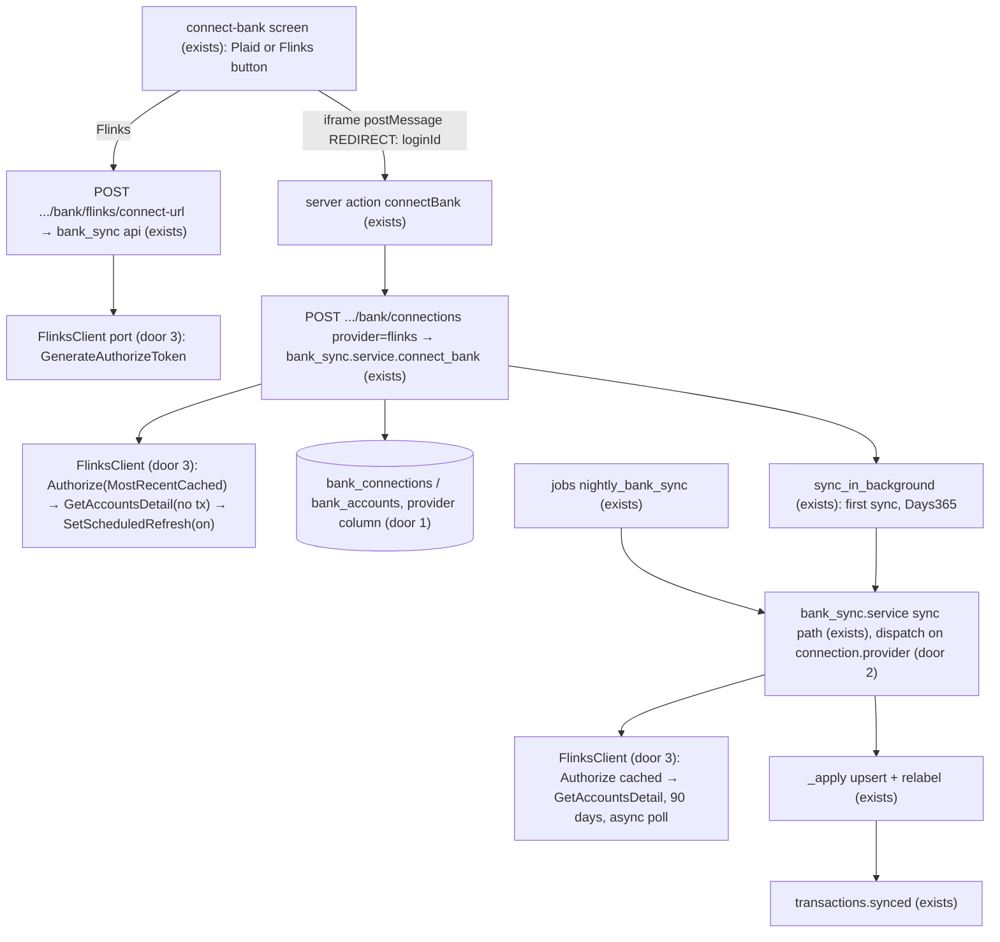
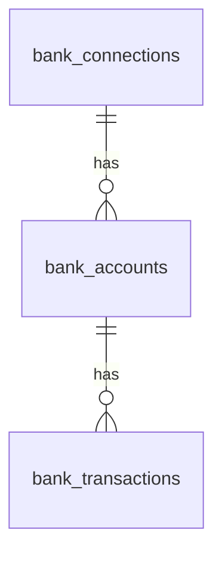

# Flinks as a second bank provider

## Problem

An owner whose bank is RBC and who signs in with RBC's authenticator app can't connect it, because Plaid rejects the login with `MFA_NOT_SUPPORTED`. Without the bank there's no forecast, so onboarding ends at step 3 for that owner. Evidence: spec 34's production check C21 is blocked on exactly this (`STATE.md` Handoff, 2026-10-16). RBC is one of Canada's largest banks, so the gap hits a large share of the target market. We have no measured figure for how many.

When this ships, the connect-bank step offers a second way in, through Flinks. Flinks runs its own login and MFA screens, and the connection then syncs every night like a Plaid connection.

## Flow

This reuses the whole sync pipeline: the `_apply` upsert, relabelling, the connection and account locks, the `transactions.synced` event, the nightly attempt/retry machinery (AD-051..053), `login_required` and the status precedence (AD-061..063), token encryption (AD-038) and disconnect. Only the fetch differs per provider.

## Impact

| Front | What changes |
| --- | --- |
| domain | new term: `provider`, either `plaid` or `flinks`. It's the bank-data provider behind one connection and lives in `bank_sync`. |
| domain | existing term: "item" / `plaid_item_id` meant a Plaid item and now means the provider's login handle (`provider_item_id`). Who reads it today: `bank_sync.repository.connection_for_item` (the webhook), `record_login_required`, the fixtures loader, and tests. |
| domain | existing term: `transactions_cursor` stays Plaid-only and is always null for Flinks. AD-046's "null = never synced" now holds only when `provider = 'plaid'`. `last_synced_at` null is the first-sync test for both providers. |
| domain | labels: Flinks returns no Plaid `personal_finance_category`, so `category`/`category_detailed` are null. `labels.py` pairs transfers by amount and date, and treats a null category as allowed for card payments (`labels.py:83`). So Flinks rows get no in-transit or detailed-category labels. |
| domain | history: a Flinks connection brings at most 365 days (`Days365`, its maximum). Plaid brings 730 (`DAYS_REQUESTED`). Forecast status `history_months` reads lower for Flinks banks. |
| domain | pending: Flinks returns posted transactions only, so `pending` is always false on Flinks rows. |
| stored data | One migration renames `plaid_item_id`→`provider_item_id`, `plaid_institution_id`→`provider_institution_id`, `plaid_account_id`→`provider_account_id` and `plaid_transaction_id`→`provider_transaction_id`, renames their constraints to match, and adds `bank_connections.provider` NOT NULL with server default `'plaid'`. Every existing row becomes `plaid`, so nothing needs backfilling. The institution unique widens to include `provider`, which can't fail on existing rows. Staging and production run it automatically before deploy. |
| config | new optional settings `FLINKS_INSTANCE`, `FLINKS_CUSTOMER_ID`, `FLINKS_AUTH_KEY`, `FLINKS_API_KEY`. If any is unset, Flinks is disabled and nothing else changes. They go in `.env.example`, Railway (`preserve()` in `.railway/railway.ts` like the Plaid keys), and AD-138's no-shared-credential check. |
| web security | CSP (report-only, AD-130) gains `frame-src https://{instance}-iframe.private.fin.ag`, plus `connect-src` if the iframe needs it. |

## Relations

One-way constraints: `bank_connections.provider` takes exactly `plaid` or `flinks` (door 1). `(provider, provider_item_id)` is unique and `(business_id, provider, provider_institution_id)` is unique (door 1). `provider_account_id` and `provider_transaction_id` stay globally unique. Plaid IDs and Flinks GUIDs can't collide, so no scoping is needed.

## Surface

| Route | In | Out | Status |
| --- | --- | --- | --- |
| `POST /v1/businesses/{business_id}/bank/flinks/connect-url` | none | `connect_url` (iframe URL with a single-use `authorizeToken`), `origin` | `200`, `403` (not owner), `404` (unknown business, or Flinks not configured), `503` (Flinks failed) |
| `POST /v1/businesses/{business_id}/bank/connections` (signature changes) | `provider` (`plaid` default, `flinks`), `public_token` (plaid) or `login_id` (flinks, a UUID), exactly one, matching `provider` | `Connection` as today, plus `provider` | `201`, `403`, `404`, `409` (bank already connected), `422` (missing or mismatched field, `login_id` not a UUID), `503` (provider failed, or Flinks accounts still preparing after the poll budget) |
| `GET /v1/businesses/{business_id}/bank/connections` (`Connection` JSON, AD-039, AD-063) | none | each `Connection` adds `provider` | `200` |
| `POST .../bank/connections/{connection_id}/link-token` (changes for Flinks) | none | as today | adds `409` "Reconnect this bank: disconnect it, then connect it again." for a Flinks connection |

## Landing

| One-way door | Literal shape | Alternative rejected |
| --- | --- | --- |
| 1. provider column and generic ID names | `bank_connections.provider text not null server_default 'plaid'`, `ck_bank_connections_provider` = `provider IN ('plaid','flinks')`. Columns renamed `provider_item_id`, `provider_institution_id`, `provider_account_id`, `provider_transaction_id`, with constraints `uq_bank_connections_provider_provider_item_id` and `uq_bank_connections_business_id_provider_provider_institution_id`. New AD supersedes AD-037 and AD-045's column names. | Keeping the `plaid_*` names and storing Flinks IDs in them: every future reader and AD row would describe a column that holds something else. A separate `flinks_connections` table: the accounts, transactions, locks and nightly state would have to be duplicated or joined across two tables. |
| 2. dispatch by provider in `bank_sync.service` | Connect and sync branch on `connection.provider`. Plaid keeps cursor paging. Flinks produces one snapshot: `added` = every returned transaction, `removed` = [], cursor untouched, run through the existing `_apply`, which already turns a seen ID into a modify-or-noop. Callers (`api`, `jobs/nightly`, fixtures) pass a `BankProviders(plaid, flinks: FlinksClient \| None)` holder in place of a bare `PlaidClient`. | A shared `BankProvider` protocol both clients implement: Plaid's cursor/webhook model and Flinks' authorize-then-snapshot model share no method signature, so the protocol would be one of them with the other's fields bolted on. |
| 3. Flinks port | `bank_sync/flinks.py`: a `FlinksClient` `Protocol` (`authorize_token`, `connect_url`, `accounts(login_id, with_transactions, days)`, `enable_nightly_refresh(login_id)`, `delete(login_id)`), an `HttpxFlinksClient` on `httpx` (already a dependency), a 15 s timeout per call, plain dataclasses out, and one `FlinksError(http_status, flinks_code)` carrying no body. Async `202` is polled every 10 s, at most 3 times on connect and at most 30 (5 min) in a sync. Mirrors AD-036. | No official Flinks Python SDK exists, so this is the only option besides a third-party wrapper. |
| 4. the Flinks loginId is a secret | Encrypted into the existing `access_token_ciphertext` (AD-038). `provider_item_id` = `sha256(login_id)` hex, so uniqueness holds without the plaintext. Never logged or returned. The full `AccountNumber` and KYC/holder data are never requested (`WithAccountIdentity=false`, `WithKYC=false`) or stored, and only `LastFourDigits` becomes `mask`. | Storing the loginId as `provider_item_id`: Flinks docs call it a permanent token, and a plaintext token in an indexed column breaks AGENTS.md's token rule. |
| 5. Flinks freshness drives `last_synced_at` | For Flinks, `last_synced_at` = `min(now, Login.LastRefresh)`. Cached data from a refresh that silently stopped then trips the existing 48-hour "hasn't synced" status (spec 21) instead of reading as fresh. | `now`, as for Plaid: cached mode (`MostRecentCached: true`) succeeds even when Flinks' nightly refresh failed, so the forecast would trust stale balances. |

- Nothing else in this change is hard to reverse.

## Criteria

### S1: The schema and the seam carry a provider, with Plaid unchanged (P1)

The rename and the provider column land, and every existing Plaid behaviour still passes.

**Acceptance Criteria**

1. The system SHALL store `provider = 'plaid'` on every `bank_connections` row that existed before the migration, and the migration's downgrade SHALL restore the `plaid_*` column names.
2. IF a row is written with `provider` other than `plaid` or `flinks` THEN the database SHALL reject it with `ck_bank_connections_provider`.
3. The system SHALL pass the existing `bank_sync`, fixtures and nightly test suites with no assertion weakened, apart from mechanical column renames.
4. The `Connection` JSON SHALL include `provider` with value `plaid` or `flinks`.

**Independent test:** run the migration upgrade and downgrade on a database with Plaid rows, then the full existing suite.

### S2: An owner connects a bank through Flinks (P1)

**Acceptance Criteria**

5. WHEN an owner calls `POST .../bank/flinks/connect-url` with Flinks configured THEN the system SHALL return `200` with a `connect_url` on `https://{FLINKS_INSTANCE}-iframe.private.fin.ag/v2/` that carries a fresh `authorizeToken`, `jsRedirect=true`, `daysOfTransactions=Days365`, `language=en`, and `demo=true` only when `FLINKS_INSTANCE` is `toolbox`.
6. IF any `FLINKS_*` setting is unset THEN `POST .../bank/flinks/connect-url` SHALL return `404` problem details.
7. IF the caller is not an owner of the business THEN `POST .../bank/flinks/connect-url` SHALL return `403`, and a user from another business SHALL be denied.
8. WHEN an owner posts `{"provider": "flinks", "login_id": <uuid>}` to `POST .../bank/connections` THEN the system SHALL store one connection with `provider = 'flinks'`, its accounts (with `mask` from `LastFourDigits`, the type mapped and an unknown type stored as `other`) and an audit entry with `provider`, return `201`, and queue the first sync.
9. WHEN a Flinks connection is created THEN the system SHALL call `SetScheduledRefresh` with `isActivated: true` for its loginId.
10. IF `provider` and the token field don't match (`flinks` with `public_token`, `plaid` with `login_id`, both, or neither) or `login_id` isn't a UUID THEN the system SHALL return `422`.
11. IF the business already has a connection with the same `(provider, provider_institution_id)` THEN the system SHALL return `409` and store nothing.
12. IF Flinks still answers `202` after 3 polls, 10 s apart, during connect THEN the system SHALL return `503` "Your bank is still preparing your accounts. Try again in a minute.", store nothing, and keep the Flinks login, so a retry with the same `login_id` succeeds.
13. IF a Flinks call fails or times out after 15 s THEN the system SHALL return `503` problem details carrying only the Flinks code, and log no request or response body.
14. The system SHALL never log, store in plaintext or return the loginId, a full account number, or holder identity data, and SHALL request accounts with `WithAccountIdentity=false` and `WithKYC=false`.

**Independent test:** with the fake Flinks client, request a connect URL, post a UUID login_id, and see a `flinks` connection with its accounts.

### S3: Flinks connections sync like Plaid connections (P1)

**Acceptance Criteria**

15. WHEN a Flinks connection syncs for the first time (`last_synced_at` null) THEN the system SHALL request `Days365` of transactions, and later syncs SHALL request `Days90`.
16. WHEN a Flinks sync returns a transaction THEN the system SHALL store `amount_cents` = `+Credit` or `−Debit` in cents, half-even, `pending = false`, `description` from `Description`, and `date` from `Date`. This is the one Flinks sign rule, in `bank_sync`.
17. WHEN a Flinks sync returns a transaction ID already stored THEN the system SHALL update it only if a value changed, and SHALL insert no duplicate.
18. WHEN a stored Flinks transaction is absent from a later Flinks response THEN the system SHALL keep it.
19. WHEN a Flinks sync succeeds THEN the system SHALL set `last_synced_at` to `min(now, Login.LastRefresh)`, update balances from `Balance.Current` and `Balance.Available`, relabel the business, and publish `transactions.synced` when something changed.
20. WHEN the nightly job finds a due Flinks connection THEN it SHALL sync it through the same attempt and retry rules as Plaid (AD-051..053), with `MostRecentCached: true`.
21. IF Flinks `Authorize` fails with `INVALID_LOGIN` or `DISABLED_LOGIN` THEN the system SHALL set `login_required` on the connection, as it does for Plaid's `ITEM_LOGIN_REQUIRED`.
22. WHEN a Flinks connection is disconnected THEN the system SHALL call Flinks `DeleteCard` for its loginId and delete it locally exactly as for Plaid. IF `DeleteCard` fails THEN the local delete SHALL still happen and the system SHALL log `bank_connection.orphaned` with the connection ID only.
23. IF `POST .../connections/{connection_id}/link-token` targets a Flinks connection THEN the system SHALL return `409` "Reconnect this bank: disconnect it, then connect it again."

**Independent test:** run `sync_connection` on a fake Flinks connection twice with one changed transaction and see one row modified, none duplicated.

### S4: The owner chooses the provider on screen (P1)

**Acceptance Criteria**

24. WHERE Flinks is configured, the connect-bank surfaces (onboarding step 3, "Connect another bank" on choose-accounts, and bank settings) SHALL show two actions: "Connect with Plaid" and "Connect with Flinks", plus a hint line saying to use Flinks if Plaid can't complete the bank's sign-in, for example RBC with an authenticator app.
25. IF the connect-url call returns `404` or fails THEN the screen SHALL show only the Plaid action, and report a failure (not a `404`) to Sentry.
26. WHEN the owner chooses Flinks THEN the screen SHALL open the Flinks Connect iframe in the existing dialog component with a loading state until the iframe loads, and Esc or the close button SHALL return focus to the Flinks button.
27. WHEN the iframe posts a `REDIRECT` message whose `event.origin` equals the API's `origin` THEN the screen SHALL take its `loginId` and call the connect action with `provider: "flinks"`. Messages from any other origin SHALL be ignored.
28. IF the connect action returns `503` THEN the screen SHALL show "Your bank is still preparing your accounts. Try again in a minute." with a retry action that reuses the same loginId. `409` SHALL show the existing "already connected" error.
29. The bank settings list SHALL show each connection's provider ("via Plaid" or "via Flinks"), and SHALL hide "Reconnect" for a Flinks connection that needs attention, showing "Disconnect it, then connect it again." instead.
30. The connect-bank screen SHALL work at 375 px wide, with keyboard alone, and with touch targets of at least 44 px, and its Playwright test SHALL pass an axe check, including with the iframe dialog open.

**Independent test:** in Playwright, open the connect screen at 375 px, tab to the Flinks button, open and close the dialog with Esc, and pass axe.

## Out of scope

| Excluded | Why |
| --- | --- |
| Flinks webhooks | They need a Flinks support ticket and can't be tested in the sandbox (Flinks docs). The nightly cached read covers freshness. |
| Flinks update or reconnect mode | Disconnect-and-reconnect is the v1 path. Flinks reconnect wasn't researched. |
| Routing a bank to a provider automatically | The user chose per-connection choice. |
| Detecting the same bank connected through both providers | Institution IDs differ by provider, and no reliable mapping exists. See Assumptions. |
| A `provider` property on the `bank_connected` analytics event | AD-120 fixes the property keys. |
| Mockup or `DESIGN.md` changes | Shared design files need a separate ask. The screen reuses existing `components/ui` parts. |

## Assumptions

| Assumption | Chosen default | Rationale | Confirmed? |
| --- | --- | --- | --- |
| Interface text names the providers | "Connect with Plaid" / "Connect with Flinks", with an RBC hint | the user asked that the "user can choose", so the choice must be legible | n |
| Same bank through both providers | Allowed by the database. The owner excludes duplicate accounts on choose-accounts. | no stable cross-provider institution ID | n |
| Flinks `Type` values to our account types | `Chequing`→`checking`, `Savings`→`savings`, `CreditCard`→`credit_card`, `LineOfCredit`→`line_of_credit`, anything else→`other`. The exact strings are confirmed against the sandbox before the mapping is written. | `other` never counts as cash (AD-040), so an unmapped type is safe | n |
| Data endpoints authenticate with `x-api-key = FLINKS_API_KEY`, and `Authorize` with the generated token as `flinks-auth-key` | as documented on docs.flinks.com. If the sandbox disagrees, stop with `TODO(question)`. | Flinks docs, 2026-10 | n |
| Flinks transaction `Id` is stable across refreshes | assumed. A sandbox integration test proves it, marked `flinks_sandbox` like `plaid_sandbox`. | criterion 17 depends on it | n |

**Open questions:**

| # | Kind | Question | Until answered |
| --- | --- | --- | --- |
| 1 | blocks go-live | Flinks sandbox credentials (`FLINKS_CUSTOMER_ID`, keys) for local and staging, and a production contract. Flinks has no self-serve production access. | Every unit test runs on a fake, but the sandbox test and the staging demo can't run |
| 2 | blocks go-live | Does Flinks production complete an RBC login that uses the authenticator app? Docs show RBC MFA test users, which isn't proof. | Spec 34 C21 stays blocked |
| 3 | open | Sign of a credit card's `Balance.Current` in Flinks | the credit mapping is written against the sandbox, with a test pinned to what it returns |

## Observable

| Surface | Decision | Landing |
| --- | --- | --- |
| screen connect-bank | empty state | AC 25 (Flinks off: Plaid only, as today) |
| screen connect-bank | loading | AC 26 |
| screen connect-bank | error | AC 25, AC 28 |
| screen connect-bank | unauthorised | existing: owner-only routes and `auth.protect()` |
| screen connect-bank | destructive confirm | n/a: connecting destroys nothing. Disconnect keeps its existing confirm. |
| screen bank settings | density and ordering | existing: AD-043 order. AC 29 adds the provider. |
| API `POST .../flinks/connect-url` | error shape and codes | AC 6, 7, 13 |
| API `POST .../connections` | error shape and codes | AC 10–13 |
| all new or changed routes | versioning | existing `/v1` |
| all new or changed routes | rate limits | n/a: owner-only and called once per connect. Flinks' own limits surface as `503` (AC 13). |
| job nightly | output and exit | existing: AD-054 job and logs. AC 20. |

## Sources

- `.specs/STATE.md` Handoff (spec 34 C21 blocked on RBC `MFA_NOT_SUPPORTED`) and AD-036..066
- Flinks docs: [key concepts](https://docs.flinks.com/guides/getting-started/key-concepts), [GenerateAuthorizeToken](https://docs.flinks.com/api/authorize/endpoints/generate-authorize-token.md), [Authorize](https://docs.flinks.com/api/authorize/endpoints/authorize.md), [GetAccountsDetail](https://docs.flinks.com/api/connect/endpoints/account-linking/get-accounts-detail.md), [widget](https://docs.flinks.com/guides/connect/flinks-connect/widget.md), [event listener](https://docs.flinks.com/guides/connect/flinks-connect/use-event-listener.md), [SetScheduledRefresh](https://docs.flinks.com/api/connect/endpoints/account-linking/set-scheduled-refresh.md), [test users](https://docs.flinks.com/guides/connect/flinks-connect/test-users.md)

