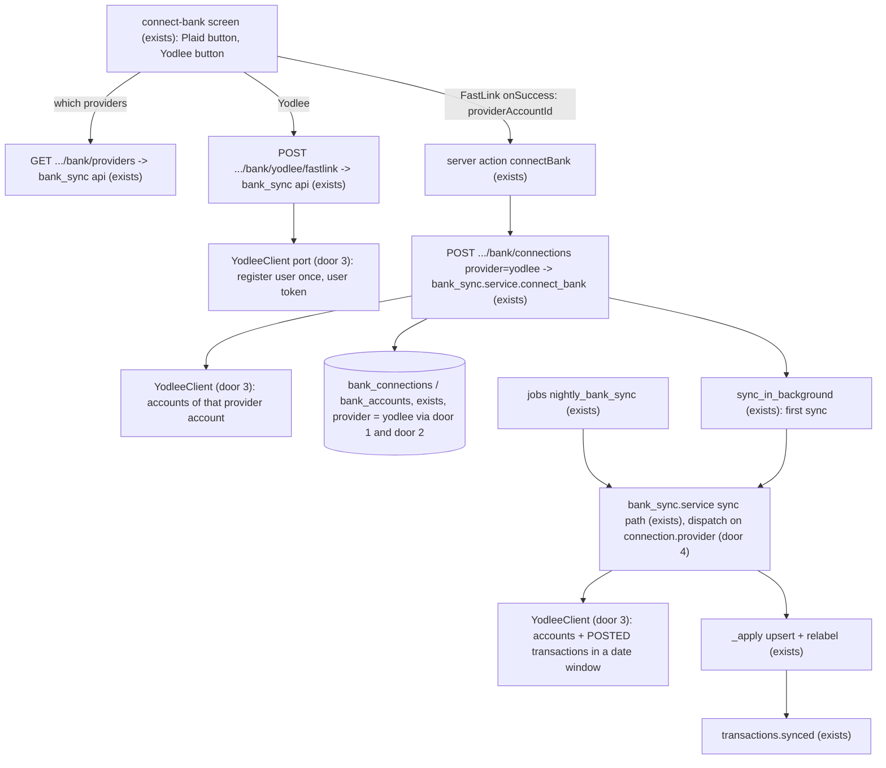
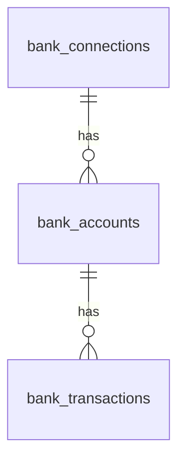

# Yodlee as a second bank provider

## Problem

An owner whose bank is RBC and who signs in with RBC's authenticator app can't connect it, because Plaid rejects the login with `MFA_NOT_SUPPORTED`. Without a bank there is no forecast, so onboarding ends at step 3 for that owner. Evidence: spec 34's production check C21 is blocked on exactly this (`STATE.md` Handoff, 2026-10-16). Plaid's own docs say OAuth connections "are not currently used by financial institutions in Canada", so Plaid has no other route to RBC. Flinks was tried and removed (spec 17a) because it would not take a personal-email signup. We have no measured count of owners with RBC authenticator-app logins.

When this ships, the connect-bank step offers a second way in, through Yodlee's FastLink. RBC has a published data-access agreement with Envestnet | Yodlee for a direct API connection. Whether that connection is live for authenticator-app clients is **not confirmed** (see Open questions 2). After connecting, the bank syncs every night like a Plaid connection.

## Flow

This reuses the whole sync pipeline: the `_apply` upsert, relabelling, the connection and account locks, the `transactions.synced` event, the nightly attempt/retry machinery (AD-051..053), `login_required` and the status precedence (AD-061..063), token encryption (AD-038), the `provider` column (AD-142) and disconnect. Only the fetch and the connect/repair handshake differ per provider.

## Impact

| Front | What changes |
| --- | --- |
| domain | new term: `yodlee` as a `provider` value (AD-142). Who branches on `provider` today: `bank_sync.repository` lookups (`has_institution`, `connection_for_item`), `service.connect_bank`, `_sync_locked`, `disconnect_bank`, `create_update_link_token`, and the webhook (Plaid only). |
| domain | existing term: `access_token_ciphertext` held a Plaid access token and now holds, for Yodlee, the encrypted Yodlee `loginName` of the business's Yodlee user (door 2). Who reads it: `decrypt_access_token` callers in `service.py` only. |
| domain | existing term: `transactions_cursor` stays Plaid-only and is always null for Yodlee. `last_synced_at` null is the first-sync test for Yodlee. |
| domain | labels: Yodlee categories are not mapped, so `category` and `category_detailed` are null (as for the abandoned Flinks plan). `labels.py` pairs transfers by amount and date and treats a null category as allowed for card payments, so Yodlee rows get no in-transit or detailed-category labels. |
| domain | history: how far back a bank's data goes depends on the bank and on Yodlee. Forecast status `history_months` can read lower for Yodlee banks than for Plaid (730 days, `DAYS_REQUESTED`). |
| domain | pending: only POSTED Yodlee transactions are stored, so `pending` is always false on Yodlee rows. A Yodlee pending transaction and its posted version carry different IDs, and a snapshot sync cannot link them. |
| stored data | One migration widens `ck_bank_connections_provider` from `plaid` to `plaid, yodlee`. No row changes, nothing to backfill. Its downgrade deletes nothing and fails if a `yodlee` row exists. Staging runs it first. |
| config | new optional settings `YODLEE_API_URL`, `YODLEE_CLIENT_ID`, `YODLEE_CLIENT_SECRET`, `YODLEE_ADMIN_LOGIN_NAME`, `YODLEE_FASTLINK_URL`, `YODLEE_FASTLINK_CONFIG_NAME`. If any is unset Yodlee is off and nothing else changes. They go in `.env.example`, Railway (`preserve()` in `.railway/railway.ts` like the Plaid keys), and AD-138's no-shared-credential check (staging and production use different Yodlee credentials). |
| web security | CSP (report-only, AD-130) gains `script-src https://cdn.yodlee.com` and `frame-src` for the FastLink host. Log and Sentry redaction gain the Yodlee client secret and user access token. |

## Relations

One-way constraints: `bank_connections.provider` takes exactly `plaid` or `yodlee` (door 1). `(provider, provider_item_id)` stays unique, and for Yodlee `provider_item_id` is Yodlee's provider-account ID (door 2). `(business_id, provider, provider_institution_id)` stays unique, so one business cannot connect the same Yodlee institution twice. `provider_transaction_id` stays globally unique and Yodlee values are prefixed (door 5).

## Surface

| Route | In | Out | Status |
| --- | --- | --- | --- |
| `GET /v1/businesses/{business_id}/bank/providers` | none | `providers` (list of `plaid`, `yodlee`; `yodlee` only when configured) | `200`, `403` (not owner), `404` (unknown business) |
| `POST /v1/businesses/{business_id}/bank/yodlee/fastlink` | `connection_id` (optional, repair) | `fastlink_url`, `access_token`, `config_name`, `expires_in` | `200`, `403` (not owner), `404` (unknown business or connection, or Yodlee not configured), `409` (connection is not a Yodlee connection), `503` (Yodlee failed) |
| `POST /v1/businesses/{business_id}/bank/connections` (signature changes) | `provider` (`plaid` default, `yodlee`), `public_token` (plaid) or `provider_account_id` (yodlee), exactly one, matching `provider` | `Connection` as today | `201`, `403`, `404`, `409` (bank already connected), `422` (missing or mismatched field), `503` (provider failed, or Yodlee returned no accounts) |
| `POST .../bank/connections/{connection_id}/link-token` (changes for Yodlee) | none | as today | adds `409` for a Yodlee connection ("Use the Yodlee window to reconnect this bank.") |

## Landing

| One-way door | Literal shape | Alternative rejected |
| --- | --- | --- |
| 1. provider value | migration changes `ck_bank_connections_provider` to `provider IN ('plaid','yodlee')`; downgrade restores `('plaid')` and fails while a `yodlee` row exists. New AD supersedes the "exactly `plaid`" half of AD-142. | A table per provider: it cannot share `_apply`, the uniques and the nightly claim, which all key on `bank_connections`. |
| 2. Yodlee identity | one Yodlee user per business, `loginName = "hr-" + business_id.hex`, registered on first FastLink launch; the loginName is encrypted into `access_token_ciphertext` (AD-038); `provider_item_id` = Yodlee provider-account ID as text; `provider_institution_id` = Yodlee provider ID as text. | A user per connection: more Yodlee users to register and bill, and a second bank needs a second token. A random loginName kept in a new table: a new table and a lookup on every call for no gain. The admin login name is never used for user data (Yodlee docs forbid a user token from it). |
| 3. Yodlee port | `bank_sync/yodlee.py`: a `YodleeClient` `Protocol` (register user, user token, launch parameters, accounts of a provider account, transactions in a date window, provider-account refresh status, delete provider account), an `HttpxYodleeClient` on `httpx` (already a dependency), 15 s timeout per call, plain dataclasses out, one `YodleeError(http_status, error_code)` carrying no body. Mirrors AD-036. | Yodlee's own SDK: I found none documented for Python, and AGENTS.md says never to invent an API. |
| 4. dispatch by provider | Connect and sync branch on `connection.provider`. Plaid keeps cursor paging. Yodlee produces one snapshot: `added` = every returned POSTED transaction, `removed` = [], cursor untouched, through the existing `_apply`, which turns a seen ID into a modify-or-noop. Callers pass `yodlee: YodleeClient \| None = None` beside `plaid` on `sync_connection`, `sync_in_background`, `run_nightly_syncs`, `repair_connection`, `disconnect_bank`; API dependency `get_yodlee_client` (None while unconfigured). | A `BankProviders` holder: it rewrites every existing call site and test for no behaviour (the same finding as 17a door 2a). |
| 5. transaction IDs | `provider_transaction_id = "yodlee:" + str(yodlee_transaction_id)` | The raw ID: numeric, it can collide with another provider's IDs in the global unique, and Yodlee's uniqueness scope is not confirmed (Open question 1). |
| 6. freshness drives `last_synced_at` | For Yodlee, `last_synced_at` = `min(now, the provider account's last successful refresh)`. Cached data from a refresh that silently stopped then trips the existing 48-hour "hasn't synced" status (spec 21). | `now`, as for Plaid: Yodlee serves cached data even when its own refresh failed, so the forecast would trust stale balances. |
| 7. a Yodlee user token reaches the browser | `POST .../yodlee/fastlink` returns a Yodlee **user** token (never the admin token, never the client secret) because FastLink runs in the browser and calls Yodlee itself. It is not logged, not stored, not cached. | Proxying FastLink through our server: FastLink is an iframe served by Yodlee and cannot be proxied. |
| 2a. sandbox user (found while building) | optional setting `YODLEE_TEST_LOGIN_NAME`: when set, it is the loginName for every business and no user is registered. Live probe 2026-10-18: the sandbox answers `POST /user/register` with `Y820` "The User Registration is not supported for Sandbox user", and offers a fixed set of pre-registered test users. Set only in local and staging; production leaves it unset. | Registering `hr-<hex>` in the sandbox: refused by Yodlee. Five sandbox users mapped to businesses: needs a table for a sandbox-only need. |

- Nothing else in this change is hard to reverse.

## Criteria

### S1: The schema and the seam accept a Yodlee provider, with Plaid unchanged (P1)

A `yodlee` connection can exist and every Plaid behaviour stays as it is.

**Acceptance Criteria**

1. WHEN the migration runs THEN the database SHALL accept `provider = 'yodlee'` and still reject any other value than `plaid` or `yodlee` on `bank_connections`.
2. WHEN the downgrade runs and a `yodlee` connection exists THEN the migration SHALL fail and delete nothing.
3. The system SHALL keep every existing Plaid test passing without changing its assertions.
4. The `Connection` JSON SHALL carry `provider` equal to `yodlee` for a Yodlee connection.

**Independent test:** run the migration tests and the existing bank tests.

### S2: Yodlee is reached through one port that fails safely (P1)

All Yodlee traffic goes through `YodleeClient`.

**Acceptance Criteria**

5. WHERE any of the six `YODLEE_*` settings is unset the system SHALL treat Yodlee as off: `GET .../bank/providers` omits `yodlee`, and `POST .../yodlee/fastlink` returns `404`.
6. IF a Yodlee call takes longer than 15 seconds THEN the client SHALL raise `YodleeError` with the HTTP status unset.
7. IF Yodlee answers with an error THEN `YodleeError` SHALL carry only the HTTP status and Yodlee's error code, never the response body.
8. The client SHALL return a debit as an amount where positive is money out and a credit as negative, so that the stored `amount_cents` is negative for a debit (the one sign flip stays in `_values`).
9. The client SHALL return only transactions whose status is POSTED.

**Independent test:** unit tests with a fake HTTP transport, no network.

### S3: An owner can open FastLink (P1)

The server prepares everything FastLink needs and nothing more.

**Acceptance Criteria**

10. WHEN an owner calls `POST .../yodlee/fastlink` and the business has no Yodlee user THEN the system SHALL register `hr-<business id hex>` at Yodlee, then return `fastlink_url`, a user-scoped `access_token`, `config_name` and `expires_in`.
11. WHEN the business already has its Yodlee user THEN the system SHALL NOT register it again.
12. WHEN `connection_id` names a Yodlee connection of that business THEN the response SHALL carry the launch parameters for editing that provider account.
13. IF `connection_id` names a Plaid connection THEN the system SHALL return `409`.
14. IF Yodlee fails THEN the system SHALL return `503` as `application/problem+json` with no Yodlee detail.
15. The system SHALL NOT write the access token, the client secret or the admin login name to any log, Sentry event or response other than the fastlink response's own `access_token`.

**Independent test:** call the route with a fake client; read the captured logs.

### S4: An owner can connect a bank through FastLink (P1)

**Acceptance Criteria**

16. WHEN an owner posts `provider = yodlee` and a `provider_account_id` THEN the system SHALL read that provider account's accounts, store the connection (`provider_item_id` = that ID, the encrypted loginName), its accounts and an audit entry in one transaction, return `201`, and start a first sync after the response.
17. WHEN the connection is stored THEN an account SHALL be included as cash only if it is checking and in CAD (AD-040).
18. IF the business already has that Yodlee institution THEN the system SHALL return `409` and store nothing.
19. IF `provider = yodlee` arrives with `public_token`, or `provider = plaid` with `provider_account_id`, or neither field THEN the system SHALL return `422`.
20. IF Yodlee returns no accounts for the provider account, or fails after FastLink succeeded THEN the system SHALL store nothing, delete that provider account at Yodlee, and return `503`.

**Independent test:** connect through the API with a fake client, then read the stored rows.

### S5: A Yodlee connection syncs every night like a Plaid one (P1)

**Acceptance Criteria**

21. WHEN a Yodlee connection syncs THEN the system SHALL upsert its POSTED transactions through `_apply` and publish `transactions.synced` when something changed.
22. WHEN the same snapshot is synced twice THEN the second sync SHALL add, modify and remove zero transactions.
23. WHEN a Yodlee connection syncs for the first time (`last_synced_at` null) THEN the system SHALL request the last 730 days, and otherwise the last 90 days.
24. WHEN a Yodlee sync succeeds THEN `last_synced_at` SHALL equal the earlier of now and the provider account's last successful refresh.
25. IF Yodlee reports that the bank needs a new login THEN the system SHALL set `login_required` and the connection status SHALL read `login_required` (AD-061, AD-063).
26. WHEN the nightly job runs THEN it SHALL sync due Yodlee connections with the same attempts, retries and `failed_nights` rules as Plaid ones (AD-051..053).
27. IF a Yodlee call fails during a sync THEN the system SHALL roll back that sync and store nothing from it.

**Independent test:** sync twice with a fake client and compare row counts.

### S6: An owner can repair and disconnect a Yodlee bank (P2)

**Acceptance Criteria**

28. WHEN an owner disconnects a Yodlee connection THEN the system SHALL delete the provider account at Yodlee first, then delete the connection, accounts and transactions locally.
29. IF Yodlee fails to delete the provider account for any reason other than "not found" THEN the system SHALL delete nothing locally and return `503`.
30. IF Yodlee says the provider account no longer exists THEN the system SHALL treat it as removed and delete locally.
31. WHEN `POST .../link-token` is called for a Yodlee connection THEN the system SHALL return `409`.

**Independent test:** disconnect with a fake client that fails once, then succeeds.

### S7: The connect-bank screen offers Yodlee (P2)

**Acceptance Criteria**

32. WHEN `GET .../bank/providers` lists `yodlee` THEN the connect-bank screen SHALL show a second action that opens FastLink; otherwise it SHALL show only the Plaid action.
33. WHILE FastLink is opening the action SHALL be disabled and announce a loading state.
34. IF the fastlink route fails THEN the screen SHALL show the error message from `messages/en.json` and allow a retry.
35. WHEN FastLink's `onSuccess` fires THEN the screen SHALL post the `providerAccountId` to the existing connect server action and continue as after a Plaid connection.
36. WHEN the owner closes FastLink without connecting THEN the screen SHALL return to its initial state.
37. The screen SHALL work at 375 px width, by keyboard alone, with touch targets of at least 44 px, and take all text from `messages/en.json`.
38. WHEN a Yodlee connection needs a new login THEN settings SHALL offer reconnecting it through FastLink in edit mode, followed by the existing repair call.

**Independent test:** Vitest with FastLink mocked; Playwright on the running app with the axe check.

### S8: Access and secrets (P1)

**Acceptance Criteria**

39. IF a user from another business, or a bookkeeper who is not an owner, calls a new or changed route THEN the system SHALL deny the request with `403` or `404` as the route's table says.
40. The system SHALL NOT use `YODLEE_ADMIN_LOGIN_NAME` to create a user token.
41. IF staging and production Yodlee credentials are identical THEN the deploy check from AD-138 SHALL fail.

**Independent test:** run the security-rules tests and the deploy check.

## Out of scope

| Excluded | Why |
| --- | --- |
| Yodlee webhooks and push refresh | the nightly job and the connect-time sync are enough for v1; a webhook is a later spec |
| mapping Yodlee categories to our labels | no spec needs them; Plaid-only labels stay Plaid-only |
| pending transactions from Yodlee | a pending item and its posted version cannot be linked in a snapshot sync |
| deleting the Yodlee user when its last bank is disconnected | no data-retention requirement yet; revisit with spec 33's privacy review |
| loans, investments and other Yodlee containers | AGENTS.md counts only checking and savings as cash |
| choosing the provider automatically from the bank name | the owner picks; a router needs usage data first |
| production go-live with Yodlee | needs a commercial agreement (Open questions 3) |

## Assumptions

| Assumption | Chosen default | Rationale | Confirmed? |
| --- | --- | --- | --- |
| Exact Yodlee request and response shapes (token call, register, accounts, transactions, refresh status, login-required status, field names) | The build starts with a live sandbox probe and pins each shape in the fake client before any production code relies on it | The docs I could fetch omit them, and AGENTS.md forbids inventing an API | n |
| Which accounts are fetched | `bank` and `creditCard` containers; credit cards are stored but never included as cash | matches Plaid, which stores every account and includes only checking | n |
| How an owner picks a provider | two buttons on the connect-bank screen: the existing Plaid one, and a second labelled for banks Plaid can't connect | the 17a plan chose a per-connection choice for the same reason | n |
| Where the server tells the web app Yodlee is on | `GET .../bank/providers` | the web must not read server secrets, and a fixed button would break while Yodlee is off | n |
| Sandbox testing | the unit suite uses a fake client; one `yodlee_sandbox` marked test hits the real sandbox and is skipped unless the five variables are set | AGENTS.md: unit tests never call providers; integration tests may use the sandbox | n |
| Currency | only CAD accounts can be cash (AD-040); other currencies are stored | unchanged rule | n |

**Open questions:**

| # | Kind | Question | Until answered |
| --- | --- | --- | --- |
| 1 | blocks | The sandbox probe: are Yodlee transaction IDs unique across users, and what are the real field names? | door 5's prefix and the client's dataclasses stay provisional; the build's first commit adds the settings so the owner can put the sandbox values in `.env.local` |
| 2 | blocks go-live | Does RBC with authenticator-app MFA connect through Yodlee in production in Canada? The sandbox has only fake banks and cannot show this. | the reason for this spec stays unproven; spec 34 C21 stays blocked |
| 3 | blocks go-live | What does Yodlee's commercial agreement need (company details, pricing for about 10–50 businesses, production credentials, FastLink config published to production)? | nothing can be switched on for real users |

## Observable

| Surface | Decision | Landing |
| --- | --- | --- |
| screen connect-bank | loading state | AC 33 |
| screen connect-bank | error state | AC 34 |
| screen connect-bank | empty state | n/a - the screen always offers at least the Plaid action |
| screen connect-bank | unauthorised state | existing - the onboarding layout already redirects non-owners |
| screen connect-bank | destructive action confirms | n/a - connecting is not destructive; disconnect keeps its existing confirm |
| screen settings bank card | reconnect state | AC 38 |
| API `GET .../bank/providers`, `POST .../yodlee/fastlink`, changed `POST .../connections` | error shape and codes | AC 5, 13, 14, 18, 19, 20, 39 (problem details, existing handler) |
| API all new routes | who may call | AC 39 |
| API all new routes | versioning, rate limits | n/a - under `/v1` already; no rate limiting exists for any bank route |
| scheduled task nightly job | output, flags, exit codes | existing - unchanged; AC 26 |

## Sources

- `.specs/features/17a-bank-flinks-provider/plan.md` - the abandoned Flinks plan; this plan reuses its seam and its findings.
- `.specs/STATE.md` AD-036, AD-038, AD-051..053, AD-061..063, AD-142 - the constraints this plan extends.
- Yodlee FastLink 4 docs (`developer.yodlee.com/docs/fastlink/4.0/getting-started`) - script URL, `accessToken` format, `onSuccess` returns `providerAccountId`, never a token from the admin login name.
