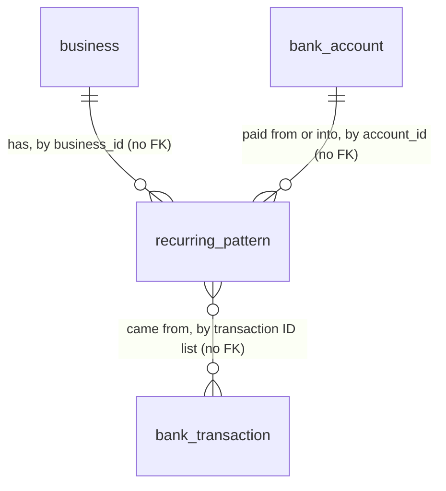

# 19 - Recurring payments

## Problem

A business's biggest regular payments - payroll, rent, software - are already in its bank history, but nothing in Headroom knows they repeat. Without that, spec 21 can only project an average, and the dashboard mockup's "Next 14 days" can't say "Payroll, Fri Oct 2, -$11,200, Recurring, every 2 weeks". For a business without accounting software (bank-only mode, `project-overview.md`), the bank history is the only source of what's coming. If the owner had to enter each repeating payment by hand, the forecast would be empty on day one.

Labels from spec 16 already set apart what isn't spending: card purchases, card payments and moves between the business's own accounts. If detection ignored them, the monthly sweep from Operating checking to Reserve savings would look like a monthly bill and be counted twice. The source gives no figures beyond the sample business.

When this ships, every committed sync replaces the business's stored recurring patterns. On the sample data that is payroll every 2 weeks (next Fri Oct 2), rent monthly (next Thu Oct 15) and software monthly (next Wed Oct 7), and nothing else. The owner reads them at `GET /v1/businesses/{business_id}/recurring-patterns`.

## Flow

This reuses the `transactions.synced` event that every sync, disconnect and sample load already publishes after committing (AD-048, AD-060, AD-066), the subscription list in `app/subscriptions.py` (AD-055), spec 16's labels (AD-057) and business-day rule (AD-059), and `require_member` (AD-031). It adds no new trigger, label or calendar.

1. A sync, disconnect or sample load commits -> `bank_sync.service` (exists) publishes `transactions.synced` for the business.
2. `app.events.publish` (exists) calls the handlers in `SUBSCRIPTIONS` order -> `forecasting.service.refresh_recurring_patterns` (new module `forecasting`, doors 1 and 2) for the event's `business_id`.
3. `forecasting.service` opens its own session (as `sync_in_background` does), takes the business's refresh lock (door 2), and reads every transaction of the business through `bank_sync.service` (exists; a new read function there, placement).
4. `forecasting` detection (new, no door - placement) keeps only `normal`, non-pending transactions, groups them, fits a schedule, and predicts each pattern's next date and amount. Pure, with no I/O.
5. `forecasting.repository` deletes the business's patterns and inserts the new set as `RecurringPattern` rows (door 1) in the same transaction, then commits. It logs `recurring_patterns.refreshed`.
6. Out: `GET /v1/businesses/{business_id}/recurring-patterns` (door 3) -> `forecasting.api` -> `forecasting.service` -> the stored rows, owner only.

## Impact

| Front | What changes |
| --- | --- |
| domain | new term: `recurring pattern` - a payment that repeats on one of 5 schedules, with a predicted next date and amount. It lives in `forecasting`, and spec 21 projects it forward. AGENTS.md's glossary already defines it |
| domain | new term: `schedule` - `weekly`, `biweekly`, `semimonthly`, `monthly`, `quarterly` (door 1). Specs 21, 26 and 30 show it ("Recurring, every 2 weeks"), with the display text in `messages/en.json` |
| modules | the `forecasting` module is created (AD-023 layout) and its router is added to the authenticated `/v1` router (AD-022). It reads bank data only through `bank_sync.service` |
| events | the first handler in `SUBSCRIPTIONS`. Spec 21's forecast handler must be subscribed after it, so that a forecast built on the same event reads fresh patterns (AD-047 runs handlers in subscription order) |
| sync latency | each sync that changes something now also runs detection over the whole business before the publisher returns. That covers connect, webhook, repair and nightly syncs. With the sample's 18 months, that is about 1,200 transactions |
| API contract | new route. `contracts/openapi.json` and `frontend/lib/api/schema.d.ts` are regenerated. No web code calls it yet |
| stored data | a new table, nothing to migrate. Businesses that synced before this ships get patterns on their next sync that changes something. There is no backfill |

## Relations

One-way constraints: `schedule` is one of exactly 5 values (door 1). `confidence` is 0 to 100 (door 1). The pattern refers to `bank_sync`'s accounts and transactions by ID only, with no foreign key (AD-037 precedent, door 1). A business's patterns are always replaced as a whole set, never edited one by one (door 2). No columns and no types here.

## Surface

| Route | In | Out | Status |
| --- | --- | --- | --- |
| `GET /v1/businesses/{business_id}/recurring-patterns` | path `business_id` (uuid) | `items[]` of `RecurringPattern` (`id`, `account_id`, `counterparty`, `description`, `schedule`, `amount_cents`, `currency`, `next_date`, `confidence`, `transaction_ids`) | `200`, `403`, `404`, `422` |

## Landing

| One-way door | Literal shape | Alternative rejected |
| --- | --- | --- |
| 1. Module `forecasting` and table `recurring_patterns` | `app/modules/forecasting/` (AD-023 layout, plus `events.py`). Table `recurring_patterns`: `id uuid` (generated by the app), `business_id uuid` and `account_id uuid` with no FK, `counterparty text not null`, `description text not null`, `schedule text not null` with `ck_recurring_patterns_schedule` in (`weekly`, `biweekly`, `semimonthly`, `monthly`, `quarterly`) (Python `Schedule` Literal), `amount_cents bigint not null` (our sign, non-zero by `ck_recurring_patterns_amount_nonzero`), `currency text not null`, `next_date date not null`, `confidence smallint not null` with `ck_recurring_patterns_confidence` (0 to 100), `transaction_ids uuid[] not null` (oldest first), `detected_at timestamptz not null`, and an index on `business_id` | A Postgres enum for `schedule`: AD-029 uses check constraints, which change in one migration. An FK to `bank_accounts` or `bank_transactions`: crosses module data ownership (AGENTS.md), and a disconnect deletes those rows first. A join table for the transactions: no reader asks "which pattern holds transaction X", and replacing a set would mean writing one row per transaction. `confidence` as a float: equality in tests and JSON round-trips get fuzzy, and nothing needs more than percent precision |
| 2. Refresh on `transactions.synced`, replace the whole set under a lock | `app/subscriptions.py` `SUBSCRIPTIONS` gains `(TRANSACTIONS_SYNCED, forecasting.service.refresh_recurring_patterns)` as its first entry. The handler opens a session from `get_sessionmaker()` and runs one transaction: `SELECT pg_advisory_xact_lock(hashtextextended('recurring_patterns:' \|\| :business_id, 0))`, then it reads the transactions, deletes every `recurring_patterns` row of the business and inserts the detected set. It commits once. Pattern IDs are new on every refresh | Upsert by a natural key: no key is stable, because amount bands split and merge as amounts change, so the key would be invented. Delete and insert with no lock: under READ COMMITTED, two overlapping refreshes each delete only the rows they can see and both insert, which leaves two sets. A row lock on a `bank_sync` table: crosses module ownership. Detecting on every read: the spec says patterns are stored, and spec 21 reads them on every recompute |
| 3. Recurring patterns route | `GET /v1/businesses/{business_id}/recurring-patterns`, owner only (AD-031), on the authenticated `/v1` router. Body `{"items": [RecurringPattern]}`, ordered by `next_date`, then `counterparty`, then `id`. `RecurringPattern` = `id`, `account_id`, `counterparty`, `description`, `schedule` (door 1's words), `amount_cents` (our sign), `currency`, `next_date` (ISO date), `confidence` (int 0 to 100), `transaction_ids` (oldest first). There is no paging | Paging with a cursor: a business has tens of patterns, not thousands, and AD-032's `{"items": ...}` can still grow a cursor later. Returning `schedule` as display text ("every 2 weeks"): all interface text lives in `messages/en.json` (AGENTS.md) |

- To be recorded in `.specs/STATE.md` when the checks are approved: door 1 AD-070, door 2 AD-071, door 3 AD-072.
- Nothing else here is hard to reverse. The tolerances, the 115% band, the 6-amount median and the confidence formula are numbers in the criteria, and they can change in a later diff with their tests.

## Criteria

"Business-day" is AD-059. "The as-of day" is the date of the business's newest transaction. Amounts are integer cents in our sign. "Band" means the transactions grouped by AC 2 and AC 3. Each schedule has an interval of 7 days (`weekly`), 14 days (`biweekly`), half a month (`semimonthly`), 1 month (`monthly`) or 3 months (`quarterly`).

### S1: The detector finds payments that repeat on a schedule (P1)

A pure function from a business's transactions and the as-of day to its recurring patterns.

**Acceptance Criteria**

1. The detector SHALL use only transactions that are not pending and are labelled `normal`. A transaction labelled `card_purchase`, `card_payment`, `internal_transfer`, `in_transit`, `credit_draw` or `credit_repayment` SHALL never be in a pattern.
2. The detector SHALL group transactions by account, currency, direction (the sign of the amount) and counterparty key. The key is the counterparty, lowercased and trimmed. When the counterparty is null, the key is the description, lowercased, with digits removed and spaces collapsed.
3. Within a group, the detector SHALL sort transactions by absolute amount. Each one SHALL join the current band while its absolute amount is at most 115% of the band's smallest, and start a new band otherwise.
4. A band SHALL fit a schedule when at least 3 of its expected dates have a transaction within the tolerance (the hits), and the hits are at least 75% of whichever is larger: the number of expected dates or the number of transactions in the band. The expected dates run from the band's first transaction to its last. The tolerances are `weekly` +/-1 day, `biweekly` +/-3, `semimonthly` +/-3, `monthly` +/-4 and `quarterly` +/-7. The day-of-month schedules use the median day of the month of the band's transactions (two medians for `semimonthly`, one for days 1 to 15 and one for days 16 to 31), clamped to the month's last day.
5. WHEN a band's transactions repeat every 7 days, every 14 days, on two days of each month, on one day of each month, or on one day every 3 months THEN the system SHALL report one pattern with schedule `weekly`, `biweekly`, `semimonthly`, `monthly` or `quarterly` respectively. WHEN more than one schedule fits THEN it SHALL pick the one whose hits are the larger share, then the shorter interval.
6. IF a band has fewer than 3 transactions THEN the system SHALL report no pattern for it. A monthly payment seen exactly 3 times SHALL be reported. (Spec 19 "Done when" 2.)
7. A pattern's next date SHALL be the schedule's first expected date after its last hit. For `weekly` and `biweekly` that date is on the band's cadence, so a payment moved for a holiday doesn't shift it. When the date is not a business day, it SHALL move to the next business day.
8. A pattern's amount SHALL be the median of the band's 6 most recent amounts (or all of them when there are fewer), rounded half to even to whole cents, in the band's currency.
9. A pattern's confidence SHALL be `round(100 * share * min(1, hits / 6))`, where `share` is AC 4's ratio of hits.
10. IF a pattern's next date is earlier than the as-of day by more than half its interval (`weekly` 3 days, `biweekly` 7, `semimonthly` 7, `monthly` 15, `quarterly` 45) THEN the system SHALL report no pattern for it. The payment has stopped.
11. Each pattern SHALL carry its account, its counterparty (the most recent hit's counterparty, or its description when that is null), its description (the most recent hit's), schedule, amount, currency, next date, confidence, and the IDs of its hits, oldest first.
12. WHEN the same transactions are given in any order THEN the detector SHALL return the same patterns.

**Independent test:** `uv run pytest tests/test_recurring_detection.py`, on synthetic transactions only.

### S2: On the sample data, payroll, rent and software are found, and nothing else (P1)

**Acceptance Criteria**

13. WHEN Harbor Street Plumbing (seed 0) has been loaded THEN its patterns SHALL include Payroll: Operating checking, `biweekly`, -1120000, next date 2026-10-02. (Spec 19 "Done when" 1.)
14. WHEN Harbor Street Plumbing (seed 0) has been loaded THEN its patterns SHALL include Wharfside Properties (description "Rent"): Operating checking, `monthly`, -380000, next date 2026-10-15. (Spec 19 "Done when" 1.)
15. WHEN Harbor Street Plumbing (seed 0) has been loaded THEN its patterns SHALL include Fieldworks Software (description "Software subscriptions"): Operating checking, `monthly`, -64000, next date 2026-10-07.
16. WHEN Harbor Street Plumbing is loaded with any seed from 0 to 9 THEN the business SHALL have exactly the 3 patterns of AC 13 to 15. No Coastal Supply Co bill, client payment, card purchase, card payment or transfer SHALL be in a pattern.
17. WHEN Harbor Street Plumbing has been loaded THEN no pattern SHALL hold a transaction of Reserve savings or one labelled `internal_transfer`. (Spec 19 "Done when" 3.)

**Independent test:** in pytest, run the spec 18 loader against the test database, then call the route as the owner.

### S3: Every committed sync refreshes the stored patterns (P1)

**Acceptance Criteria**

18. WHEN `transactions.synced` is published for a business THEN, once the handlers return, the business's stored patterns SHALL be exactly what AC 1 to 12 detect over its current transactions, and no earlier pattern of that business SHALL remain. Other businesses' patterns SHALL be unchanged.
19. WHEN the same `transactions.synced` event is handled twice THEN the business SHALL hold the same patterns as after the first (the same count and values, apart from `id` and `detected_at`).
20. WHEN two refreshes for the same business run at the same time THEN the business SHALL end with one set of patterns, with no pattern stored twice.
21. WHEN a business has no transaction that qualifies (for example, after its last bank is disconnected) THEN a refresh SHALL leave it with 0 patterns.
22. IF detection or the write fails THEN the refresh SHALL roll back and leave the business's earlier patterns in place, and `app.events` SHALL log `event.handler_failed` (AD-047).
23. WHEN a refresh commits THEN the system SHALL log one `recurring_patterns.refreshed` line with `business_id` and `patterns` (the count), and no transaction description, counterparty or amount.

**Independent test:** `uv run pytest tests/test_recurring_refresh.py`, with transactions written through `bank_sync`'s sync service and a fake Plaid client.

### S4: The owner reads the patterns through the API (P1)

**Acceptance Criteria**

24. WHEN the owner calls `GET .../recurring-patterns` THEN the system SHALL answer `200` with `{"items": [...]}`. Each item SHALL have exactly door 3's fields, and the items SHALL be ordered by `next_date`, then `counterparty`, then `id`.
25. IF the business has no patterns THEN the system SHALL answer `200` with `{"items": []}`.
26. IF the caller is not a member of the business THEN the system SHALL answer `404` "Business not found.". IF the caller's role is not `owner` THEN it SHALL answer `403`. A pattern of another business SHALL never appear in the response.
27. IF `business_id` is not a UUID THEN the system SHALL answer `422` problem details (AD-008).

**Independent test:** `uv run pytest tests/test_recurring_patterns_api.py`.

## Out of scope

| Excluded | Why |
| --- | --- |
| Projecting patterns across the 13 weeks | Spec 21 does it, from `next_date` and the schedule |
| Predicting the card payment | The dashboard mockup labels it "Card payment", not "Recurring". Spec 21 takes it from the card's balance |
| A web screen listing the patterns | No spec asks for one. Spec 26 shows them inside "Next 14 days" |
| Letting the owner edit, confirm or dismiss a pattern | No spec or mockup has it |
| Publishing `forecast_inputs.changed` when patterns change | Spec 21 recomputes on `transactions.synced`, the same event that refreshes the patterns |
| A backfill command for businesses that synced before this ships | The next sync that changes something refreshes them. Staging holds only sandbox data |
| Matching expected payments against patterns | Spec 20 matches expected payments to transactions |

## Assumptions

| Assumption | Chosen default | Rationale | Confirmed? |
| --- | --- | --- | --- |
| When detection runs | On every `transactions.synced`, replacing the business's whole set (door 2) | spec 19 doesn't say. This is the one event every bank data change already publishes, and spec 21 recomputes on it too | n |
| Pattern IDs | New on every refresh, not stable | there is no stable natural key (door 2). Spec 21 snapshots and spec 24 explanations copy the amount, date and counterparty they show, so they don't depend on a pattern ID that lives on | n |
| Which accounts | Every account, included or not, with only `normal` transactions (AC 1). Spec 21 keeps the included ones | changing an account's inclusion publishes no `transactions.synced`, so filtering here would leave stale patterns. Credit accounts produce no `normal` transactions anyway | n |
| Line of credit repayments (`credit_repayment`) | Not patterns | AGENTS.md: lines of credit never count as cash, and spec 16 labels them as moves between the business's own accounts | n |
| "Similar amount" | Within 115% of the band's smallest amount (AC 3) | covers a rent or software price change of up to 15%; payroll and rent in the sample are exact | n |
| "Recent amounts" | The 6 most recent (AC 8) | about 3 months of biweekly payroll, or 6 months of rent | n |
| Confidence | AC 9: the share of expected dates hit, scaled down below 6 hits | spec 19 names the field but not its meaning. This makes a perfect 3-hit pattern 50 and a perfect 6+ hit pattern 100 | n |
| The as-of day | The business's newest transaction date, not the clock | the result then doesn't depend on the day the code runs, and the sample loaded on any day gives the dates in AC 13 to 15 | n |
| Holidays in the next date | Moved to the next business day (AC 7), even for payroll, which the sample moves earlier | when the bank posts is unknown. Only the next date is affected, and spec 21 owns the dates after it | n |

**Open questions:** none - all resolved or logged above.

## Observable

| Surface | Decision | Landing |
| --- | --- | --- |
| API `GET .../recurring-patterns` | response shape | AC 24, door 3 |
| API `GET .../recurring-patterns` | error shape and codes | AC 26, AC 27 |
| API `GET .../recurring-patterns` | who may call it | AC 26 |
| API `GET .../recurring-patterns` | versioning | existing - under `/v1` (AGENTS.md) |
| API `GET .../recurring-patterns` | rate limit | n/a - no route has one in v1, and the response is bounded by the business's patterns |
| collection `recurring patterns` | grouping criterion | AC 2, AC 3 |
| collection `recurring patterns` | naming | AC 11 (counterparty and description from the most recent hit) |
| collection `recurring patterns` | ordering | AC 24 |
| collection `recurring patterns` | duplicates | AC 20 (one set per business), AC 4 (a second transaction on one expected date is not a second hit) |
| collection `recurring patterns` | the exception that doesn't fit | AC 6 (fewer than 3), AC 10 (stopped), AC 1 (labels that are never spending) |

## Sources

- `context/specs/19-forecast-recurring-payments.md` - the build list and "Done when".
- `design/mockups/dashboard-desktop.dc.html` - "Recurring, every 2 weeks" for payroll, "Recurring, monthly" for software, and "Card payment" kept apart (AC 15, Out of scope).
- `app/fixtures/harbor_street.py` (AD-068) - the payroll, rent and software schedules behind AC 13 to 16.
