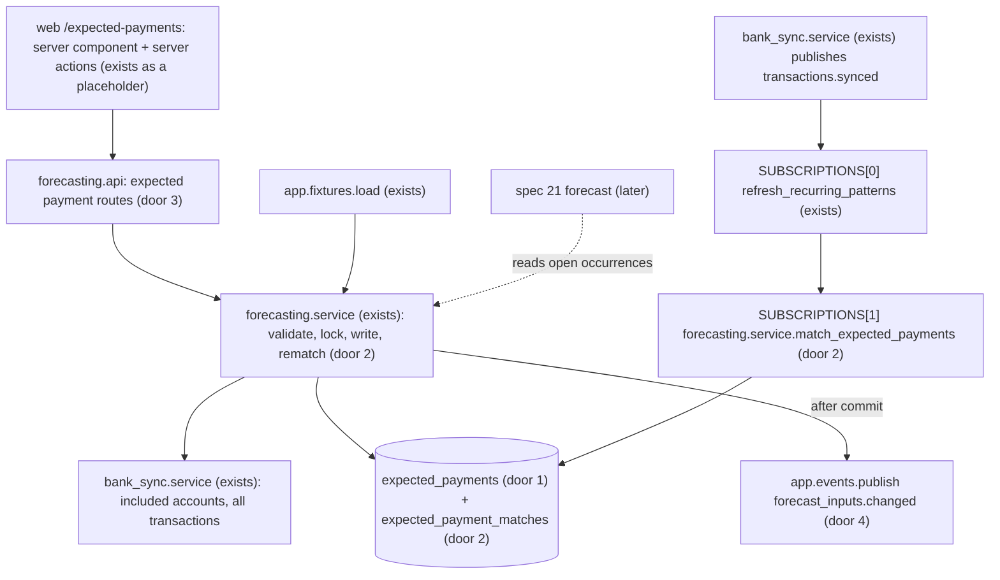
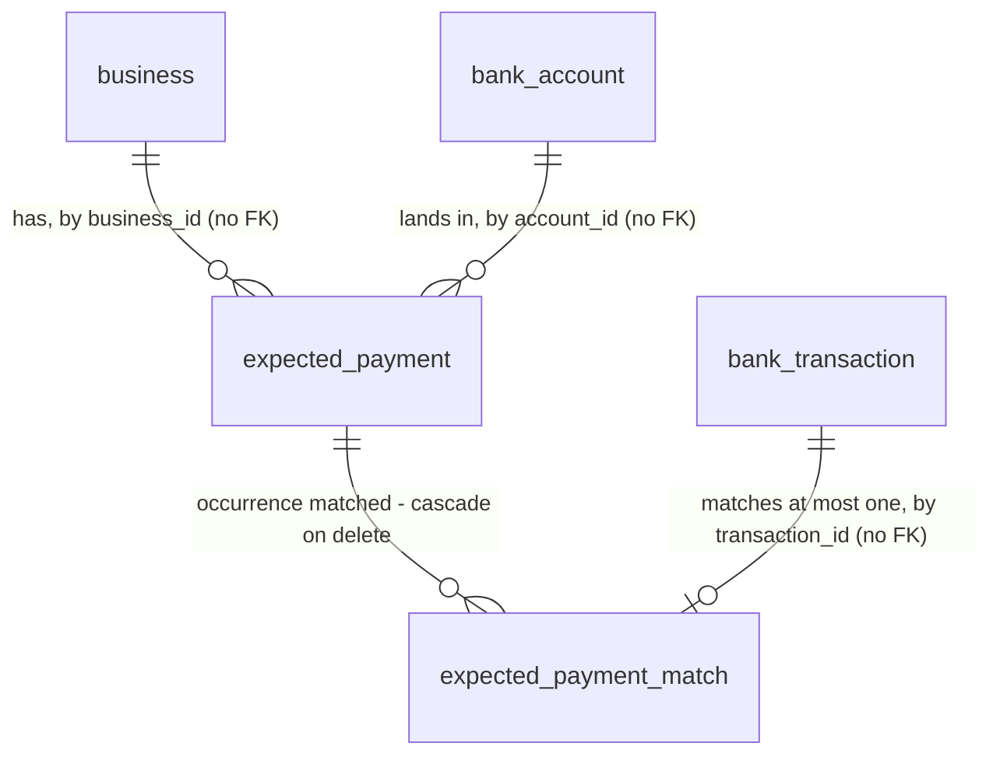

# 20 - Expected payments

## Problem

Some of a business's biggest movements of cash never repeat, so its bank history can't predict them: a large client invoice due next month, a quarterly supplier order, an equipment deposit. Spec 19 finds only what repeats in the history. Today the owner knows these payments are coming and Headroom doesn't. The forecast that spec 21 builds would miss them, and so would the alert that spec 24 raises. In the sample business, missing them would hide the Nov 9 gap. That gap is the $14,500 Coastal Supply order landing beside payroll (`project-overview.md`, AD-068).

There is a second cost. Once an expected payment arrives, it is in the bank balance. If Headroom still counted the expected payment as well, the forecast would include the same money twice: too optimistic for money in, too pessimistic for money out. The source gives no figures beyond the sample business.

When this ships, the owner adds, edits and deletes expected payments on the Expected payments page. Each payment has:

- an amount and a direction
- a date
- an account (the primary account unless the owner chooses another)
- a description
- an optional repeat schedule

Every sync matches real transactions to the expected payments. A matched payment drops off the page and out of the payments still to come, so the money is counted once.

## Flow

This reuses the `transactions.synced` event and the subscription list (AD-048, AD-055), the existing `forecasting` module with its replace-the-set-under-an-advisory-lock pattern (AD-070, AD-071), the owner check (AD-031), the audit log (AD-011), the problem details (AD-008), the shadcn Dialog (already a full-screen sheet below `sm`) with the Toast, Select and ToggleGroup components, and the app shell's placeholder route `/expected-payments`. It adds no new trigger, module or component.

1. The owner submits the dialog. A server action (placement) calls `POST`, `PUT` or `DELETE` `.../expected-payments` through the typed client (AD-017, AD-025).
2. `forecasting.api` (exists; door 3 routes) checks that the caller is the owner. `forecasting.service` then:
   - takes the business's expected-payments lock (door 2)
   - checks the account against the business's included accounts through `bank_sync.service` (exists)
   - writes the `ExpectedPayment` row (door 1) and the audit entry
   - recomputes every match of the business (door 2)
   - commits, then publishes `forecast_inputs.changed` (door 4)
3. A sync commits and `transactions.synced` is published. `refresh_recurring_patterns` runs first (AD-071). Then `match_expected_payments` (door 2) opens its own session, takes the same lock, reads the business's transactions through `bank_sync.service`, replaces its matches and commits. Matching is a pure function with no I/O and no clock (placement).
4. Out: `GET .../expected-payments` returns the payments that still have an upcoming occurrence, with `next_date` and `overdue` computed for the business-local today. The server component renders the table. Spec 21 will read the open occurrences through `forecasting.service`.

## Impact

| Front | What changes |
| --- | --- |
| domain | new term: `expected payment` - a payment the owner says is coming, once or on a repeat schedule. It lives in `forecasting` |
| domain | new term: `occurrence` - one dated instance of an expected payment. A one-off has one; a repeating payment has one per period from its start date |
| domain | new term: `match` - a real transaction paired with one occurrence (door 2). A matched occurrence is never counted again |
| domain | new term: `repeats` - `weekly`, `biweekly`, `monthly`, `quarterly`, or null for a one-off (door 1). Spec 21 projects from these words. It is a separate set from spec 19's `Schedule`, which also has `semimonthly` |
| events | the first publisher of `forecast_inputs.changed` (door 4); spec 21 subscribes to it. `transactions.synced` gains a second handler, which runs after the patterns refresh. Spec 21's forecast handler must come after both |
| sync latency | every sync that changes something now also matches over the business's transactions. That is about 1,200 for the sample's 18 months |
| sample loader | `app.fixtures.load` also creates the 4 sample expected payments through the service. Spec 18 deferred this to here (spec 18 plan, out of scope) |
| web | the placeholder at `/expected-payments` becomes the real page; nav and shell are unchanged. `messages/en.json` gains an `expectedPayments` block |
| API contract | 4 new routes. `contracts/openapi.json` and `frontend/lib/api/schema.d.ts` are regenerated |
| stored data | 2 new tables, so there is nothing to migrate. A sample loaded before this ships has no expected payments until it is loaded again |

## Relations

One-way constraints:

- `repeats` is null or one of exactly 4 values (door 1).
- The amount is non-zero and in our sign (door 1).
- An occurrence has at most one match, and a transaction is in at most one match (door 2).
- A business's matches are always replaced as a whole set, never edited one by one (door 2).
- Accounts and transactions are referenced by ID only, with no foreign key (AD-037, AD-070 precedent).

No columns and no types here.

## Surface

| Route | In | Out | Status |
| --- | --- | --- | --- |
| `GET /v1/businesses/{business_id}/expected-payments` | path `business_id` | `items[]` of `ExpectedPayment` (`id`, `account_id`, `description`, `amount_cents`, `currency`, `date`, `repeats`, `next_date`, `overdue`) | `200`, `403`, `404`, `422` |
| `POST /v1/businesses/{business_id}/expected-payments` | `account_id` (optional), `description`, `amount_cents`, `date`, `repeats` | `ExpectedPayment` | `201`, `403`, `404`, `409`, `422` |
| `PUT /v1/businesses/{business_id}/expected-payments/{payment_id}` | the same body as `POST` | `ExpectedPayment` | `200`, `403`, `404`, `409`, `422` |
| `DELETE /v1/businesses/{business_id}/expected-payments/{payment_id}` | path ids | empty | `204`, `403`, `404`, `422` |

## Landing

| One-way door | Literal shape | Alternative rejected |
| --- | --- | --- |
| 1. Table `expected_payments` (module `forecasting`) | `id uuid` app-generated; `business_id uuid` and `account_id uuid` with no FK; `description text not null`; `amount_cents bigint not null` in our sign, with `ck_expected_payments_amount_nonzero`; `currency text not null` (copied from the account); `date date not null` (the first occurrence); `repeats text null` with `ck_expected_payments_repeats` in (`weekly`, `biweekly`, `monthly`, `quarterly`), Python `Repeats` Literal; `created_at` and `updated_at timestamptz not null`; index on `business_id`. Read only through `forecasting.service` | A `direction` column beside a positive amount: two fields would hold one sign, and every reader would have to combine them (AGENTS.md: positive is in). `semimonthly`: one date can't say which second day. An end date or count: no spec or mockup has one, and a nullable column can be added later. An FK to `bank_accounts`: crosses module ownership, and a disconnect deletes accounts first (AD-037) |
| 2. Matches as a stored set, replaced per business under a lock | Table `expected_payment_matches`: `expected_payment_id` FK `expected_payments.id` `ON DELETE CASCADE`, `business_id uuid`, `occurrence_date date`, `transaction_id uuid` (no FK), primary key `(expected_payment_id, occurrence_date)`, unique `uq_expected_payment_matches_transaction_id`. Every write takes `pg_advisory_xact_lock(hashtextextended('expected_payments:' \|\| business_id, 0))`, deletes all of the business's matches, and inserts the recomputed set in the same transaction. The writes are the 3 routes and the sync handler. `SUBSCRIPTIONS[1]` is `(transactions.synced, forecasting.service.match_expected_payments)` | A `matched_transaction_id` column on the payment: it can't express which occurrence of a repeating payment was matched. Matching on every read: spec 21 and the page would each recompute it, and could disagree. Updating matches incrementally: Plaid replaces a pending transaction with a posted one (remove plus add), so a stored match can lose its transaction, and recomputing from scratch is the only rule that stays right. Advancing a repeating payment's `date` on a match: that loses what the owner entered, and a removed transaction couldn't undo it |
| 3. Expected payment routes and JSON | The 4 routes in `Surface`, owner only (AD-031), on the authenticated `/v1` router. Body `{"account_id"?: uuid, "description": str, "amount_cents": int, "date": "YYYY-MM-DD", "repeats": "weekly" \| "biweekly" \| "monthly" \| "quarterly" \| null}` with `extra="forbid"`. `ExpectedPayment` = `id`, `account_id`, `description`, `amount_cents` (our sign), `currency`, `date`, `repeats`, `next_date` (ISO date), `overdue` (bool). The list is `{"items": [...]}` (AD-032), with no paging. Rule violations are `409` problem details (AD-044) | `PATCH` with optional fields: the dialog always sends every field, and optional fields add a "which were sent" branch that no client uses. A separate `direction` field: door 1. Returning matched one-offs with a status: the user chose upcoming only. Display text for `repeats`: `messages/en.json` holds it (AGENTS.md) |
| 4. `forecast_inputs.changed`, first publisher | `forecasting/events.py` `FORECAST_INPUTS_CHANGED = "forecast_inputs.changed"`. It is published after the route's commit (AD-047) with the payment's `business_id` and payload `{"source": "expected_payments", "expected_payment_id": str}`. Matching on `transactions.synced` publishes nothing | A payload with the changed fields: spec 21 recomputes the whole business, and amounts in events would reach logs (AGENTS.md). Publishing from the sync handler: spec 21 already recomputes on `transactions.synced`, after this handler, so a second event would build the same forecast twice. Spec 23's minimum balance can publish the same event with its own `source` |

- To be recorded in `.specs/STATE.md` when the checks are approved: door 1 AD-073, door 2 AD-074, door 3 AD-075, door 4 AD-076.
- Nothing else here is hard to reverse. The tolerances, the date bounds and the description length are numbers in the criteria, and their tests change with them.

## Criteria

These terms are used throughout:

- **"Today"** is the business-local date of the request's clock (the business's `time_zone`, AD-029). The sample loader passes its own clock (AC 27).
- **Amounts** are integer cents in our sign.
- **"Included account"** is a `bank_sync` account of the business with `included` true (AD-040).
- **"Late window"**: an occurrence's late window closes 14 days after its date.

### S1: The owner creates, edits, deletes and lists expected payments through the API (P1)

**Acceptance Criteria**

1. WHEN the owner calls `POST .../expected-payments` with a valid body THEN the system SHALL answer `201` with the `ExpectedPayment` JSON (door 3) and store one row whose `currency` is the account's currency.
2. IF the body has no `account_id` THEN the system SHALL use the business's primary account (AD-042).
3. IF `account_id` is not an included account of this business (unknown, another business's, excluded, or a credit account) THEN the system SHALL answer `409` with detail "Choose an account you count as cash." and store nothing.
4. IF the body has no `account_id` and the business has no primary account THEN the system SHALL answer `409` with detail "Connect a bank before adding expected payments." and store nothing.
5. IF any of the following holds THEN the system SHALL answer `422` problem details (AD-008) and store nothing:
   - `description` is under 1 or over 100 characters after trimming
   - `amount_cents` is 0, or its absolute value is over 9999999999
   - `date` is earlier than today minus 90 days, or later than today plus 730 days
   - `repeats` is not null and not one of door 1's 4 words
   - the body has a field not in door 3

   The stored description SHALL be the trimmed text.
6. WHEN the owner calls `PUT .../expected-payments/{payment_id}` with a valid body THEN the system SHALL answer `200` with the updated JSON, keeping the same `id` and `created_at`. AC 2 to 5 SHALL apply to the body.
7. WHEN the owner calls `DELETE .../expected-payments/{payment_id}` THEN the system SHALL answer `204`, and the payment and its matches SHALL no longer exist.
8. IF `payment_id` is not a payment of this business THEN `PUT` and `DELETE` SHALL answer `404` with detail "Expected payment not found." and change nothing.
9. WHEN the owner calls `GET .../expected-payments` THEN the system SHALL answer `200` with `{"items": [...]}`:
   - The list SHALL hold only payments with a `next_date` (AC 20). This is the "upcoming only" rule the user approved on 2026-10-06.
   - Items SHALL be ordered by `next_date`, then `description`, then `id`.
   - Each item SHALL have exactly door 3's fields.
   - A business with none SHALL get `{"items": []}`.
10. IF the caller is not a member of the business THEN every route SHALL answer `404` "Business not found.". IF the caller's role is not `owner` THEN every route SHALL answer `403` (AD-031). Another business's payment SHALL never be listed, changed or deleted.
11. IF `business_id` or `payment_id` is not a UUID THEN the system SHALL answer `422` problem details.
12. WHEN a create, update or delete commits THEN the same transaction SHALL write one audit entry: `expected_payment.created`, `expected_payment.updated` or `expected_payment.deleted`, with target type `expected_payment` and the payment's ID. The entry SHALL hold no description and no amount.

**Independent test:** `uv run pytest tests/test_expected_payments_api.py`.

### S2: Real transactions are matched to expected payments (P1)

13. The occurrences of a payment SHALL be generated as follows:
    - A one-off (`repeats` null) has one occurrence, on its `date`.
    - `weekly` and `biweekly` occur every 7 and every 14 days from `date`.
    - `monthly` and `quarterly` occur every 1 and every 3 months from `date`, on the day of the month of `date`, moved back to the month's last day when that month is shorter. For example, a monthly payment from Jan 31 occurs Feb 28, then Mar 31.
14. A transaction SHALL be a candidate for an occurrence only when every one of these holds (tolerances approved by the user on 2026-10-06):
    - it belongs to the same business and is labelled `normal`, whether pending or posted
    - it has the same currency and the same sign
    - `10 * |transaction amount - expected amount| <= |expected amount|`
    - its date is from 7 days before to 14 days after the occurrence
15. Occurrences SHALL be matched in order of occurrence date, then the payment's `created_at`, then the payment's `id`. Each SHALL take the unmatched candidate with the smallest amount difference, then the smallest day difference, then the earlier date, then the smaller transaction `id`. A transaction SHALL be in at most one match, and an occurrence SHALL have at most one.
16. Matching SHALL depend only on the payments and the transactions, never the clock. WHEN the same inputs are given in any order THEN it SHALL produce the same matches.
17. WHEN `transactions.synced` is published for a business THEN, once the handlers return, its stored matches SHALL be exactly what AC 13 to 16 give over its current payments and transactions. A match whose transaction was removed SHALL be gone, and its occurrence SHALL be open again. Other businesses' matches SHALL be unchanged.
18. WHEN a payment is created, updated or deleted THEN the business's matches SHALL be recomputed in the same transaction as the change. A transaction that already happened SHALL match a payment added after it.
19. WHEN the same `transactions.synced` event is handled twice, or two writes for one business run at the same time, THEN the business SHALL end with one set of matches, with no match stored twice.
20. A payment's `next_date` SHALL be its earliest occurrence that has no match and is either:
    - the one-off's own occurrence (overdue one-offs stay listed), or
    - a repeating occurrence whose late window has not closed (its date plus 14 days is today or later).

    A matched one-off SHALL have no `next_date`. `overdue` SHALL be true exactly when `next_date` is earlier than today.
21. IF matching or its write fails during a sync THEN the handler SHALL roll back and leave the earlier matches in place, and `app.events` SHALL log `event.handler_failed` (AD-047).
22. WHEN matches are written THEN the system SHALL log one `expected_payments.matched` line with `business_id` and `matches` (the count), and no description, counterparty or amount.

**Independent test:** `uv run pytest tests/test_expected_payment_matching.py`. It uses synthetic transactions written through `bank_sync`'s sync service with a fake Plaid client, plus pure tests of the matcher.

### S3: A matched payment is counted only once (P1)

23. `forecasting.service.open_occurrences(session, business_id=..., today=..., until=...)` SHALL return every occurrence that has no match, is dated on or before `until`, and is either a one-off occurrence or a repeating one whose late window has not closed. Each occurrence SHALL come with its payment's `id`, `account_id`, `description`, `amount_cents`, `currency` and its date.
24. A matched occurrence SHALL never be returned by `open_occurrences` or shown on the list. (Spec 20 "Done when" 2.)

    Example: "Acme Co, invoice 1042" is +800000 on 2026-10-06. A synced transaction of +790000 on 2026-10-09 matches it, so it leaves `open_occurrences` and the list. The bank balance holds the money once.

    Example: a quarterly -1450000 from 2026-11-12 is matched on 2026-11-13. It still returns 2027-02-12.

**Independent test:** in `tests/test_expected_payment_matching.py`, sync a matching transaction, then compare `open_occurrences` and the list before and after.

### S4: Changes tell the forecast to recompute (P1)

25. WHEN a create, update or delete commits THEN the system SHALL publish exactly one `forecast_inputs.changed` after the commit (door 4). It SHALL carry the business's ID and the payload `source` = `"expected_payments"` and `expected_payment_id`. IF the request fails (any `4xx`) THEN nothing SHALL be published.
26. Matching on `transactions.synced` SHALL publish no `forecast_inputs.changed`. In `SUBSCRIPTIONS`, `match_expected_payments` SHALL come right after `refresh_recurring_patterns`.

**Independent test:** `uv run pytest tests/test_expected_payments_api.py -k event`, with a recording handler subscribed.

### S5: The sample business has the mockup's expected payments (P2)

27. WHEN Harbor Street Plumbing is loaded (spec 18) THEN it SHALL have exactly the fixture's 4 expected payments on Operating checking: Acme once, Coastal `quarterly`, Birch once and the lease deposit once. Each SHALL be created through `forecasting.service`, with today taken from the loader's clock (AD-069's `SYNCED_AT`), and none SHALL be matched. A second load of the same business SHALL not add more.

**Independent test:** in pytest, run the spec 18 loader against the test database, then call the list route as the owner.

### S6: The owner manages expected payments on the web (P1)

Screen `/expected-payments`, from `design/mockups/expected-payments.dc.html`. All text comes from `messages/en.json`.

28. The page SHALL match the mockup:
    - the title "Expected payments" and the line "Payments you know are coming that Headroom can't predict from your bank data."
    - a primary button "Add expected payment" (AD-013)
    - a card with a table of columns Date, Description, Account, Repeats and Amount, plus an actions column whose header is visible only to screen readers ("Actions")

    In each row:
    - the date is `next_date` formatted as "Tue, Oct 6"
    - the account is its name
    - Repeats reads "Doesn't repeat", "Every week", "Every 2 weeks", "Every month" or "Every 3 months"
    - the amount comes from `lib/format.ts`, as "+$8,000" in `--positive` for money in and "−$14,500" in ink for money out, in tabular numbers
    - two 44px icon buttons are labelled "Edit {description}" and "Delete {description}"
29. WHILE a row's `overdue` is true, the row SHALL show a `warning` Badge "Overdue" beside the date.
30. IF a row's `account_id` is not one of the business's included accounts THEN its Account cell SHALL read "Account removed".
31. IF the list is empty THEN the page SHALL show the empty state (DESIGN.md): an icon, the title "No expected payments yet", the sentence "Add a payment you know is coming, such as a large invoice, so your forecast includes it." and the button "Add expected payment".
32. WHILE the page loads THEN it SHALL show a skeleton. IF the API call fails THEN it SHALL show the error state "We couldn't load your expected payments." with a "Try again" button that reloads it.
33. WHEN the owner activates "Add expected payment" THEN a dialog titled "Add expected payment" SHALL open with these fields, in this order:
    - a segmented control "Money out" / "Money in", with "Money out" selected
    - Amount, with a "$" prefix and `inputmode="decimal"`
    - Date, a native date input
    - Description
    - Account, the included accounts with the primary account selected
    - Repeats, defaulting to "Doesn't repeat"
    - Cancel and "Add payment"

    WHEN the owner submits valid values THEN the payment SHALL be created, the dialog SHALL close, the toast "Expected payment added" SHALL show, and the list SHALL show the new row.
34. WHEN the owner activates "Edit {description}" THEN the same dialog SHALL open titled "Edit expected payment", filled with the payment's values, with the primary button "Save changes". A save SHALL update the row and show the toast "Expected payment updated".
35. WHEN the owner activates "Delete {description}" THEN a confirmation dialog "Delete {description}?" SHALL open with Cancel and a destructive "Delete payment". Confirming SHALL remove the row and show the toast "Expected payment deleted". Cancel SHALL change nothing.
36. IF the amount is empty, 0, not a number, has more than 2 decimals, or is over $99,999,999.99, or the description is empty, THEN the dialog SHALL show an error under that field and send nothing. IF the API answers `409` or `422` THEN the dialog SHALL stay open with the values kept and show "We couldn't save this payment. Check the details and try again.", or the `409`'s detail when there is one.
37. At 375 pixels wide:
    - the page SHALL have no horizontal scroll
    - each row SHALL stack as description and amount, then date, repeats and account
    - the dialogs SHALL be full-screen sheets
    - every control SHALL be at least 44px tall
38. Using only the keyboard, the owner SHALL be able to:
    - open the add dialog
    - fill and submit it
    - open edit and delete for any row
    - close any dialog with Escape, with focus returning to the button that opened it

    Axe SHALL report no violations on the page, on either dialog, or in the empty state.
39. WHEN the owner adds, edits and then deletes a payment in the web app THEN each change SHALL be in the database after that step. (Spec 20 "Done when" 1.)

**Independent test:** `npx playwright test e2e/expected-payments.spec.ts` against the local API and database, plus Vitest for the dialog's validation and the row formatting.

## Out of scope

| Excluded | Why |
| --- | --- |
| Projecting expected payments across the 13 weeks | Spec 21 reads `open_occurrences` |
| Removing an expected payment that duplicates a recurring pattern | Spec 21 combines the two inputs. The sample's Coastal order is deliberately not in the history (spec 18 plan) |
| Matching or unmatching by hand | No spec or mockup has it |
| An end date or a count for repeating payments | No spec or mockup has it. The owner deletes the payment |
| Showing matched or past payments | The user chose upcoming only (AC 9) |
| Uploading a spreadsheet of invoices | `project-overview.md` mentions it, but no v1 spec builds it |
| Bookkeepers managing expected payments | Spec 31 adds the bookkeeper role to these routes |
| The analytics event "expected payment added" | Spec 32 |

## Assumptions

| Assumption | Chosen default | Rationale | Confirmed? |
| --- | --- | --- | --- |
| Which transactions can match | Any account of the business, not only the payment's account; labelled `normal`; pending included (AC 14) | the forecast is one combined balance, and clients pay into whichever account they have. Pending money is already in the balance, and AC 17 rematches when Plaid replaces it with the posted transaction | n |
| Repeat choices | `weekly`, `biweekly`, `monthly`, `quarterly`; no "twice a month" (door 1) | the mockup shows only "Doesn't repeat" and "Every 3 months". A twice-a-month payment needs a second date, which the dialog doesn't have | n |
| Date bounds | From today minus 90 days to today plus 730 days (AC 5) | a payment that's a little late can still be entered, and nothing beyond 2 years affects a 13-week forecast | n |
| Phone layout of the table | Each row stacks (AC 37) | there is no phone mockup for this screen, and 6 columns can't fit in 375px without scrolling | n |
| Date field | A native `<input type="date">` | there's no date picker in `components/ui/`, and AGENTS.md says to ask before adding a component. The native input works with the keyboard and on phones | n |
| Delete confirmation | A confirmation dialog (AC 35), as for disconnecting a bank | the mockup shows only the trash icon. A delete can't be undone | n |
| A payment whose account was disconnected or excluded | Kept. The cell reads "Account removed" (AC 30). Matching still runs across all accounts, and editing it requires choosing an included account | deleting the owner's entry because a bank was reconnected would lose data, and spec 21 counts it in the combined balance anyway | n |
| Audit entries | One per create, update or delete (AC 12) | every owner change to bank settings is audited already (AD-011), and bookkeepers will make these changes from spec 31 | n |

**Open questions:** none - all resolved or logged above.

## Observable

| Surface | Decision | Landing |
| --- | --- | --- |
| screen `/expected-payments` | empty state | AC 31 |
| screen `/expected-payments` | loading state | AC 32 |
| screen `/expected-payments` | error state | AC 32 (page), AC 36 (dialog) |
| screen `/expected-payments` | unauthorised state | existing - `auth.protect()` (AD-026), and the API's `403` / `404` lead to AC 32's error |
| screen `/expected-payments` | density and ordering | AC 28, AC 9 (by next date) |
| screen `/expected-payments` | destructive action confirms | AC 35 |
| API all 4 `.../expected-payments*` | response shape | AC 1, AC 9, door 3 |
| API all 4 `.../expected-payments*` | error shape and codes | AC 3, AC 4, AC 5, AC 8, AC 11 |
| API all 4 `.../expected-payments*` | who may call it | AC 10 |
| API all 4 `.../expected-payments*` | versioning | existing - under `/v1` (AGENTS.md) |
| API all 4 `.../expected-payments*` | rate limit | n/a - no route has one in v1, and only the owner can call these |
| collection `expected payments` | grouping and ordering | AC 9 |
| collection `expected payments` | naming | AC 5 (the owner's description, trimmed) |
| collection `expected payments` | duplicates | n/a - two identical entries are two payments the owner added. AC 15 gives each its own transaction |
| collection `expected payments` | the exception that does not fit | AC 20 (an overdue one-off stays listed), AC 30 (a removed account) |

## Sources

- `context/specs/20-forecast-expected-payments.md` - the build list and "Done when".
- `design/mockups/expected-payments.dc.html` - binding for the page and the add dialog (AC 28, AC 33).
- `app/fixtures/harbor_street.py` `EXPECTED_PAYMENTS` (AD-068) - the 4 sample payments (AC 27).
