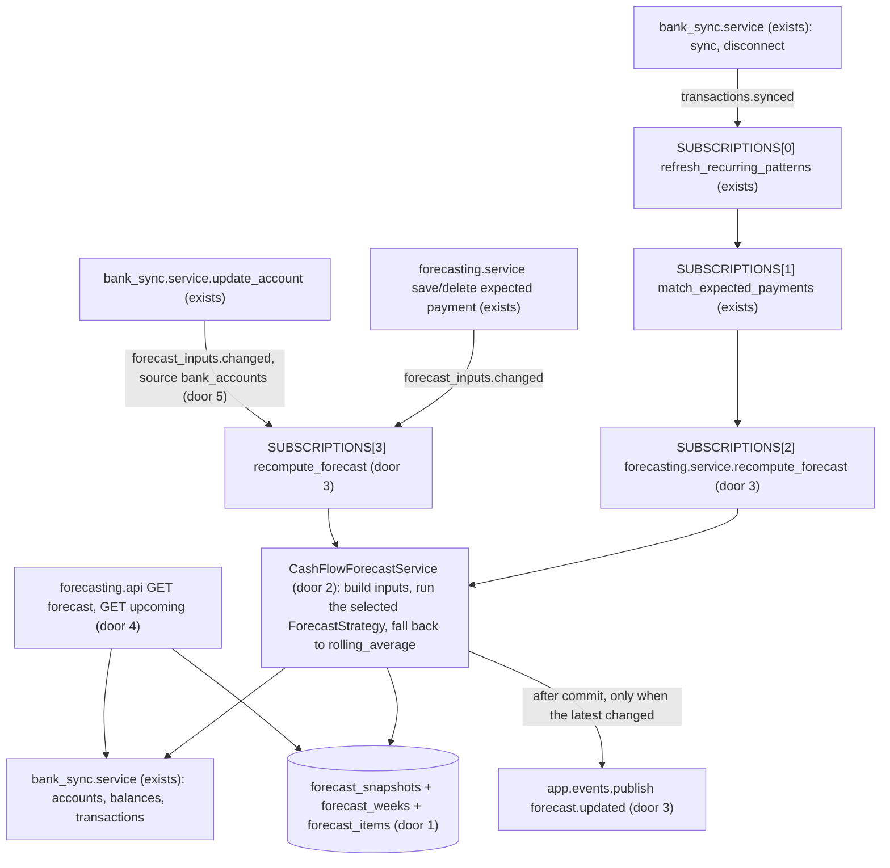
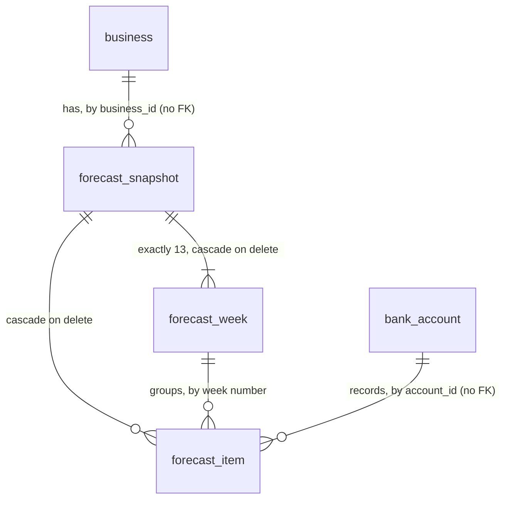

# 21 - The 13-week forecast

## Problem

Headroom now knows a business's balances (spec 13), its transactions (spec 14), the payments that repeat (spec 19) and the payments the owner says are coming (spec 20). It still can't say what the balance will be next month. So the owner can't see a cash gap coming. Spec 24 has nothing to raise an alert from, and the dashboard (spec 26) and the weekly digest (spec 30) have nothing to show. The product's core promise ("warns when the balance will drop below the minimum", AGENTS.md) is unmet.

The owner pays for it the way the overview describes. A spreadsheet forecast is "built once, rarely updated, and out of date within weeks" (`project-overview.md`). A gap found the week it lands leaves no time to move a payment or chase an invoice. The source gives no figures beyond the sample business.

When this ships, every bank sync and every change to an expected payment or an included account recomputes the business's forecast. The forecast covers 13 weeks starting on Mondays in the business's time zone. Each week has an end balance, a low and a high estimate, money in, money out, and the payments behind them. Each payment carries its account. `GET .../forecast` returns the latest forecast, and `GET .../upcoming?days=14` returns the named payments of the next 14 days, which is the dashboard's "Next 14 days" list.

## Flow

This reuses:

- the `transactions.synced` and `forecast_inputs.changed` events and the subscription list (AD-048, AD-055, AD-076)
- the stored recurring patterns and `open_occurrences` (AD-071, AD-074)
- the replace-under-an-advisory-lock pattern (AD-071)
- the owner check (AD-031) and the problem details (AD-008)
- detection's own cadence for a pattern's later dates (spec 19)

It adds no new module, and no screen.

1. A sync or a disconnect commits and publishes `transactions.synced`. Patterns refresh (AD-071), then matches (AD-074). Then `recompute_forecast` (door 3) opens its own session and takes the business's forecast lock.
2. `CashFlowForecastService` (door 2) works out today for the business-local date and the 13 week starts. It then reads, through `bank_sync.service` (exists):
   - the included accounts with their balances and currencies
   - the credit card accounts and their balances
   - every transaction
   - each connection's status

   From its own module it reads the patterns, `open_occurrences` and the IDs of the transactions matched to an expected payment. It builds the frozen `ForecastInputs` (`forecasting/strategies.py`), hashes them (door 1, `forecasting/engine.py`), and runs the strategy chosen by `FORECAST_STRATEGY` (door 2). The strategy is a pure function: no session, no clock.
3. If the hash equals the latest snapshot's, it touches nothing and publishes nothing. Otherwise it upserts the snapshot with its 13 weeks and its items, makes it the latest, commits, and publishes `forecast.updated` (door 3).
4. An expected payment write (spec 20) or an inclusion change (door 5) publishes `forecast_inputs.changed` after its commit. Step 2 runs from `SUBSCRIPTIONS[3]`.
5. Out: `GET .../forecast` returns the latest snapshot, plus `incomplete` computed at request time from the connections' status. `GET .../upcoming` returns that snapshot's named items dated in the next `days` days.

## Impact

| Front | What changes |
| --- | --- |
| domain | new term: `forecast snapshot` - one stored 13-week forecast of a business, keyed by the fingerprint of its inputs (door 1). The newest is "the forecast". Lives in `forecasting` |
| domain | new term: `forecast week` - week 1 starts on the first Monday on or after the business-local today. Week 1's end balance also counts the items dated from today to that Monday. Specs 22, 24, 26 and 30 branch on this (door 6) |
| domain | new term: `forecast item` - one dated amount behind a week's totals. Its `source` is `recurring_pattern`, `expected_payment`, `card_payment` or `estimate`. It always has an `account_id` |
| domain | new term: `estimate` - the irregular rest of the money in and out, such as client receipts and supplier bills: a weekly average of the recent `normal` transactions not explained by a pattern or an expected payment |
| domain | existing term: `incomplete` - first defined here: an included connection needs attention (AD-061, AD-063) or hasn't synced for 48 hours (AD-062). Specs 26 and 29 show it |
| events | `forecast.updated` gets its first publisher (door 3); spec 24 subscribes to it. `SUBSCRIPTIONS` gains index 2 (`transactions.synced`) and index 3 (`forecast_inputs.changed`), both `recompute_forecast` |
| events | `forecast_inputs.changed` gets a second publisher: `bank_sync.service.update_account`, when `included` changes (door 5, extends AD-076). Today an excluded account would keep counting until the next sync |
| bank_sync view | `TransactionView` gains `linked_transaction_id` (AD-057's existing column), so the card payment knows which cash account pays the card. The API's `Transaction` JSON (AD-067) is unchanged |
| request latency | `forecast_inputs.changed` is handled in the same thread (AD-047). Each expected payment write and each account inclusion change now waits for a recompute, which is bounded by AC 27 |
| settings | new optional `FORECAST_STRATEGY` (default `recurring_pattern`). `.env.example` documents it. Railway needs no change |
| API contract | 2 new routes. `contracts/openapi.json` and `frontend/lib/api/schema.d.ts` are regenerated. No screen reads them yet (spec 26) |
| sample | the forecast does not reproduce the reference future's week ends. Its flat estimate can't produce the reference's back-loaded client receipts (user decision 2026-10-07). Spec 24 recalibrates the sample to the engine's output. The named items match the reference, apart from AC 21's one holiday deviation |
| stored data | 3 new tables, so nothing to migrate. A business has no forecast until its next event. `python -m app.fixtures.load` produces one through the real sync |

## Relations

One-way constraints:

- A business has at most one snapshot per inputs fingerprint (door 1).
- A snapshot has exactly weeks 1 to 13, one row each (door 1).
- An item belongs to exactly one week of its snapshot (door 1).
- An item's `source` is one of exactly 4 words (door 1).
- Accounts, patterns and expected payments are referenced by ID only, with no foreign key (AD-037, AD-070 precedent). Snapshots copy the description, amount and date they show.

No columns and no types here.

## Surface

| Route | In | Out | Status |
| --- | --- | --- | --- |
| `GET /v1/businesses/{business_id}/forecast` | path `business_id` | `Forecast`: `id`, `as_of`, `computed_at`, `strategy`, `currency`, `opening_balance_cents`, `incomplete`, `weeks[13]` (`number`, `starts_on`, `ends_on`, `end_balance_cents`, `low_cents`, `high_cents`, `money_in_cents`, `money_out_cents`, `item_ids`), `items[]` of `ForecastItem` | `200`, `403`, `404`, `422` |
| `GET /v1/businesses/{business_id}/upcoming` | path `business_id`, query `days` (1-90, default 14) | `{"items": [ForecastItem]}` | `200`, `403`, `404`, `422` |

`ForecastItem` = `id`, `date`, `account_id`, `amount_cents`, `currency`, `source`, `source_id`, `description`, `counterparty`, `schedule`.

## Landing

| One-way door | Literal shape | Alternative rejected |
| --- | --- | --- |
| 1. Snapshot tables (module `forecasting`) | **`forecast_snapshots`:** `id uuid` app-generated; `business_id uuid` (no FK); `inputs_sha256 text` (64 lowercase hex); `strategy text`; `as_of date`; `currency text`; `opening_balance_cents bigint`; `created_at` and `last_computed_at timestamptz`. Unique `uq_forecast_snapshots_business_id_inputs_sha256`. The latest is the greatest `(last_computed_at, id)`. **`forecast_weeks`:** `snapshot_id` FK `ON DELETE CASCADE`; `number smallint` with `ck_forecast_weeks_number` (1-13); `starts_on date`; `end_balance_cents`, `low_cents`, `high_cents`, `money_in_cents`, `money_out_cents bigint`. PK `(snapshot_id, number)`. **`forecast_items`:** `id uuid`; `snapshot_id` FK `ON DELETE CASCADE`; `week smallint` (1-13); `date date`; `account_id uuid`; `amount_cents bigint` with `ck_forecast_items_amount_nonzero`; `currency text`; `source text` with `ck_forecast_items_source` over exactly `recurring_pattern`, `expected_payment`, `card_payment`, `estimate` (Python `ItemSource` Literal); `source_id uuid null`; `description text null` (null only for `estimate`); `counterparty text null`; `schedule text null` (one of AD-070's 5 words). **The hash** is SHA-256 of canonical JSON (sorted keys, no spaces) of `ForecastInputs` plus the strategy name. Patterns enter by content, never by their ID, because pattern IDs are new on every refresh (AD-071) | Keying by a sync ID: none exists. Adding one would change 4 publishers, and a no-op event would still write a row (user decision 2026-10-07). One JSONB document per snapshot: spec 22 compares week ends across snapshots, and a check constraint can't hold 13 weeks inside JSON. A plain insert with no upsert: inputs that return to an earlier state (a payment added, then deleted) would hit the unique key, and the stale snapshot would stay latest |
| 2. Strategy seam | `forecasting/strategies.py`: `class ForecastStrategy(Protocol): name: ClassVar[str]; def forecast(self, inputs: ForecastInputs) -> ForecastResult`. `ForecastInputs` is a frozen dataclass with `today`, `week_starts` (13 Mondays), `cash_accounts` (id, currency, balance), `card_accounts` (id, balance), `transactions`, `patterns`, `open_occurrences`. `ForecastResult` has `items` and `weeks`, all in integer cents. `STRATEGIES: dict[str, ForecastStrategy]` is filled by `register(strategy)`. `CashFlowForecastService.run(inputs)` runs `STRATEGIES[settings.forecast_strategy]`. If that raises, or doesn't return exactly 13 weeks, it logs `forecast.strategy_failed` and runs `rolling_average`. Setting `forecast_strategy: Literal["recurring_pattern", "rolling_average"] = "recurring_pattern"` (env `FORECAST_STRATEGY`) | A strategy that reads the session: spec 22's backtest replays "what was known then", which needs a pure function of inputs. A free-text setting checked at the first recompute: a typo would surface only in a handler log, after deploy |
| 3. Recompute on events, `forecast.updated` | `SUBSCRIPTIONS[2]` = `(transactions.synced, forecasting.service.recompute_forecast)`; `SUBSCRIPTIONS[3]` = `(forecast_inputs.changed, forecasting.service.recompute_forecast)`. One transaction under `pg_advisory_xact_lock(hashtextextended('forecast:' \|\| business_id, 0))`. When the hash equals the latest snapshot's, nothing is written or published. Otherwise the snapshot is upserted on the unique key (`last_computed_at = now()`), with weeks and items written only on insert. Then it commits and publishes. `forecasting/events.py` `FORECAST_UPDATED = "forecast.updated"`, with the business's ID and payload `{"snapshot_id": str}` | Publishing on every recompute: spec 24 would re-evaluate alerts for nothing. Amounts in the payload: they would reach logs (AD-076's reasoning). A queue or background job: AD-047's bus is synchronous, and AC 27 bounds the cost |
| 4. Forecast routes and JSON | The 2 routes in `Surface`, owner only (AD-031), on the authenticated `/v1` router. Amounts are integer cents in our sign. `money_out_cents` is 0 or less. Dates are ISO. `item_ids` are the week's items by `date`, `source`, `id`. `incomplete` is computed per request, not stored. `schedule` is null or one of AD-070's 5 words. With no snapshot: `404` "Forecast not ready." | Storing `incomplete` on the snapshot: the 48-hour rule changes with the clock and no event fires, so a stored flag goes stale. Item IDs only, with no copied fields: spec 24 explanations and the upcoming list would need the pattern rows, which a refresh deletes (spec 19 assumption) |
| 5. Inclusion change is a forecast input | `bank_sync.service.update_account` publishes, after its commit and only when `included` changed, `forecast_inputs.changed` with payload `{"source": "bank_accounts", "account_id": str}` (extends AD-076) | Waiting for the next sync: an excluded account would keep counting as cash on the dashboard for up to a day. A new `bank_accounts.changed` event: AGENTS.md fixes the v1 event list, and AD-076 already gives `source` for exactly this |
| 6. Week convention | `week_starts[0]` is the first Monday on or after today, business-local (AD-029 `time_zone`). Week n starts on `week_starts[0] + 7(n-1)` days and ends on the Sunday after. Items dated from today to `week_starts[0]` belong to week 1. "Today" is `now` in the business's time zone | Week 1 as the week containing today: on a Saturday, week 1 would be 2 days long. The reference future (AD-068) and the dashboard's "week of November 9" count from the Monday after Saturday 2026-09-26 |
| 7. `ForecastInputs` additions (found while building; extends door 2, which stays as approved) | `ForecastInputs` also carries `matched_transaction_ids: frozenset[UUID]` (AD-074's matched transactions, which AC 11 and AC 14 leave out of the estimate). `card_accounts` rows carry the card's `name` (AC 10's `description`). `open_occurrences` rows carry `repeats` (AC 8's `schedule`), so `service.OpenOccurrence` gains `repeats`. Each field enters the fingerprint, like the rest. `CashFlowForecastService(selected).run(inputs, *, business_id=...)`: `business_id` is only for the `forecast.strategy_failed` log | Letting the strategy read matches or account names from the session: it would no longer be pure, and spec 22 could not replay it. Leaving matched transactions in the estimate: an expected payment that arrived would count twice, once in the balance and once in the weekly average |

- To be recorded in `.specs/STATE.md` when the checks are approved: door 1 AD-077, door 2 AD-078, door 3 AD-079, door 4 AD-080, door 5 AD-081, door 6 AD-082.
- Nothing else here is hard to reverse. The window lengths, the band formula and the `days` bounds are numbers in the criteria, and their tests change with them.

## Criteria

These terms are used throughout:

- **"Today"**: door 6.
- **"Included account"**: a `bank_sync` account with `included` true (AD-040) whose currency is `CAD`.
- **"Card account"**: an account of type `credit_card`.
- **"Window end"**: the Sunday that ends week 13.
- **Amounts** are integer cents in our sign.
- **Rounding**: any average or band is rounded half to even to whole cents.

### S1: Every business gets a 13-week forecast (P1)

**Acceptance Criteria**

1. WHEN `recompute_forecast` handles an event for a business THEN the system SHALL store one snapshot with exactly 13 weeks, numbered 1-13, starting on door 6's Mondays.
2. The opening balance SHALL be the sum of `balance_cents` over the included accounts. A null balance counts as 0. Credit cards, lines of credit, excluded accounts and non-CAD accounts SHALL count 0.
3. The system SHALL give each week:
   - `money_in_cents`: the sum of its positive items
   - `money_out_cents`: the sum of its negative items (0 or less)
   - `end_balance_cents`: the previous week's end (the opening balance for week 1) plus money in plus money out
4. Every item SHALL have an `account_id`, a `date` from today to the window end, and a `week` that contains its date (door 6). Each week's `item_ids` SHALL be exactly the IDs of its items.
5. WHEN the business has no transactions, or 2 weeks of them, or 2 years of them THEN both strategies SHALL return 13 weeks and SHALL not raise. (Spec 21 "Done when" 1.) With no transactions, no patterns, no open occurrences and no card balance, every week's end SHALL equal the opening balance.
6. IF the selected strategy raises, or returns other than 13 weeks, THEN the system SHALL log `forecast.strategy_failed` (`business_id`, `strategy`, `error_type`), store the `rolling_average` result, and record `strategy` = `rolling_average`.

**Independent test:** `uv run pytest tests/test_forecast_engine.py`, with pure strategy tests on synthetic `ForecastInputs`.

### S2: The `recurring_pattern` strategy projects named payments and an estimate of the rest (P1)

7. Each recurring pattern on an included account SHALL give one `recurring_pattern` item per occurrence from its `next_date` to the window end:
   - Occurrences after `next_date` follow the cadence that spec 19's detection fitted to the pattern's transactions, each moved to the next business day (AD-059).
   - An occurrence dated before today SHALL be dated today. It is late, not skipped.
   - Each item carries the pattern's `amount_cents`, `description`, `counterparty`, `schedule` and `account_id`, and `source_id` = the pattern's ID.
8. Each open occurrence from `open_occurrences(today=today, until=window end)` on an included account SHALL give one `expected_payment` item:
   - with the occurrence's amount, description and account
   - with `schedule` = the payment's `repeats`, and `source_id` = the payment's ID
   - dated today when its date is before today
9. IF an expected item and a recurring item have the same account and sign, amounts within 10% of the expected amount (spec 20 AC 14's rule), and dates at most 7 days apart, THEN the system SHALL keep the expected item and drop the recurring one. Pairs are taken in order of the expected item's date, then the smallest day difference, then the item's `source_id`. Each item is in at most one pair.
10. Each card account SHALL give `card_payment` items only when its latest card-side `card_payment` transaction is linked (AD-057) to a cash-side transaction on an included account. Then:
    - The payment day is the median-low day of the month of its last 3 cash-side payments.
    - The first item is on the first such day on or after today, moved to the next business day, for `-balance_cents` of the card. It is left out when the balance is null or 0 or less.
    - A later item falls each month after that, up to the window end, for minus the average of its last 3 cash-side payments.
    - Every item uses the cash-side account. Its `description` is the card account's name and its `source_id` is the card account's ID.
11. The estimate SHALL be the business's included-account transactions labelled `normal`, dated from today minus 7·k days to yesterday, leaving out:
    - transactions listed in any pattern's `transaction_ids`
    - transactions matched to an expected payment

    `k` = the number of whole or part weeks from the oldest included-account transaction to today, at least 1 and at most 13. Each week SHALL get one `estimate` item per included account and direction with a non-zero total: that account's in (or out) total divided by `k`, dated the week's Monday (today for week 1 when today is that Monday or earlier). Each has null `description`, `counterparty`, `schedule` and `source_id`.
12. Each week's `low_cents` and `high_cents` SHALL be `end_balance_cents` minus and plus `round(σ·√n)`. Here n is the week number, and σ is the population standard deviation of the business's k weekly net estimate totals (the estimate's transactions summed per 7-day block back from yesterday). With k = 1, σ is 0.
13. On Harbor Street Plumbing (spec 18, seed 0), with today 2026-09-26, the forecast SHALL contain exactly these items:
    - Payroll -1120000 on 2026-10-02, 10-16, 10-30, 11-13, 11-27 and 12-11
    - Rent -380000 on 2026-10-15, 11-16 and 12-15
    - Software subscriptions -64000 on 2026-10-07, 11-09 and 12-07
    - Business Visa -245000 on 2026-10-08
    - the 4 expected payments on their reference dates (Acme 2026-10-06, Coastal 2026-11-12, Birch 2026-11-17, lease 2026-12-07)

    Each named item of the reference future (AD-068) SHALL appear with the same date and amount, except the 2026-12-25 payroll (AC 21) and the later card payments, which come from AC 10's average. The week ends are not pinned (user decision 2026-10-07).

**Independent test:** `uv run pytest tests/test_forecast_strategies.py` (pure), plus `tests/test_forecast_sample.py` for AC 13.

### S3: `rolling_average`, the fallback (P1)

14. `rolling_average` SHALL project no patterns and no card payments. It SHALL give:
    - AC 8's `expected_payment` items
    - per week, per included account and direction, one `estimate` item: the average over AC 11's window of every included-account transaction except those labelled `internal_transfer` or `in_transit` and those matched to an expected payment
15. Its band SHALL follow AC 12, over its own weekly totals.

**Independent test:** `uv run pytest tests/test_forecast_strategies.py -k rolling`.

### S4: Recompute once per real change (P1)

16. `SUBSCRIPTIONS` SHALL be, in order: `refresh_recurring_patterns`, `match_expected_payments`, `recompute_forecast` on `transactions.synced`, and `recompute_forecast` on `forecast_inputs.changed`.
17. WHEN the same event is handled twice THEN the business SHALL have one snapshot for it, and `forecast.updated` SHALL be published once. (Spec 21 "Done when" 2.)
18. WHEN the inputs return to an earlier state (an expected payment added, then deleted) THEN the earlier snapshot SHALL become the latest again, with no second row for its fingerprint, and `forecast.updated` SHALL be published.
19. WHEN two recomputes for one business run at the same time THEN they SHALL run one after the other under the forecast lock, and no fingerprint SHALL be stored twice.
20. WHEN a new latest snapshot commits THEN the system SHALL publish exactly one `forecast.updated` with the business's ID and payload `{"snapshot_id": <id>}`, after the commit. IF the recompute fails THEN it SHALL roll back, keep the earlier latest snapshot, publish nothing, and `app.events` SHALL log `event.handler_failed` (AD-047).
21. Holiday rule: a projected date that is not a business day SHALL move to the next business day (AD-059, spec 19 AC 7). Example: the sample's 2026-12-25 payroll moves to 2026-12-29 (2026-12-28 is the observed Boxing Day), which is outside week 13. The reference future moves it earlier, to 2026-12-24.
22. WHEN `update_account` changes `included` THEN the system SHALL publish one `forecast_inputs.changed` with `source` = `"bank_accounts"` and the `account_id`, after the commit. A change of `primary` alone SHALL publish nothing.
23. WHEN a snapshot is written THEN the system SHALL log one `forecast.updated` line with `business_id`, `snapshot_id`, `strategy`, `items` (the count) and `duration_ms`. An unchanged fingerprint SHALL log `forecast.unchanged` with `business_id`. Neither SHALL hold an amount, a description or a counterparty.

**Independent test:** `uv run pytest tests/test_forecast_recompute.py`, with a recording handler subscribed to `forecast.updated`.

### S5: The owner reads the forecast and the next payments (P1)

24. WHEN the owner calls `GET .../forecast` THEN the system SHALL answer `200` with the latest snapshot as door 4's JSON, with `weeks` in order 1-13 and `items` by `date`, `source`, `id`. IF the business has no snapshot THEN it SHALL answer `404` "Forecast not ready.".
25. `incomplete` SHALL be true exactly when at least one connection with an included account has status `login_required` or `sync_failing` (AD-063), or a `last_synced_at` that is null or more than 48 hours before the request.
26. WHEN the owner calls `GET .../upcoming?days=N` THEN the system SHALL answer `200` with `{"items": [...]}`: the latest snapshot's items other than `estimate`, dated from the request's today to today plus N-1 days, ordered by `date`, `source`, `id`.
    - `days` defaults to 14.
    - IF `days` is not an integer from 1 to 90 THEN it SHALL answer `422`.
    - With no snapshot it SHALL answer `404` "Forecast not ready.".
    - On the sample with today 2026-09-26 and `days=14`, it SHALL list exactly: Payroll 2026-10-02, Acme 2026-10-06, Software 2026-10-07 and Business Visa 2026-10-08 (the dashboard mockup's next 14 days).
27. A recompute for a business with 2 years of history (20 transactions per business day on included accounts, plus 3 patterns and 4 expected payments) SHALL finish in under 2.0 seconds of wall time in one run against the local database, from the handler's start to its commit. (Spec 21 "Done when" 3.)
28. IF the caller is not a member of the business THEN both routes SHALL answer `404` "Business not found.". IF the caller's role is not `owner` THEN they SHALL answer `403` (AD-031). IF `business_id` is not a UUID THEN they SHALL answer `422`. Another business's forecast SHALL never be returned.

**Independent test:** `uv run pytest tests/test_forecast_api.py`.

## Out of scope

| Excluded | Why |
| --- | --- |
| Reproducing the reference future's week ends, the $3,150 low, and the fix numbers | User decision 2026-10-07: spec 24 recalibrates the sample to this engine's output |
| The minimum balance and `forecast/status` | Spec 23 |
| Finding cash gaps, or naming the payments that cause them | Spec 24 reads the snapshot's items |
| The backtest and stored accuracy | Spec 22 builds on door 2's pure strategies |
| A per-account balance or a per-account low | `specs/later/` (account shortfall) |
| Recomputing when a day passes with no event | No spec asks for it. Nightly syncs publish when balances change. GET computes `incomplete` live |
| Pruning old snapshots | Spec 22 compares earlier forecasts with actual balances, so all are kept |
| Line-of-credit draws and repayments as projected items | No spec or mockup projects them. Spec 25 reads the line's available credit directly |
| Bookkeepers reading the forecast | Spec 31 adds the role to these routes |
| Any screen | Spec 26 |

## Assumptions

| Assumption | Chosen default | Rationale | Confirmed? |
| --- | --- | --- | --- |
| What "fallback" means | `rolling_average` runs when the selected strategy fails or breaks the 13-week rule; it is also selectable by `FORECAST_STRATEGY` (AC 6, door 2) | the spec names it the fallback, and gives no other trigger | n |
| How the estimate is shaped | A flat weekly average over the last 13 weeks or fewer, per account and direction (AC 11) | the simplest method that explains itself and never fails on short history; spec 22 measures it | n |
| The low/high band | ±σ·√n of the weekly estimate totals (AC 12) | uncertainty grows with the horizon, and comes only from the irregular part. Named payments are taken as certain | n |
| A payment that is both expected and recurring | The owner's expected payment wins (AC 9) | spec 20 left combining the two inputs to spec 21, and the owner's entry is the more deliberate one | n |
| The card payment | The current balance on the next usual payment day, then the average of the last 3 payments monthly (AC 10) | spec 19 left the card to spec 21 "from the card's balance". The mockup labels it "Card payment" | n |
| Holidays | Next business day for every projected date (AC 21), as in spec 19 | one rule for all. Payroll paid early on holidays is a known miss at the window's edge | n |
| Non-CAD accounts | Counted as 0 and their items left out (definitions, AC 2) | v1 is CAD-only (AGENTS.md); converting needs exchange rates no spec provides | n |
| Measuring "under 2 seconds" | The forecast handler alone, from start to commit, on 2 years at 20 transactions per business day (AC 27) | pattern detection and matching are other handlers with their own costs | n |
| Inclusion changes trigger a recompute | Yes (door 5, AC 22) | `forecast_inputs.changed` is the spec's mechanism for input changes; otherwise the dashboard shows excluded money until the next sync | n |
| Who reads the forecast | Owner only (AC 28) | AD-031; spec 31 adds bookkeepers | n |

**Open questions:** none - all resolved or logged above.

## Observable

| Surface | Decision | Landing |
| --- | --- | --- |
| API `GET .../forecast`, `GET .../upcoming` | response shape | AC 24, AC 26, door 4 |
| API `GET .../forecast`, `GET .../upcoming` | error shape and codes | AC 24, AC 26, AC 28 (problem details, AD-008) |
| API `GET .../forecast`, `GET .../upcoming` | who may call it | AC 28 |
| API `GET .../forecast`, `GET .../upcoming` | versioning | existing - under `/v1` (AGENTS.md) |
| API `GET .../forecast`, `GET .../upcoming` | rate limit | n/a - no route has one in v1, and both are reads by the owner |
| event `forecast.updated` | payload shape | AC 20, door 3 |
| collection `forecast items` | grouping and ordering | AC 4, AC 24, AC 26 |
| collection `forecast items` | naming | AC 7, AC 8, AC 10 (copied from the source); AC 11 (null for estimates) |
| collection `forecast items` | duplicates | AC 9 (expected wins over recurring) |
| collection `forecast items` | the exception that does not fit | AC 7, AC 8 (late items dated today); AC 21 (holiday moves past week 13) |

## Sources

- `context/specs/21-forecast-engine.md` - the build list and "Done when".
- `app/fixtures/harbor_street.py` reference future (AD-068) - the named items AC 13 and AC 26 pin.
- User decisions of 2026-10-07: pin named items only; key snapshots by an inputs fingerprint.
