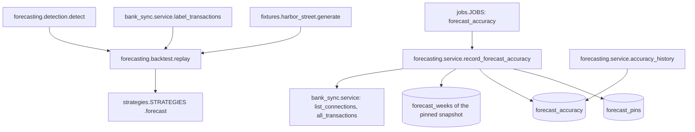

# Forecast Accuracy Design

**Spec**: `.specs/features/22-forecast-accuracy/spec.md`
**Status**: Approved (user asked to build, 2026-10-07)

---

## Architecture Overview

There are two independent parts, both inside the `forecasting` module:

1. **Backtest:** a pure, in-memory replay of Harbor Street. It has no database, no clock and no settings, and it runs through the strategy seam (AD-078).
2. **Weekly record:** an hourly job in `JOBS` (AD-056) that pins the latest snapshot each business-local Monday, then stores the error once each target week is over. `accuracy_history` reads the rows for spec 32.



Approach exploration: the alternative was a backtest that loads the fixture into a local database and replays it through `forecast_inputs`. That approach is slower, needs Postgres, and can't label "as of" a past day, because the stored labels are computed for the load day. The pure replay is the only one that meets ACC-03, so no other approach is presented.

---

## Code Reuse Analysis

### Existing Components to Leverage

| Component | Location | How to Use |
| --- | --- | --- |
| `generate(seed)`, `REFERENCE_DAY`, `FIRST_DAY` | `app/fixtures/harbor_street.py` | The replayed history and reference balances (AD-068) |
| `label_all`, `Item` | `app/modules/bank_sync/labels.py` | Reached only through a new public `bank_sync.service.label_transactions` (AGENTS.md import rule) |
| `detection.detect` | `app/modules/forecasting/detection.py` | Patterns as known on the origin day (it takes `as_of` = latest transaction date) |
| `ForecastInputs`, `STRATEGIES`, `opening_balance` | `app/modules/forecasting/strategies.py` | The strategy seam; untouched |
| `engine.week_starts`, `engine.business_today` | `app/modules/forecasting/engine.py` | Weeks (AD-082) and the business-local day |
| `repository.latest_snapshot`, `snapshot_weeks` | `app/modules/forecasting/repository.py` | The pin source and the forecast end balance |
| `accounts_service.business_time_zones` | `app/modules/accounts/service.py` | Business-local Monday and Tuesday |
| `bank_sync_service.list_connections`, `all_transactions` | `app/modules/bank_sync/service.py` | The actual-balance reconstruction |
| `JOBS`, `Job` | `app/jobs/__init__.py` | Registration of the new job |
| `insert(...).on_conflict_do_nothing` | the `upsert_snapshot` pattern in `repository.py` | Write-once pins and rows |

### Integration Points

| System | Integration Method |
| --- | --- |
| Hourly runner | `JOBS` gains `forecast_accuracy` after `nightly_bank_sync`, so a fresh sync lands first in the same run |
| Database | Two new tables in `forecasting/models.py`, plus one Alembic autogenerate migration |
| Spec 32 | Calls `forecasting.service.accuracy_history` |

---

## Components

### `bank_sync.service.label_transactions`

- **Purpose**: Exposes the pure labeller so `forecasting` can label a replayed history as of a past day.
- **Location**: `app/modules/bank_sync/service.py`
- **Interfaces**:
  - `LabelItem = labels.Item` (re-export)
  - `label_transactions(items: Iterable[LabelItem], account_types: Mapping[uuid.UUID, str], today: date) -> dict[uuid.UUID, tuple[str, uuid.UUID | None]]`: the label and linked ID of each item
- **Reuses**: `labels.label_all`. Same shape as the existing `is_business_day` wrapper.

### `forecasting.backtest`

- **Purpose**: The replay (ACC-01 to ACC-08).
- **Location**: `app/modules/forecasting/backtest.py`
- **Interfaces**:
  - `HORIZONS = (1, 4, 13)`; `WARM_UP_WEEKS = 13`
  - `origins(sample) -> list[date]`: the Mondays from the first Monday on or after `FIRST_DAY` + 13 weeks to the last Monday ≤ `REFERENCE_DAY`
  - `inputs_at(sample, today) -> ForecastInputs`: everything known on `today`
  - `actual_balance(sample, sunday) -> int`: the reference cash balance minus cash transactions dated after `sunday`
  - `replay(sample) -> dict[str, dict[int, HorizonScore]]` by strategy, then horizon; `HorizonScore(origins, zero_actual, mean_percent, mean_abs_cents, worst_percent)`
  - `render(seed, scores) -> str`: fixed-width text table, dollars to the cent
  - `main(argv: Sequence[str] | None = None) -> int`: argparse `--seed` with `type=int` and a non-negative check; argparse exits 2 on bad input
- **IDs**: `uuid.uuid5(NAMESPACE, key)` for accounts and transactions, so the output is deterministic (ACC-07)
- **Cash / card**: cash accounts are `checking` and `savings` in CAD (the line of credit is excluded, as in AD-040); cards are `credit_card`. A card owed on day *d* = reference owed + the card's transactions after *d* (purchases are negative). That mirrors our sign.
- **Origin today**: the Saturday before the Monday, so `engine.week_starts(today)[0]` is that Monday
- **Expected payments**: none. Every sample expected payment is dated after `REFERENCE_DAY`.

### Tables (`forecasting/models.py`)

```python
class ForecastPin(Base):            # "forecast_pins"
    business_id: uuid  PK           # no FK: accounts owns businesses
    week_start: date   PK           # business-local Monday
    snapshot_id: uuid  FK forecast_snapshots.id ON DELETE CASCADE
    created_at: timestamptz server_default now()

class ForecastAccuracy(Base):       # "forecast_accuracy"
    business_id: uuid  PK
    week_start: date   PK           # the pin's Monday
    horizon: smallint  PK           # ck_forecast_accuracy_horizon: IN (1, 4, 13)
    target_week_start: date         # week_start + 7(horizon - 1)
    snapshot_id: uuid  FK forecast_snapshots.id ON DELETE CASCADE
    currency: text
    forecast_cents: bigint
    actual_cents: bigint
    error_cents: bigint             # forecast - actual
    created_at: timestamptz server_default now()
```

The primary keys are the idempotency keys (ACC-16). Index: `ix_forecast_accuracy_horizon_week_start` on `(horizon, week_start)` for `accuracy_history`.

### `forecasting.service.record_forecast_accuracy`

- **Purpose**: One hourly pass over every business that has a snapshot (ACC-11 to ACC-18).
- **Location**: `app/modules/forecasting/service.py`; queries in `repository.py`
- **Interfaces**:
  - `record_forecast_accuracy(now: datetime) -> dict[str, int]`: returns `{"pinned": n, "recorded": m, "failed": f}`
- **Flow per business** (its own session and transaction; on any exception it rolls back, logs `forecast.accuracy_failed` with `business_id` and `error_type`, and continues):
  1. `today` is the business-local date, and `monday = today − weekday`. If `(business, monday)` has no pin and a latest snapshot exists, it inserts a pin with ON CONFLICT DO NOTHING.
  2. For each pin with `week_start ≥ monday − 14 weeks` and each h in (1, 4, 13), it sets `target = week_start + 7(h−1)`. The row is due when `today ≥ target + 8 days` (the Tuesday after the target's Sunday) and no row exists. The forecast is the pinned snapshot's week with `starts_on == target`; if there is none, it skips. The actual is the sum over included CAD accounts of `balance_cents or 0`, minus those accounts' transactions dated after `target + 6`. It inserts with ON CONFLICT DO NOTHING.
- **Businesses**: `repository.snapshot_business_ids()` (this module's own table), with time zones from `accounts_service.business_time_zones`. This is a job-only cross-business read, like AD-053.
- **Log**: one `forecast.accuracy_recorded` line with counts only.

### `app/jobs/forecast_accuracy.py`

- `forecast_accuracy(now) -> dict[str, int]` calls `record_forecast_accuracy(now)`. `JOBS = (nightly_bank_sync, forecast_accuracy)`.

### `forecasting.service.accuracy_history`

- `AccuracyRecord` frozen dataclass: `business_id`, `week_start`, `horizon`, `target_week_start`, `snapshot_id`, `currency`, `forecast_cents`, `actual_cents`, `error_cents`, `error_percent: float | None`
- `accuracy_history(session, *, horizon: int, since: date) -> list[AccuracyRecord]` raises `ValueError` outside (1, 4, 13), and orders by `week_start`, then `business_id`.

---

## Error Handling Strategy

| Error Scenario | Handling | User Impact |
| --- | --- | --- |
| One business's recording raises | Roll back that business, log `forecast.accuracy_failed`, continue, count `failed` | None; it retries next hour (write-once rows) |
| Bad `--seed` | argparse usage message, exit 2 | Developer sees usage |
| Actual balance 0 | Row stored; `error_percent` is null; the backtest counts it in `zero_actual` | None |
| Pinned snapshot lacks the target week | No row for that horizon | Gap in history, by design (ACC-15) |

---

## Risks & Concerns

| Concern | Location (file:line) | Impact | Mitigation |
| --- | --- | --- | --- |
| The 10% bar is unreachable on the current sample | `app/fixtures/harbor_street.py:397` (random client and supplier days) | Done-when 1 can't be ticked | context.md D5: measure now, then a follow-up realigns the sample |
| The forecast doesn't produce the Nov 9 gap | `app/modules/forecasting/strategies.py:463` vs the AD-068 future | Spec 24's alerts on the sample won't fire as the mockups show | Known: spec 21's plan defers week-end recalibration to spec 24; plan the D5 follow-up with it |
| `all_transactions` loads every transaction per business per due row | `app/modules/bank_sync/service.py:423` | Hourly cost grows with history | Load once per business per run, only when a row is due (at most a few businesses a week) |
| Pinning depends on the job running during the week | `app/jobs/__init__.py` | A week with no run gets no pin, so it leaves a gap, not a wrong number | Accepted (spec edge case); Railway runs hourly |

---

## Tech Decisions (only non-obvious ones)

| Decision | Choice | Rationale |
| --- | --- | --- |
| Backtest location | `forecasting/backtest.py`, importing `app.fixtures.harbor_street` | The spec names the command `python -m app.modules.forecasting.backtest` |
| Percent not stored | Derived in `accuracy_history` | One source of truth; cents are exact |
| Pin and row FKs | To `forecast_snapshots` with CASCADE | Snapshots are never deleted in v1; if they ever are, the pins and rows go with them |
| Job order | After `nightly_bank_sync` | Fresh balances are used when both are due |

Project-level decisions are logged as AD-083 to AD-086 in `.specs/STATE.md`.
