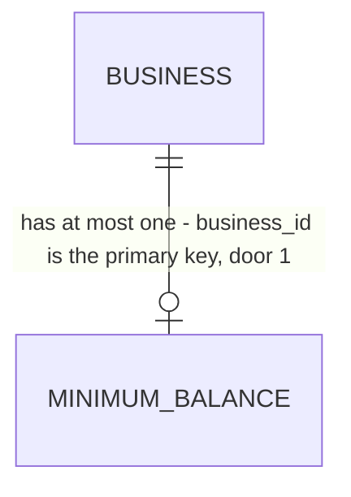

# 23 - Minimum balance and the first forecast

## Problem

An owner who finishes onboarding step 3 today lands on the home page with no minimum balance. Headroom has no number to compare the forecast against, so spec 24 can't raise a single alert, and the product's core promise ("warns when the balance will drop below the minimum the owner chose", AGENTS.md) is unmet for every business. The owner also gets no sign that a forecast is being built. They leave a half-empty screen in the minute after connecting a bank, which `project-overview.md` puts inside the 15 minutes of "day one".

The source gives no figures beyond the mockups and the 15-minute day-one budget.

When this ships, step 3's Continue leads to step 4. There the owner sees a suggested minimum (about two weeks of their typical spending), keeps it or types their own, and continues. Step 5 shows the forecast being built, step by step, and moves to the dashboard once the forecast reflects their bank data. Spec 24 reads the saved minimum.

## Flow

This reuses the owner check (AD-031) and problem details (AD-008). It also reuses `forecast_inputs.changed` and its `source` field, which AD-076 reserved for this spec, and the forecast fingerprint (AD-077) to decide "ready". It reuses the connection status and `last_synced_at` (AD-062, AD-063), `StepIndicator` (AD-034), and the onboarding layout. It adds no new module.

1. Step 3's Continue -> web `/onboarding/minimum-balance` (door 5) - a server component loads `GET .../minimum-balance` (door 2) and shows the saved amount, or else the suggested one.
2. `GET .../minimum-balance` -> `forecasting.api` (exists) -> `forecasting.service` (exists). The suggestion is read through `bank_sync.service` (exists): included cash accounts and their transactions.
3. Step 4's Continue -> server action -> `PUT .../minimum-balance` (door 2) -> `forecasting.service` (exists). It writes `minimum_balances` (door 1) and an audit entry (AD-011) in one transaction. After the commit, and only when the amount changed, it publishes `forecast_inputs.changed` with `source` `minimum_balance` (door 3). `recompute_forecast` (exists, AD-079) handles it.
4. On success the browser goes to web `/onboarding/forecast` (door 5). That server component loads `GET .../forecast/status` (door 4) every 3 seconds via `router.refresh()`.
5. `GET .../forecast/status` -> `forecasting.service` (exists). It reads the connections and the pattern count through `bank_sync.service` / its own repository, then compares the latest snapshot's fingerprint with the fingerprint of the current inputs (`engine.fingerprint`, exists).
6. Out: once the status is `ready`, the server component redirects to `/`. The dashboard comes in spec 26; until then `/` is the existing home page.

## Impact

| Front | What changes |
| --- | --- |
| domain | new term: `minimum balance` - the glossary term (AGENTS.md), stored per business in `forecasting`; spec 24 compares forecast weeks with it, and spec 26 draws it |
| domain | new term: `suggested minimum` - 2 × the median weekly money out of the last 13 complete weeks, rounded up to the next $100; computed per request, never stored |
| domain | existing term: `forecast_inputs.changed` - gains `source` `minimum_balance`. The only subscriber today is `recompute_forecast` (AD-079), which recomputes. The fingerprint doesn't change, so it writes and publishes nothing. Spec 24 will subscribe to re-check alerts |
| web | step 3's Continue (`components/onboarding/choose-accounts.tsx`) goes to `/onboarding/minimum-balance` instead of `/`. `e2e/choose-accounts.spec.ts` asserts the old target and changes with it |
| stored data | new table, nothing to migrate. Existing businesses (staging only) have no row, and GET answers `amount_cents: null` |

## Relations

One-way constraints: one row per business (primary key `business_id`, door 1); the amount is 0 or more (door 1); no foreign key to `businesses`, following AD-037. No columns or types here.

## Surface

| Route | In | Out | Status |
| --- | --- | --- | --- |
| `GET /v1/businesses/{business_id}/minimum-balance` | - | `amount_cents` (null = never set) · `currency` · `suggested_cents` (null = no spending history) · `updated_at` (null = never set) | `200`, `401`, `404` |
| `PUT /v1/businesses/{business_id}/minimum-balance` | `amount_cents` (int, 0 to 1,000,000,000) | the same `MinimumBalance` JSON | `200`, `401`, `403`, `404`, `422` |
| `GET /v1/businesses/{business_id}/forecast/status` | - | `state` (`building`, `ready` or `needs_attention`) · `institution_names` · `transactions_read` · `history_months` · `recurring_count` · `recurring_names` (at most 2) | `200`, `401`, `404` |

## Landing

| One-way door | Literal shape | Alternative rejected |
| --- | --- | --- |
| 1. Table `minimum_balances` (module `forecasting`) | `business_id uuid` primary key (no FK, AD-037); `amount_cents bigint not null` with `ck_minimum_balances_amount_cents_nonnegative` (`amount_cents >= 0`); `currency text not null` (the business's, AD-029); `updated_at timestamptz not null default now()`; `updated_by uuid not null` (a `users.id`, AD-020). Written and read only through `forecasting.service`. A change writes the audit entry `minimum_balance.changed` with details `{"amount_cents": n}` | A column on `businesses`: that table belongs to `accounts`, and AD-076 has `forecasting` publish the change. Every reader (specs 24 and 26) would reach into the identity module for a threshold. A history table: AD-011's audit log already keeps every change |
| 2. Minimum balance routes and JSON | The `GET` and `PUT` in `Surface`. GET: any member (`require_member(Role.OWNER)` today; spec 31 adds `bookkeeper` to the GET only). PUT: `Role.OWNER` only, so a non-owner member gets `403` (AD-031). Body `{"amount_cents": int}` with `extra="forbid"`; outside 0..1,000,000,000 (up to $10,000,000) it's `422`. `MinimumBalance` = `amount_cents`, `currency`, `suggested_cents`, `updated_at` | `404` when it's unset: step 4 needs the suggestion in the same response. A dollars field: AGENTS.md says money moves as integer cents |
| 3. `forecast_inputs.changed` source | Published after the commit, only when the stored amount changed (first set, or a different value): payload `{"source": "minimum_balance"}`. A `PUT` with the same amount writes no audit entry and publishes nothing (extends AD-076) | Putting the minimum into `ForecastInputs`: the forecast doesn't depend on it, so every change would make a new snapshot and shift the backtest fingerprint. A new `minimum_balance.changed` event: AGENTS.md fixes the v1 event list, and AD-076 reserved this source |
| 4. Forecast status route and JSON | `GET .../forecast/status`, any member. `state`: `needs_attention` when any connection with an included account has status `login_required`; else `ready` when every such connection has a `last_synced_at` **and** the latest snapshot's `inputs_sha256` equals `engine.fingerprint(forecast_inputs(now), settings.forecast_strategy)`; else `building`. `institution_names` lists connections oldest first. `transactions_read` = every included connection has a `last_synced_at`. `history_months` = whole months from the oldest transaction on an included account to today, or null with no transactions. `recurring_count` = number of stored patterns. `recurring_names` = up to 2 patterns, largest absolute `amount_cents` first, each as `counterparty` or else `description` | "A snapshot exists": the minimum-balance `PUT` can build a snapshot from balances alone before the first sync lands, and step 5 would then send the owner to an empty dashboard. Comparing `last_computed_at` with `last_synced_at`: an unchanged recompute writes nothing (AD-079), so a correct forecast would look stale forever |
| 5. Onboarding routes | `/onboarding/minimum-balance` (step 4 of 5) and `/onboarding/forecast` (step 5 of 5), under the existing onboarding layout. Each starts with `auth.protect()` (AD-026). Each redirects to `/onboarding/business` with no business and to `/onboarding/bank` with no connection, like step 3. Step 5 redirects to `/onboarding/minimum-balance` while `amount_cents` is null | `/onboarding/step-4`: the existing steps are named by content (`business`, `bank`, `accounts`). A single wizard route: steps 2 and 3 are separate routes, and the back button must work |

- To record in `.specs/STATE.md` when the checks are approved: door 1 AD-087, door 2 AD-088, door 3 AD-089 (extends AD-076), door 4 AD-090, door 5 AD-091.
- Nothing else here is hard to reverse. The polling interval, the 3-minute "slow" threshold and the suggestion rule are numbers in the criteria, and their tests change with them.

## Criteria

### S1: The owner sets a minimum balance through the API (P1)

`GET` and `PUT .../minimum-balance` store one minimum per business and suggest one.

**Acceptance Criteria**

1. WHEN a member calls `GET .../minimum-balance` for a business with no stored minimum THEN the system SHALL return `200` with `amount_cents` null, `updated_at` null, `currency` `CAD` and `suggested_cents` per AC 3.
2. WHEN the owner calls `PUT .../minimum-balance` with `{"amount_cents": 500000}` THEN the system SHALL return `200` with `amount_cents` 500000 and a non-null `updated_at`, and a following `GET` SHALL return `amount_cents` 500000.
3. The system SHALL compute `suggested_cents` as 2 × the median weekly money out over the last 13 complete Monday-to-Sunday weeks before the business-local today. Money out is the absolute sum of negative transactions on included accounts, excluding labels `internal_transfer` and `in_transit`. Weeks before the week of the oldest such transaction don't count. The result is rounded up to the next multiple of 10000 cents.
4. IF the business has no complete week of history on its included accounts THEN the system SHALL return `suggested_cents` null.
5. IF the body's `amount_cents` is negative, over 1,000,000,000, not an integer, or missing, or the body has another field THEN the system SHALL return `422` problem details and store nothing.
6. WHEN the stored amount changes (set for the first time, or set to a different value) THEN the system SHALL write one audit entry `minimum_balance.changed` with `details` `{"amount_cents": <new>}` in the same transaction, and after the commit publish one `forecast_inputs.changed` with payload `{"source": "minimum_balance"}`.
7. WHEN the owner `PUT`s the amount already stored THEN the system SHALL return `200` and write no audit entry and publish no event.
8. IF the caller is not a member of the business THEN the system SHALL return `404` "Business not found." on all three routes of this spec. IF a member who isn't the owner calls `PUT` THEN the system SHALL return `403`.

**Independent test:** pytest against the API with the Harbor Street fixture (AD-069): GET shows the suggestion, PUT stores, a second PUT with the same value publishes nothing, and a stranger gets `404`.

### S2: Step 5 knows when the first forecast is ready (P1)

`GET .../forecast/status` reports progress and says `ready` only when the forecast reflects the synced bank data.

**Acceptance Criteria**

9. WHILE any connection with an included account has never synced (`last_synced_at` null) the system SHALL return `state` `building` and `transactions_read` false.
10. WHEN every connection with an included account has synced and the latest snapshot's fingerprint equals the fingerprint of the current inputs THEN the system SHALL return `state` `ready`.
11. WHILE the business has no snapshot, or its latest snapshot's fingerprint differs from the current inputs', the system SHALL return `state` `building`.
12. IF any connection with an included account has status `login_required` THEN the system SHALL return `state` `needs_attention`, whatever the other conditions.
13. The system SHALL return `institution_names` (connections oldest first), `history_months` (whole months from the oldest included-account transaction to today; null with none), `recurring_count`, and `recurring_names` (at most 2, largest absolute amount first, `counterparty` or else `description`).
14. WHEN the minimum balance is set before the first sync has landed THEN the system SHALL keep returning `building` until the sync commits and its recompute finishes. Then it SHALL return `ready`.

**Independent test:** pytest: load Harbor Street without its sync, check `building`; sync and recompute, check `ready`; mark a connection `login_required`, check `needs_attention`.

### S3: Onboarding step 4 screen (P1)

`/onboarding/minimum-balance` matches `onboarding-4-minimum-balance.dc.html`.

**Acceptance Criteria**

15. WHEN the owner opens step 4 with no stored minimum THEN the screen SHALL show "Step 4 of 5", the heading "Set your minimum balance", the input labelled "Minimum balance" prefilled with the suggestion as whole dollars with thousands separators, "Suggested: $X, about two weeks of your typical spending.", the "How alerts work" card naming the same amount, "You can change this at any time in Settings." and a "Continue" button. All text comes from `messages/en.json`, and money is formatted only through `lib/format.ts`.
16. WHERE a minimum is already stored the screen SHALL prefill the stored amount instead of the suggestion.
17. WHERE `suggested_cents` is null the screen SHALL show an empty input and no "Suggested" line, and the alerts card SHALL read without an amount.
18. WHILE the owner edits the input the alerts card SHALL show the typed amount once it is a valid whole-dollar amount.
19. IF the owner presses Continue with an empty input, or text that isn't a whole-dollar amount of 0 to 10,000,000 (digits, optional commas, optional leading `$`) THEN the screen SHALL show an inline error under the input, linked by `aria-describedby`, and send nothing.
20. WHEN the owner presses Continue with a valid amount THEN the screen SHALL `PUT` it as cents through a server action and, on `200`, go to `/onboarding/forecast`.
21. IF the save fails THEN the screen SHALL show an error alert ("We couldn't save your minimum balance. Try again.") and keep the typed value.
22. IF loading the minimum balance fails THEN the screen SHALL show the existing `LayoutError`.
23. WHEN step 3's Continue is pressed with at least one included account THEN the browser SHALL go to `/onboarding/minimum-balance`.

**Independent test:** Playwright on a fixture-loaded business: the suggestion is prefilled, an invalid value shows the error, and Continue reaches step 5.

### S4: Onboarding step 5 screen (P1)

`/onboarding/forecast` matches `onboarding-5-building-forecast.dc.html` and moves to the dashboard once the status is ready.

**Acceptance Criteria**

24. WHEN the owner opens step 5 THEN the screen SHALL show "Step 5 of 5" with all 5 segments filled, the heading "Building your forecast", "This usually takes a minute or two.", a `role="status"` `aria-live="polite"` list of four steps, and "You'll go to your dashboard as soon as it's ready."
25. The screen SHALL show the four steps as "Connected {institution names}" (done); "Read {n} months of transactions" (done when `transactions_read`, "Reading your transactions" in progress otherwise, "Read your transactions" when `history_months` is null); "Finding recurring payments" (in progress once transactions are read, with "{name}, {name}, and {n} others so far" when `recurring_count` > 0); and "Building your 13-week forecast" (pending until ready). Done shows the green check, in progress shows the accent arc, and pending shows the empty circle, as in the mockup.
26. WHILE the status is `building` the screen SHALL reload the status every 3 seconds.
27. WHEN the status is `ready` THEN the system SHALL redirect to `/`.
28. IF the status is `needs_attention` THEN the screen SHALL say "Your bank needs you to log in again." with a link to `/settings/banks`, and stop polling.
29. IF the status is still `building` 3 minutes after the screen opened THEN the screen SHALL add "This is taking longer than usual. You can go to your dashboard; your forecast will appear there when it's ready." with a link to `/`, and keep polling.
30. IF loading the status fails THEN the screen SHALL show the existing `LayoutError` with its retry, and polling SHALL resume after a successful retry.
31. IF the business has no stored minimum balance THEN opening step 5 SHALL redirect to `/onboarding/minimum-balance`.

**Independent test:** the Done-when Playwright test: sign up, steps 2-3 through the Plaid sandbox, step 4, and step 5's "Building your forecast" is visible.

### S5: Both screens meet the screen rules (P1)

**Acceptance Criteria**

32. The system SHALL give both screens no horizontal scroll at 375 px wide, touch targets of at least 44 px, and pass an axe check with no violations.
33. The system SHALL make both screens completable with the keyboard alone: Tab reaches the input and Continue, and Enter in the input submits step 4.
34. The system SHALL redirect each of the two steps to `/onboarding/business` with no business and to `/onboarding/bank` with no connection.

**Independent test:** Playwright at 375 px with `@axe-core/playwright`, keyboard only.

## Out of scope

| Excluded | Why |
| --- | --- |
| Editing the minimum balance in Settings | The settings business page is a placeholder. The copy promises "change this at any time in Settings", but no spec 23 build item covers that screen. Its route already exists for whichever spec fills it |
| Redirecting a business with no minimum from the app shell to step 4 | No build item asks for it. It would add an API call on every shell render (see Assumptions) |
| Alerts, emails, and the dashboard chart line | Specs 24, 29 and 26 |
| A minimum per account | `specs/later` (account shortfall) |

## Assumptions

| Assumption | Chosen default | Rationale | Confirmed? |
| --- | --- | --- | --- |
| Where the minimum lives | module `forecasting`, table `minimum_balances` (door 1) | AD-076 already names spec 23 as a `forecasting` input source, and creating the `alerts` module for one table is premature | y (approved with "build", 2026-10-09) |
| An owner who leaves after step 3 never reaches step 4 | the app shell does not redirect. Step 4 is reachable only from step 3, or by URL | keeps the shell at one API call (AD-033). Spec 26's dashboard can prompt when `amount_cents` is null | y (approved with "build", 2026-10-09) |
| How "two weeks of typical spending" is measured | AC 3: 2 × median weekly money out, 13 complete weeks, rounded up to $100 | the median ignores one large one-off payment (an AGENTS.md test case). $100 rounding keeps a typed-looking number | y (approved with "build", 2026-10-09) |
| The longest step 5 waits before offering a way out | 3 minutes (AC 29) | the mockup says "a minute or two"; three gives a margin before the owner is told | y (approved with "build", 2026-10-09) |
| Poll interval | 3 seconds via `router.refresh()` | keeps loading in server components (AGENTS.md); about 40 calls a forecast | y (approved with "build", 2026-10-09) |

**Open questions:** none - all resolved or logged above.

## Observable

| Surface | Decision | Landing |
| --- | --- | --- |
| API `GET`/`PUT .../minimum-balance`, `GET .../forecast/status` | response shape | AC 1, AC 2, AC 13, doors 2 and 4 |
| API, all three routes | error shape and codes | AC 5, AC 8 (problem details, AD-008) |
| API, all three routes | who may call it | AC 8 |
| API, all three routes | versioning | existing - under `/v1` (AGENTS.md) |
| API, all three routes | rate limit | n/a - no route has one in v1; step 5's polling is bounded by AC 26's 3-second interval |
| event `forecast_inputs.changed` | payload shape | AC 6, door 3 |
| screen step 4 | empty state | AC 17 (no suggestion) |
| screen step 4 | loading state | existing - `app/onboarding/loading.tsx` |
| screen step 4 | error state | AC 21 (save), AC 22 (load), AC 19 (invalid input) |
| screen step 4 | unauthorised state | existing - `auth.protect()` (AD-026); AC 34 |
| screen step 4 | density and ordering | AC 15, from the mockup |
| screen step 4 | destructive action confirms | n/a - nothing is deleted; the amount can be changed again |
| screen step 5 | empty state | AC 25 (no history: "Read your transactions"; no patterns: no sub-line) |
| screen step 5 | loading state | existing - `app/onboarding/loading.tsx`; the screen itself is the progress state (AC 26) |
| screen step 5 | error state | AC 28 (bank), AC 29 (slow), AC 30 (load failed) |
| screen step 5 | unauthorised state | existing - `auth.protect()`; AC 31, AC 34 |
| screen step 5 | density and ordering | AC 24, AC 25 |
| screen step 5 | destructive action confirms | n/a - the screen has no action |
| copy on both screens | structure, tone, what the reader does next | AC 15, AC 24, AC 25, AC 28, AC 29 - mockup copy verbatim, DESIGN.md writing guidelines |

## Sources

- `context/specs/23-forecast-minimum-balance-and-first-forecast.md` - the build list and "Done when".
- `design/mockups/onboarding-4-minimum-balance.dc.html`, `design/mockups/onboarding-5-building-forecast.dc.html` - binding layout and copy.
- `.specs/STATE.md` AD-076 - spec 23 publishes `forecast_inputs.changed` with its own `source`.
