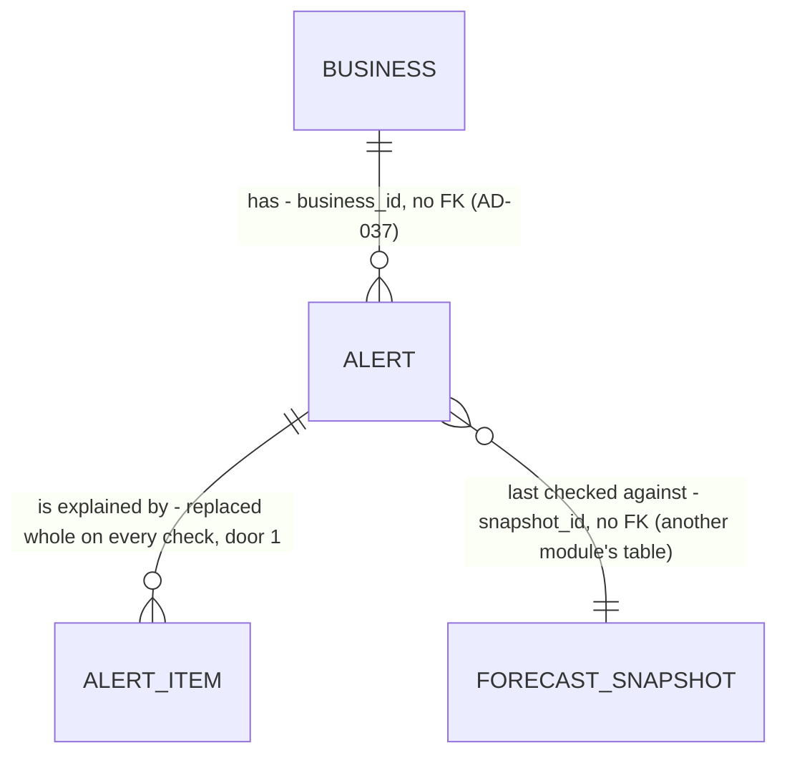

# 24 - Cash gap alerts

## Problem

Headroom stores a 13-week forecast (spec 21) and the owner's minimum balance (spec 23), but nothing compares them. An owner whose cash will drop below their minimum in six weeks finds out only by reading the chart week by week. Nothing tells them which payments cause the drop. The product's core promise ("warns when the balance will drop below the minimum the owner chose" and "names the payments that cause each drop", AGENTS.md) is unmet. Specs 25 (fixes), 26 (dashboard alert cards), 27 (alert page) and 29 (alert emails) have no alert to read.

The source gives no figures beyond the mockups: on the sample, a $5,000 minimum, a $3,150 low in the week of Nov 9, short by $1,850, caused by a $14,500 supplier payment and $11,200 of payroll, with Birch & Co's $9,600 arriving after.

When this ships, every new forecast and every change to the minimum re-checks the business's cash gaps. A new gap becomes one open alert that names its payments. A gap that grows a lot is announced again, and a gap that leaves the forecast closes on its own. The owner can dismiss an alert. Spec 29 emails on `alert.created` and `alert.updated`.

## Flow

This reuses the event bus and `SUBSCRIPTIONS` (AD-047, AD-055), `forecast.updated` (AD-079), the minimum's `forecast_inputs.changed` (AD-089), `forecasting.service.latest_forecast` (AD-080) for the weeks and items, the per-business advisory lock pattern (AD-071, AD-079), the owner/member checks (AD-031) and problem details (AD-008). It doesn't recompute anything the forecast already holds.

1. `forecast.updated` (exists), or `forecast_inputs.changed` with `source` `minimum_balance` (exists) -> `app.subscriptions` (exists) runs `alerts.service.check_cash_gaps` after `recompute_forecast` (door 4).
2. `alerts.service` (new module `alerts`, door 1) opens its own session and takes the business's alerts lock. It reads the latest forecast through `forecasting.service.latest_forecast` (exists) and the stored minimum through a new `forecasting.service.minimum_balance_amount` (cheap: no suggestion).
3. `alerts` finds the gaps, matches each to an open or dismissed alert by overlapping weeks (door 2), and creates, updates, reopens or resolves `alerts` rows and replaces their `alert_items` (door 1) in one transaction.
4. After the commit -> it publishes `alert.created`, `alert.updated` or `alert.resolved` (door 3). There are no subscribers yet; spec 29 adds one.
5. `GET .../alerts`, `GET .../alerts/{alert_id}` -> `alerts.api` (door 5) -> `alerts.service` reads the stored alerts. `POST .../alerts/{alert_id}/dismiss` -> `alerts.service`, under the same lock.

## Impact

| Front | What changes |
| --- | --- |
| domain | new term: `alert` - one cash gap of one business, with a state (`open`, `dismissed`, `resolved`), lives in module `alerts` |
| domain | new term: `cash gap` (the AGENTS.md glossary term, made exact) - a maximal run of consecutive forecast weeks whose `end_balance_cents` is below the minimum. `low_cents` / `high_cents` are the uncertainty band (context.md, Findings) and are not used |
| domain | existing term: `forecast_inputs.changed` - gains its second subscriber. `alerts` acts only on `source` `minimum_balance` and ignores the others, which already lead to `forecast.updated` |
| domain | existing module `forecasting` - gains one public read, `minimum_balance_amount(session, business_id) -> (amount_cents, currency) or None`. `get_minimum_balance` computes the suggestion over every transaction, and the alert check doesn't need it |
| app | `app/main.py` mounts the `alerts` router on the authenticated `/v1` router (AD-022). `app/subscriptions.py` gains 2 rows after the existing 4. `tests/test_forecast_recompute.py::test_subscriptions_order` (spec 21 C26) asserted the whole tuple and now asserts its first 4 |
| contracts | `contracts/openapi.json` and `frontend/lib/api/schema.d.ts` are regenerated with 3 new routes |
| stored data | 2 new tables, nothing to migrate or backfill. A business with a forecast and a minimum gets its alerts on its next forecast or minimum change |

## Relations

One-way constraints: `state` is exactly one of `open`, `dismissed`, `resolved` (door 1). An item's `kind` is exactly `cause` or `arrives_after` (door 1). Items are deleted with their alert. No two `open` or `dismissed` alerts of one business overlap in weeks; the alerts lock and the matching rule enforce this (door 2). No columns or types here.

## Surface

| Route | In | Out | Status |
| --- | --- | --- | --- |
| `GET /v1/businesses/{business_id}/alerts` | query `state` (`open`, `dismissed`, `resolved`; default `open`) | `{"items": [Alert]}` by `starts_on`, then `id` | `200`, `401`, `404`, `422` |
| `GET /v1/businesses/{business_id}/alerts/{alert_id}` | - | `Alert` | `200`, `401`, `404` |
| `POST /v1/businesses/{business_id}/alerts/{alert_id}/dismiss` | no body | `Alert` with `state` `dismissed` | `200`, `401`, `403`, `404`, `409` |

`Alert` = `id` · `state` · `starts_on` (the first gap week's Monday) · `ends_on` (the last gap week's Sunday) · `lowest_week_starts_on` · `lowest_balance_cents` · `minimum_cents` · `shortfall_cents` · `currency` · `created_at` · `updated_at` · `dismissed_at` (null unless dismissed) · `resolved_at` (null unless resolved) · `items`: [`kind` · `date` · `amount_cents` · `currency` · `description` · `counterparty` · `source` · `schedule`].

## Landing

| One-way door | Literal shape | Alternative rejected |
| --- | --- | --- |
| 1. Module `alerts` and its tables | `app/modules/alerts/` (AD-023 layout). Table `alerts`: `id uuid` app-generated, `business_id uuid` no FK, `state text` with `ck_alerts_state` over exactly `open`, `dismissed`, `resolved` (Python `AlertState` Literal), `starts_on date`, `ends_on date`, `lowest_week_starts_on date`, `lowest_balance_cents bigint`, `minimum_cents bigint`, `shortfall_cents bigint` with `ck_alerts_shortfall_positive` (`> 0`), `notified_shortfall_cents bigint`, `currency text`, `snapshot_id uuid` no FK, `created_at`, `updated_at`, `dismissed_at`, `resolved_at` (`timestamptz`, the last two null). Table `alert_items`: PK `(alert_id, position)`, `alert_id` FK `alerts.id` `ON DELETE CASCADE`, `kind text` with `ck_alert_items_kind` over exactly `cause`, `arrives_after`, `date`, `amount_cents bigint`, `currency`, `description` / `counterparty` / `schedule` null, `source text` (AD-077's item source words), `source_id uuid` null | A JSON column for the items: specs 25 and 27 read each item's amount and date, and a typed row keeps money as integer cents (AGENTS.md). Computing the explanation per request from the latest snapshot: an alert outlives its snapshot (AD-077 reuses snapshots), and a dismissed or resolved alert must still say what it was about. A row per week of the gap: the gap is one problem, and spec 29 sends one email |
| 2. "The same gap" | Under `pg_advisory_xact_lock(hashtextextended('alerts:' \|\| business_id, 0))`, a found gap is the same gap as an `open` or `dismissed` alert whose `starts_on..ends_on` shares at least one week with it. Gaps are matched earliest first, each to the earliest-starting alert it overlaps, and each alert at most once. An unmatched gap creates an alert. An unmatched `open` or `dismissed` alert is resolved. A `resolved` alert never matches again | Same `starts_on`: a gap that starts a week earlier, because one payment moved, would resolve the old alert and create a new one, and spec 29 would email twice for one problem. A Postgres exclusion constraint on overlapping date ranges: it needs the `btree_gist` extension (a new dependency) for a guarantee the lock already gives, and AD-071 / AD-074 / AD-079 use the same lock pattern |
| 3. Alert events | `alerts/events.py`: `ALERT_CREATED = "alert.created"`, `ALERT_UPDATED = "alert.updated"`, `ALERT_RESOLVED = "alert.resolved"` (AGENTS.md's v1 list). Payload `{"alert_id": str}` only. Published after the commit, one per changed alert | Amounts in the payload: event payloads reach logs (AD-079). Spec 29 reads the alert by ID |
| 4. Subscriptions | `SUBSCRIPTIONS[4]` `(forecast.updated, alerts.service.check_cash_gaps)`, `SUBSCRIPTIONS[5]` `(forecast_inputs.changed, alerts.service.check_cash_gaps)`; the handler returns at once for a `forecast_inputs.changed` whose `source` isn't `minimum_balance` | One subscription to `forecast_inputs.changed` with no filter: every expected-payment change would run the check twice, once through `forecast.updated` and once directly. That's harmless, but it doubles the work |
| 5. Alert routes and JSON | The 3 routes and `Alert` in `Surface`. GETs: any member (`require_member(*Role)`). Dismiss: `Role.OWNER` (AD-031). An unknown alert, or one of another business, is `404` "Alert not found.". Dismissing a `resolved` alert is `409` "This alert is already resolved.". Dismissing a `dismissed` alert answers `200` and changes nothing. Outside the 3 words, `state` is `422` | A `DELETE` for dismiss: a dismissed alert still exists and can reopen (D2). A list of every state by default: resolved alerts pile up forever, and spec 26 shows only open ones |

- To record in `.specs/STATE.md` when the checks are approved: door 1 AD-095, door 2 AD-096, door 3 AD-097, door 4 AD-098 (extends AD-055), door 5 AD-099. (AD-093 and AD-094 are reserved for 23a.)
- Nothing else here is hard to reverse. The 20% "large payment" share, the 7-day "after" window, and the 20% / $1,000 growth rule are numbers in the criteria, and their tests change with them.

## Criteria

### S1: A gap in the forecast becomes one alert that names its payments (P1)

**Acceptance Criteria**

1. WHEN the alert check runs for a business with a latest forecast and a stored minimum THEN the system SHALL find each cash gap: each maximal run of consecutive forecast weeks whose `end_balance_cents` is below `minimum_cents` (strictly).
2. The system SHALL give each gap `starts_on` (its first week's Monday), `ends_on` (its last week's Sunday), `lowest_balance_cents` (the lowest week end in the run), `lowest_week_starts_on` (that week, the earliest on a tie), and `shortfall_cents` = `minimum_cents` − `lowest_balance_cents`.
3. WHEN a gap matches no `open` or `dismissed` alert of the business THEN the system SHALL store one `open` alert for it and, after the commit, publish one `alert.created` with payload `{"alert_id": "<id>"}`.
4. The system SHALL list as the alert's `cause` items every forecast item that is not an `estimate`, has a negative amount, and is dated from the Monday before `starts_on` to `ends_on`, whose absolute amount is at least 20% of the money going out in that window (every outgoing item, estimates included). They are ordered by date, then by amount.
5. The system SHALL list as the alert's one `arrives_after` item the largest incoming forecast item that is not an `estimate` and is dated in the 7 days after `ends_on` (the earliest on a tie), or none when there is no such item.
6. The system SHALL give every item its `date`, `amount_cents`, `currency`, `description`, `counterparty`, `source` and `schedule` as the forecast item has them.
7. WHEN the sample (`23a`, seed 0, today 2026-09-26) is loaded and the minimum is set to 500000 THEN the system SHALL hold exactly 1 alert: `open`, `starts_on` 2026-11-09, `ends_on` 2026-11-15, `lowest_balance_cents` 315000, `shortfall_cents` 185000. Its `cause` items SHALL be exactly Coastal Supply Co -1450000 on 2026-11-12 and Payroll -1120000 on 2026-11-13, and its `arrives_after` item SHALL be "Birch & Co, invoice 1057" +960000 on 2026-11-17 (Done when 1).
8. IF the business has no forecast or no stored minimum THEN the check SHALL change no alert and publish nothing.

**Independent test:** pytest: load the sample with the clock at 2026-09-26, `PUT` the minimum, then `GET .../alerts` shows the one alert with its 3 items.

### S2: Re-checking never duplicates, and small changes stay quiet (P1)

**Acceptance Criteria**

9. WHEN the check runs again on the same forecast and minimum THEN the system SHALL create no alert, leave every alert row and item unchanged (`updated_at` included), and publish nothing (Done when 2).
10. WHEN a gap matches an alert by overlapping weeks (door 2) THEN the system SHALL update that alert's dates, amounts, `snapshot_id` and items in place and never create a second alert.
11. WHEN a matched `open` alert's new `shortfall_cents` exceeds its `notified_shortfall_cents` by more than 100000, or by more than 20% of it, THEN the system SHALL publish one `alert.updated` and set `notified_shortfall_cents` to the new shortfall.
12. WHEN a matched alert's shortfall shrinks, or grows by at most both limits of AC 11, THEN the system SHALL update the alert silently, with no event (Done when 2).
13. WHEN the `forecast_inputs.changed` that a minimum change publishes arrives THEN the system SHALL re-check the gaps against the new minimum, even though the forecast didn't change.
14. WHEN `forecast_inputs.changed` arrives with any other `source` THEN the handler SHALL do nothing.
15. WHEN two checks for the same business run at once THEN the system SHALL serialise them on the business's alerts lock, so that the second sees the first's alerts and creates no duplicate.

**Independent test:** pytest on hand-built forecasts: run the check twice and count alerts and events; grow the shortfall by $999 (silent), then past $1,000 (one `alert.updated`).

### S3: Alerts move between open, dismissed and resolved (P1)

**Acceptance Criteria**

16. WHEN an `open` or `dismissed` alert matches no gap in the latest forecast THEN the system SHALL set it `resolved` with `resolved_at`, and after the commit publish one `alert.resolved` (Done when 3).
17. WHEN a gap appears that overlaps only a `resolved` alert THEN the system SHALL create a new alert (AC 3).
18. WHEN the owner calls `POST .../alerts/{alert_id}/dismiss` on an `open` alert THEN the system SHALL return `200` with `state` `dismissed` and `dismissed_at` set, set `notified_shortfall_cents` to the current shortfall, and publish nothing.
19. WHEN a matched `dismissed` alert's shortfall grows past AC 11's limits, measured from the shortfall at dismissal, THEN the system SHALL set it back to `open`, clear `dismissed_at`, and publish one `alert.updated` (D2).
20. WHILE an alert is `dismissed` and its shortfall stays within AC 11's limits the system SHALL keep it `dismissed` and update its numbers and items silently.
21. IF the owner dismisses a `resolved` alert THEN the system SHALL return `409` "This alert is already resolved." and change nothing. IF they dismiss a `dismissed` alert THEN the system SHALL return `200` and change nothing.

**Independent test:** pytest: create an alert, move the forecast so the gap disappears (resolved, one event), and dismiss and then grow it (reopened, one event).

### S4: The alerts API (P1)

**Acceptance Criteria**

22. WHEN a member calls `GET .../alerts` THEN the system SHALL return `200` `{"items": [...]}` with the business's alerts in `state` (default `open`), ordered by `starts_on`, then `id`. Each is in the `Alert` shape of `Surface`, with items ordered as AC 4 and AC 5 (causes first).
23. WHEN a member calls `GET .../alerts/{alert_id}` for an alert of the business in any state THEN the system SHALL return `200` with that `Alert`.
24. IF `state` is not one of `open`, `dismissed`, `resolved` THEN `GET .../alerts` SHALL return `422` problem details.
25. IF the alert doesn't exist or belongs to another business THEN `GET .../alerts/{alert_id}` and dismiss SHALL return `404` "Alert not found.".
26. IF the caller is not a member of the business THEN all 3 routes SHALL return `404` "Business not found.". IF a member who isn't the owner calls dismiss THEN the system SHALL return `403`. (Amended while building, 2026-10-09: "and their `GET`s SHALL succeed" waits for spec 31's `bookkeeper` role. v1's only role is `owner`, as in AD-088.)
27. The system SHALL return money only as integer cents with `currency`, and SHALL put no amount in any alert event payload.

**Independent test:** pytest through `TestClient` with signed tokens, including a second business whose owner gets `404` on the first business's alert.

## Out of scope

| Excluded | Why |
| --- | --- |
| Suggested fixes and their new lowest balances | Spec 25 |
| Alert cards on the dashboard, and the alert page | Specs 26 and 27 |
| Emails on `alert.created` / `alert.updated` | Spec 29 |
| Per-account shortfalls (the dashboard mockup's "Payroll overdraws Operating") | `specs/later`; spec 26 says it isn't in v1 |
| Realigning the sample and the ±10% backtest bar (Done when 4) | Feature `23a`, built first (D1). Spec 24's Done when 4 is ticked by it |

## Assumptions

| Assumption | Chosen default | Rationale | Confirmed? |
| --- | --- | --- | --- |
| What counts as a "large" outgoing payment (AC 4) | Not an estimate, dated from the Monday before the gap to its end, and at least 20% of the money going out in that window | On the sample, the threshold is $6,286, which names Coastal ($14,500) and payroll ($11,200) but not the Visa payment ($2,845) or software ($640), as both mockups do. A fixed dollar amount wouldn't scale from a 2-person to a 50-person business | y (approved, 2026-10-09) |
| "The money that arrives only after it" (AC 5) | One item: the largest incoming named item in the 7 days after the gap | On the sample, 4 client payments arrive that week. Only the largest, Birch & Co's $9,600, appears in the mockup and is the payment spec 25's first fix moves | y (approved, 2026-10-09) |
| Same gap across forecasts (door 2) | Overlapping weeks | A gap that shifts by a week is still one problem, and one email | y (approved, 2026-10-09) |
| The baseline for "grows by more than 20% or $1,000" (AC 11, AC 19) | The shortfall last announced (created, updated) or dismissed, not the last stored one | Measured against the last stored value, a gap that creeps up $500 a week would never be announced | y (approved, 2026-10-09) |
| Who may dismiss | The owner only. GETs are open to any member | Writes are owner-only so far (AD-031). Spec 31 decides for bookkeepers | y (approved, 2026-10-09) |
| The list's default `state` | `open` | Spec 26 shows open alerts. Resolved ones pile up | y (approved, 2026-10-09) |
| A gap whose weeks are all in the past | Resolved, like any gap that leaves the forecast | The forecast window only moves forward, so a past gap is gone from it | y (approved, 2026-10-09) |

**Open questions:** none - all resolved or logged above. The 20% rule and the single arrives-after item were approved on 2026-10-09; AC 7 waits on `23a` (D1).

## Observable

| Surface | Decision | Landing |
| --- | --- | --- |
| API `GET .../alerts`, `GET .../alerts/{alert_id}`, `POST .../dismiss` | response shape | AC 22, AC 23, AC 18, door 5 |
| API, all 3 routes | error shape and codes | AC 21, AC 24, AC 25, AC 26 (problem details, AD-008) |
| API, all 3 routes | who may call it | AC 26 |
| API, all 3 routes | versioning | existing - under `/v1` (AGENTS.md) |
| API, all 3 routes | rate limit | n/a - no route has one in v1 |
| API `GET .../alerts` | empty state | AC 22 - `{"items": []}` |
| API `GET .../alerts` | ordering and duplicates | AC 22 (order); duplicates can't exist (AC 10, AC 15) |
| events `alert.created`, `alert.updated`, `alert.resolved` | payload shape | AC 3, AC 11, AC 16, AC 27, door 3 |
| collection: a business's alerts | grouping, naming, the exception that doesn't fit | door 2 (one alert per gap); AC 17 (a resolved alert is never reused) |

## Sources

- `context/specs/24-alerts-cash-gaps.md` - the build list and Done when.
- `.specs/features/24-alerts-cash-gaps/context.md` - D1 (realign first), D2 (a dismissed alert reopens when it grows), the spike.
- `design/mockups/alert.dc.html`, `design/mockups/dashboard-desktop.dc.html` - the sample's alert: $5,000 minimum, $3,150, $1,850, Coastal Supply Co and payroll as causes, Birch & Co after.
