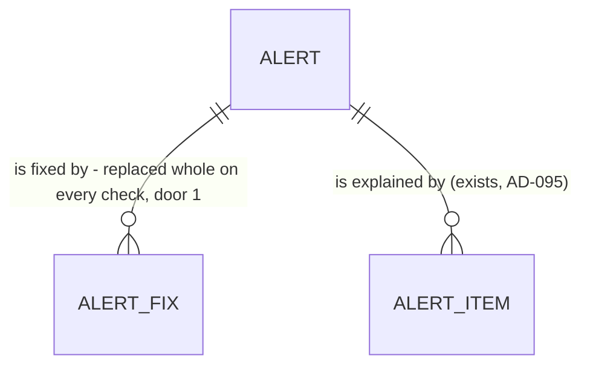

# 25 - Suggested fixes

## Problem

A cash gap alert (spec 24) tells the owner when cash drops below their minimum and which payments cause it, but not what to do about it. An owner short by $1,850 in six weeks must work out alone whether asking a client to pay early, pushing a supplier, or drawing on credit would close the gap, and by how much. The product promise "suggests fixes" (AGENTS.md) is unmet, and the alert page (spec 27) and alert emails (spec 29) have no fixes to show.

The source gives no figures beyond the alert mockup. On the sample (a $5,000 minimum, a $3,150 low in the week of Nov 9, short by $1,850), it shows three fixes with new lowest balances of $12,750 (Birch & Co pays a week early), $17,650 (Coastal Supply Co's $14,500 moves a week later) and $5,150 (draw $2,000 of the $20,000 available on the line of credit).

When this ships, every alert carries up to three fixes chosen by rules. Each fix says what to do, with which payment or how much, and what the lowest balance would then be. The fixes are recomputed with the alert on every check.

## Flow

This reuses spec 24's check (`alerts.service.check_cash_gaps`, its lock, its gap and its stored items), the forecast weeks it already reads through `forecasting.service.latest_forecast`, and the accounts read `bank_sync.service.list_connections` (AD-043's data, `available_cents` from AD-041). No new event, route or subscription.

1. `forecast.updated` or the minimum's `forecast_inputs.changed` -> `alerts.service.check_cash_gaps` (exists), unchanged up to each gap's explanation.
2. `alerts.service` (exists) reads the business's line-of-credit accounts through `bank_sync.service` (exists), once per check and only when a gap exists.
3. `alerts.gaps` (exists, pure) gains the fix rules: from the gap, its explanation, the 13 forecast weeks, the minimum and the credit lines, it returns the fixes, each with its new lowest balance.
4. `alerts.service` stores them in `alert_fixes` (door 1), replaced whole with the items, in the same transaction. A change only to fixes updates the alert silently (no event).
5. out: the 3 alert routes (exist) return `Alert` with `fixes` (door 2).

## Impact

| Front | What changes |
| --- | --- |
| domain | new term: `fix` - one suggested action on one alert, of kind `pay_early`, `move_payment`, `draw_credit` or `financing`, with the alert's new lowest balance if it were applied. It lives in module `alerts` |
| domain | new term: `new lowest balance` - the lowest `end_balance_cents` of the 13 forecast weeks after the fix's money moves. Moving an item later (outgoing) or earlier (incoming), or borrowing and then repaying, never lowers a week, so this equals the gap's own lowest week whenever that week is still the lowest |
| domain | existing term: alert "changed" (spec 24 AC 9, 10) now also covers a change in fixes alone: `updated_at` moves, and no event is published, as for items (AC 12) |
| app | `alerts.service` reads `bank_sync.service` for the first time (allowed: service to service). `test_alerts_sample.py` (C7) and `test_alerts_api.py` see one new key, `fixes`, in `Alert` |
| contracts | `contracts/openapi.json` and `frontend/lib/api/schema.d.ts` are regenerated: `Alert` gains `fixes` |
| stored data | 1 new table, nothing to backfill. Existing alerts get their fixes on their next check (the next forecast or minimum change), and return `fixes: []` until then |

## Relations

One-way constraints: a fix's `kind` is exactly one of `pay_early`, `move_payment`, `draw_credit`, `financing` (door 1). Fixes are deleted with their alert. An alert has at most one fix of each kind, and never both `draw_credit` and `financing` (AC 9). No columns or types here.

## Surface

| Route | In | Out | Status |
| --- | --- | --- | --- |
| `GET /v1/businesses/{business_id}/alerts` | unchanged | `{"items": [Alert]}`, each `Alert` with `fixes` | `200`, `401`, `404`, `422` (unchanged) |
| `GET /v1/businesses/{business_id}/alerts/{alert_id}` | unchanged | `Alert` with `fixes` | `200`, `401`, `404` (unchanged) |
| `POST /v1/businesses/{business_id}/alerts/{alert_id}/dismiss` | unchanged | `Alert` with `fixes` | `200`, `401`, `403`, `404`, `409` (unchanged) |

`Fix` = `kind` · `amount_cents` (the payment moved, in our sign; or the amount borrowed, positive) · `currency` · `date` (the payment's new date; or the day the money is borrowed) · `original_date` (the payment's current date; null for borrowing) · `repay_on` (borrowing only; else null) · `description` · `counterparty` (the payment's, as the alert item has them; for `draw_credit` the account name and null; for `financing` both null) · `available_cents` (`draw_credit` only; else null) · `new_lowest_balance_cents`. Fixes are in kind order `pay_early`, `move_payment`, `draw_credit`, `financing` (the mockup's order). The interface text ("Ask Birch & Co to pay a week early") is spec 27's, built from these fields in `messages/en.json`.

## Landing

| One-way door | Literal shape | Alternative rejected |
| --- | --- | --- |
| 1. Table `alert_fixes` (module `alerts`) | PK `(alert_id, position)`, `alert_id` FK `alerts.id` `ON DELETE CASCADE`, `kind text` with `ck_alert_fixes_kind` over exactly `pay_early`, `move_payment`, `draw_credit`, `financing` (Python `FixKind` Literal), `amount_cents bigint`, `currency text`, `date date`, `original_date date` null, `repay_on date` null, `description text` null, `counterparty text` null, `available_cents bigint` null, `new_lowest_balance_cents bigint`; replaced whole on every check with `alert_items` | Computing fixes per request: it needs the alert's snapshot weeks after a newer forecast replaced it, so a resolved or dismissed alert's fixes would drift from its stored numbers, and spec 29's email and spec 27's page could disagree. A JSON column on `alerts`: money stays typed integer cents (AGENTS.md), as for `alert_items` (AD-095) |
| 2. `Fix` JSON on `Alert` | `Alert.fixes`: [`Fix`] as in `Surface`, after `items`; kind order fixed | Free text from the API ("Ask Birch & Co..."): the text belongs in `messages/en.json` (AGENTS.md), and French comes later |

- To record in `.specs/STATE.md` when the checks are approved: door 1 AD-100 (extends AD-095), door 2 AD-101 (extends AD-099).
- Nothing else here is hard to reverse. The one-week shift, the $1,000 rounding, and the rule for choosing which payment moves are numbers in the criteria, and their tests change with them.

## Criteria

### S1: Each alert offers the fixes its rules allow (P1)

**Acceptance Criteria**

1. WHEN the check stores or updates an alert THEN the system SHALL compute its fixes from the gap, its stored items, the latest forecast's 13 weeks, the minimum, and the business's line-of-credit accounts, and store them in the same transaction as the items.
2. WHEN the alert has an `arrives_after` item THEN the system SHALL offer one `pay_early` fix: that item's `amount_cents`, `description` and `counterparty`, `original_date` its date, and `date` 7 days earlier.
3. WHEN the alert has at least one `cause` item THEN the system SHALL offer one `move_payment` fix for the cause with the largest absolute amount (the earliest on a tie): its `amount_cents`, `description` and `counterparty`, `original_date` its date, and `date` 7 days later.
4. WHEN the business has a `line_of_credit` account in the alert's currency whose `available_cents` is at least the alert's `shortfall_cents` THEN the system SHALL offer one `draw_credit` fix on the one with the most available credit (by name on a tie): `amount_cents` = the shortfall rounded up to the next 100000 (whole $1,000), capped at `available_cents`; `date` = the alert's `starts_on`; `repay_on` = the `arrives_after` item's date, or the day after `ends_on` when there is none; `description` the account name; `available_cents` its available credit (Done when 2).
5. IF no line of credit qualifies under AC 4 (none, another currency, `available_cents` null, or less than the shortfall) THEN the system SHALL offer no `draw_credit` fix (Done when 2).
6. IF no line of credit qualifies under AC 4 THEN the system SHALL offer one `financing` fix: `amount_cents` = the shortfall rounded up to the next 100000, `date` = `starts_on`, `repay_on` = the day after `ends_on`.
7. The system SHALL compute each fix's `new_lowest_balance_cents` as the lowest `end_balance_cents` of the forecast's 13 weeks after applying the fix: a moved payment counts in each week ending on or after its new date instead of its original date, and borrowed money counts in each week ending on or after `date` and before `repay_on`.
8. IF a fix's `new_lowest_balance_cents` is not above the alert's `lowest_balance_cents` THEN the system SHALL not offer it.
9. The system SHALL return an alert's fixes in the order `pay_early`, `move_payment`, `draw_credit`, `financing`, with at most one of each kind, and never both `draw_credit` and `financing`.
10. WHEN the sample (`23a`, seed 0, today 2026-09-26) is loaded and the minimum is set to 500000 THEN the alert SHALL hold exactly 3 fixes: `pay_early` "Birch & Co, invoice 1057" +960000 from 2026-11-17 to 2026-11-10, new lowest 1275000; `move_payment` "Coastal Supply Co, quarterly order" -1450000 from 2026-11-12 to 2026-11-19, new lowest 1765000; `draw_credit` "Line of credit" 200000 on 2026-11-09, repaid 2026-11-17, available 2000000, new lowest 515000 (Done when 1).

**Independent test:** pytest: load the sample with the clock at 2026-09-26, `PUT` the $5,000 minimum, then `GET .../alerts` shows the one alert with the 3 fixes and their new lowest balances.

### S2: Fixes stay in step with their alert (P1)

**Acceptance Criteria**

11. WHEN a check finds the fixes unchanged and nothing else about the alert changed THEN the system SHALL leave the alert, its items and its fixes unchanged, `updated_at` included (spec 24 AC 9 still holds).
12. WHEN a check changes only an alert's fixes THEN the system SHALL replace them, set `updated_at`, and publish no event.
13. WHEN the line of credit's `available_cents` drops below the shortfall, and the next check runs THEN the system SHALL replace that alert's `draw_credit` fix with a `financing` fix.
14. WHEN an alert is resolved THEN the system SHALL keep its last fixes unchanged.
15. The system SHALL return `fixes` on every `Alert` from the 3 alert routes, as `[]` when there are none, with money only as integer cents with `currency`.

**Independent test:** pytest on hand-built forecasts and accounts: run the check twice (no change, no event); lower the line's available credit and run again (`financing` replaces `draw_credit`, no event).

## Out of scope

| Excluded | Why |
| --- | --- |
| The fixes on screen, and their wording | Spec 27 (the alert page) and spec 29 (emails) render them from `messages/en.json` |
| Applying a fix (moving an expected payment, drawing on the line) from the alert | The spec asks only to suggest. An owner edits an expected payment through spec 20's routes |
| Interest or fees on a draw or on financing | No source gives a rate. The new lowest balance counts only the principal |
| Fixes for a per-account shortfall | `specs/later`, as for spec 24 |

## Assumptions

| Assumption | Chosen default | Rationale | Confirmed? |
| --- | --- | --- | --- |
| "Otherwise: short-term financing" (spec Build) | Financing is the alternative to the line of credit: offered exactly when no line covers the shortfall (AC 6), so an alert always has a way to borrow | The other reading (financing only when no other fix applies) would leave a business without a line of credit and with a movable payment with no borrowing option. Either reading gives the sample's 3 fixes | y (approved, 2026-10-09) |
| "Ask to move it or split it" (spec Build) | Move only: the largest cause moves 7 days later (AC 3). No split fix | The mockup shows only "Move the supplier payment by a week". Moving a payment later never lowers another week, so a split can't beat a move's new lowest. The text can mention splitting in spec 27 | y (approved, 2026-10-09) |
| Which payment moves (AC 3) | The largest cause, one fix | On the sample that is Coastal ($14,500), not payroll ($11,200), as in the mockup. Payroll rarely moves | y (approved, 2026-10-09) |
| How early a client pays, how late a payment moves | 7 days both ways | The mockup: Nov 17 to Nov 10, Nov 12 to Nov 19. The arrives-after window is 7 days (AD-096), so a payment from it lands back in the gap's last week | y (approved, 2026-10-09) |
| How much to borrow | The shortfall rounded up to the next whole $1,000 | The mockup: $1,850 short, draw $2,000, new lowest $5,150 | y (approved, 2026-10-09) |
| When borrowed money is repaid | A line: when the arrives-after payment lands ("Repay it when Birch & Co pays"), else the day after the gap. Financing: the day after the gap ("for the length of the gap") | The mockup's line-of-credit text, and the spec's financing rule | y (approved, 2026-10-09) |

**Open questions:** none - all resolved or logged above. The user approved every recommended default on 2026-10-09 (financing whenever no line covers the shortfall; move only, no split).

## Observable

| Surface | Decision | Landing |
| --- | --- | --- |
| API, the 3 alert routes | response shape | AC 15, door 2 |
| API, the 3 alert routes | error shape and codes, who may call, versioning | existing - unchanged from spec 24 (AD-099) |
| API, the 3 alert routes | rate limit | n/a - no route has one in v1 |
| API `Alert.fixes` | empty state | AC 15 - `[]` |
| collection: an alert's fixes | ordering, duplicates, the exception that doesn't fit | AC 9 (order, one per kind); AC 5, AC 6, AC 8 (when a kind is left out) |
| document: the fix text a reader acts on | wording and tone | n/a - spec 27 writes the text from the fields; this spec returns no prose |

## Sources

- `context/specs/25-alerts-suggested-fixes.md` - the four rules and Done when.
- `design/mockups/alert.dc.html` - the sample's three fixes, their dates, and the new lowest balances $12,750, $17,650 and $5,150.
- `.specs/features/24-alerts-cash-gaps/plan.md` - the alert, its gap and items that the fixes build on (AD-095 to AD-099).
