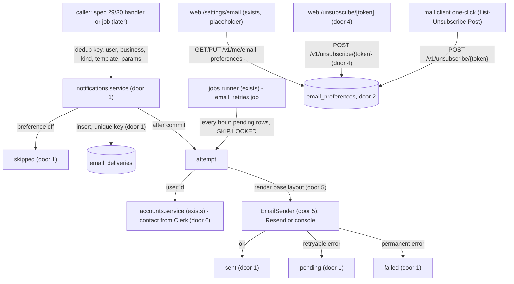
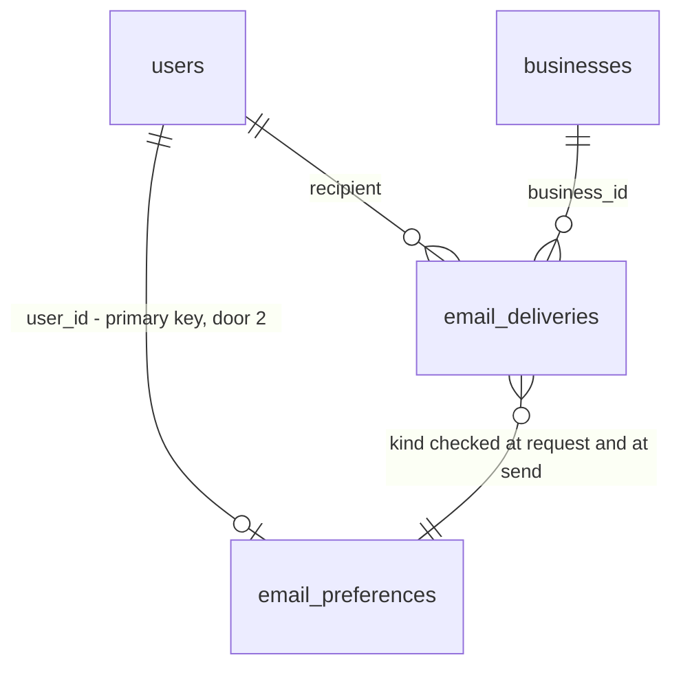

# 28 - Email foundation

## Problem

The API cannot send an email today. Specs 29 (alert emails), 30 (weekly digest) and 31 (bookkeeper invitations) each need to, and without a shared base each would invent its own sending, its own retry and its own footer. Three things go wrong if they do:

- **Duplicates.** An event can reach a handler twice (AD-047's handlers must be idempotent; the API and the jobs process both publish, AD-055), so an owner gets the same alert email twice.
- **Lost emails.** A provider outage during the one attempt drops an alert email for good, and the owner learns about the cash gap too late.
- **No way out.** Nobody can stop the emails. Canada's anti-spam law (CASL) requires an unsubscribe link and a mailing address in commercial messages (DESIGN.md "Emails"). Every email's footer, in both mockups (`email-alert.dc.html`, `email-digest.dc.html`), links to "Email preferences" and "Unsubscribe", and today both would land on nothing: `/settings/email` is a "coming soon" placeholder and there is no unsubscribe route.

The source gives no volume or incident figures.

When this ships, a module can ask for an email to a user and it is sent once, retried until it goes out, and wrapped in the DESIGN.md layout with a working footer. A person can turn alert and digest emails on or off in settings, or stop every email in one click from the email itself without signing in.

## Flow

This reuses the event bus and its subscriptions (AD-047, AD-055), the hourly jobs runner (AD-056), the `SKIP LOCKED` claim pattern (AD-053), the protocol-plus-fake seam used for Plaid (AD-036), the `/v1` auth router and `/me` (AD-022), `users` (AD-020), and the settings shell and server-action pattern from spec 17. No real email is sent by this spec; spec 29 is the first caller.

1. A caller asks `notifications` (new module, door 1) for an email: dedup key, user, business, kind (`alert` or `weekly_digest`), template name and params. If the user's preference for that kind is off, the request is recorded as `skipped`. Otherwise one `email_deliveries` row is inserted (door 1), and a repeated key inserts nothing.
2. After the caller's commit, the delivery is attempted at once: claimed with `FOR UPDATE SKIP LOCKED`, preference re-checked, the recipient's address and first name read from Clerk through `accounts.service` (exists; door 6), the template rendered inside the base layout (door 5), and the result handed to the `EmailSender` with the delivery id as Resend's idempotency key.
3. Out: `sent`, `failed` (permanent error), or still `pending` (retryable error). The hourly `email_retries` job (joins `JOBS`, AD-056) repeats step 2 for every `pending` row.
4. Preferences: `/settings/email` (exists as a placeholder) reads and writes `GET`/`PUT /v1/me/email-preferences` through server actions.
5. Unsubscribe: the footer's link opens the public `/unsubscribe/[token]` page (door 4). Its button calls a server action that `POST`s `/v1/unsubscribe/{token}` (door 4) with no session. Mail clients that support RFC 8058 `POST` the same URL from the `List-Unsubscribe` header.

## Impact

| Front | What changes |
| --- | --- |
| domain | new term: **email delivery** - one email to one user for one dedup key, lives in `notifications` |
| domain | new term: **email kind** - `alert` or `weekly_digest`, the unit a preference turns on or off. Specs 29 and 30 send these kinds |
| api | new module `app/modules/notifications/`, the fifth module AGENTS.md names. Spec 29 subscribes its handler in `app/subscriptions.py` |
| api | `accounts.service` gains a contact lookup (primary email and first name) that calls Clerk's Backend API. It is the first outbound Clerk call; until now the API only verified tokens locally (AD-021) |
| api | `app/main.py` mounts a second router outside the `/v1` auth dependency, for unsubscribe (extends AD-049, which kept that space for provider webhooks) |
| jobs | `JOBS` becomes `(nightly_bank_sync, forecast_accuracy, email_retries)` |
| settings | new variables: `EMAIL_SENDER` (`console` or `resend`, no default), `RESEND_API_KEY` (required when `resend`), `EMAIL_FROM`, `EMAIL_MAILING_ADDRESS`, `WEB_URL`, `API_PUBLIC_URL`, `CLERK_SECRET_KEY`. `.env.example` and `.railway/railway.ts` (`api`, and `jobs` by reference per AD-054) gain them. Applying the Railway file needs a separate go-ahead |
| web | `/settings/email` stops being a placeholder. New public page `/unsubscribe/[token]`, the first page besides sign-in and sign-up with no `auth.protect()` (extends AD-026) |
| web | `messages/en.json` gains `Settings.Email` and `Unsubscribe` namespaces. Spec 27 is editing the same file in the working tree right now, so merge rather than overwrite |
| contracts | `contracts/openapi.json` and `lib/api/schema.d.ts` regenerate for the three new routes |
| stored data | two new tables, nothing existing migrates. A user with no `email_preferences` row reads as both kinds on |

## Relations

One-way constraints:

- `email_deliveries`: (dedup key, user) is unique (door 1); state is exactly `pending`, `sent`, `failed` or `skipped` (door 1); kind is exactly `alert` or `weekly_digest` (door 1).
- `email_preferences`: one row per user at most (door 2); the unsubscribe token is unique and never changes once issued (door 3).

## Surface

| Route | In | Out | Status |
| --- | --- | --- | --- |
| `GET /v1/me/email-preferences` | session | `alerts` · `weekly_digest` (booleans) | `200`, `401` |
| `PUT /v1/me/email-preferences` | session; `alerts`, `weekly_digest` (both required booleans) | same as GET | `200`, `401`, `422` |
| `POST /v1/unsubscribe/{token}` | path `token`; no session; any body (RFC 8058 sends `List-Unsubscribe=One-Click`) | `status` = `unsubscribed` | `200`, `404` |
| `GET /settings/email` (web page) | session | HTML: two switches | `200`, `307` to `/sign-in` when signed out |
| `GET /unsubscribe/{token}` (web page) | path `token`; no session | HTML: the unsubscribe page | `200` |

## Landing

| One-way door | Literal shape | Alternative rejected |
| --- | --- | --- |
| 1. The delivery record and its dedup key | Module `notifications` (AD-023 layout). Table `email_deliveries`: `business_id` and `user_id` (FK `users.id`), `dedup_key text` chosen by the caller (spec 29 will use the alert id and its notified shortfall), unique `uq_email_deliveries_dedup_key_user_id` on `(dedup_key, user_id)`, `ck_email_deliveries_state` over exactly `pending`, `sent`, `failed`, `skipped`, `ck_email_deliveries_kind` over exactly `alert`, `weekly_digest`, plus the template name and its params, attempts, the provider's message id, and timestamps. Insert is `ON CONFLICT DO NOTHING` | Resend's `Idempotency-Key` alone: it expires after 24 hours, so an event replayed a day later emails again, and it says nothing about a send that never reached Resend. Dedup keyed on the event: events carry no id (AD-047), and two `alert.updated` for the same alert are different emails |
| 2. Where preferences live | Table `email_preferences` (module `notifications`): primary key `user_id` (FK `users.id`), `alerts boolean`, `weekly_digest boolean`, `unsubscribe_token text` unique, `updated_at`. No row = both `true`; the row is created on the first PUT, unsubscribe, or email request. Per user, not per business | Columns on `users`: `accounts` owns that table and AGENTS.md forbids writing another module's tables. Per business: the API route is `/v1/me/...`, and a person with two businesses would have to unsubscribe twice |
| 3. The unsubscribe token in sent emails | `secrets.token_urlsafe(32)` (43 characters), issued once per user, the same in every email, never rotated. Links: `{WEB_URL}/unsubscribe/{token}` in the footer; header `List-Unsubscribe: <{API_PUBLIC_URL}/v1/unsubscribe/{token}>` with `List-Unsubscribe-Post: List-Unsubscribe=One-Click` | A signed, stateless token (HMAC with a new secret): rotating the secret breaks every link already sent, and CASL needs the link to keep working. A token per email: more rows for no gain, since unsubscribe turns everything off anyway |
| 4. Public unsubscribe surface | API: `unsubscribe = APIRouter(prefix="/v1/unsubscribe")` in `app/main.py`, outside `current_user`, beside AD-049's `webhooks`; the token is its only credential. Web: `app/unsubscribe/[token]/page.tsx`, outside `(app)`, no `auth.protect()`; opening it changes nothing, and only its button unsubscribes | Unsubscribing on `GET`: link scanners such as Outlook Safe Links open every link and would unsubscribe people who never clicked. Putting the route in the webhooks router: AD-049 keeps that router for signature-verified providers |
| 5. Sending and rendering | `EmailSender` `Protocol` in `notifications` with `ResendSender` (`uv add resend`; `resend.Emails.send(params, {"idempotency_key": str(delivery_id)})`) and `ConsoleSender` (prints to stdout), chosen by `EMAIL_SENDER`; tests inject a fake like AD-036. Templates are Jinja2 (`uv add jinja2`, autoescape on) under `notifications/templates/`: one base layout with HTML and text halves that every later email extends | React Email in the web app: the jobs process sends the digest and has no Node. Calling Resend's REST API by hand: AGENTS.md prefers the official package to hand-written clients. f-strings: no escaping of payee names |
| 6. Where the recipient's address comes from | Read from Clerk at send time (`uv add clerk-backend-api`, `CLERK_SECRET_KEY`, the user's `primary_email_address_id` matched in `email_addresses`, plus `first_name`), inside `accounts.service`; never stored by Headroom (conforms to AD-020) | Copying the email into `users`: supersedes AD-020, puts PII in our database, and goes stale when the person changes their address in Clerk |

- Nothing else here is hard to reverse. Copy, the retry schedule and the screen layout are criteria, and their tests change with them.

## Criteria

### S1: An email is sent once, in the house layout (P1)

A module asks for an email and exactly one goes out, wrapped in DESIGN.md's layout.

**Acceptance Criteria**

1. WHEN a module requests an email of kind `alert` or `weekly_digest` to a user whose preference for that kind is on THEN the system SHALL record one `pending` delivery and attempt it once right after the caller's commit.
2. WHEN the same dedup key is requested twice for the same user (the same event processed twice) THEN the system SHALL keep one delivery, and the `EmailSender` SHALL receive exactly one send.
3. WHEN the API and the jobs process attempt the same pending delivery at the same time THEN the `EmailSender` SHALL receive exactly one send.
4. The system SHALL pass the delivery's id as the provider's idempotency key on every send.
5. IF the recipient's preference for the email's kind is off when the email is requested THEN the system SHALL record the delivery as `skipped` and send nothing.
6. IF the recipient's preference for the email's kind is off when a pending delivery is attempted THEN the system SHALL mark it `skipped` and send nothing.
7. WHEN a delivery is attempted THEN the system SHALL address it to the user's primary email address in Clerk at that moment, and SHALL give the template the user's Clerk first name (null when Clerk has none).
8. IF Clerk has no primary email address for the user, or no such user THEN the system SHALL mark the delivery `failed` and SHALL NOT retry it.
9. The HTML part SHALL be one column 600 px wide, with the "Headroom" wordmark at the top in Georgia, headings in Georgia, and body text in the system sans-serif stack (`-apple-system, 'Segoe UI', Helvetica, sans-serif`), on the mockups' colours (`#F5F3EE` page, `#FFFFFF` card, `#16202B` text).
10. The footer SHALL read, in order: the caller's reason line (for example "You're getting this email because you're an owner of Harbor Street Plumbing on Headroom."), then "Email preferences" linking to `{WEB_URL}/settings/email` and "Unsubscribe" linking to `{WEB_URL}/unsubscribe/{token}` separated by " · ", then "Headroom · {EMAIL_MAILING_ADDRESS}".
11. The system SHALL give every email a plain-text part with the same content and footer, with each link written out as its full URL.
12. The system SHALL put on every email the headers `List-Unsubscribe: <{API_PUBLIC_URL}/v1/unsubscribe/{token}>` and `List-Unsubscribe-Post: List-Unsubscribe=One-Click`.
13. The HTML part SHALL escape every template param (a payee named `<b>Acme</b>` shows as that text, not bold).
14. WHERE `EMAIL_SENDER` is `console` the system SHALL print each email's recipient, subject and plain-text part to standard output and SHALL call no provider.
15. IF `EMAIL_SENDER` is unset, or is `resend` with no `RESEND_API_KEY` THEN settings SHALL fail to load, naming the field and not its value (AD-001).
16. The system SHALL NOT log an email address, an unsubscribe token, a Resend API key or an email's content; send logs carry the delivery id, kind and error type only.

**Independent test:** with the fake sender, request the same test email twice with one dedup key and see one send whose HTML and text parts carry the footer, the links and the headers; with `EMAIL_SENDER=console`, see the email printed.

### S2: A failed send is retried until it goes out (P1)

A provider outage delays an email; it never loses one.

**Acceptance Criteria**

17. IF a send fails with a retryable error (a network error or timeout, Resend `429`, `409 concurrent_idempotent_requests` or `resource_locked`, or any `5xx`), or the Clerk lookup fails the same way THEN the delivery SHALL stay `pending` with its attempt count raised by one, and the system SHALL log `email.send_failed` with the delivery id and error type.
18. WHEN the hourly job runs THEN it SHALL attempt every `pending` delivery once, with no cap on the number of runs a delivery is retried in, until it is `sent`.
19. IF a send fails with any other Resend `4xx` error THEN the system SHALL mark the delivery `failed`, log `email.failed` with the delivery id and error type, and never retry it.
20. WHEN the job finishes THEN it SHALL return the counts `emails_sent`, `emails_failed` and `emails_pending` for the run's `jobs.run_finished` line (AD-056).

**Independent test:** with a fake sender that fails twice and then succeeds, run the job three times and see one `sent` delivery and exactly one successful send.

### S3: Email preferences (P1)

A signed-in person chooses which emails they get.

**Acceptance Criteria**

21. WHEN a signed-in user who never changed their preferences calls `GET /v1/me/email-preferences` THEN the API SHALL answer `200` `{"alerts": true, "weekly_digest": true}`.
22. WHEN a signed-in user calls `PUT /v1/me/email-preferences` with both booleans THEN the API SHALL save them and answer `200` with the saved values, and the next `GET` SHALL return them.
23. IF the `PUT` body misses a field, has an extra field, or has a non-boolean value THEN the API SHALL answer `422` problem details and save nothing.
24. IF either route is called without a valid session THEN the API SHALL answer `401` problem details.
25. The API SHALL let each user read and write only their own preferences (the route takes no user id).
26. The `/settings/email` screen SHALL show, under the heading "Email preferences", two switches with the current values: "Cash gap alerts" ("Email me when cash is projected to fall below my minimum.") and "Weekly digest" ("A summary of my forecast every Monday morning.").
27. WHEN the user flips a switch THEN the screen SHALL save both values through a server action and show the toast "Email preferences saved".
28. IF saving fails THEN the switch SHALL return to its previous value and the screen SHALL show "We couldn't save your email preferences. Try again." in a `role="alert"` element.
29. IF loading the preferences fails THEN the screen SHALL show the existing settings error state, and WHILE they load it SHALL show the existing loading skeleton.
30. The screen SHALL fit 375 px with no horizontal scroll, give each switch a touch target at least 44 px tall, work with the keyboard alone, and pass an axe check.

**Independent test:** sign in, open Settings → Email preferences, turn off the weekly digest, reload, and see it still off; `GET /v1/me/email-preferences` returns `weekly_digest: false`.

### S4: Unsubscribe in one click without signing in (P1)

The footer's link, or the mail client's unsubscribe button, stops every Headroom email at once.

**Acceptance Criteria**

31. WHEN `POST /v1/unsubscribe/{token}` is called with a user's token and no session THEN the API SHALL set both of that user's preferences to off and answer `200` `{"status": "unsubscribed"}`, and an immediate `GET /v1/me/email-preferences` by that user SHALL return both `false`.
32. WHEN the same token is posted again THEN the API SHALL answer `200` and change nothing.
33. IF the token matches no user THEN the API SHALL answer `404` problem details and change nothing.
34. WHEN a mail client posts the RFC 8058 body `List-Unsubscribe=One-Click` (`application/x-www-form-urlencoded`) THEN the API SHALL treat it like any other unsubscribe call.
35. WHEN a user has unsubscribed THEN a delivery to them still `pending` SHALL be `skipped` at its next attempt (AC 6), and a new request SHALL be `skipped` (AC 5).
36. The system SHALL give each user one unsubscribe token, 43 URL-safe characters from `secrets.token_urlsafe(32)`, the same in every email and never changed.
37. The `/unsubscribe/[token]` page SHALL open without signing in, outside the app shell, with the "Headroom" wordmark, the heading "Unsubscribe from Headroom emails?", the text "You'll stop getting cash gap alerts and the weekly digest." and a primary "Unsubscribe" button, and opening it SHALL change no preference.
38. WHEN the visitor presses "Unsubscribe" THEN the page SHALL call the API through a server action, disable the button and show "Unsubscribing…" until it returns.
39. WHEN the call succeeds THEN the page SHALL show "You're unsubscribed" and "You won't get any more emails from Headroom. To turn them back on, go to Email preferences.", with "Email preferences" linking to `/settings/email`.
40. IF the API answers `404` THEN the page SHALL show "This unsubscribe link isn't valid" and "To change your emails, go to Email preferences." with the same link.
41. IF the call fails for any other reason THEN the page SHALL show "We couldn't unsubscribe you. Try again." in a `role="alert"` element and re-enable the button.
42. The page SHALL fit 375 px with no horizontal scroll, use the onboarding column (at most 480 px, centred) on desktop, work with the keyboard alone, and pass an axe check.

**Independent test:** in a private window, open `/unsubscribe/{token}` for the sample owner, press "Unsubscribe", see the confirmation, then sign in and see both switches off in Email preferences.

## Out of scope

| Excluded | Why |
| --- | --- |
| The alert email, the digest, the invitation email | Specs 29, 30 and 31. This spec ships the base layout and sending, and no real email |
| Sending to an address that is not a user yet | Spec 31's invitations need it; it adds a recipient address beside `user_id` then |
| Bookkeepers' opt-in default for alerts | Only owners exist until spec 31; spec 29 decides how bookkeepers opt in |
| Bounce and complaint webhooks from Resend | No spec asks for them; a hard bounce shows as `failed` only when Resend rejects at send |
| Purging old deliveries | No volume yet to justify it; data deletion is handled by hand in v1 (spec 35) |
| Rate limits on the public unsubscribe route | Spec 33 adds rate limits to the API |
| Per-business preferences | Preferences are per person (door 2) |

## Assumptions

| Assumption | Chosen default | Rationale | Confirmed? |
| --- | --- | --- | --- |
| Which web pages this spec builds | Both `/settings/email` and `/unsubscribe/[token]` (S3, S4) | Both footer links need a real page to land on | y |
| What unsubscribe turns off | Every Headroom email: alerts and the digest (AC 31) | Simplest reading of CASL; either kind can be turned back on in preferences | y |
| Retry schedule | One immediate attempt, then once per hourly job run, with no cap (AC 18) | The Done-when says "until it succeeds"; the jobs runner is hourly (AD-054), and Resend's 24-hour idempotency window covers a send that succeeded but wasn't recorded, as long as the retry comes within 24 hours || y |
| An email requested while unsubscribed | Recorded as `skipped`, not dropped (AC 5) | Keeps the dedup key used, so turning preferences back on later doesn't send a stale email for an old event || y |
| Rendering time | Templates render at send time from the stored template name and params, not when the email is requested | The first name comes from Clerk at send time (AC 7), and a retry after a template fix sends the fixed version || y |
| Console output | `print` to standard output, not the structured logger | The logger ships to Railway and Sentry; printed email content must stay on the developer's machine || y |
| Switch saves | Each flip saves at once, with no Save button (AC 27) | Matches the "Counts as cash" switch in bank settings (spec 17) || y |

**Open questions:**

| # | Kind | Question | Until answered |
| --- | --- | --- | --- |
| 1 | blocks go-live | Headroom's mailing address for the footer (the mockups show `[MAILING ADDRESS]`) | `EMAIL_MAILING_ADDRESS` holds a placeholder on staging, and no real client may get an email |
| 2 | blocks go-live | The sending domain verified in Resend, and the `From` address (for example `Headroom <alerts@...>`) | Staging sends from Resend's test sender, which delivers only to the account owner's address |

## Observable

| Surface | Decision | Landing |
| --- | --- | --- |
| screen `/settings/email` | loading state | AC 29 |
| screen `/settings/email` | empty state | n/a - a user with no saved preferences reads as both on (AC 21), so there is always something to show |
| screen `/settings/email` | error state | AC 28 (save), AC 29 (load) |
| screen `/settings/email` | unauthorised state | AC 24, and the page's `auth.protect()` redirects to `/sign-in` (AD-026) |
| screen `/settings/email` | density and ordering | AC 26 (alerts first, then the digest) |
| screen `/settings/email` | destructive action confirms | n/a - a switch flips back as easily as it flipped |
| screen `/settings/email` | phone and keyboard | AC 30 |
| screen `/unsubscribe/[token]` | loading state | AC 38 (the button's pending state); the page itself loads no data |
| screen `/unsubscribe/[token]` | empty state | n/a - the page always shows the same question |
| screen `/unsubscribe/[token]` | error state | AC 40 (invalid link), AC 41 (failure) |
| screen `/unsubscribe/[token]` | unauthorised state | n/a - public by design (door 4); the token is the credential |
| screen `/unsubscribe/[token]` | destructive action confirms | AC 37: opening the link is the question, the button is the answer; nothing happens on open |
| screen `/unsubscribe/[token]` | phone and keyboard | AC 42 |
| API `GET`/`PUT /v1/me/email-preferences` | response shape, error shape and codes | AC 21-24; errors are AD-008 problem details |
| API `GET`/`PUT /v1/me/email-preferences` | who may call | AC 24, AC 25 |
| API `POST /v1/unsubscribe/{token}` | response shape, error shape and codes | AC 31-34 |
| API `POST /v1/unsubscribe/{token}` | who may call | anyone holding the token (door 4) |
| all three new API routes | versioning | existing - under `/v1` like every route |
| all three new API routes | rate limits | n/a - spec 33 adds them for the whole API (Out of scope) |
| job `email_retries` | output, exit codes, failing halfway | AC 20; exit codes and a raising job are AD-056's `run_due` |
| email footer copy | structure, tone, what the reader does next | AC 10, AC 11: why they got it, then how to change or stop it |
| unsubscribe and preferences copy | structure, tone, what the reader does next | AC 26, AC 37, AC 39-41: every outcome links to Email preferences or offers "Try again" |

## Sources

- `context/specs/28-email-foundation.md` - the spec and its three Done-when items
- `context/DESIGN.md` "Emails" and `design/mockups/email-alert.dc.html` - the binding layout and footer
- Resend send-email and errors reference (resend.com/docs), and `resend-python` 2.49 `Emails.send(params, options)` with `idempotency_key`
