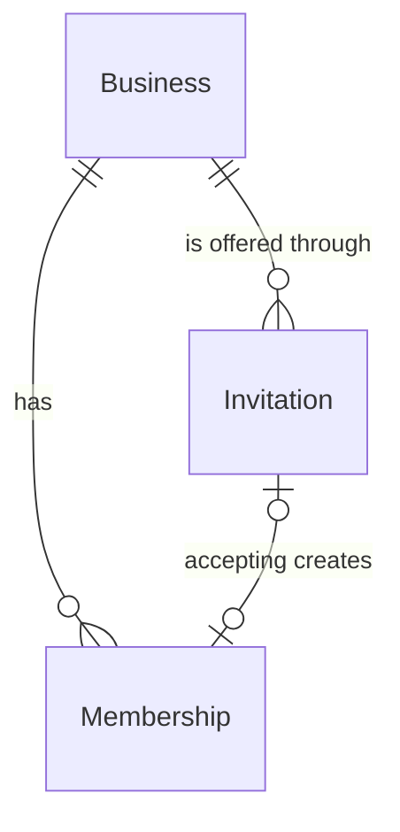

# Spec 31: Bookkeeper invitations

## Problem

An owner who wants their bookkeeper to see the forecast has no way to add them. The only role is `owner` (AD-030), `/settings/members` is a placeholder, and the only way to share access is to share a login. Spec 29 also sent alert emails to owners only (AD-116), so a bookkeeper who watches a client's cash can't be warned. The spec gives no figures; the pilot plan counts on bookkeepers as a sales channel (`context/Roadmap.md`).

When this ships, an owner can invite a bookkeeper by email. The bookkeeper accepts while signed in with that address and gets a limited role on that business: they read the forecast and alerts and manage expected payments, and they can't touch banks, members or business settings. Each invite, accept and removal is in the audit log. A bookkeeper can opt in to alert emails for each client.

## Flow

This reuses `require_member` (AD-031), `app.audit.record`, `accounts.contact` (AD-111), the `EmailSender` and templates of spec 28 (AD-110) and the alert recipient query of spec 29 (AD-112, AD-116).

1. Owner → `POST /v1/businesses/{id}/invitations` → `accounts.api` passes `notifications.service.send_invitation` (new function, door 4) to `accounts.service.invite` (exists), which stores an `invitations` row (door 1, 3), audits `invitation.created`, calls the sender before the commit, and commits. If sending fails, nothing is stored. (The sender is passed in, not imported, because `notifications` already imports `accounts`.)
2. Invitee opens `{WEB_URL}/invite/{token}` (new web page, signed in) → `GET /v1/invitations/{token}` → business name and status.
3. Invitee accepts → `POST /v1/invitations/{token}/accept` → `accounts.service` compares `sha256(primary Clerk address)` with `email_hash` (door 2), inserts a `bookkeeper` membership, marks the invitation accepted and audits `invitation.accepted`, in one transaction.
4. Owner → `DELETE /v1/businesses/{id}/members/{user_id}` → membership deleted, `member.removed` audited.
5. `alert.created` / `alert.updated` → `notifications.email_alert` (exists) asks `accounts.service.alert_recipient_ids` (replaces `owner_ids` here only) for owners plus bookkeepers whose `receive_alert_emails` is true.

## Impact

| Front | What changes |
| --- | --- |
| domain | new term: bookkeeper - a member who reads forecasts and alerts and manages expected payments; lives in `accounts` (`Role.BOOKKEEPER`, door 6) |
| roles | `ck_memberships_role` allows `owner`, `bookkeeper`. Every `require_member(*Role)` read now admits bookkeepers (AD-099 planned this) |
| endpoint split | Reads stay `*Role`. Expected-payment writes become `OWNER, BOOKKEEPER`. Banks, minimum balance, business `PATCH`, members, invitations and alert dismiss stay owner only. Each `OwnerDep` in `forecasting/api.py`, `alerts/api.py`, `bank_sync/api.py` is classified before the checks |
| alert emails | `owner_ids` stays for the weekly digest; `alert_recipient_ids` is new and used by `email_alert` |
| notifications | `send_invitation(address, ...)` sends once through `EmailSender`. It writes no `email_deliveries` row (that table needs a `user_id` and Clerk lookup) and has no background retry |
| audit | three new actions, written in the same transaction as the change |
| web | Members section replaces `SettingsPlaceholder`; `/invite/[token]` is new; owner-only controls are hidden for bookkeepers; `settings/email` gains a per-client alert toggle |
| copy | UI text in `frontend/messages/en.json`; the invitation email in Jinja templates (AD-110) |
| stored data | one migration: `invitations` table, widened role check, `memberships.receive_alert_emails` default false. Nothing to backfill |
| specs | spec 29's note that AD-116 ends with spec 31 |

## Relations

One-way constraints: `token_hash` unique (door 1); one pending invitation per `(business_id, email_hash)` (door 3); `role` in `owner`, `bookkeeper` (door 6).

## Surface

| Route | In | Out | Status |
| --- | --- | --- | --- |
| `POST /v1/businesses/{business_id}/invitations` | `email` | `id` · `expires_at` | `201`, `403`, `404`, `409`, `422`, `503` |
| `GET /v1/businesses/{business_id}/members` | none | `items` [`user_id` · `role` · `name` · `email` · `receive_alert_emails`], `invitations` [`id` · `created_at` · `expires_at`] | `200`, `404` |
| `DELETE /v1/businesses/{business_id}/members/{user_id}` | none | none | `204`, `403`, `404`, `409` |
| `GET /v1/invitations/{token}` | none | `business_name` · `status` | `200`, `404` |
| `POST /v1/invitations/{token}/accept` | none | `Business` | `200`, `403`, `404`, `410` |
| `PUT /v1/businesses/{business_id}/me/alert-emails` | `enabled` | the member | `200`, `403`, `404`, `422` |

## Landing

| One-way door | Literal shape | Alternative rejected |
| --- | --- | --- |
| 1. Token | `secrets.token_urlsafe(32)` in the link; only `sha256(token)` hex in `invitations.token_hash` (unique); `expires_at = created_at + 7 days`, UTC, checked on read and on accept | Storing the token: a database leak would hand out working links |
| 2. Address match | `invitations.email_hash = sha256(lowercase(strip(address)))`. Accept matches the signed-in user's primary Clerk address only | Matching any email address of the user: only the primary one is the account's identity |
| 3. Table `invitations` | `id`, `business_id` FK, `invited_by_user_id` FK, `token_hash`, `email_hash`, `expires_at`, `created_at`, `accepted_at` null, `accepted_by_user_id` null; partial unique `(business_id, email_hash) WHERE accepted_at IS NULL`; rows kept after accepting | Deleting on accept: replaying the link would 404 instead of being idempotent. Storing the address: breaks AD-020 (user decision 2026-10-15) |
| 4. Invitation email | `notifications.service.send_invitation(address, business_name, inviter_name, token)`; templates `invitation.subject.txt`, `.html`, `.txt` over `base.*`; footer reason "You're getting this email because {inviter} invited you to {business} on Headroom."; no unsubscribe link or preference. A `SendError` raises, the invite request rolls back and answers `503` | Queueing in `email_deliveries`: needs a `user_id` and a stored address. Cost: no background retry; the owner invites again |
| 5. Audit actions | `invitation.created`, `invitation.accepted`, `member.removed`; entity is the invitation or user ID; no address and no hash | Names that break `noun.past_tense_verb` |
| 6. Role value | `bookkeeper` in `ck_memberships_role` | `viewer` or `editor`: the product says bookkeeper |
| 7. Re-inviting after expiry (found while building) | `accounts.service.invite` deletes the business's unaccepted, expired invitation for the same `email_hash` before inserting the new one, because the partial unique index (door 3) counts it as pending | Marking it accepted or adding `expires_at` to the index: an expired row would then look like history of a membership that never existed, and the index could not use `now()` |
| 8. The invite page is outside `(app)` (found while building) | `frontend/app/invite/[token]/page.tsx` with `await auth.protect()`; the `(app)` layout sends a user with no business to onboarding, and a bookkeeper has none until they accept | `app/(app)/invite/...`: the invited bookkeeper would be redirected to create a business before seeing the invitation |
| 9. Log redaction of the invitation token (found while building) | `app/log.py` `TOKEN_PATTERN` also matches the segment after `/v1/invitations/`, so access logs and problem `instance` fields never hold a token | Moving the token to a request body: it would change the approved Surface paths |

- Nothing else in this change is hard to reverse

## Criteria

### S1: An owner invites a bookkeeper (P1)

The owner enters an address and the bookkeeper gets a link that works for 7 days.

**Acceptance Criteria**

1. WHEN an owner posts a valid address THEN the system SHALL store an invitation that expires exactly 7 days after creation, email `{WEB_URL}/invite/{token}` to that address, audit `invitation.created`, and answer `201` with `id` and `expires_at`.
2. IF the address belongs to a current member of the business, or has a pending invitation there, THEN the system SHALL answer `409`, store nothing and send nothing. The comparison ignores case and surrounding spaces.
3. IF the email can't be sent THEN the system SHALL answer `503` and store no invitation.
4. IF the address isn't a valid email THEN the system SHALL answer `422`.
5. The system SHALL store no readable address and SHALL log neither the token nor the address.

**Independent test:** with the fake sender, invite `Pat@Example.test`; one email holds a link, and the database holds only hashes.

### S2: The bookkeeper accepts (P1)

**Acceptance Criteria**

6. WHEN a signed-in user whose primary address matches accepts a valid invitation THEN the system SHALL add a `bookkeeper` membership with `receive_alert_emails` false, set `accepted_at`, audit `invitation.accepted`, and answer `200` with the business.
7. IF the invitation is older than 7 days THEN the system SHALL answer `410` and add no membership.
8. IF the signed-in address differs THEN the system SHALL answer `403` and add no membership.
9. IF the same user accepts twice THEN the system SHALL keep one membership and answer `200` both times.
10. IF a different user tries an accepted invitation THEN the system SHALL answer `403` and add no membership.
11. IF the token is unknown THEN the system SHALL answer `404`.
12. IF the accepting user already owns that business THEN the system SHALL answer `409` and add nothing.

**Independent test:** accept as the invited address, then as another user, then after day 7.

### S3: An owner removes a member (P1)

**Acceptance Criteria**

13. WHEN an owner removes a bookkeeper THEN the system SHALL delete the membership, audit `member.removed`, and answer `204`. That user's later requests for the business get `404`.
14. IF the target is an owner THEN the system SHALL answer `409`.
15. IF the target isn't a member of that business THEN the system SHALL answer `404`.

**Independent test:** remove a bookkeeper, then request the dashboard as them.

### S4: A bookkeeper's permissions are enforced by the API (P1)

**Acceptance Criteria**

16. The system SHALL let a bookkeeper read the dashboard, forecast, alerts and expected payments, and create, change and delete expected payments, each audited as for an owner.
17. IF a bookkeeper calls any owner-only route THEN the system SHALL answer `403`. A test lists every route under `/v1/businesses/{business_id}` from the app and fails if one isn't classified as owner-only or shared.
18. IF a user who isn't a member of the business calls any route in the Surface table that takes a `business_id` THEN the system SHALL answer `404`.
19. The web app SHALL hide the controls for banks, members, business settings and the minimum balance from a bookkeeper.

**Independent test:** sign in as a bookkeeper and call each route.

### S5: A bookkeeper opts in to alert emails (P2)

**Acceptance Criteria**

20. WHEN a bookkeeper turns on alert emails for a business THEN the system SHALL email them on `alert.created` and `alert.updated` for that business, as it does the owners. By default, and after they turn it off, they get none.
21. IF an owner calls the toggle THEN the system SHALL answer `403`.
22. The weekly digest SHALL still go to owners only.

**Independent test:** publish `alert.created` with the flag off, then on.

### S6: The screens (P1)

**Acceptance Criteria**

23. The Members section SHALL show members and pending invitations, with a loading state, an empty state ("no bookkeepers yet"), and an error state. Removing a member asks for confirmation first.
24. The `/invite/[token]` page SHALL show the business name and an Accept button, and SHALL show distinct messages for expired, wrong address, already accepted and unknown links.
25. The system SHALL make both screens work at 375px, be usable by keyboard alone, have 44px touch targets and pass an axe check.

**Independent test:** Playwright on both pages.

## Out of scope

| Excluded | Why |
| --- | --- |
| Revoking a pending invitation | Not in the spec's Build list; an invitation expires after 7 days |
| Showing who a pending invitation went to, and resending | Only hashes are stored (user decision 2026-10-15) |
| Retrying the invitation email in the background | Same decision |
| Changing a member's role, several owners, firms | `specs/later/` |
| Bookkeeper weekly digests | Spec 30 stays owners only |

## Assumptions

| Assumption | Chosen default | Rationale | Confirmed? |
| --- | --- | --- | --- |
| The members list when Clerk is down | Still lists roles, without names or addresses | A Clerk outage shouldn't block removing someone | n |
| The alert toggle's place | `settings/email`, one row per client business | Bookkeepers manage email choices there already (spec 28) | n |
| Which address accept matches | The primary Clerk address only (door 2) | Primary is the account's identity | n |

**Open questions:** none - all resolved or logged above.

## Observable

| Surface | Decision | Landing |
| --- | --- | --- |
| screen Members | empty state | AC 23 |
| screen Members | loading and error states | AC 23 |
| screen Members | destructive action confirms | AC 23 |
| screen Members | unauthorised (bookkeeper) | AC 19 |
| screen `/invite/[token]` | error states (expired, wrong address, used, unknown) | AC 24 |
| screen `/invite/[token]` | loading state | existing - `(app)/loading.tsx` |
| all new routes | error shape and codes | Surface table; errors are RFC 9457 (AGENTS.md) |
| all new routes | versioning, rate limits | n/a - under `/v1`; v1 has no rate limiting |
| email `invitation` | structure, tone, next action | AC 1: subject, one button to the link, footer reason |
| email `invitation` | unsubscribe | n/a - a one-time transactional email to someone with no account |
| email `invitation` | rendering in mail clients | existing - the `base` template proven in spec 29 |

## Sources

- `context/specs/31-accounts-bookkeeper-invitations.md` - the goal and Done-when items
- `.specs/STATE.md` AD-020, AD-030, AD-031, AD-099, AD-110, AD-111, AD-112, AD-116 - the constraints this conforms to
- User decisions 2026-10-15: hashed address with a send-once email; per-business opt-in for bookkeepers
