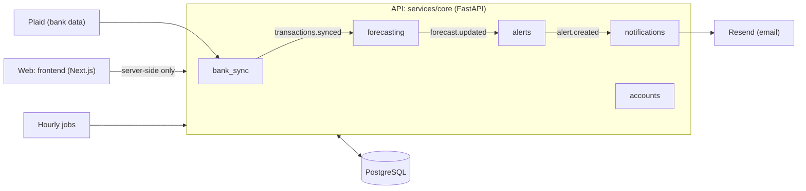

# Headroom

**Cash flow forecasting for small businesses in Canada.**

Headroom tells a small business when it's about to run short of cash, why, and what to do about it, weeks before it happens. It connects to the business's bank accounts through Plaid and does four things:

- forecasts the combined cash balance 13 weeks ahead
- warns when the balance will drop below a minimum the owner chooses
- names the payments that cause each drop
- suggests fixes, such as delaying a payment or collecting an invoice early

It's built for owner-operators of businesses with 2–50 employees, and for the bookkeepers who serve them. Businesses without accounting software can use it too: in bank-only mode, the forecast is built from bank history alone.

## Status

v1 is being built for the first clients as 36 short specs (see [context/Roadmap.md](context/Roadmap.md)).

| Specs | Area | Status |
|---|---|---|
| 01–05 | Project setup, CI, staging on Railway | Done |
| 06–09 | Design system, app shell, errors and logging, typed API client | Done |
| 10–11 | Login, businesses, and access | Done |
| 12–17 | Bank connection, transaction sync, nightly job, labels, settings | Done |
| 18–23 | Sample data, recurring payments, expected payments, forecast engine, accuracy | Done |
| 24–27 | Cash gap alerts, suggested fixes, dashboard, alert page | Done |
| 28 | Email foundation | Done |
| 29–36 | Alert emails, weekly digest, bookkeeper invitations, launch | Not started |

Each spec file in [context/specs/](context/specs/) has its current status.

## How it works



- **Web app** ([frontend/](frontend/)): Next.js with the App Router. It loads data in server components and calls the API only from the server, so the browser never talks to the API directly.
- **API** ([services/core/](services/core/)): one FastAPI application made of five independent modules: `accounts`, `bank_sync`, `forecasting`, `alerts`, and `notifications`. The modules talk to each other through an in-process event bus.
- **Jobs:** a runner that Railway starts every hour. It syncs banks overnight, scores forecast accuracy, and retries failed emails, then exits.
- **Database:** PostgreSQL, with migrations managed by Alembic.

## Tech stack

| Area | Tools |
|---|---|
| Web | Next.js 16, React 19, TypeScript (strict), Tailwind CSS 4, shadcn/ui, next-intl, Recharts |
| API | Python 3.12+, FastAPI, SQLAlchemy 2, Alembic, Pydantic, structlog |
| Database | PostgreSQL 17 (Docker locally) |
| Auth | Clerk |
| Bank data | Plaid |
| Email | Resend |
| Monitoring | Sentry |
| Tests | pytest, Vitest, Testing Library, Playwright with axe |
| Hosting | Railway (`development` → staging, `main` → production) |

## Repository layout

```text
.
├── AGENTS.md               # Rules and commands for AI coding agents (the source of truth for commands)
├── context/                # Product docs, roadmap, design system, and the specs
├── contracts/openapi.json  # The API contract, generated from the API
├── design/mockups/         # Screen mockups
├── docker-compose.yml      # Local PostgreSQL
├── frontend/               # The web app (Next.js)
├── services/core/          # The API and the hourly jobs (FastAPI)
├── .railway/               # Railway service settings
├── .github/workflows/      # CI
└── k8s/                    # Starter Kubernetes files; not used in v1
```

## Quick start

You need Docker, Node.js, and [uv](https://docs.astral.sh/uv/). You also need a Clerk development instance and Plaid sandbox keys. Use only sandbox and test keys locally.

```bash
# 1. Start the local database (once)
docker compose up -d postgres

# 2. Start the API (from services/core)
cp .env.example .env.local      # then fill in the values
uv sync
uv run alembic upgrade head
uv run fastapi dev app/main.py  # API docs at http://localhost:8000/docs

# 3. Start the web app (from frontend, in a second terminal)
cp .env.example .env.local      # then fill in the values
npm install
npm run dev                     # http://localhost:3000
```

To try the app with realistic data, load the synthetic sample business from `services/core`:

```bash
uv run python -m app.fixtures.load harbor_street
```

More detail is in [frontend/README.md](frontend/README.md) and [services/core/README.md](services/core/README.md).

## Checks

CI runs these on every push. Run the ones for the area you changed before you push.

```bash
# API (from services/core)
uv run ruff format --check . && uv run ruff check .
uv run mypy app
uv run pytest

# Web (from frontend)
npm run lint && npm run typecheck && npm test && npm run build
```

## Contributing

- **Branches:** work on `development`, which deploys to staging. `main` is production only and changes only through a pull request from `development`.
- **Specs:** every change belongs to a spec in [context/specs/](context/specs/). A spec can start only once every spec it depends on is Done.
- **Commits:** use Conventional Commits, with the module as the scope and the spec number at the end. For example: `feat(forecasting): detect recurring payments (spec 19)`.
- **Generated files:** never edit `contracts/openapi.json` or `frontend/lib/api/schema.d.ts` by hand. Regenerate them. The backend README explains how.
- **Rules:** [AGENTS.md](AGENTS.md) has the architecture, security, and coding rules. They apply to people as well as to agents.

## Security

Headroom handles bank data. In short:

- Plaid access tokens are encrypted before they're stored, and never leave the backend.
- Tokens, account numbers, and raw provider data are never logged or returned.
- Every row of customer data belongs to a business, and every query filters on it.
- Code, tests, and fixtures use only synthetic data and the Plaid sandbox.
- Secrets live only in environment variables. Never commit an `.env*` file other than `.env.example`.

The full rules are in [AGENTS.md](AGENTS.md#security-and-data-handling).

## Documentation

| Document | What it covers |
|---|---|
| [context/project-overview.md](context/project-overview.md) | The problem, the product, and who it's for |
| [context/Roadmap.md](context/Roadmap.md) | The order of work, the pilot gate, and decisions |
| [context/DESIGN.md](context/DESIGN.md) | The design system and writing guidelines |
| [context/README.md](context/README.md) | How the docs and specs are organized |
| [AGENTS.md](AGENTS.md) | Commands, architecture rules, and conventions |
