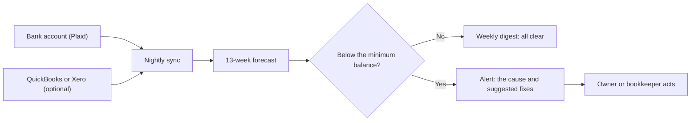
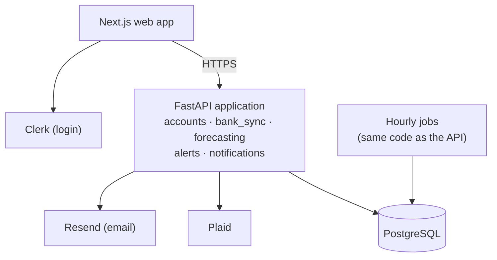

# Headroom: project overview

**Cash flow forecasting for small businesses in Canada**

*Status: pre-MVP. v1 starts with spec 01 (the frontend scaffold). Last updated: October 1, 2026.*

> We tell small businesses when they're about to run short of cash, why, and what to do about it, weeks before it happens.

## Related documents

| Document | What it covers |
|---|---|
| `Roadmap.md` | The order of work, timing, the pilot gate, and decisions |
| `specs/` | v1 as 36 short specs (01–36), built in dependency order. `specs/later/` holds the features that wait for the first clients. |
| `AGENTS.md` | Rules and commands for AI coding agents working in the repository |
| `DESIGN.md` | The design system, the writing guidelines, and the list of screen mockups in `design/mockups/` |
| `docker-compose.yml` | Local Postgres for development |
| `k8s/` | Starter Kubernetes files, not used until much later |

## The problem

Small businesses rarely fail because they're unprofitable on paper. They fail because cash runs out before money comes in. A widely cited study attributes roughly 82% of small-business failures to cash flow problems.

The cause is usually timing, not a lack of money. Payroll and a large supplier bill land in the same week, while the customer payment that would cover them is still a few days away. The owner finds out when the account is already short.

The usual ways of seeing this coming all fall short:

| What owners use today | Why it fails |
|---|---|
| A spreadsheet forecast | Built once, rarely updated, and out of date within weeks |
| Their accountant | Reviews what already happened, and only a few times a year |
| The bank app | Shows today's balance, not next month's |
| Existing forecasting tools | Most assume the business already uses accounting software and has time to set up a new tool |

Most owners of very small businesses also handle the finances themselves, on top of everything else. Any solution has to take minutes a week, not hours.

## The solution

The product connects to a business's bank account, and optionally to QuickBooks or Xero. It learns the business's patterns of money coming in and going out, and it updates a 13-week cash forecast every night.

The owner chooses a minimum balance. When the forecast drops below it, the product sends an alert that names the payments causing the drop and suggests specific fixes:

- move a payment to a later date
- collect an invoice early
- arrange short-term financing to cover the gap

### What using it looks like

| When | What the customer does | Time |
|---|---|---|
| Day one | Signs up, connects the bank, and sets a minimum balance | About 15 minutes |
| Every night | Nothing. The app syncs new transactions and updates the forecast. | None |
| Once a week | Reads the digest email or glances at the dashboard | 5–10 minutes |
| When a gap is flagged | Picks a fix, often with one click | A few minutes |

After day one, the customer checks one number a week and acts only when a shortfall is coming.

### Businesses without accounting software

Many of the smallest businesses, the ones with the most acute cash problems, don't use accounting software at all. Bank-only mode serves them. The app detects recurring payments such as payroll and rent from bank history. The owner adds one-off expected payments in a few seconds, or uploads a spreadsheet of invoices. The forecasting works the same way; it just starts with less information.

## Who it's for

**Owner-operators of small businesses (2–50 employees).** These are the core customers. Their incoming payments are uneven, their payroll and supplier bills are fixed, and they have no finance staff. Trades, agencies, and small manufacturers feel this most.

**Bookkeepers and accounting firms.** They already build cash forecasts by hand for some clients, and the product automates that work. One firm can bring 10–30 client businesses at once, which makes firms the main growth channel.

**New and very small businesses without accounting software.** Tools that require QuickBooks or Xero can't serve them; bank-only mode can.

## What a customer sees: an example

A business has $42,300 in the bank. The forecast shows cash falling to $3,150 in week 7, below the owner's $5,000 minimum. The alert explains why: a $14,500 supplier payment and $11,200 of payroll land in the same week, and the only money expected before then is an $8,000 client payment.

The business isn't short of money overall. Two big payments just land at a bad time, and that's fixable with a few weeks' warning. The alert suggests:

- **Delay a payment:** ask the supplier for a few extra days, or to split the payment in two.
- **Bring money in sooner:** offer the client a small discount for paying a few days early.
- **Cover the gap:** use a short-term credit line or invoice financing for that one week.
- **Prevent it next time:** schedule payroll and large supplier payments in different weeks.

The owner sees this in week 1, not the night before payroll.

## Features

v1 is deliberately small: just enough for the first clients to rely on every week. Each feature has its own spec.

| Stage | Features | Specs |
|---|---|---|
| v1: first clients | Login and businesses, bank connection and sync, recurring and expected payments, the 13-week forecast, cash gap alerts with fixes, emails, onboarding, the dashboard, and the release | 01–36 |
| After clients confirm | In-app billing, alerts for a single account running short, QuickBooks and Xero, scenarios, one-click actions, a workspace for accounting firms, and more | `specs/later/` |

`Roadmap.md` has the order of work and the conditions for scaling up.

## What makes it different

Float, Pulse, Dryrun, and Cash Flow Frog already sell cash flow forecasting. This product competes in five ways:

1. **Niche first.** It aims to win one industry in one region before expanding.
2. **Bank-only mode.** It serves businesses that don't use accounting software.
3. **Explanations, not just charts.** Every alert names the cause and a specific fix.
4. **Built for accountants.** A firm plan with a multi-client dashboard turns one sale into many client accounts.
5. **Mid-range pricing.** The entry price falls within competitors' range, and below Float and Dryrun.

| Competitor | Entry price (checked September 2026) |
|---|---|
| Cushion | $18/month (aimed at freelancers) |
| Pulse | $29/month |
| Cash Flow Frog | About $33/month |
| Dryrun | $49/month |
| Float | $59/month |

## Business model

Customers pay a monthly subscription, in Canadian dollars:

| Plan | Price | Includes |
|---|---|---|
| Starter | $39/month | One connection (a bank with all of its accounts, or an accounting app), the 13-week forecast, low-balance alerts, weekly email |
| Growth | $79/month | Up to 5 bank connections plus accounting software, alerts that explain the cause, scenario planning, one-click actions |
| Firm | $15–20 per client per month | Multi-client dashboard, alerts across all clients, separate billing for each client |

The first 5–10 pilot customers get 50% off for three months in exchange for feedback and a testimonial. The pilot will also test which features belong in which plan. Until billing is built into the app, pilot customers pay through Stripe Payment Links, handled by hand.

Three things decide whether the business works:

- **Cost to serve each customer.** Bank-data fees are the largest cost, so confirm them before setting final prices.
- **Cost to win each customer.** Finance software for small businesses is among the most expensive kinds of software to win customers for, at around $1,450 per customer. That's why the plan relies on accountants and content rather than ads.
- **Payback and retention.** Each customer should bring in at least 3 times what it cost to win them, and fewer than 3.5% of customers should cancel each month.

## Go-to-market

1. **First customers:**
   - pilot businesses in Canada, outside Quebec, found through direct outreach and personal networks
   - bookkeepers who bring their clients along
2. **Repeatable growth:**
   - a bookkeeper partner program that pays a commission on referrals
   - search-optimized content on the problems owners already search for
   - a free forecast check
   - listings in the QuickBooks and Xero app marketplaces
3. **Scale:**
   - LinkedIn and direct outreach to accounting firms
   - industry events
   - forecasting built into payroll and bookkeeping software
   - paid search on a few high-intent keywords, once there's data on which searches lead to signups

## Technology

| Layer | Choice | Why |
|---|---|---|
| Frontend | Next.js (App Router) with TypeScript, Tailwind CSS, shadcn/ui, and Recharts, plus an API client generated from the shared API contract | The browser never talks to the API directly, and the contract keeps the frontend and backend in sync |
| Backend | Python + FastAPI | Python has the strongest forecasting libraries (pandas, statsmodels, Prophet) |
| Database | PostgreSQL | Reliable and relational, and each module owns its own tables |
| Bank data | Plaid (Canadian alternative: Flinks) | One API gives read-only access to Canadian banks |
| Accounting data | QuickBooks and Xero APIs | Real due dates for invoices and bills |
| Billing | Stripe: Payment Links during the pilot, with billing built into the app later | No billing code until clients confirm |
| Login | Clerk | Login is too important to build from scratch, and Clerk works closely with Next.js |
| Hosting | Railway, in its US East region (it has no Canadian region): a web app, an API, an hourly jobs service, and Postgres, with staging and production environments | Cheap and simple while the idea is being proven |
| Email, errors, and analytics | Resend, Sentry, and PostHog | Low-cost services that work well at small scale |

In v1, everything runs on Railway: a Next.js web app, one FastAPI application made of separate modules, and an hourly jobs service that runs the same code as the API. Each module has clean boundaries, so it can later become its own service:

The architecture changes in stages, and only when the load, team size, or compliance needs require it:

1. **After the pilot:** forecasting moves into separate background workers that receive jobs through a message queue, still on Railway.
2. **At scale:** the application splits into separate services, and moves to Kubernetes only if Railway stops being enough.

The modules already pass events to each other using the names the queue will use (`transactions.synced`, `forecast.updated`, `alert.created`). So splitting a module out changes only how events are delivered, not the module's code. `AGENTS.md` has the rules that keep it that way.

## Security and trust

Customers are handing over access to their bank data, so security is part of the product:

- **Read-only:** the product reads bank data and never moves money.
- **No bank passwords:** customers log in to their bank through Plaid's own window, so their bank passwords never reach this product's servers.
- **Encrypted tokens:** the product stores only an encrypted access token, and that token never reaches the browser.
- **Separated data:** each business's data is kept apart from every other business's. Accountants see a client's data only after the client grants them access.
- **Webhooks and logs:** every Plaid and Stripe webhook is checked for a valid signature, and sensitive values are removed from logs.
- **Outside review:** an outside security test (penetration test) and preparation for a SOC 2 audit start once the pilot confirms clients (see `specs/later/`). A full SOC 2 Type II audit follows as the business grows, since accounting firms will expect one.

## Measuring success

| Question | Metric | Starting target |
|---|---|---|
| Does onboarding work? | Share of new sign-ups who connect a bank within 24 hours | 70%+ |
| Do people use it? | Share of paying businesses that check their forecast weekly | 60%+ |
| Are alerts useful? | Share of alerts that lead to an action | 30%+ |
| Can people trust the forecast? | Difference between the 4-week forecast and the actual balance | Within ±10% |
| Does each customer pay for itself? | Revenue from a customer over their lifetime, compared with the cost of winning them | At least 3 to 1 |
| Do customers stay? | Share of customers who cancel each month | Under 3.5% |
| Is growth affordable? | Months to earn back what it cost to win a customer | Under 12 |

Spec 32 sets up the report that measures these. `Roadmap.md` has the conditions for scaling up.

## Budget

These are rough monthly running costs. They're estimates, not quotes, so confirm current pricing before relying on them.

| Stage | Main costs | Rough monthly cost |
|---|---|---|
| v1 and pilot (specs 01–36) | Railway (web app, API, hourly jobs, and Postgres), plus Sentry and PostHog. Clerk and Resend are often free at low volume. | $50–200, plus bank-data fees |
| After clients confirm | Adds a managed message queue, a cache, and monitoring, plus a one-time penetration test and SOC 2 preparation | A few hundred dollars, plus one-time costs |
| Scale on Kubernetes, only if needed | A managed cluster (about $73/month for the EKS control plane), servers (about $121–145/month each for 4 CPUs and 16 GB of memory), and managed databases | Several hundred to a few thousand dollars |

Bank-data fees and Stripe's per-payment fees grow with the number of customers.

## Risks

| Risk | How to reduce it |
|---|---|
| Bank-data fees eat the margin | Confirm Plaid's pricing when you apply for production access (during milestone 1), compare it with MX, Finicity, and Codat, and keep every plan's price above what that plan costs to serve each customer |
| Owners don't trust a new app with their bank data | Read-only access, encryption, a clear data policy, a public security page, and SOC 2 once clients confirm; bookkeepers can vouch for the product |
| Winning customers costs too much | Grow through bookkeeper partners, articles that people find through search, and the free forecast check; use paid ads last |
| Inaccurate forecasts destroy trust | Test forecasts against past data (spec 22), show a low and high estimate with every forecast, and let users correct mistakes (after the pilot) |
| Customers stop checking once the novelty wears off | The weekly digest, alerts that recommend an action, and one-click fixes |
| Well-funded competitors | Win one niche deeply, offer bank-only mode, and build the workspace for accounting firms |
| Privacy law, and data stored outside Canada | A lawyer's review under PIPEDA, and the provincial privacy laws in British Columbia and Alberta; a privacy policy that says data is stored in the United States; and Quebec only once its stricter rules are handled |
| Building too much infrastructure too early | Start with one application, and split it only at the gates in `Roadmap.md` |
| Building without enough evidence from customers, since the validation phase was skipped | Treat the paid pilot as the real test, and apply its gate in `Roadmap.md` strictly |

## Current status

**Done so far**
- Market research and choice of problem
- A dashboard mockup, and an example alert with suggested fixes
- Proposed pricing, checked against competitors' prices
- An architecture plan, code templates that follow SOLID principles, a Docker Compose setup, and starter Kubernetes files
- `Roadmap.md`, `AGENTS.md`, `DESIGN.md`, screen mockups, and 36 short specs
- Setup decisions: Railway, Next.js, Clerk, Plaid, Resend, Sentry, and PostHog

**Next (v1)**
- Set up the repository yourself, then use specs 01–05 to generate the project with official tools.
- At the same time, start the privacy policy, the terms of service, and the application for Plaid production access, because they take time.
- Then build specs 06–36, one short spec at a time.

**Open questions**
- Which industry to start with
- What bank data really costs per customer
- The domain name (a `.ca` domain suits the Canadian launch)
- Whether any clients need their data kept in Canada, since Railway has no Canadian region
- Whether prices stay at $39 and $79 in Canadian dollars, which is cheaper than competitors' US-dollar prices

Questions about a single feature are listed in that feature's spec.
